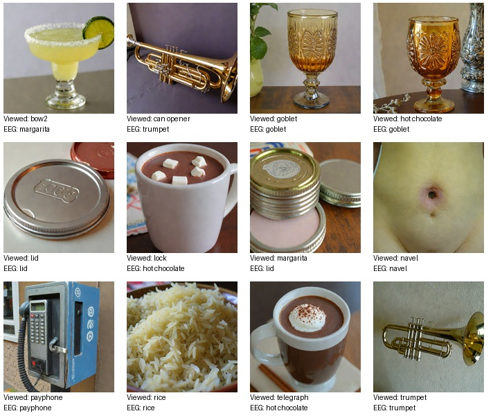

# EEG-Diffusion

Reconstructing viewed photographs from EEG. The primary task is to draw the right object from four presentations of one photograph to one participant. We also test whether the image preserves details that distinguish that photograph from nine others of the same object.

[中文研究摘要](docs/CURRENT_RESEARCH.md) · [Experiment registry](docs/EXPERIMENT_REGISTRY.md) · [Reconstruction galleries](research/eeg_stack_20261112/gallery/GALLERY.md) · [Reproduction guide](docs/REPRODUCIBILITY.md)

[](https://github.com/Botwwt/EEG-Diffusion/actions/workflows/checks.yml)

## Selected model for calibrated objects

**Predict an object word, then draw one image with a photo-specific EEG condition.** A personal Fisher projection learns 96 directions from 17 posterior EEG electrodes on 512 other objects (5,120 distinct calibration photos per participant). At inference, each of the 12 candidate objects has eight labeled support photos and their EEG. The closest EEG prototype supplies the word. A second decoder estimates how the query differs from the eight supports in H/14 image-feature space. A gain estimated on separate calibration objects scales that difference. A frozen ViT-H IP-Adapter and four SDXL-Turbo steps render one image. The query photograph enters evaluation after generation. [Architecture and matched controls](docs/PHOTO_STRUCTURE.md) · [Prepare EEG and run inference](docs/FRESH_PHOTO_REPLAY.md)

### Results on 12 additional objects

We locked the 12 objects, 120 photos, folds, model and primary photo-identification endpoint before inspecting their EEG or scoring images. The same three previously studied people viewed all 120 photos. Each row below includes every query, including incorrect EEG words. [Registration and per-participant image results](docs/FRESH_PHOTO_VALIDATION.md)

| Outcome on the 360 participant–photo queries | Own EEG | Eight-support visual mean | Wrong EEG from the same predicted word and fold |
| --- | ---: | ---: | ---: |
| Correct EEG word among 12 | 209/360 (58.1%) | Same words | Same words |
| Generated image named correctly among 1,854 labels, CLIP-L/14 | 135/360 (37.5%) | 141/360 | 142/360 |
| Viewed photo ranks first among ten of its object, DINOv2 | 44/360 (12.2%) | 51/360 | 43/360 |
| Viewed photo ranks first among ten of its object, CLIP-L/14 | 29/360 (8.1%) | 32/360 | 38/360 |

With naming restricted to the 12 registered words, CLIP recognized the generated objects in 208/360 queries. The same scorer assigned the correct name to 71/120 **original photographs** among 1,854 labels, and to 119/120 among twelve. For the primary DINOv2 photograph test, chance is 10%. Own EEG minus the eight-support mean was **−1.94 percentage points** (paired 95% interval −5.28 to +1.39). The model can often draw the correct kind of object. Identifying the exact viewed photograph remains an open problem. [Original-photo naming by object](research/eeg_stack_20261112/results/object_fidelity/fresh_reference_names.json) · [Photo-level scores and uncertainty](research/eeg_stack_20261112/results/object_fidelity/fresh_photo_dino_pixels.json)

On a fourth panel with **twelve different objects**, the same posterior readout decoded the correct word for **232/360** queries. CLIP named 232/360 generated images among those twelve words and **199/360 (55.3%)** among 1,854 labels. Same-object photo identification was **42/360** with DINOv2, compared with **31/360** for the mean and **38/360** for wrong EEG. A proposed 63-electrode object readout gave 228 correct words, 199 full-vocabulary image hits and 40 same-object photo hits. We retained the 17-electrode readout. The two panels use different objects and share participants. [Fourth-panel design, paired comparison and examples](docs/FULL_HEAD_512.md)



Each tile shows the true object label and the word decoded from EEG. A single fixed rule selected the examples, including errors. The replay guide also builds private side-by-side comparisons with the original stimuli. [Sub-04 gallery](research/eeg_stack_20261112/gallery/photo_angle_sub04_fresh.jpg) · [Sub-05 gallery](research/eeg_stack_20261112/gallery/photo_angle_sub05_fresh.jpg) · [Image replay](docs/FRESH_PHOTO_VALIDATION.md#reproduce-the-saved-image-comparison)

## Single-person reconstruction without target-class EEG supports

On the official 200-photo test, sub-04 viewed each stimulus 80 times. The decoder can generate with a continuous EEG estimate and the same prompt, “A photograph.”, for every query. Scaling the estimated visual deviation from the training-image mean raised DINOv2 retrieval from **10/200 to 20/200** against the actual photographs. The paired gain was 5.0 percentage points (95% interval 1.0 to 9.0). Independent CLIP photo retrieval rose from **5/200 to 17/200**. Full 1,854-label naming gave **2/200** for both versions. With the EEG-decoded object word added to the prompt, angular calibration raised DINOv2 retrieval from **13/200 to 24/200** (paired gain 5.5 points, 95% interval 1.0 to 10.0). CLIP named **4/200** correctly at both angles. At the calibrated angle, the named arm retrieved four more photos than the generic prompt with DINOv2 (95% interval for the difference −2.5 to +6.5 points). Each test object has a single photograph, so this benchmark cannot resolve same-object photographic detail. [Physical EEG and calibration](docs/OFFICIAL_REPEAT_OBJECT.md) · [Generated images, naming and controls](docs/OFFICIAL_REPEAT_IMAGES.md)

## Other experiments

With the object word fixed, a separate study pooled four presentations from each of nine viewers of the same photograph. Across two previously studied panels, the generated object was named correctly on **180/240** queries within the panel vocabulary. Independent DINOv2 identified the viewed photo among ten of the same object on **30/240** ordinary pooled reconstructions. Doubling the difference between matched and support-mean diffusion predictions gave **37/240**, compared with **22/240** for exchanged EEG. The gain over the ordinary pooled reconstruction was 2.9 percentage points (95% interval −0.4 to +6.7), and RGB error increased. Each query uses 36 physical presentations. [Fixed-word acquisition study and image controls](docs/FIXED_WORD_PHOTO_DOSE.md)

| Question | Evidence | Results and code |
| --- | --- | --- |
| How much object recognition survives a recording-session control? | On twelve objects recorded in the same combination of sessions, CLIP named 55/120 single-person and 69/120 three-person generated images among the twelve labels. Full-vocabulary credits were 48 and 59.5. DINO identified 15/120 exact photos for each. Three people contribute twelve physical observations per picture. | [Session audit and matched-object experiments](docs/COHORT_SESSION_CONTROLS.md) · [Fixed examples](research/eeg_stack_20261112/gallery/GALLERY.md#session-matched-objects) |
| Where is the generator losing the identity of the photo? | On 120 third-panel images from sub-04, replacing only the EEG word by the true word gave 13 same-object photo hits versus 14 from EEG. Supplying the exact viewed-photo H/14 feature instead gave 74. The latter is a reference-input diagnostic. | [Condition substitutions, pixel scores and paired intervals](docs/PHOTO_CONDITION_DIAGNOSTIC.md) |
| Which EEG features distinguish photographs of the same object? | On 96 held-out generic objects, direct H/14 prediction gave 9,371/12,960 correct pair assignments. Cross-session reproducibility gave 9,569 and cross-participant supervision gave 9,589. All three people improved in feature space. | [Repeat recordings](docs/REPEAT_PHOTO_SUBSPACE.md) · [Other participants as training teachers](docs/SHARED_PHOTO_EEG.md) · [Generator-gradient experiment](docs/IP_DENOISER_GRADIENT.md) |
| Does personal calibration help draw the right object? | With 128 other calibration objects and seven additional people, Brain-HIVE image naming rose from 503/1,680 (29.9%) to 678.5/1,680 (40.4%). On the earlier panels in three people, expanding calibration from 128 to 512 objects raised naming from 321.5/720 to 406.5/720. | [Seven participants](docs/OBJECT_FIDELITY.md) · [Calibration-size comparison](docs/PHOTO_STRUCTURE.md#personal-calibration-size-and-scalp-coverage) |
| Does the H/14 condition carry information about the individual photo? | On two earlier 12-object panels, CLIP named 433/720 own-EEG images. When both EEG words were correct and two photos had to be assigned jointly, CLIP gave 115/170 for own EEG, 89/170 for the mean and 64/170 for wrong EEG. All-query ten-photo identification was 65/720 for CLIP and 78/720 for DINOv2. | [H/14 angle and eight-candidate controls](docs/PHOTO_STRUCTURE.md#calibrating-the-residual-angle-before-generation) |
| Can EEG recover color and composition? | Low-frequency color and local contrast improved a strict grayscale SSIM comparison against swapped EEG in three participants on fresh objects. All four spatial variants had 39/72 correct DINOv2 pair assignments. | [Spatial residuals](docs/SPATIAL_PHOTO.md) · [Foreground and support experiments](docs/PHOTO_STRUCTURE.md) · [Local visual prediction errors](docs/CONTEXT_RESIDUAL.md) |
| Which model leads the separate ten-participant R4 benchmark? | M1a + D2 at s375 identified 982/5,000 photographs (19.64%) within concept. All ten participants saw the same 500 photographs. The benchmark uses VAE-decoded references and a shared noise seed within each concept. | [Architecture, matched controls and evaluation protocol](docs/EXPERIMENT_REGISTRY.md) |
| What happens with unfamiliar objects or more repeats? | On a separate sub-03 R4 panel without target-class examples, 60/200 generated images were assigned to the correct one of 20 concepts. The separate official 80-repeat, 200-stimulus benchmark gave 18.46% for O14 across ten people. | [Unregistered-object R4 study](docs/OBJECT_FIDELITY.md) · [Official R80 study](research/eeg_stack_20261112/O12_O13_O14_REPORT.md) |

## Run the checks

The public numerical audits run on a CPU with Python 3.11 or newer. GPU reconstruction additionally requires the EEG and image archives, model weights and research environments listed in the replay guide. [Installation](docs/INSTALLATION.md) · [Model assets and GPU replay](docs/REPRODUCIBILITY.md)

```bash
python -m pip install -e '.[dev]'
python -m eeg_diffusion verify-r4
python -m eeg_diffusion verify-stack
python -m eeg_diffusion verify
python -m pytest -q
```

[Citation](CITATION.cff) · [MIT license](LICENSE) · [Third-party assets](THIRD_PARTY_NOTICES.md)
