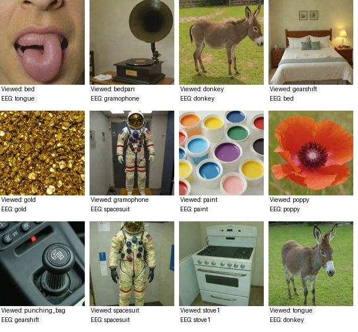

# EEG-Diffusion

Reconstructing viewed photographs from EEG with Brain-HIVE and SDXL-Turbo. We measure both whether a generated image depicts the correct object and whether EEG preserves features of the particular photograph.

[Experiment registry](docs/EXPERIMENT_REGISTRY.md) · [中文研究摘要](docs/CURRENT_RESEARCH.md) · [Reproduction guide](docs/REPRODUCIBILITY.md) · [Reconstruction gallery](research/eeg_stack_20261112/gallery/GALLERY.md)

[](https://github.com/Botwwt/EEG-Diffusion/actions/workflows/checks.yml)

## Object reconstruction from four EEG trials

The primary task is to draw a new photograph of **one of twelve calibrated objects** from one person's EEG. Each query averages four physical presentations of the photograph. In each fold, eight other photos per object and their EEG recordings are available for calibration. The generator gets one predicted word and produces one image.

### Selected model

1. **Learn what distinguishes objects for this person.** On 128 other objects with ten photos each, a regularized Fisher projection weights EEG directions by how strongly they separate objects relative to the variation between photos of the same object. It keeps 96 directions from 17 posterior electrodes.
2. **Decode the object.** Map the query and the eight calibration recordings per object into that space. The closest category mean by cosine similarity supplies the predicted word.
3. **Draw the prediction.** Use that word, the visual prototype of its eight calibration photos, an EEG-predicted visual adjustment and an EEG-predicted 8×8 starting latent. Brain-HIVE and SDXL-Turbo generate one image in four steps. The original query photo is used for scoring. [Fit the personal decoder](research/eeg_stack_20261112/code/fit_personal_session_metric.py) · [Prepare generator inputs](research/eeg_stack_20261112/code/condition_registered_predictions.py)

### Held-out participants

We selected the readout on sub-04 and checked it on sub-05. We then fixed the seven remaining participants, both photo panels and the primary endpoint before inspecting their personal-model predictions. The frozen comparison uses the sub-03 decoder and each target participant's eight supports per object. The personal system uses an additional 1,280 calibration photos per participant. A separate OpenAI CLIP-L/14 names each generated image against all 1,854 THINGS concepts. [Locked confirmation design](research/eeg_stack_20261112/results/object_fidelity/personal_confirmation_design.json)

**On the seven participants, naming credit rose from 29.9% to 40.4%** (503 to 678.5 of 1,680 participant–photo queries). The same 240 photographs were used across participants. The primary evaluator scores the generated RGB before JPEG compression. It named 99/120 and 104/120 original photos correctly on the two panels.

| Outcome | First 12 objects, frozen → personal | Second 12 objects, frozen → personal |
| --- | ---: | ---: |
| Generated image, true name ranked first among 1,854 | 190/840 → **277/840** | 313/840 → **401.5/840** |
| Paired gain above, percentage points [95% interval] | +10.4 [+0.5, +20.6] | +10.5 [+1.0, +20.9] |
| EEG, correct object among twelve | 229/840 → **351/840** | 339/840 → **439/840** |
| Generated image, matching photograph among ten of the same object | 104/840 → **88/840** | 96/840 → **76/840** |

Intervals resample participants and object classes together. On the photo-identification measure, picking a random same-object photo gives 10%. The two panels use distinct classes. The full-vocabulary score measures recognition of output images from a generator whose predicted word is drawn from the twelve known objects. [Per-person and per-object records](research/eeg_stack_20261112/results/object_fidelity/personal_confirmation.json)



The gallery shows the first participant in the confirmation set and the lowest archive row for each object. “Viewed” is the object's true label. “EEG” is the predicted word sent to the generator. Every image, including wrong predictions, follows the same selection rule. [First panel, same participant](research/eeg_stack_20261112/gallery/personal_sub01_registered.jpg) · [Personal model, controls and photo-level scores](docs/OBJECT_FIDELITY.md) · [Reproduce the experiments](docs/OBJECT_FIDELITY_REPLAY.md)

### Color and composition

We also predicted a photograph's 4×4 color deviation from the mean of the eight calibration photos for its predicted object. On sub-05 the low-frequency RGB error decreased from 0.2872 to 0.2776 with the category mean alone and to 0.2762 with the EEG correction on the first panel. The corresponding second-panel values were 0.2855, 0.2765 and 0.2750. On both participants tested, the intervals for the EEG correction included zero when restricted to correctly decoded objects. The primary model uses the original generator output. [Color residuals and matched EEG swaps](docs/OBJECT_FIDELITY.md#平均误差和一张照片自己的误差)

### Other inference settings

In the sub-03 source participant, the frozen decoder with eight supports per object identified 85/120 and 92/120 objects from EEG, with generated-image naming credit of 71/120 and 82/120. Applying that decoder to nine other participants who supplied their own eight supports gave 304/1,080 and 450/1,080 EEG hits. Requiring each EEG prototype comparison to cross acquisition sessions gave 233/1,080 and 324/1,080. [Source, transfer and recording-session controls](docs/OBJECT_FIDELITY.md#换一个被试再画一遍)

For **unregistered objects**, a separate sub-03 R4 confirmation panel used 20 held-out concepts and ten photos per concept. Independent visual scoring assigned **60/200** generated images to the correct concept, compared with **25/200** for the matched native baseline and **7/200** after shuffling EEG. The 20 candidates are used only by the evaluator. This experiment and the twelve-object calibration study have different inference conditions.

## Ten-participant R4 photograph benchmark

**M1a + D2 at s375** achieves **19.64%** within-concept Top-1 across ten participants. Each output uses four EEG trials from one participant, four U-Net evaluations and one generated candidate. The benchmark contains the same 500 stimulus photographs for each participant. An independent OpenAI CLIP ViT-L/14 image encoder ranks the VAE-decoded references. Chance is 10% within concept and 0.20% across all 500 photos. [Participant records](research/eeg_stack_20261112/results/exp8c_m1a_heldout6_and_all10_results.json)

| Input and conditioning model, same s375 sampler | All ten, Intra10 | Six outside development, Intra10 |
| --- | ---: | ---: |
| Mean waveform + representation-trained Arm1b | 18.12% | 17.67% |
| M1a + representation-trained Arm1b | 18.78% | 18.73% |
| Mean waveform + D2 | 18.76% | 18.13% |
| M1a + SwapDiff Arm3b | 19.46% | 19.13% |
| **M1a + D2** | **19.64%** | **19.73%** |

The selected arm identified 982 of 5,000 participant–photo queries within concept and 190 across the full gallery. Its paired advantage over M1a + SwapDiff was 0.18 percentage points (95% CI −0.58 to +0.94). All ten participants contributed EEG for other concepts during training. The six-person subset stayed outside the four-person development group for this stage. The evaluator shares a seed within each concept. [Matched controls, all eight arms and per-participant scores](docs/EXPERIMENT_REGISTRY.md)

### From EEG to an image

1. **Encode four trials.** M1a combines the encoding of an inverse-RMS-weighted waveform (72%) with the mean of four individual-trial encodings (28%). A shared three-layer EEG backbone reads three time windows with participant-specific input layers.
2. **Construct two generator inputs.** Brain-HIVE and a learned residual map the encoded EEG to four image-conditioning tokens. A participant-specific multi-window ridge model estimates the starting latent from the weighted waveform.
3. **Generate once.** SDXL-Turbo takes four steps with the EEG-derived starting latent and tokens. SwapDiff trained the conditioning path to distinguish correct and swapped EEG–photo pairs of the same concept. D2 then trained the residual conditioning layer through the four-step rollout against three competing photos. M1a was applied to the trained D2 checkpoint at evaluation. [Training lineage, architecture and batch calibration](docs/EXPERIMENT_REGISTRY.md) · [Selected-model replay](research/eeg_stack_20261112/code/eval_m1a_d2.py)

## Experiment guide

| Question | Study and outcome |
| --- | --- |
| Which changes help early retrieval and native generation? | [October experiments](docs/EXPERIMENTS.md) and [Brain-HIVE / ATM history](research/eeg/) cover visual targets, repeat reliability, ordinary adapters and their matched controls. |
| How strong is the official 80-repeat reconstruction benchmark? | [O12–O14](research/eeg_stack_20261112/O12_O13_O14_REPORT.md) reports **18.46%** 200-way for O14 from one participant. The ten-participant fusion diagnostic gives **29.25%** using EEG from ten people for each output. |
| Can EEG steer the generator between photos of the same concept? | [SwapDiff](research/eeg_stack_20261112/SWAPDIFF_REPORT.md) tests balanced EEG swaps. [Starting-latent interventions and D2](research/eeg_stack_20261112/DRAFT_INTRA4_REPORT.md) trace which generator input carries the difference. |
| Does aggregation or a different visual objective help? | [M1 and M2](research/eeg_stack_20261112/TRIAL_PREC_DINOV2_REPORT.md) compare waveform and feature pooling and a DINOv2/OpenCLIP hybrid. M1a + M2a leads the reported Inception and AlexNet-5 swap scores. |
| Does a photograph's local visual prediction error help reconstruction? | [Paired CPU and GPU studies](docs/CONTEXT_RESIDUAL.md) show above-chance residual decoding. On 200 additional sub-03 photos, the within-concept residual start identified 28 originals versus 27 for the direct start. A finer spatial gate reduced squared error and lost ten retrieval hits against direct prediction. |

## Run the checks

From the repository root with Python 3.11 or newer:

```bash
python -m pip install -e '.[dev]'
python -m eeg_diffusion verify-r4
python -m eeg_diffusion verify-stack
python -m eeg_diffusion verify
python -m pytest -q
```

`verify-r4` reconstructs the eight-arm s375 comparison from participant records. `verify-stack` checks the official R80 results. `verify` audits the frozen October release. GPU replay requires the original EEG caches, trained checkpoints, generator and evaluator assets. [Preparation and replay commands](docs/REPRODUCIBILITY.md) · [Installation](docs/INSTALLATION.md)

The [experiment registry](docs/EXPERIMENT_REGISTRY.md) maps the research questions to their executors, controls, evidence and archives. Use [CITATION.cff](CITATION.cff) with the revision used for the study. [MIT license](LICENSE) · [Third-party assets](THIRD_PARTY_NOTICES.md)
