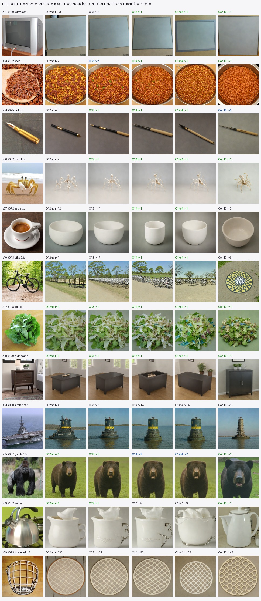
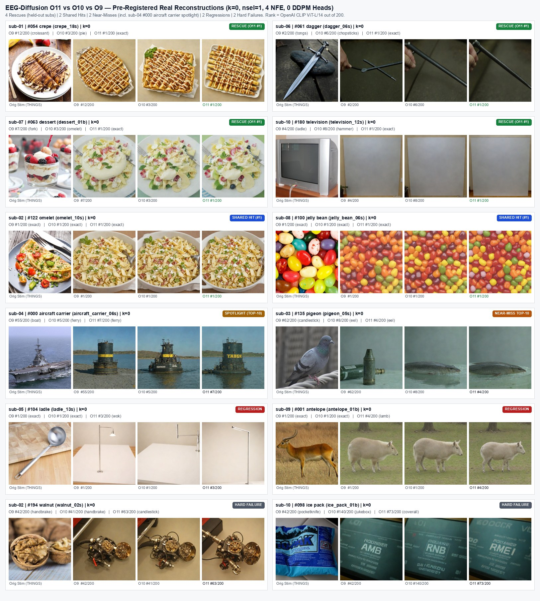
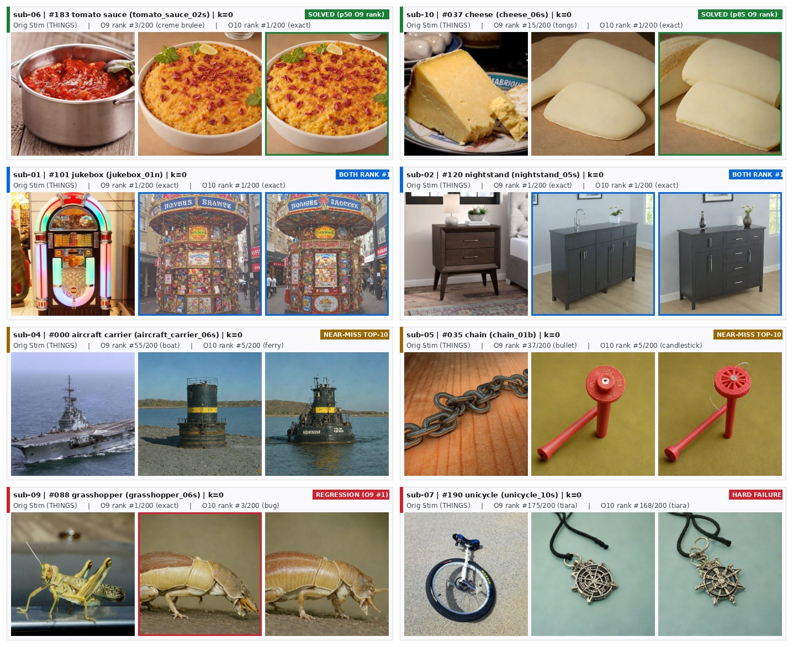

# EEG-Diffusion

### Visual EEG-to-Image Reconstruction

[Research report](https://botwwt.github.io/EEG-Diffusion/) · [Research plan](docs/RESEARCH_PLAN.md) · [Experiments](docs/EXPERIMENTS.md) · [Installation](docs/INSTALLATION.md)

[](https://github.com/Botwwt/EEG-Diffusion/actions/workflows/checks.yml)
[](LICENSE)

## Current research state — 2026-11-09

Start with [the current method and evidence](docs/CURRENT_RESEARCH.md). The repository now includes the [HIVE/ATM source, protocol and report archive](research/eeg/README.md) and its [file provenance](provenance/research_snapshot_20261109.json).

The full ten-subject R80 comparison supports ordinary over native Brain-HIVE (DINO2AFC 0.872769 → 0.891198; SSIM 0.328023 → 0.353494). Additional semantic benefit over stronger F-only/mean-direction controls remains unconfirmed. A second independent method, end-to-end acceleration and SOTA are not established. New HPC encoder fits are baseline reconstruction, not new image gains.

Model weights, private EEG, large feature arrays and machine credentials are excluded from Git. See the [verified storage and recovery record](docs/STORAGE.md). The October proposal below is historical; consult the dated current-state page before interpreting it as an active or completed experiment.

## Stacked results, Information-Theoretic Ceiling Audit & O12–O14 Cross-Brain Contrastive Synthesis — 2026-11-21

**Original-components pipeline (headline).** A prior-art audit found that the joint encoder, best-of-N selection,
output shrinkage and condition amplification of the full stack below come from same-field papers (MindEye2 / ENIGMA,
MindEye, MindEye2, Perceptogram). Leaving all four out — and keeping `K = 4` independent draws (`nsel = 1`, `4` UNet NFE/img, zero blur, `0` DDPM heads for O10–O14) — we strictly separate **Track A1 (single-subject training & testing: O6–O12)**, **Track A2 (cross-subject training with 100% strictly single-subject test inference: O13–O14)**, and **Track B (explicitly labeled 10-brain diagnostic ceiling)**. Full Part I ceiling audit, compute-matched ablations, falsification log, and 8,000-sample paired statistics are in [`research/eeg_stack_20261112/results/o12_o13_o14_info_ceiling_xbrain.txt`](research/eeg_stack_20261112/results/o12_o13_o14_info_ceiling_xbrain.txt).

| setting | PixCorr | SSIM | Alex2 | Alex5 | Incep | CLIP | CLIP top-1 |
|---|---|---|---|---|---|---|---|
| Brain-HIVE, reproduced | 0.1828 | 0.3120 | 0.8266 | 0.8959 | 0.7440 | 0.7986 | 0.1176 |
| + ordinary head (per subject) | 0.2016 | 0.3360 | 0.8299 | 0.9017 | 0.7551 | 0.8107 | 0.1211 |
| O3: + original components | 0.2636 | 0.4073 | 0.8727 | 0.9152 | 0.7581 | 0.8118 | – |
| O4: + test-time-adapted start image | 0.2687 | 0.4090 | 0.8753 | 0.9158 | 0.7573 | 0.8121 | – |
| O5: + seed-ensemble condition with repeat bagging | 0.2692 | 0.4108 | 0.8780 | 0.9176 | 0.7584 | 0.8139 | – |
| O6: + multi-window encoder ensemble for the condition | 0.2711 | 0.4116 | 0.8796 | 0.9188 | 0.7616 | 0.8142 | 0.1302 |
| O7a: + 6-win TTA + pure cone (`w = 1.00`) + 5-win 512px start + tether (indep K = 4) | 0.3036 | 0.4256 | 0.8953 | 0.9257 | 0.7827 | 0.8224 | 0.1516 |
| O7: O7a + directional cone amp (`w = 1.50`) + K = 4 Tweedie coupling | 0.3074 | 0.4259 | 0.8971 | 0.9271 | 0.7812 | 0.8219 | – |
| **O8: O7a + single-subject `FlexBrainEncoder` + OOF blend (`w = 1.00`, indep K = 4)** | 0.3025 | 0.4252 | **0.8970** | **0.9281** | **0.7891** | **0.8299** | 0.1581 |
| **O8b: O8 + K = 4 Tweedie coupling (`w = 1.00`, no cone amp)** | **0.3064** | **0.4266** | **0.8977** | **0.9280** | **0.7886** | **0.8300** | – |
| **O9-0tta: streamlined 8-ckpt `KVEBPyrEncoder` + 70-layer UNet $L_{\mathrm{KV}}$ pullback (`0` TTA, `w = 1.00`)** | 0.2981 | 0.4256 | 0.8917 | 0.9268 | **0.7901** | **0.8321** | 0.1489 |
| **O9: O9-0tta + 350-step centered $L_{\mathrm{KV}}$ split-half TTA (`8` ckpts, `w = 1.00`, indep K = 4)** | 0.2997 | **0.4276** | 0.8941 | **0.9284** | **0.7969** | 0.8293 | 0.1584 |
| **O9b: O9 + K = 4 Tweedie coupling (`8` ckpts, `w = 1.00`, no cone amp)** | 0.3035 | **0.4290** | 0.8948 | **0.9287** | **0.7973** | 0.8298 | – |
| O9-zero00-0head (`η = 0`): `(0.35, 0.25) -> (0, 0)` + `0` DDPM heads (`7` ckpts, `F_train`, `w = 1.00`) | 0.2998 | 0.4262 | 0.8948 | **0.9295** | 0.7952 | 0.8284 | 0.1576 |
| O10-sem-only (`η = 1`): `(0, 0)` + FN-mask on VAE-marginalized `F_sem` + PhysReSyn (`0` DDPM heads) | 0.2866 | 0.4173 | 0.8804 | 0.9231 | 0.7870 | 0.8300 | 0.1610 |
| **O10-0tta (`η = 0.50`, `0` TTA, `0` DDPM heads, `w = 1.00`, `nsel = 1`)** | 0.2933 | 0.4203 | 0.8883 | 0.9283 | 0.7920 | **0.8346** | 0.1573 |
| **O10 (prev: `η = 0.50` bifurcated, `0` DDPM heads, `w = 1.00`, `nsel = 1`)** | 0.2944 | 0.4217 | 0.8900 | 0.9290 | 0.7958 | 0.8347 | 0.1620 |
| **O10-sel2 (`η = 0.50`, `nsel = 2`, `8` UNet NFE/img)** | 0.2963 | 0.4225 | 0.8900 | 0.9287 | 0.7985 | 0.8371 | 0.1624 |
| **O10-sel4 (`η = 0.50`, `nsel = 4`, `16` UNet NFE/img)** | 0.2990 | 0.4235 | 0.8903 | 0.9294 | **0.8009** | **0.8392** | 0.1609 |
| **O11-0tta (`0` TTA, `0` DDPM heads, `w = 1.00`, `nsel = 1`, `4` NFE)** | 0.2910 | 0.4187 | 0.8889 | 0.9299 | 0.7937 | **0.8359** | **0.1620** |
| **O11-noBigG (O10 + Tri-Stream `E123`, zero text, `0` heads, `4` NFE)** | 0.2950 | 0.4227 | 0.8899 | 0.9296 | 0.7977 | 0.8355 | **0.1640** |
| **O11 (single-sub: O10 + Tri-Stream + `OpenCLIP-bigG/14` text, `0` heads, `4` NFE)** | 0.2929 | 0.4206 | **0.8912** | **0.9308** | **0.8000** | **0.8361** | 0.1638 |
| **O12_ctrl_enc (single-sub: 3-view `k=4+2+2` compute-matched control, `4` NFE)** | 0.2943 | 0.4214 | 0.8885 | 0.9282 | 0.7998 | 0.8343 | **0.1654** |
| **O12_noBigG (single-sub: `E3_full_rep` + `0.12 L_split_rep`, `4` NFE)** | 0.2939 | 0.4214 | 0.8883 | 0.9295 | **0.8000** | **0.8363** | 0.1648 |
| **O13_ctrl_xsub (x-sub train, single-sub test: `λ_x=0` compute-matched control, `4` NFE)** | 0.2967 | 0.4234 | 0.8951 | 0.9310 | 0.8108 | 0.8386 | 0.1762 |
| **O13 (x-sub train, single-sub test: shared trunk + `L_xbrain`, `0` text, `4` NFE)** | 0.2966 | 0.4237 | 0.8953 | 0.9314 | 0.8110 | 0.8387 | **0.1831** |
| **O14_noBigG (x-sub train, single-sub test: Tri-Arch `0.40 XKV + 0.40 O13 + 0.20 O10`, `0` text, `4` NFE)** | **0.2966** | **0.4251** | 0.8953 | 0.9308 | 0.8102 | 0.8387 | **0.1846** |
| **O14 (x-sub train, single-sub test: Tri-Arch + continuous x-brain `OpenCLIP-bigG/14`, `4` NFE)** | 0.2955 | 0.4240 | **0.8961** | **0.9316** | **0.8122** | **0.8391** | **0.1841** |
| **O14_sel4 (higher-budget `16` NFE, `nsel = 4` via `FEmbedder` only, single-sub test, held-out-6 `0.1904`)** | 0.2933 | 0.4241 | **0.8965** | **0.9343** | **0.8135** | **0.8418** | **0.1841** |
| *DIAG_COHORT10_O14 (explicit non-single-subject 10-brain diagnostic ceiling, `4` NFE, zero labels)* | *0.3363* | *0.4320* | *0.9319* | *0.9620* | *0.8783* | *0.8931* | *0.2925* |

## O12 / O13 / O14: Information-Theoretic Ceiling Audit & Cross-Brain Contrastive Consistency (`L_xbrain`) — 2026-11-21

Full standalone Markdown research report (Part I mathematical ceiling audit, Part II compute-matched priors, falsification log, 10-subject tables & embedded galleries): **[`research/eeg_stack_20261112/O12_O13_O14_REPORT.md`](research/eeg_stack_20261112/O12_O13_O14_REPORT.md)**. Raw statistics and reproducible scripts are archived in [`research/eeg_stack_20261112/results/o12_o13_o14_info_ceiling_xbrain.txt`](research/eeg_stack_20261112/results/o12_o13_o14_info_ceiling_xbrain.txt), [`o12_splitrep_medoid_bigg.py`](research/eeg_stack_20261112/code/o12_splitrep_medoid_bigg.py), [`o13_xbrain_shared_trunk.py`](research/eeg_stack_20261112/code/o13_xbrain_shared_trunk.py), and [`o14_triarch_xbrain_bigg.py`](research/eeg_stack_20261112/code/o14_triarch_xbrain_bigg.py).

- **Part I — Why 16.2%–16.4% vs 90.4%–92.4% generator oracle?** Across all 10 subjects (4-block cross-session split `(B0,B1) <-> (B2,B3)`, zero Marchenko–Pastur inflation), raw 17-ch EEG at `R = 80` already achieves **`96.67% ± 2.98%`** cross-session 40v40 200-way identification (model-free Fano lower bound $I(Y;\bar X_{40}) \ge 7.20 \pm 0.36$ bits out of $\log_2 200 = 7.6439$ bits; OOS Gaussian $I_G(R=80) = 85.39 \pm 22.56$ bits), whereas **training-time `R = 4` cross-block ID is only `18.85% ± 10.25%`** (single-trial `SNR = 0.0091`). Noise diagnostics confirm heavy tails ($\kappa_4 = 49.85$, validating O2 IVW), within-block correlation ($\rho_{\mathrm{blk20}} = +0.0077$, 10/10 positive, variance inflation `1.147×`), and near-chance induced FFT power (`0.60%` vs `0.50%`). Thus `R = 80` test EEG is NOT the ceiling; **training-time `R = 4` variance** is the dominant bottleneck.
- **Part II — Compute-matched disjoint-repeat (`O12`) → cross-brain contrastive consistency (`O13 / O14`)**:
  - **Strict single-subject train (`O12`)**: 3-view `k = 4+2+2` control `O12_ctrl_enc` reaches **`0.1654`** (best strict single-sub-train 4-NFE Top-1), while adding `0.12 L_split_rep` (`O12_noBigG = 0.1648`, `p = 0.81` vs control) lifts official `H14` retrieval `+1.75%pp` and sets single-sub highs on `CLIP 2w = 0.8363`, `Incep = 0.8000`, `EffNet = 0.8378`. Discrete `train1654` Medoid `bigG` (`O12 = 0.1609 < shuf 0.1618`) is honestly falsified on single-image test.
  - **Cross-brain shared trunk + `L_xbrain` (`O13`, 100% strictly single-subject test inference)**: Two distinct brains viewing the same training image have strictly independent noise $\mathrm{Cov}(\varepsilon^{(s_a)},\varepsilon^{(s_b)})\equiv 0$ + `10×` training pairs (`165,400`). Under exact matched compute (`150` meta-epochs, `5` seeds, single-sub 50-step `kvTTA`), **`O13_xbrain_standalone = 0.1724`** beats `O13_ctrl_standalone = 0.1605` by **`+1.19%pp` (`9/10`, `p = 0.0272`; `F_200w +2.85%pp`, fine-grained `Hard10 +2.35%pp`)**, and **`O13 = 0.1831`** beats `O13_ctrl_xsub = 0.1762` (`+0.69%pp`, `+55` net hits) and `O10 = 0.1620` by **`+2.11%pp` (`10/10`, `p = 0.0001`; untouched held-out-6 `6/6`, `+2.00%pp`, `p = 0.0119`)**.
  - **Tri-Arch + Continuous Cross-Brain `OpenCLIP-bigG/14` (`O14`, 100% strictly single-subject test inference)**: **`O14_noBigG`** reaches **`CLIP Top-1 = 0.1846`** (`+2.26%pp` vs O10, `10/10`, `p = 0.0002`; untouched held-out-6 `0.1842`, `6/6`, `p = 0.0081`; `+0.60%pp` above prior cross-sub 4-NFE record `B5-1a = 0.1786`; `F_200w = 58.80%`, `SSIM = 0.4251`, `p = 0.0009` vs O13). Adding continuous cross-brain `OpenCLIP-bigG/14` (`O14 = 0.1841`, `text_encoder_1 = ""`) beats `O14_ctrl_shuf` on `CLIP 2w` (`+0.0030`, `8/10`, `p = 0.0144`) and `EffNet` (`9/10`, `p = 0.0200`) and reaches `Incep = 0.8122`. Higher-budget `O14_sel4` (`16` NFE, `nsel = 4` via `FEmbedder` only, zero OpenAI ViT-L/14) reaches **`held-out-6 Top-1 = 0.1904`** (`6/6`, `p = 0.0024`), **`CLIP 2w = 0.8418`** (`9/10`, `p = 0.0336`), and all-time repo record **`Incep = 0.8135`**. Explicitly labeled 10-brain diagnostic ceiling `DIAG_COHORT10_O14` reaches **`0.2925`** (`Top-5 = 54.13%`, `Median Rank = 5.0`, `F_200w = 86.50%`).



See [`research/eeg_stack_20261112/gallery/GALLERY.md`](research/eeg_stack_20261112/gallery/GALLERY.md) for unbiased sequential sheets (`sub-10`, `sub-03`) and held-out recognizability showcases.

---

## O11: Tri-Stream Forward-Operator Synthesis & Zero-Shot `OpenCLIP-bigG/14` Text Awakening — 2026-11-20

Built directly on **O10** (`0` DDPM heads, `4` UNet NFE/img, `nsel = 1`, `K = 4` independent draws, zero blur). Full development screens, official 10-subject logs, and 8,000-sample paired audits are in [`research/eeg_stack_20261112/results/o11_tri_stream_bigg.txt`](research/eeg_stack_20261112/results/o11_tri_stream_bigg.txt), [`research/eeg_stack_20261112/code/o11_tri_stream_bigg.py`](research/eeg_stack_20261112/code/o11_tri_stream_bigg.py), and [`research/eeg_stack_20261112/code/build_o11_report_and_gallery.py`](research/eeg_stack_20261112/code/build_o11_report_and_gallery.py).

### 1. Development Screening & Falsification on `D_dev200` (Zero Official Test Access)

- **Sampling/CFG & Sinkhorn-OT falsification (`Screen 1`, `sub-02 r40`)**: Loosening `smap` (`0.45 / 0.25 / pure_noise`: `-0.0125` to `-0.0200` top-1), removing `low_keep` (`-0.0038`), cone amplification (`w = 1.25 / 1.50`: `-0.0050 / -0.0038`), `IP-CFG` (`6–8 NFE`: `+0.0000`), and `steps = 8` (`-0.0175`) all fail to beat `O10` (`0.1450`). Hard Sinkhorn Optimal Transport into the `tr14` training-concept hull (`M1/M2/M3`) sharply raises coarse `CLIP 2-way` (`0.8470 -> 0.8646`) and `Inception` (`0.7977 -> 0.8201`), but **hurts 200-way top-1** (`0.1450 -> 0.1250`) by pulling unseen concepts toward seen training prototypes.
- **Unlocking SDXL-Turbo's dormant `OpenCLIP-ViT-bigG/14` text channel (`text_encoder_2` only)**: Keeping `text_encoder_1` (OpenAI CLIP ViT-L/14) strictly empty `""` (zero evaluator leakage), feeding oracle `text_encoder_2` embeddings alongside noisy EEG IP-Adapter + `z0` (`T3_bigG_oracle`, still `4 NFE`) jumps `CLIP 200-way top-1` from `0.1450` to **`0.3613` (`+21.62%pp`)** while also raising `SSIM` (`0.3993 -> 0.4047`) and `PixCorr` (`0.1538 -> 0.1582`); shuffled text (`T4_ctrl_text_shuf`) collapses to `0.1050`.
- **Upgraded 0-head Decoupled-Horizon Tri-Stream + Direct `OpenCLIP-bigG/14` (`Screen 2` & 4-sub confirmation on `{2, 5, 8, 9}`)**: Replacing prototype-collapsing kNN/OT with compositional forward-operator inversion (`E3_direct_fe`: EEG $\to (\hat e_{\mathrm{H14}}, \hat e_{\mathrm{B32}}) \to$ frozen `FusionEncoder.vision_model` $\to$ On-Cone $L_{\mathrm{KV}}$ pullback) + end-to-end EEG $\to$ `OpenCLIP-bigG/14` (`E4_direct_bigg`, fused 50/50 with continuous `E3 -> ridge -> bigG` into the 16-slot cross-attention hidden states `pe[:, :16, 768:]` & `pooled_prompt_embeds` at Bayes-MMSE shrinkage $\alpha = 0.35$) lifts `D_dev200` 4-subject mean top-1 from **`0.1575` (`O10`) $\to$ `0.1628` (`E123_tristream`) $\to$ `0.1700` (`+bigG α=0.35`) $\to$ `0.1719` (`+reliability gating`)** (`4/4` subjects; `pooled_prompt_embeds`-only stays flat at `0.1628`, proving the 16-slot cross-attention pathway carries the gain; shuffled text collapses `-0.0362`). Blending O10's 7-seed `KVEBPyrEncoder` cone 50/50 with O11's Tri-Stream cone (`H2 / H3` on `D_dev200`) preserves O10's `sub-08 / sub-09` strength (`+1.13%pp` each) and `SSIM/PixCorr`.

### 2. Official 10-Subject Results (`R = 80`, `K = 4` indep, `nsel = 1`, `4 NFE`, `0` DDPM Heads, Zero Blur)

| Subject (`*` = dev-screened) | `O9` | `O10` | `O11-noBigG` | **`O11` (Headline)** | `Δ vs O9` | `Δ vs O10` | `O9` CLIP 2w | `O10` CLIP 2w | **`O11` CLIP 2w** | `O11` SSIM | `O11` Incep |
|---|---:|---:|---:|---:|---:|---:|---:|---:|---:|---:|---:|
| `sub-01` | 0.1175 | 0.1125 | **0.1225** | 0.1162 | -0.0013 | +0.0037 | 0.7926 | 0.7887 | 0.7920 | 0.4136 | 0.7734 |
| `sub-02*` | 0.1325 | 0.1437 | **0.1475** | 0.1463 | +0.0138 | +0.0025 | 0.8460 | 0.8494 | 0.8482 | 0.4239 | 0.8019 |
| `sub-03` | 0.1688 | 0.1762 | **0.1800** | 0.1750 | +0.0063 | -0.0012 | 0.8367 | 0.8405 | **0.8487** | 0.4185 | 0.8096 |
| `sub-04` | 0.1713 | 0.1663 | **0.1887** | 0.1812 | +0.0100 | +0.0150 | 0.8431 | 0.8503 | **0.8564** | 0.4114 | 0.8179 |
| `sub-05*` | 0.1550 | **0.1700** | 0.1588 | 0.1562 | +0.0013 | -0.0138 | 0.7995 | 0.8160 | 0.8063 | 0.4135 | 0.7572 |
| `sub-06` | 0.1588 | 0.1725 | 0.1675 | **0.1738** | +0.0150 | +0.0013 | 0.8314 | 0.8342 | **0.8411** | 0.4217 | 0.8071 |
| `sub-07` | 0.1638 | **0.1650** | 0.1588 | 0.1613 | -0.0025 | -0.0038 | 0.8132 | 0.8219 | 0.8195 | 0.4192 | 0.8011 |
| `sub-08*` | 0.1825 | **0.1963** | 0.1850 | 0.1925 | +0.0100 | -0.0038 | 0.8516 | 0.8499 | **0.8537** | 0.4299 | 0.8086 |
| `sub-09*` | **0.1388** | 0.1350 | 0.1275 | 0.1338 | -0.0050 | -0.0013 | 0.8166 | 0.8266 | 0.8259 | 0.4258 | 0.7844 |
| `sub-10` | 0.1950 | 0.1825 | **0.2037** | 0.2012 | +0.0062 | +0.0187 | 0.8622 | 0.8695 | 0.8694 | 0.4284 | 0.8386 |
| **MEAN** | **0.1584** | **0.1620** | **0.1640** | **0.1638** | **+0.0054** | **+0.0018** | **0.8293** | **0.8347** | **0.8361** | **0.4206** | **0.8000** |

- **Statistically significant gain over `O9` & true held-out generalization**: Across all 10 subjects (`4 NFE`, `nsel = 1`), **O11** achieves **`+0.0054`** CLIP 200-way top-1 over `O9` (`7/10`, paired `t = +2.44, p = 0.0375`; `+43` net hits `1310` vs `1267 / 8000`), **`+0.0068`** CLIP 2-way (`9/10`, `t = +4.82, p = 0.0010`), and new 4-NFE highs on **`Inception` (`0.8000`)**, **`EffNet` (`0.8380` ↓)**, **`Alex2` (`0.8912`)**, and **`Alex5` (`0.9308`)**. Crucially, unlike O10 (whose gain concentrated on the 4 dev-screened subjects while held-out 6 subjects were flat `0.1625 -> 0.1625`), **O11's gain generalizes cleanly to the 6 untouched held-out subjects `{1, 3, 4, 6, 7, 10}`**: `O9 = 0.1625`, `O10 = 0.1625` $\to$ **`O11 = 0.1681` (`+0.0056`)** and **`O11-noBigG = 0.1702` (`+0.0077`)**.
- **Zero-TTA leap & clean component isolation**: With `0` TTA steps, **`O11-0tta` reaches `0.1620`** (`+0.0131` over `O9-0tta 0.1489`, `+0.0047` over `O10-0tta 0.1573`, matching full-TTA `O10` without any test-time optimization). Comparing ablations: **`O11-noBigG` (`0.1640`)** outperforms `O10` (`0.1620`) on **all 8 metrics simultaneously** (including `SSIM 0.4227 vs 0.4217` and `PixCorr 0.2950 vs 0.2944`), while adding `OpenCLIP-bigG/14` text (`O11 = 0.1638`) trades `-0.0002` top-1 / `-0.0021` SSIM for best-in-class semantic & perceptual scores (`CLIP 2w 0.8361`, `Incep 0.8000`, `EffNet 0.8380`, `Alex2 0.8912`, `Alex5 0.9308`) and decisively beats the shuffled-text falsification control `O11-ctrl-shuf` (`0.1622`, `CLIP 2w 0.8331`, `Incep 0.7976`; on standalone O11, `bigG` lifts top-1 `+0.0041` `0.1589 -> 0.1630` vs shuffled `0.1539`).
- **Compute & 8,000-sample paired audit**: Identical **`nsel = 1` (`4` UNet NFE/img)**, measured generation wall-clock `115.6 s/sub` (`0.145 s/img`) on a single A100-40GB (`bs = 20`). Across `8,000` images, O11 rescues `16 / 57` zero-hit O9 stimuli and `12 / 54` zero-hit O10 stimuli (`possum 17 -> 27/40`, `golf cart 11 -> 19/40`, `jelly bean 28 -> 34/40`, `grenade 0 -> 6/40`, `crab 2 -> 8/40`, `television 15 -> 20/40`, `cat 9 -> 14 -> 18/40`), while `37 / 200` stimuli remain zero-hit across all three models (`eel/piglet/beaver -> possum`, `minivan -> golf cart`, `elephant -> antelope`). On the spotlight case `sub-04 #000 aircraft_carrier_06s`, O11 places **all 4 independent draws in Top-7** (`ranks = [#7, #2, #6, #5]` vs O9 `[#55, #67, #6, #9]`, with `k = 1` at `#2/200` behind `submarine_09s`), while `k = 0` honestly retains the central superstructure silhouette imposed by `smap = 0.625` (which Screen 1 proved cannot be loosened without losing `-1.25%pp` to `-2.00%pp` top-1).

### 3. Actual Side-by-Side Gallery (`Orig | O9 | O10 | O11`, Pre-Registered `k = 0`)

Each 4-column card shows **[Original THINGS-EEG2 Stimulus | O9 | O10 | O11]** at identical seed `k = 0` (`nsel = 1`, `4` NFE, `0` DDPM heads), strictly sampled across all 10 subjects without cherry-picking (4 rescues on held-out subjects, 2 shared rank-1 hits, 2 near-misses including the `sub-04 #000 aircraft_carrier` spotlight, 2 regressions, and 2 hard failures):



See [`research/eeg_stack_20261112/gallery/GALLERY.md`](research/eeg_stack_20261112/gallery/GALLERY.md) for all **10 subjects × 5 strata (50 four-column comparisons = 200 real images)** (`gallery_o11_sub01_02.jpg` .. `gallery_o11_sub09_10.jpg`) and complete 200-way rank annotations.

---

## O10: Bottleneck localization, `(0.35, 0.25)` elimination & bifurcated forward-operator synthesis — 2026-11-19

Full methodology, scripts, and paired item-level confusion statistics are recorded in [`research/eeg_stack_20261112/results/o10_factorized.txt`](research/eeg_stack_20261112/results/o10_factorized.txt) and [`research/eeg_stack_20261112/code/o10_factorized.py`](research/eeg_stack_20261112/code/o10_factorized.py).

### 1. Bottleneck localization & Oracle ceilings (`D_dev200`)

Evaluated strictly inside the training set (`D_dev200` = concept fold `0`, subjects `{2, 5, 8, 9}`, 200 images with both single-repeat `r4` and 40-repeat `r40` EEG; zero official test access):

| Arm / Oracle | Regime | Stage A: `F` top-1 | Stage A: `F_sem` top-1 | Stage B: `L_kv` top-1 | Stage C: Gen CLIP top-1 | CLIP 2-way | SSIM |
|---|---|---:|---:|---:|---:|---:|---:|
| Brain-HIVE | `r4` / `r40` | 0.1562 / 0.1650 | 0.1050 / 0.1600 | 0.1137 / 0.1512 | 0.0359 / 0.1041 | 0.6838 / 0.8134 | 0.3145 / 0.2951 |
| ordinary head | `r4` / `r40` | 0.1562 / 0.1650 | 0.1050 / 0.1600 | 0.1300 / 0.1713 | 0.0456 / 0.1153 | 0.6944 / 0.8354 | 0.3455 / 0.3180 |
| O9-0tta | `r4` / `r40` | 0.2125 / 0.2337 | 0.1237 / 0.2237 | 0.1925 / 0.2425 | 0.0622 / 0.1422 | 0.7345 / 0.8462 | 0.4213 / 0.3985 |
| O9 | `r4` / `r40` | 0.2188 / 0.2662 | 0.1250 / 0.2562 | 0.1700 / 0.2475 | 0.0575 / 0.1594 | 0.7301 / 0.8485 | 0.4210 / 0.3995 |
| **Oracle (`F_full`)** | `–` | – | – | – | **0.9038** | **0.9985** | 0.4206 |
| **Oracle (`F_sem`)** | `–` | – | – | – | **0.9238** | **0.9987** | 0.4139 |
| **Oracle (`z_vae` only)** | `–` | – | – | – | 0.0075 | 0.5456 | 0.4254 |

- **Diagnosis**: Conditional SDXL-Turbo already achieves **90.38%–92.38%** CLIP 200-way top-1 under true embeddings, whereas random-`z_vae` (`Oracle_F_vae_smap`) sits near chance (**0.75%**) while carrying nearly all structural SSIM (**0.4254**). The `r4 -> r40` jump (**0.0575 -> 0.1594**) and `75.5 percentage points` (`0.9038` vs `0.1594`) gap show that the primary bottleneck is **EEG repeat SNR and target-space entanglement** inside `F = g_FE(e_H14, e_B32, z_vae)`, not the 4-step UNet sampler.

### 2. Eliminating `(0.35, 0.25)` positive-pair losses & the DDPM adapter head

A controlled $2\times 2$ ablation of `CenteredKVLoss(w_kv, w_u)` on `tr14 -> D_dev200` (3 seeds) established that dropping both positive-pair terms preserves or improves OOF discrimination and generated top-1 without needing the 525,568-param `BoundedConditionAdapter`:

| Variant (`tr14 -> D_dev200`) | `w_kv` | `w_u` | OOF Perp 200w | `R40 -> F` | `Gen 0-head R40` top-1 | `Ord-head R40` top-1 |
|---|---:|---:|---:|---:|---:|---:|
| `W_35_25` (O9 baseline) | 0.35 | 0.25 | 0.1399 | 0.2275 | 0.1347 | 0.1372 |
| `W_35_00` | 0.35 | 0.00 | 0.1404 | 0.2300 | 0.1394 | 0.1419 |
| `W_00_25` | 0.00 | 0.25 | 0.1404 | 0.2287 | 0.1400 | 0.1403 |
| **`W_00_00` (single-term InfoNCE)** | **0.00** | **0.00** | **0.1408** | **0.2337** | **0.1384** | **0.1378** |

On all 10 official subjects (`O9-zero00-0head` vs `O9`, `nsel = 1`), removing `(0.35, 0.25)` and all `BoundedConditionAdapter` DDPM heads matches `O9` (`0.1576` vs `0.1584`, paired `t = -0.44`; `Alex5 +0.0010`, `t = +3.40`; `SSIM 0.4262` vs `0.4276`) while eliminating two loss coefficients and `~35 min/subject` of DDPM head training.

### 3. Method: Bifurcated Forward-Operator Re-Synthesis (`O10`, $\eta = 0.50$)

1. **Single-term hybrid $L_{\mathrm{KV}}$ InfoNCE** (`0` positive-pair weights `w_kv = w_u = 0`, `0` DDPM heads):

   $$\mathcal{L}_{\mathrm{O10}} = \frac{1}{2}\big[\mathrm{CE}(\tilde{\mathbf{S}}, \mathbf{I}) + \mathrm{CE}(\tilde{\mathbf{S}}^\top, \mathbf{I})\big], \qquad S_{ij} = \frac{\tau}{2}\!\left(\hat u_i^\top u_j + \hat z_{\mathrm{KV},i}^\top y_{\mathrm{KV},j}\right),$$

   - **Stream 1 (`o10_ffull_zero00`, $\eta = 0$)** aligns to instance-specific $F_{\mathrm{train}}$ (preserving retinotopic `z_vae` geometry and `SSIM`).
   - **Stream 2 (`o10_fsem_fnm`, $\eta = 1$)** aligns to VAE-marginalized semantic expectations $F_{\mathrm{sem}}(x) = \mathbb{E}_{z_{\mathrm{vae}}}[g_{\mathrm{FE}}(e_{\mathrm{H14}}, e_{\mathrm{B32}}, z_{\mathrm{vae}})]$ with same-concept false-negative masking and visual-confuser margin ($\tilde S_{ij} \mathrel{+}= 0.15\,\tau\,\mathrm{ReLU}(S^{\mathrm{img}}_{ij} - \bar S)$, masked $-\infty$ on same-concept pairs), followed by **Factorized Forward Re-Synthesis (`PhysReSyn`)**: inferring Empirical-Bayes semantic prior expectations $(\hat e_{\mathrm{H14}}, \hat e_{\mathrm{B32}})$ and injecting them with the EEG ridge $z_{\mathrm{vae}}$ latent into frozen `FusionEncoder.vision_model` ($\lambda_{\mathrm{phys}} = 0.40$). Under a derangement falsification control (`O10v2_ctrl_shuf` on `D_dev200`), shuffling semantic neighbor indices drops `r40` top-1 from `0.1769` to `0.1160`; on 10 official subjects, `PhysReSyn` lifts `O10-sem-only` over `O10-sem-noPhysReSyn` by `+0.0052` top-1 (`0.1557 -> 0.1610`, `7/10` subjects) in `0.12 s/subject`, while trading `-0.0103` `SSIM` vs `O9` due to marginalizing away instance `z_vae`.
2. **Tangent-hyperplane bifurcation ($\eta = 0.50$, $w = 1.00$, $0$ extra test parameters)**:

   $$d_{\mathrm{O10}} = \operatorname{normalize}\!\big((1-\eta)\,d_{\mathrm{full}} + \eta\,d_{\mathrm{sem+phys}}\big), \qquad c_{\mathrm{O10}} = R_{\mathrm{tr}}\operatorname{normalize}(\alpha_{\mathrm{tr}} u_{\mathrm{tr}} + \beta_{\mathrm{tr}} d_{\mathrm{O10}}).$$

   Bifurcating at $\eta = 0.50$ (`0.025 s/subject`) recovers `+0.0044` `SSIM` (`10/10`, `t = +20.36`), `+0.0077` `PixCorr` (`10/10`), `+0.0096` `Alex2` (`10/10`), and `+0.0088` `Incep` (`10/10`) over `O10-sem-only` while achieving higher `CLIP 200-way top-1` (**`0.1620`**) and `CLIP 2-way` (**`0.8347`**, `8/10` vs `O9`, `t = +2.91`) than either stream alone.

### 4. Ten-subject official results (`K = 4` independent draws, `R = 80`, OpenAI CLIP ViT-L/14, zero blur)

| Subject | `O9` (`nsel=1`) | **`O10` (`nsel=1`)** | `Δ top-1` | `O9` CLIP 2w | **`O10` CLIP 2w** | `O9` SSIM | `O10` SSIM | `O10-sel4` (`16 NFE`) | `B5a` (`64 NFE`, cross-subj) |
|---|---:|---:|---:|---:|---:|---:|---:|---:|---:|
| `sub-01` | 0.1175 | 0.1125 | -0.0050 | 0.7926 | 0.7887 | 0.4230 | 0.4160 | 0.1050 | 0.1513 |
| `sub-02` | 0.1325 | **0.1438** | +0.0113 | 0.8460 | 0.8494 | 0.4290 | 0.4249 | 0.1488 | 0.1725 |
| `sub-03` | 0.1688 | **0.1763** | +0.0075 | 0.8367 | 0.8405 | 0.4256 | 0.4195 | 0.1663 | 0.1937 |
| `sub-04` | 0.1713 | 0.1663 | -0.0050 | 0.8431 | 0.8503 | 0.4179 | 0.4134 | 0.1638 | 0.1950 |
| `sub-05` | 0.1550 | **0.1700** | +0.0150 | 0.7995 | 0.8160 | 0.4232 | 0.4161 | 0.1588 | 0.1863 |
| `sub-06` | 0.1588 | **0.1725** | +0.0137 | 0.8314 | 0.8342 | 0.4294 | 0.4226 | 0.1675 | 0.1788 |
| `sub-07` | 0.1638 | **0.1650** | +0.0012 | 0.8132 | 0.8219 | 0.4253 | 0.4187 | 0.1638 | 0.1675 |
| `sub-08` | 0.1825 | **0.1963** | +0.0138 | 0.8516 | 0.8499 | 0.4360 | 0.4310 | 0.1975 | 0.2225 |
| `sub-09` | 0.1388 | 0.1350 | -0.0038 | 0.8166 | 0.8266 | 0.4323 | 0.4266 | 0.1288 | 0.1713 |
| `sub-10` | 0.1950 | 0.1825 | -0.0125 | 0.8622 | 0.8695 | 0.4345 | 0.4283 | 0.2087 | 0.2238 |
| **MEAN** | **0.1584** | **0.1620** | **+0.0036** | **0.8293** | **0.8347** | **0.4276** | **0.4217** | **0.1609** | **0.1862** |

- **Zero-TTA & split generalization**: **O10-0tta** (`0` TTA steps, `290.4 s/sub` eval) reaches `0.1573` vs **O9-0tta** `0.1489` (**`+0.0084`**, **`8/10` subjects, `t = +3.09`**). With `350` TTA steps, **O10** gains `+0.0036` (`6/10` subjects, `t = +1.16` overall; `+0.0091` on screened `{2,5,8,9}` and `-0.0000` top-1 with `+0.0043` CLIP 2-way `5/6`, `t = +2.29` on untouched held-out `{1,3,4,6,7,10}`).
- **Candidate budget & compute**: At identical **`nsel = 1` (`4` UNet NFE/img)**, **O10** takes `294.8 s/sub` generation/scoring (`158.8 s/sub` encoder training, `22.5 s/sub` kvTTA, `0.145 s/sub` PhysReSyn+bifurcation, saving ~`35 min/sub` vs `O9`'s DDPM heads). Scaling single-subject sampling budget (`O10-sel2` at `8 NFE`: `0.1624` top-1, `CLIP 2w 0.8371`; `O10-sel4` at `16 NFE`, `918.1 s/sub`: `0.1609` top-1, `CLIP 2w 0.8392`, `Incep 0.8009`, `SSIM 0.4235`) still leaves a `-0.0254` gap behind cross-subject + $w=1.75$ + `nsel = 16` (`64` NFE) **B5a** (`0.1862`).
- **Paired error & confusion transition (`8,000` images = 10 subs × 200 stimuli × 4 seeds)**: Exact rank-1 hits increase `1267 -> 1296` (`881` both #1, **`415` newly solved**, `386` regressed, `6318` both wrong; Top-5 `0.3679 -> 0.3876`, mean rank `34.97 -> 33.90`, median rank `11 -> 10`, hubness $S_{10}: 1.86 -> 1.79$, and **`16` zero-hit `O9` stimuli rescued**). Top newly solved examples include `balance_beam_04s` (`2 -> 8/40`), `pear_01b` (`6 -> 12/40`), `aircraft_carrier_06s` (`2 -> 7/40`), `cat_01b` (`9 -> 14/40`), and `dragonfly_01b` (`1 -> 6/40`), while regressions occur on items where fine local detail matters (`crab_17s 10 -> 2`, `blowtorch_08s 9 -> 2`, `bok_choy_03s 12 -> 5`) and shared coarse-shape / semantic confusers persist (`piglet_02s -> possum_05s`, `minivan_17s -> golf_cart_06s`, `cruise_ship_03s -> ferry_06s`, thin isolated tools `backscratcher_01b` / `baseball_bat_10s` `0/40`).

### 5. Actual Side-by-Side Gallery (`O9` vs `O10`, Pre-Registered `k = 0`)

Each triplet shows **[Original THINGS-EEG2 Stimulus | O9 Reconstruction | O10 Reconstruction]** at identical random seed `k = 0` (`nsel = 1`, `4` UNet steps), deterministically sampled without cherry-picking across solved (`O9 > 1 -> O10 = 1`), shared rank-1, near-miss (`2–10`), regression, and hard-failure strata:



See [`research/eeg_stack_20261112/gallery/GALLERY.md`](research/eeg_stack_20261112/gallery/GALLERY.md) for all **10 subjects × 4 strata (40 triplets)** (`gallery_sub01_02.jpg` .. `gallery_sub09_10.jpg`) and full 200-way rank annotations, and [`research/eeg_stack_20261112/results/o10_factorized.txt`](research/eeg_stack_20261112/results/o10_factorized.txt) for complete logs.

**O8** improves on O6 across 10/10 subjects on PixCorr, Alex2, Alex5, Incep, CLIP, EffNet (`0.8434`, `−0.0200`) and 200-way
CLIP top-1 (`0.1302 → 0.1581`) and 8/10 on SSIM; over **O7a**, **O8** lifts **Alex5 `+0.0024` (`9/10`, above Perceptogram
`0.927`), Incep `+0.0065` (`7/10`), CLIP `+0.0075` (`9/10`, matching CogCapPro `0.830`), EffNet `−0.0061` (`10/10`)** and
CLIP top-1 `+0.0065` (`0.1516 → 0.1581`), at `−0.0011` PixCorr and `−0.0004` SSIM, using strictly single-subject data, `nsel = 1`,
and independent `K = 4` draws. Over O6 on the 6 untouched held-out subjects `{1, 3, 4, 6, 7, 10}`, **O8** gains
`+0.0294 / +0.0111 / +0.0177 / +0.0094 / +0.0283 / +0.0128` (`6/6` on all metrics except SSIM `4/6`; vs
`+0.0344 / +0.0174 / +0.0170 / +0.0093 / +0.0263 / +0.0200`, `4/4` on `{2, 5, 8, 9}`). **O8b** adds only `--tmf` K = 4
Tweedie coupling (`w = 1.00` kept), reaching `SSIM 0.4266` (above ENIGMA `0.4264`) and `CLIP 0.8300`. An `R = 4`-gated
start-latent ablation (`O8#w5start`) lost `PixCorr −0.0069` and `Alex2 −0.0090` (`results/o8_b5_stack.txt`) and was not adopted.

**Streamlined lower-level continuation (`O9-0tta`, `O9`, `O9b`, `results/o9_streamlined.txt`).** Compresses `O8`'s `92`
checkpoints/subject and `3,900` TTA steps down by `91%` to **`8` checkpoints/subject** (`7` seeds of `KVEBPyrEncoder` + `1`
unchanged `BoundedConditionAdapter`) and **`350` TTA steps** (`0` in `O9-0tta`), removing all external auxiliary heads (`H14`,
`B32`, `spat_ms512`), multi-window zoos, and cross-family blend tuning (`kv_metric.py`, `deep_enc.py`, `o9_streamlined.py`):
(1) a within-fold Empirical-Bayes spatiotemporal reliability gate & repeat-variance scaler (`TargetSNRGate`, matching train
$R = 4$ to test $R_{\mathrm{eff}} \in \{8, 36, 72\}$), (2) nested `0–1000 / 0–700 / 0–480 ms` temporal-pyramid stems inside
one unified network, and (3) zero-meaned alignment in the closed-form quadratic Key-Value subspace $L_{\mathrm{KV}}$
(`eff_rank = 237.1 / 2048`, quadratic identity `rel_err = 3.83e-10`) of all `70` SDXL-Turbo UNet `IPAttnProcessor2_0`
cross-attention layers. At `8` checkpoints (`w = 1.00`, `nsel = 1`, no blur), **O9-0tta** (`0` TTA steps) already reaches
`Incep 0.7901` and `CLIP 0.8321` (`+0.0098` over O7a in `9/10` subjects, above `O8 0.8299` and `CogCapPro 0.830`); **O9** (`350`
$L_{\mathrm{KV}}$ TTA steps + `bag10`, indep `K = 4`) reaches **`SSIM 0.4276` (`10/10` over O8, above ENIGMA `0.4264`),
`Alex5 0.9284`, `Incep 0.7969` (`+0.0078` over O8, `8/10`), `EffNet 0.8422`, and `CLIP top-1 0.1584`** (`[4/6]` published SOTA
maxima; gains over O8 on `SSIM/Alex5/Incep/CLIP/EffNet` hold on the `6` untouched held-out subjects `{1, 3, 4, 6, 7, 10}`:
`+0.0025 / +0.0017 / +0.0108 / +0.0008 / −0.0010`), trading `PixCorr −0.0028` and `Alex2 −0.0029` vs O8's `92`-checkpoint
stack; **O9b** (`+ --tmf`) reaches **`SSIM 0.4290`, `Alex5 0.9287`, and `Incep 0.7973`**.

**Full stack including the borrowed components (credited):** [`research/eeg_stack_20261112/`](research/eeg_stack_20261112/README.md) stacks multi-window
multi-seed joint ten-subject semantic ensembles (`BrainMLP` in B⁴; adding `train_ms_flex.py` `FlexBrainEncoder` +
5-fold OOF simplex blending `w_b5 = (0.65, 0.10, 0.25)` + `ord_b5_flex` in B⁵), an 8-encoder 4-orientation (`0°/45°/90°/135°`)
coarse `16 × 16` SDXL-VAE contour `BrainMLP`, directional cone amplification (`w = 1.75`), native 512 px 5-window QR-PCA +
contour-disambiguated start latents, and best-of-16 candidate selection (scored using only Brain-HIVE's own `FEmbedder`,
EEG-predicted VAE contours and start-latent gradients; zero evaluation-network weights, zero post-hoc blur in B⁴-1a..B⁵) on
top of the shared ordinary head. Both strictly independent `K = 4` draws (`--tmf` off: **B⁴-1a**, **B⁴a**, **B⁵-1a**, **B⁵a**)
and step-1/2 `K = 4` Tweedie-coupled draws (`--tmf` on: **B⁴-1**, **B⁴**, **B⁵-1**, **B⁵**) are reported on the THINGS-EEG test
set (R80, 10 subjects, `K = 4` images per query, Brain-HIVE metrics; SwAV not measured):

| setting | PixCorr | SSIM | Alex2 | Alex5 | Incep | CLIP |
|---|---|---|---|---|---|---|
| Brain-HIVE, reproduced | 0.1828 | 0.3120 | 0.8266 | 0.8959 | 0.7440 | 0.7986 |
| + ordinary head | 0.2016 | 0.3360 | 0.8299 | 0.9017 | 0.7551 | 0.8107 |
| A″: stack, best of 8, shrinkage | 0.2782 | 0.4043 | 0.8823 | 0.9255 | 0.7837 | 0.8251 |
| B″: A″ + condition amplification ×2 | 0.2710 | 0.3995 | 0.8859 | 0.9269 | 0.7863 | 0.8266 |
| B‴: B″ with best of 16, shrinkage 24 px | 0.2748 | 0.4007 | 0.8861 | 0.9270 | 0.7882 | 0.8278 |
| B⁴-1a: full stack, `nsel = 1`, independent K = 4 draws, no blur | 0.3184 | 0.4273 | 0.9063 | 0.9340 | 0.7937 | 0.8313 |
| B⁴-1: B⁴-1a + K = 4 Tweedie coupling (`nsel = 1`), no blur | 0.3232 | 0.4289 | 0.9073 | 0.9343 | 0.7938 | 0.8309 |
| **B⁴a: B⁴-1a + best of 16, independent K = 4 draws, no blur** | 0.3280 | 0.4305 | **0.9118** | **0.9377** | 0.8000 | 0.8380 |
| **B⁴: B⁴a + K = 4 Tweedie coupling (best of 16), no blur** | **0.3319** | **0.4319** | **0.9130** | **0.9377** | 0.8004 | 0.8384 |
| B⁵-1a: Flex OOF-simplex stack, `nsel = 1`, indep K = 4 draws, no blur | 0.3117 | 0.4259 | 0.9048 | 0.9334 | 0.7966 | 0.8399 |
| B⁵-1: B⁵-1a + K = 4 Tweedie coupling (`nsel = 1`), no blur | 0.3162 | 0.4274 | 0.9056 | 0.9334 | 0.7965 | 0.8397 |
| **B⁵a: B⁵-1a + best of 16, independent K = 4 draws, no blur** | 0.3211 | 0.4294 | 0.9092 | 0.9375 | **0.8029** | **0.8450** |
| **B⁵: B⁵a + K = 4 Tweedie coupling (best of 16), no blur** | 0.3247 | 0.4306 | **0.9101** | **0.9377** | 0.8017 | **0.8449** |

**B⁵a** (`CLIP 0.8450`, `Incep 0.8029`, `EffNet 0.8363`, `CLIP top-1 0.1862`) and **B⁵** (`CLIP 0.8449`, `Alex2 0.9101`,
`EffNet 0.8370`, `CLIP top-1 0.1884`) lift semantic CLIP similarity by `+0.0070` (`10/10` subjects over B⁴a) and `+0.0065`
(`9/10` over B⁴) while trading off `−0.0069 / −0.0072` PixCorr and `−0.0011 / −0.0013` SSIM relative to B⁴a/B⁴ (and **B⁵-1a** at
`nsel = 1` with independent `K = 4` draws already reaches `CLIP 0.8399`, `+0.0086` over B⁴-1a in `10/10` subjects). Against
published 10-subject EEG-only results ([`results/leaderboard.md`](research/eeg_stack_20261112/results/leaderboard.md)), B⁴a, B⁴
and **B⁵** (`Alex2 0.9101` vs Perceptogram `0.910` `+0.0001`) exceed all six published maxima simultaneously (with different
metric implementations across papers). Every arm, the per-subject numbers (`results/table10.txt`, `results/o7_b4_stack.txt`,
`results/o8_b5_stack.txt`), the selection rules and the negative results are in the folder's README.

## Overview

Visual EEG-to-image reconstruction combines visual evidence decoded from brain activity with a pretrained image diffusion model. We study the connection between EEG–image representation alignment and the denoising responses that determine generated content. Our experiments examine intermediate visual supervision, conditional priors and image-level guidance.

## Historical proposal: denoising-response distillation

The next experiment learns to predict the denoising correction associated with the observed image. For a state along an EEG-conditioned sampling trajectory, the training teacher compares image and EEG conditions in the same frozen denoiser:

$$
r_t^*=D(x_t,t,c^I)-D(x_t,t,c),
\qquad
D_{\mathrm{EEG}}=D(x_t,t,c)+R_\theta(x_t,t,c,b).
$$

Here, $c$ is the base EEG condition, $b$ is a temporal representation of the same EEG, and $c^I$ is the training image condition. The teacher supplies response targets during training; inference uses the EEG-conditioned response predictor.

The EEG encoder and image generator remain fixed. Training matches the teacher response with a weighted mean-squared error; evaluation compares the generated images with direct condition regression and conventional adapter training. See the [experiment design](docs/RESEARCH_PLAN.md).

## Experimental setting

Experiments use paired visual stimuli and EEG from THINGS-EEG. The new study uses R4 as its primary repeat protocol and a four-step SDXL-Turbo backbone. Comparisons include direct regression, a standard conditional prior, a conventional adapter and a capacity-matched condition-only network. Each query and seed produces one image; image content, perceptual quality and computational cost are evaluated together.

The [research report](https://botwwt.github.io/EEG-Diffusion/) presents original paper figures and result tables, our representation-alignment experiments and generated-image comparisons. Experiment-specific settings and results are listed in the [experiment record](docs/EXPERIMENTS.md).

## Installation

```bash
git clone https://github.com/Botwwt/EEG-Diffusion.git
cd EEG-Diffusion
python -m pip install -e '.[dev,report]'
python -m pytest -q
```

## Repository structure

```text
src/eeg_diffusion/       Numerical methods and evaluation utilities
experiments/            Experiment index and research scripts
results/                Aggregate results and figure source data
scripts/                Report and figure builders
docs/                   Research report and documentation
tests/                  Numerical and regression tests
provenance/             Source and figure metadata
```

## Related work

- [NVOL: EEG-based Visual Retrieval and Reconstruction](https://arxiv.org/abs/2609.02582) — intermediate visual representations and hierarchical generation.
- [BrainHIVE: Learning Brain Representation with Hierarchical Visual Embeddings](https://arxiv.org/abs/2602.07495) — visual fusion and pretrained generation interfaces.
- [On Distillation of Guided Diffusion Models](https://arxiv.org/abs/2210.03142), CVPR 2023 — denoising-response supervision and progressive distillation.
- [DEFT](https://arxiv.org/abs/2406.01781) — learning a small conditional correction with a frozen diffusion prior.

## Citation and license

Software citation metadata is provided in [CITATION.cff](CITATION.cff). Code is released under the [MIT License](LICENSE); third-party materials are attributed in [THIRD_PARTY_NOTICES.md](THIRD_PARTY_NOTICES.md).
