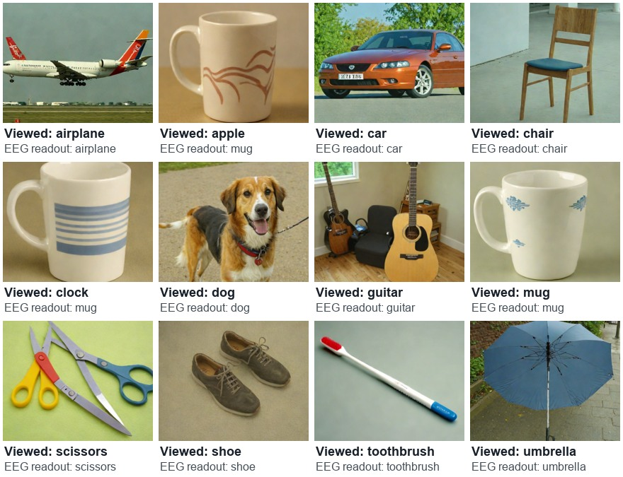

# EEG-Diffusion

Reconstructing viewed photographs from EEG with Brain-HIVE and SDXL-Turbo. We measure both whether a generated image depicts the correct object and whether EEG preserves features of the particular photograph.

[Experiment registry](docs/EXPERIMENT_REGISTRY.md) · [中文研究摘要](docs/CURRENT_RESEARCH.md) · [Reproduction guide](docs/REPRODUCIBILITY.md) · [Reconstruction gallery](research/eeg_stack_20261112/gallery/GALLERY.md)

[](https://github.com/Botwwt/EEG-Diffusion/actions/workflows/checks.yml)

## Object reconstruction from four EEG trials

**For a participant who can provide calibration EEG, use the personal four-trial object decoder.** It learns from 1,280 photos of other objects and eight calibration photos per registered class in each fold. We selected the decoder on sub-04, then ran it unchanged on sub-05. The same generator and independent 1,854-name evaluator went from **29 to 46 correct** on the first 120 photos and **45.5 to 62.5** on 120 more (ties split credit). The ten-photo within-class identification on sub-05 was **12/120 on both panels**, equal to chance. [Personal model, controls and photo-level scores](docs/OBJECT_FIDELITY.md#用其他物体学出这个人的脑电读出) · [All twelve fixed examples from the second panel](research/eeg_stack_20261112/gallery/personal_sub05_replicate.jpg)

With twelve registered objects, sub-03's EEG identified the object in **85/120 unseen photographs**. Eight other photos per object provided calibration in each fold. A separate CLIP-L/14 evaluator named the generated object correctly **71/120** times from the full 1,854-name THINGS vocabulary. The same evaluator named **99/120** originals correctly. On a second, uniformly sampled set of twelve objects, the frozen method gave **92/120** EEG classifications and **82/120** correct names for generated images.

How much carries over to a new person? Across the other **nine participants**, the same source models with each person's own eight-example calibration identified **304/1,080** and **450/1,080** objects from EEG on the two panels. Requiring every EEG prototype comparison to cross acquisition sessions gave **233/1,080** and **324/1,080** with the visual branch retained. For sub-04, chosen before scoring, the independent evaluator named **34/120** and **57.5/120** generated objects with the original frozen system (tied names split credit). Participants viewed the same photos. [Transfer, rendering and session controls](docs/OBJECT_FIDELITY.md#换一个被试再画一遍)



Each tile shows the first stimulus by archive row for its registered object. The first label names what the participant saw, and the second gives the EEG decoder's prediction. The generator receives the predicted name, a visual prototype built from calibration photos, and continuous EEG features. The two labels also show where recognition failed. [Object-level results and controls](docs/OBJECT_FIDELITY.md) · [Run the three protocols](docs/OBJECT_FIDELITY_REPLAY.md)

For **unregistered objects**, a separate sub-03 R4 confirmation panel used 20 held-out concepts and ten photos per concept. Independent visual scoring assigned **60/200** generated images to the correct concept, compared with **25/200** for the matched native baseline and **7/200** after shuffling EEG. The 20 candidates are used only by the evaluator. This experiment and the twelve-object calibration study have different inference conditions.

## Ten-participant R4 photograph benchmark

**M1a + D2 at s375** achieves **19.64%** within-concept Top-1 across ten participants. Each output uses four EEG trials from one participant, four U-Net evaluations and one generated candidate. The benchmark contains the same 500 stimulus photographs for each participant. An independent OpenAI CLIP ViT-L/14 image encoder ranks the VAE-decoded references. Chance is 10% within concept and 0.20% across all 500 photos. [Participant records](research/eeg_stack_20261112/results/exp8c_m1a_heldout6_and_all10_results.json)

| Input and conditioning model, same s375 sampler | All ten, Intra10 | Six outside development, Intra10 |
| --- | ---: | ---: |
| Mean waveform + representation-trained Arm1b | 18.12% | 17.67% |
| M1a + representation-trained Arm1b | 18.78% | 18.73% |
| Mean waveform + D2 | 18.76% | 18.13% |
| M1a + SwapDiff Arm3b | 19.46% | 19.13% |
| **M1a + D2** | **19.64%** | **19.73%** |

The selected arm identified 982 of 5,000 participant–photo queries within concept and 190 across the full gallery. Its paired advantage over M1a + SwapDiff was 0.18 percentage points (95% CI −0.58 to +0.94). All ten participants contributed EEG for other concepts during training. The six-person subset stayed outside the four-person development group for this stage. The evaluator shares a seed within each concept. [Matched controls, all eight arms and per-participant scores](docs/EXPERIMENT_REGISTRY.md)

### From EEG to an image

1. **Encode four trials.** M1a combines the encoding of an inverse-RMS-weighted waveform (72%) with the mean of four individual-trial encodings (28%). A shared three-layer EEG backbone reads three time windows with participant-specific input layers.
2. **Construct two generator inputs.** Brain-HIVE and a learned residual map the encoded EEG to four image-conditioning tokens. A participant-specific multi-window ridge model estimates the starting latent from the weighted waveform.
3. **Generate once.** SDXL-Turbo takes four steps with the EEG-derived starting latent and tokens. SwapDiff trained the conditioning path to distinguish correct and swapped EEG–photo pairs of the same concept. D2 then trained the residual conditioning layer through the four-step rollout against three competing photos. M1a was applied to the trained D2 checkpoint at evaluation. [Training lineage, architecture and batch calibration](docs/EXPERIMENT_REGISTRY.md) · [Selected-model replay](research/eeg_stack_20261112/code/eval_m1a_d2.py)

## Experiment guide

| Question | Study and outcome |
| --- | --- |
| Which changes help early retrieval and native generation? | [October experiments](docs/EXPERIMENTS.md) and [Brain-HIVE / ATM history](research/eeg/) cover visual targets, repeat reliability, ordinary adapters and their matched controls. |
| How strong is the official 80-repeat reconstruction benchmark? | [O12–O14](research/eeg_stack_20261112/O12_O13_O14_REPORT.md) reports **18.46%** 200-way for O14 from one participant. The ten-participant fusion diagnostic gives **29.25%** using EEG from ten people for each output. |
| Can EEG steer the generator between photos of the same concept? | [SwapDiff](research/eeg_stack_20261112/SWAPDIFF_REPORT.md) tests balanced EEG swaps. [Starting-latent interventions and D2](research/eeg_stack_20261112/DRAFT_INTRA4_REPORT.md) trace which generator input carries the difference. |
| Does aggregation or a different visual objective help? | [M1 and M2](research/eeg_stack_20261112/TRIAL_PREC_DINOV2_REPORT.md) compare waveform and feature pooling and a DINOv2/OpenCLIP hybrid. M1a + M2a leads the reported Inception and AlexNet-5 swap scores. |
| Does a photograph's local visual prediction error help reconstruction? | [Paired CPU and GPU studies](docs/CONTEXT_RESIDUAL.md) show above-chance residual decoding. On 200 additional sub-03 photos, the within-concept residual start identified 28 originals versus 27 for the direct start. A finer spatial gate reduced squared error and lost ten retrieval hits against direct prediction. |

## Run the checks

From the repository root with Python 3.11 or newer:

```bash
python -m pip install -e '.[dev]'
python -m eeg_diffusion verify-r4
python -m eeg_diffusion verify-stack
python -m eeg_diffusion verify
python -m pytest -q
```

`verify-r4` reconstructs the eight-arm s375 comparison from participant records. `verify-stack` checks the official R80 results. `verify` audits the frozen October release. GPU replay requires the original EEG caches, trained checkpoints, generator and evaluator assets. [Preparation and replay commands](docs/REPRODUCIBILITY.md) · [Installation](docs/INSTALLATION.md)

The [experiment registry](docs/EXPERIMENT_REGISTRY.md) maps the research questions to their executors, controls, evidence and archives. Use [CITATION.cff](CITATION.cff) with the revision used for the study. [MIT license](LICENSE) · [Third-party assets](THIRD_PARTY_NOTICES.md)
