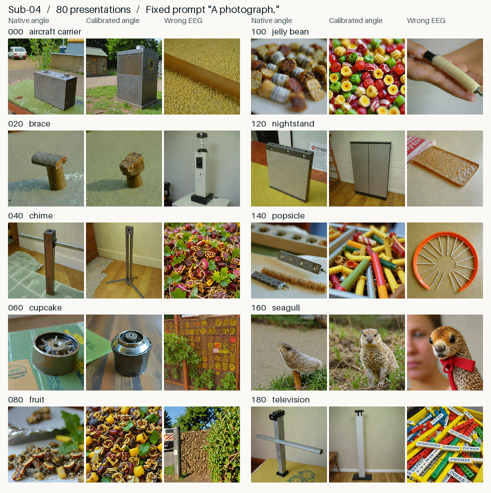

# Four and eighty EEG presentations of the same official test images

Sub-04 viewed each of 200 official THINGS-EEG2 test photographs eighty times. The R4 condition uses one four-presentation block. R80 averages EEG features across all twenty nonoverlapping blocks, including the first. Both conditions use the same participant, test photographs and learned decoder. These 200 stimuli had been used in prior feature evaluation. Each official test object contributes one photograph. Retrieval from the 200 originals measures whether generated content identifies the viewed object and image together. Within-object photographic fidelity requires multiple photographs of each object. [EEG readout and conditioning-packet construction](../research/eeg_stack_20261112/code/fit_official_repeat_objects.py)

## Native-angle JPEG results

For the primary task, independent CLIP-L/14 identified the correct object across all 1,854 THINGS labels on **4/200** decoded-word R80 images and **0/200** decoded-word R4 images. The corresponding exchanged-EEG result was **0/200**. With the common prompt, R4 and R80 both scored **2/200**, and exchanged R80 scored **0/200**. On the 200 actual photographs the same naming evaluator awarded **170.25/200** top-one credits. Equal text representations share credit among tied THINGS IDs. The four-hit R80 advantage with decoded words has a two-sided paired-swap *p* of 0.124. [Six-arm CLIP naming and image retrieval](../research/eeg_stack_20261112/results/object_fidelity/official_repeat_clip.json)

| Prompt and EEG | DINO top one / 200 | DINO top five / 200 | Mean correct rank | RGB RMSE | Luminance correlation |
|---|---:|---:|---:|---:|---:|
| Decoded word, R4 | 11 | 27 | 69.76 | 0.2764 | 0.0095 |
| Decoded word, R80 | 13 | 42 | 59.07 | 0.2725 | 0.0223 |
| Decoded word, exchanged R80 | 0 | 4 | 104.97 | 0.2831 | 0.0129 |
| Fixed prompt, R4 | 8 | 27 | 70.33 | 0.2765 | 0.0131 |
| Fixed prompt, R80 | 10 | 32 | 62.51 | 0.2759 | 0.0073 |
| Fixed prompt, exchanged R80 | 0 | 1 | 99.62 | 0.2861 | 0.0103 |

With the decoded word, eighty presentations improved mean rank by **10.69 positions** over four (paired 95% interval **1.73 to 20.00**). With fixed text the improvement was **7.83 positions** (−0.67 to 16.28). The top-one difference was two photographs for either prompt, **+1.0 percentage point** (−2.5 to +4.5). With fixed text, matched R80 identified ten originals and exchanged R80 identified zero, a **5.0-point** difference (+2.0 to +8.0). Spatial luminance correlations remained close to zero. In the fixed-prompt gallery, for example, row 060 shows a cupcake in the reference crop and a container of small parts in the R80 output. [All six arms and paired intervals](../research/eeg_stack_20261112/results/object_fidelity/official_repeat_images.json)

## Images and measures

Each of the 200 rows has six generated images. In the first three conditions the generator receives a predicted word and a continuous visual estimate from R4 EEG, R80 EEG or another row's R80 EEG. In the other three conditions the prompt is always “A photograph.” and only the continuous estimate changes. Every arm uses the recipient row's seed, 923761 plus the zero-based official row number. The wrong-EEG donor is the fixed 67-position circular shift of the 200 rows. Two conditions can predict the same word even when their EEG differs. [Six-arm registration](../research/eeg_stack_20261112/results/object_fidelity/official_repeat_images_design.json) · [Renderer](../research/eeg_stack_20261112/code/render_official_repeat_images.py)

The scorer matches the shared stimulus metadata against the image manifest row by row and verifies each original JPEG. It validates the frozen conditioning packet, six generated-image hash lists and common seeds. The two readout budgets use the same, evaluation-only original gallery. No original image enters the generator through this evaluation. [Official stimulus manifest reconstruction](../research/eeg_stack_20261112/code/official_object_readout.py) · [Independent image scorer](../research/eeg_stack_20261112/code/score_official_repeat_images.py)

The registered primary outcome is object naming with CLIP-L/14 across 1,854 words. The independent DINO outcomes here include top-one retrieval and the mean rank of the correct original among all 200. A uniform ranker has 0.5% expected top-one accuracy and mean rank 100.5. The scorer uses cosine similarity of final CLS representations from frozen DINOv2-S/14. Exact ties receive average rank and fractional identification credit. RGB root-mean-square error measures corresponding 32 × 32 thumbnails on a 0–1 scale. Pearson correlation measures spatial agreement of luminance after subtracting each image's mean. Originals use a square center crop, so these pixel comparisons concern aligned crop coordinates. The report compares R80 with R4 and wrong EEG separately for each prompt. It also gives R4 versus wrong EEG. Each 95% interval resamples the 200 shared photograph rows together across arms, holding the fitted model, reference gallery and participant fixed. [Pinned DINO weights and preprocessing](../research/eeg_stack_20261112/code/score_within_photo_dino.py)

The private galleries show official rows 0, 20, 40, …, 180 in ascending order. Each row shows the original, R4, R80 and wrong EEG. Separate sheets show the decoded-word and fixed-prompt versions. No visual selection enters the scores.

### Second experiment with a calibrated visual angle

The follow-up keeps the fixed prompt, radius, donor assignment and recipient seed. It multiplies each predicted visual angle away from the generic training mean by 3.2474 and caps it at 1.062 radians. Both constants came from generic calibration. This method was chosen after inspecting previous generic validation results. Its three generation arms are R4, R80 and exchanged R80. Their decoded words stay in the packet solely for traceability. [Angle calibration design](../research/eeg_stack_20261112/results/object_fidelity/official_repeat_global_angle_design.json)

The second scoring pass verifies the native and adjusted packets, the actual prompts and donor rows. It pairs new and prior scores on each of the same 200 photographs. It also measures whether the R80 advantage over wrong EEG or R4 changes after calibration. A private comparison sheet shows the original, original-angle R80, calibrated-angle R80 and calibrated-angle wrong EEG for the same ten prespecified rows.

| Calibrated angle, fixed prompt | DINO top one / 200 | DINO top five / 200 | Mean correct rank | RGB RMSE | Luminance correlation |
|---|---:|---:|---:|---:|---:|
| R4 | 13 | 41 | 62.44 | 0.2831 | 0.0252 |
| R80 | 20 | 57 | 42.80 | 0.2745 | 0.0313 |
| Exchanged R80 | 0 | 5 | 99.07 | 0.3024 | 0.0162 |

At eighty presentations, angle calibration raised DINO identification from **10 to 20 of 200** with the same prompt and row seed, a paired gain of **5.0 points** (1.0 to 9.0). It improved mean rank by **19.71 positions** (11.24 to 28.27). Exchanged EEG scored zero top-one identifications at both angles. At the calibrated angle, R80 gained seven identifications over R4, **3.5 points** (−1.5 to +8.5). Comparing the two R80 angles, RGB RMSE changed by −0.0014 (−0.0062 to +0.0035). The fixed gallery shows more saturated, candy-like colors at row 100, while the aircraft carrier at row 000 is still rendered as a metal box. [Independent DINO, pixel and paired angle results](../research/eeg_stack_20261112/results/object_fidelity/official_global_angle_images.json)

The primary CLIP-L/14 full-vocabulary naming score for fixed-prompt R80 remained **2/200**. Two previously incorrect images gained the right name while two earlier hits lost it. With the official 200 names supplied for evaluation, the same images improved from **3 to 7** hits (+2.0 points, −0.5 to +5.0). With the actual 200 reference photographs as the CLIP retrieval gallery, R80 improved from **5 to 17** (+6.0 points, +2.5 to +9.5, two-sided paired-swap *p* = 0.0019). The wrong-EEG images improved from zero to three photo matches. Subtracting this change gave a **4.5-point** gain for correctly aligned EEG (1.0 to 8.5). Both runs produced exactly the same original-to-original photo scores and original-to-word scores. [Calibrated CLIP results](../research/eeg_stack_20261112/results/object_fidelity/official_global_angle_clip.json) · [Paired angle comparison from full CLIP matrices](../research/eeg_stack_20261112/results/object_fidelity/official_global_angle_clip_paired.json)

At row 120 the calibrated-angle rendering acquires a cabinet-like shape but omits the reference nightstand's horizontal drawers. At row 140 its colors become closer to those of the popsicles while the objects remain hollow tubes. At row 180 neither angle reproduces the television screen. These examples come from the same prespecified row sequence used for both settings.



Each triplet in this public sheet shows native-angle R80, calibrated-angle R80 and a calibrated-angle R80 estimate from another stimulus. The label gives the category of the photograph the participant saw. All thirty images use the prompt “A photograph.” The private sheet `outputs/official-repeat-object/sub-04/global-angle/independent_images/gallery_angle_comparison.jpg` adds the corresponding original photographs.

### Calibrated visual angle with an EEG-decoded word

After inspecting the fixed-prompt calibration results, we registered the remaining three conditions on the same 200 objects. Each receives the original EEG-decoded word and the calibrated visual direction. Pairing against the native-angle named images holds the word fixed. Pairing against the calibrated-angle fixed-prompt images holds the visual direction fixed. A third comparison computes how much the naming effect changes between angles. All comparisons retain the recipient seed, repeat budget and donor assignment. This follow-up uses a previously examined test set. [Follow-up registration](../research/eeg_stack_20261112/results/object_fidelity/official_global_named_images_design.json)

| Calibrated angle with decoded word | Full 1,854 names | Restricted 200 names | CLIP photo retrieval | DINO photo retrieval | DINO mean rank | RGB RMSE | Luminance correlation |
|---|---:|---:|---:|---:|---:|---:|---:|
| R4 | 1 | 10 | 9 | 12 | 60.66 | 0.2849 | 0.0179 |
| R80 | 4 | 14 | 18 | 24 | 42.41 | 0.2757 | 0.0299 |
| Exchanged R80 | 0 | 0 | 2 | 0 | 102.50 | 0.3010 | 0.0133 |

All four identification columns count hits across the same 200 test photographs. On the primary 1,854-name task the new R80 images scored **4/200**, the same count as the native-angle named images (paired difference 0.0 points, −2.0 to +2.0). With the calibrated direction fixed, adding the decoded word raised the count from **2 to 4/200** (+1.0 point, −1.5 to +3.5). The broad naming task therefore shows no clear advantage from either change. Restricting the evaluator to the 200 official names raised the latter comparison from 7 to 14 (+3.5 points, +0.5 to +7.0, unadjusted two-sided paired-swap *p* = 0.065). [Complete CLIP counts](../research/eeg_stack_20261112/results/object_fidelity/official_global_named_clip.json) · [CLIP paired comparisons](../research/eeg_stack_20261112/results/object_fidelity/official_global_named_clip_paired.json)

With the same decoded word at R80, calibration improved DINO original-photo identification from **13 to 24/200** (+5.5 points, +1.0 to +10.0). With the calibrated visual direction fixed, adding the word changed DINO identification from **20 to 24/200** (+2.0 points, −2.5 to +6.5). The corresponding CLIP photo counts were **12 to 18** and **17 to 18**. Within the new named arm, R80 gained **12 DINO hits over R4** (+6.0 points, +1.0 to +11.0). The fixed comparison sheet shows closely similar candy-like clusters for both calibrated prompts at row 100. At row 160 both show a small mammal where the original shows a seagull. [DINO, pixel and paired comparisons](../research/eeg_stack_20261112/results/object_fidelity/official_global_named_images.json)

## Replay

Create the [native and global-angle packets](OFFICIAL_REPEAT_OBJECT.md#replay). To render on a compute GPU, set `ARCHIVE` to the archived SDXL-Turbo environment, `ADAPTER` to the pinned ViT-H adapter and `DICT` to the released 1,854-name CSV. The following commands create the JPEGs and their canonical settings before either scorer opens the original photographs.

```bash
C=research/eeg_stack_20261112/code
D=research/eeg_stack_20261112/results/object_fidelity
S=outputs/official-repeat-object/sub-04
R=outputs/official-object-readout/sub-03/evaluation
for folder in global-angle global-named; do
  mkdir -p "$S/$folder"
  cp "$S/global_angle_packet.npz" "$S/$folder/render_packet.npz"
  cp "$D/official_repeat_global_angle_packet.json" "$S/$folder/render_packet.json"
done
for mode in native global named; do
  dest="$S"
  design="$D/official_repeat_images_design.json"
  if [ "$mode" = global ]; then dest="$S/global-angle"; design="$D/official_global_angle_images_design.json"; fi
  if [ "$mode" = named ]; then dest="$S/global-named"; design="$D/official_global_named_images_design.json"; fi
  args=(--packet "$dest/render_packet.npz" --out "$dest/render" --design "$design" --dictionary "$DICT")
  python "$C/render_official_repeat_images.py" render "${args[@]}" --archive "$ARCHIVE" --adapter "$ADAPTER"
  python "$C/render_official_repeat_images.py" join "${args[@]}"
  python "$C/score_official_repeat_jpegs.py" --render "$dest/render" --design "$design" \
    --archive "$ARCHIVE" --references "$R" --dictionary "$DICT" --out "$dest/clip/summary.json"
done
```

For Slurm, package the exact files with `python "$C/package_official_repeat_jobs.py" --series repeat --out outputs/official-repeat-object/bundles`. Repeat with `--series global_angle`. Each command prints the two tar hashes. Place both archives in the submission directory alongside the [render](../research/eeg_stack_20261112/jobs/run_official_repeat_images.sbatch) and [scoring](../research/eeg_stack_20261112/jobs/score_official_repeat_images.sbatch) job files. These jobs expect the adapter at `official/ip-adapter_sdxl_vit-h.safetensors` and the dictionary at `official/dictionary.csv`. For each series, submit the render with `sbatch --parsable --export=ALL,SERIES="$series",BUNDLE_SHA="$input_sha" run_official_repeat_images.sbatch`. Submit the scorer with `sbatch --dependency=afterok:"$render_job" --export=ALL,SERIES="$series",BUNDLE_SHA="$score_sha" score_official_repeat_images.sbatch`. Extract the three named image archives under that series' local `render/` folder and the resulting `clip.tar` under the local series directory.

Run from the repository root in an environment with NumPy, SciPy, Pillow, PyTorch and Transformers. The default paths use the official sub-03 evaluation archive for the shared test originals, sub-04's frozen generation packet and source prediction receipts, and the local revision-pinned DINOv2-S/14 weights. The source metadata records the same stimuli for the official participants.

```shell
python research/eeg_stack_20261112/code/score_official_repeat_images.py reference
python research/eeg_stack_20261112/code/score_official_repeat_images.py score --publish research/eeg_stack_20261112/results/object_fidelity/official_repeat_images.json
python research/eeg_stack_20261112/code/score_official_repeat_images.py angle --publish research/eeg_stack_20261112/results/object_fidelity/official_global_angle_images.json
python research/eeg_stack_20261112/code/compare_official_angle_clip.py
python research/eeg_stack_20261112/code/gallery_official_repeat_images.py
python research/eeg_stack_20261112/code/score_official_named_factorial.py dino
python research/eeg_stack_20261112/code/score_official_named_factorial.py clip
```

The first command verifies the 200 official photo identities and their DINO self-retrieval. The second checks the 1,200 native-angle JPEGs against the renderer's receipts, writes the compact report, and places the private per-image scores and two galleries under `outputs/official-repeat-object/sub-04/independent_images`. The third scores the 600 calibrated-angle JPEGs and reads the native per-image scores for paired comparisons. Its private outputs are under `outputs/official-repeat-object/sub-04/global-angle/independent_images`.

The fourth command uses the two archived CLIP score matrices and row records under the corresponding `clip` directories. It reconstructs full-vocabulary naming, restricted naming, photo retrieval, midranks and cosine scores, verifies the per-row credits and seeds, then resamples the same stimulus IDs across angles. It runs on CPU. [Archived CLIP scorer](../research/eeg_stack_20261112/code/score_official_repeat_jpegs.py) · [CPU angle comparison](../research/eeg_stack_20261112/code/compare_official_angle_clip.py)

For the calibrated-angle named images, the Slurm series is `global_named`. The final two evaluation commands use its `global-named/render` and `global-named/clip` folders. A private fixed comparison sheet shows the original, native-angle named R80, calibrated-angle fixed-prompt R80 and calibrated-angle named R80. [Paired DINO, pixel and CLIP scoring](../research/eeg_stack_20261112/code/score_official_named_factorial.py)
