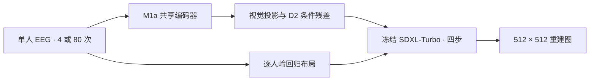

# 论文主任务、方法与主表

最终模型采用**原已登记权重的共享 M1a+D2**。训练使用十人和 1,323 个训练概念。推理只用当前一人的实测 EEG 和被试索引。THINGS‑EEG2 主表覆盖十名被试、200 个官方未见物体、四个原生系统和十二项成图指标。另有四次和八十次实测 EEG 的同生成器比较。现有证据支持将照片结构保真与成图主体的可辨性作为两个端点。 [正式主表](PAPER_UNIFORM_RECONSTRUCTION.md#主表--r80-原生系统同图重评) · [主体实验记录](OBJECT_LOG_REVIEW.md)

## 任务

主任务是 **THINGS‑EEG2 上未见物体的单人 EEG 图像重建**。每名被试有 200 个测试刺激，每个物体一张照片，共 2,000 条查询。标准 R80 用每条查询的全部 80 次实测呈现。低试次 R4 固定取呈现序号 0、1、2、3。每条查询只给当前人的脑电和被试索引，固定种子生成一张图。官方名称和原照在成图后参与评分。公开测试曾用于前代比较与真图条件诊断。独立的 50 个训练区留出物体、每物体十张照片，用于复核 R4 跨概念的结构及照片级结果。 [数据划分、图像回执与输入限制](../research/eeg_stack_20261112/PAPER_BENCHMARK_PROTOCOL.md)

任务沿用已发表的 ATM 和 D²-FOSA 在 THINGS-EEG 上将生成图与刺激原照比较的做法。ATM 表 1 同时衡量低层像素与结构、高层视觉特征。D²-FOSA 把成图质量表与 EEG 表征的图库检索表分开，其生成表直接对比 ATM 和 MB2C。本文在正文保留标准 80 次 EEG 的同库成图对照，并用 4 次 EEG 的主表检验少试次下能否画对同一批未见物体。逐人和十人共享的训练访问在各行标清，直接比较同训练访问的模型。[ATM，NeurIPS 2024](https://proceedings.neurips.cc/paper_files/paper/2024/hash/ba5f1233efa77787ff9ec015877dbd1f-Abstract-Conference.html) · [ATM 表 1](https://arxiv.org/html/2403.07721v7#S3.T1) · [D²-FOSA，CVPR 2026 表 3](https://openaccess.thecvf.com/content/CVPR2026/papers/Yu_D2-FOSA_Dual-Diffusion_Guided_EEG-to-Image_Reconstruction_with_Frequency-Oriented_Semantic_Alignment_CVPR_2026_paper.pdf#page=7) · [MB2C，ACM MM 2024](https://doi.org/10.1145/3664647.3681292) · [CCF 会议目录](https://www.ccf.org.cn/Academic_Evaluation/)

每个方法的全部 2,000 张实际成图分别用冻结的 CLIP 和 SigLIP2 对 1,854 个 THINGS 名字评分。同图双命名取两个命名积分的较小值。真实原照也用同样的评分器。图像细节用 200 张原照检索、PixCorr、SSIM 和 CLIP 两图辨认评价。标准 R80 表沿用 ATM 的像素和视觉特征列，包含 AlexNet(2/5)、Inception 和 SwAV。人工开放命名目前停留在协议阶段，计划将零基行号按 `paper-r4-open-20261126/<行号>` 的 SHA‑256 升序取前 40 个物体，在十名被试上盲评每法 400 张。评分者只看乱序生成图并自由作答。 [指标定义](../research/eeg_stack_20261112/PAPER_BENCHMARK_PROTOCOL.md) · [ENIGMA 人工评估](https://arxiv.org/abs/2602.10361)

## 最终架构

共享 M1a+D2 复用 Brain‑HiVE 的融合视觉目标、图像投影和冻结的四步 SDXL‑Turbo。脑电侧使用逐人输入分支和共享残差主干。各被试的 115、160、225 个采样点窗口分别提取特征，再共享三层残差主干并融合窗口结果。训练初段将同张照片的两个被试编码作为跨人正对，使用 $\mathcal L_{\mathrm{vis}}+0.25\mathcal L_{\mathrm{cross}}$。$\mathcal L_{\mathrm{vis}}$ 对齐冻结的照片表征。跨人项对融合、H/14 与 B/32 读出分别使用 .35、.40、.25。后续训练包含 800 步同物体照片对比与 600 步正错配去噪监督。 [Brain‑HiVE](https://proceedings.iclr.cc/paper_files/paper/2026/hash/c5506f154e5f2203a7dca2bee2faeced-Abstract-Conference.html) · [共享编码器](../research/eeg_stack_20261112/code/o13_xbrain_shared_trunk.py) · [分阶段训练入口](../research/eeg_stack_20261112/code/paper_training.py)

M1a 先读取逐次波形和加权平均波形。对每组四次 EEG，$w_{rc}=\max(10^{-6},\operatorname{mean}_t x_{rct}^2)^{-1/2}$，$\tilde x_{ct}=\sum_r w_{rc}x_{rct}/\sum_r w_{rc}$。记 $E(x,r)$ 为输出融合视觉向量和隐藏向量的编码器，$r$ 为有效试次数。每组输出

$$
(f_g,h_g)=.72 E(\tilde x_g,4)+\frac{.28}{4}\sum_{r=1}^{4}E(x_{gr},1).
$$

R80 按试次顺序计算 20 个不重叠四次组，再对 $(f_g,h_g)$ 求平均。R4 用一组。令 $\mathrm{unit}(z)=z/\|z\|$。用训练集给定的均值方向 $u$、半径 $R$ 和系数 $\alpha,\beta$ 计算 $C(f)=R\,\mathrm{unit}\big(\alpha u+\beta\,\mathrm{unit}((I-uu^\top)\mathrm{unit}(f))\big)$。令 $A$ 为冻结的 Brain‑HiVE 视觉适配器及投影。四个 2,048 维条件 token 为

$$
T_0=A(C(f)),\qquad
\Delta=\operatorname{reshape}_{4\times 2048}\!left(W_2\,\operatorname{SiLU}\bigl(W_1\operatorname{LN}(h)+b_1\bigr)\right),\qquad
T=T_0+\min\!\left(1,\frac{.35\|T_0\|_F}{\|\Delta\|_F}\right)\Delta .
$$

实现对范数加数值下界，残差中间宽度为 128。独立的逐人岭回归从 EEG 预测低频潜布局。该布局初始化四步采样，首次去噪后以 .75 系数回混相同噪声下的预测布局，最后两步再作小幅低频修正。四步始终送入同一组 $T$，使用空提示且无分类器引导，VAE 解码出一张 512×512 图。 [重复加权](../research/eeg_stack_20261112/code/exp8_trial_precision_swapdiff.py) · [成图路径](../research/eeg_stack_20261112/code/paper_render.py) · [单次查询入口](../research/eeg_stack_20261112/code/paper_shared_infer.py)

D2 以同物体四张训练照片构成配对批次。生成图与原照的相似度矩阵为 $S=.60 S_{H/14}+.25 S_{B/32}+.15 S_{\mathrm{layout}}$。前两项在冻结视觉特征上计算余弦相似度，第三项用 $16\times16$ 池化潜布局的余弦相似度。末端条件层的训练目标为

$$\mathcal L_{D2}=\tfrac12\big[\mathrm{CE}(15S,\mathrm{id})+\mathrm{CE}(15S^\top,\mathrm{id})\big]-\tfrac12\operatorname{mean}(\operatorname{diag} S)+\mathcal L_{\mathrm{reg}}.$$

正则项为 $\mathcal L_{\mathrm{reg}}=.05\,\operatorname{mean}\big[(T-T_{\mathrm{swap}})^2\big]$，其中 $T_{\mathrm{swap}}$ 来自前一阶段冻结的条件层。D2 训练使用每张训练照的四次平均 EEG，并对平均波形做小幅时间平移。评估用上面的 M1a 读出。四张生成图使用相同的初始噪声和逐步噪声，布局来自训练概念折外的 EEG 预测。梯度通过全部四步及解码图像，更新条件残差。令距离 $d_{ij}=1-S_{ij}$，两图正配的总距离小于交叉配对，就是 $d_{aa}+d_{bb}<d_{ab}+d_{ba}$。四图的行列交叉熵将这个思想扩为双向照片指派。如果一个物体的类别贡献表现为整个相似度矩阵上的共同加法常数，行列 softmax 都会抵消该常数。正例项仍可保留双方共有的视觉信息。D2 直接监督同类不同照片的对应，开放命名需单独验证。

方法贡献是把同类照片的双向指派用于冻结生成器的实际成图，并通过四步更新 EEG 条件，从训练照片读出延伸到生成照片的对应。全链反传沿用 DRaFT 思路。正例权重同为 .5、其余训练配置相同的对照可以单独检验四图对比项。D1 另用 12 倍正例项近似匹配初始梯度尺度。 [DRaFT，ICLR 2024](https://deepmind.google/research/publications/51081/) · [配对训练](../research/eeg_stack_20261112/code/exp6_draft_intra4.py) · [R4 配对消融](PAPER_UNIFORM_RECONSTRUCTION.md#方法组件与配对消融)

## 标准 R80 主表

沿用 ATM 的成图指标。在同一官方测试集上，每法 2,000 张图。ATM 和 CognitionCapturer 使用作者发布的单张结果。Brain‑HiVE 和 ENIGMA 用全部 1,654 类逐人复跑。共享 M1a+D2 用十名被试和 1,323 个训练概念，每次只输入一人的 EEG。四个原生系统各自使用原采样配置，训练访问与通道数见复跑记录。 [ATM，NeurIPS 2024 表 1](https://arxiv.org/html/2403.07721v7#S3.T1) · [原生系统、设置与逐图配对](PAPER_UNIFORM_RECONSTRUCTION.md#主表--r80-原生系统同图重评)

| 方法 | CLIP 命名 ↑ | SigLIP2 命名 ↑ | CLIP 原照首位 ↑ | DINOv2 原照首位 ↑ | PixCorr ↑ | SSIM ↑ | AlexNet(2) ↑ | AlexNet(5) ↑ | Inception ↑ | CLIP 两图 ↑ | EffNet ↓ | SwAV ↓ |
| --- | ---: | ---: | ---: | ---: | ---: | ---: | ---: | ---: | ---: | ---: | ---: | ---: |
| ATM | 1.050% | 1.375% | 7.20% | 9.20% | .1314 | .3142 | .7613 | .8353 | .6922 | .7399 | .9026 | .5906 |
| CognitionCapturer | .550% | .713% | 5.15% | 7.05% | .1509 | .3565 | .7546 | .8127 | .6699 | .7159 | .9096 | .5887 |
| Brain‑HiVE | 2.025% | 2.275% | 12.05% | 13.45% | .1951 | .3288 | .8330 | .8948 | .7476 | .7998 | .8783 | .5654 |
| ENIGMA | 1.913% | 1.975% | 13.15% | 16.20% | .1818 | .3319 | .8473 | .9069 | .7716 | .8256 | .8675 | .5430 |
| **共享 M1a+D2** | 2.550% | 2.075% | 11.40% | 16.15% | .2384 | .4267 | .8769 | .9158 | .7786 | .7992 | .8540 | .5272 |

共享 M1a+D2 相对逐人 Brain‑HiVE 的 SSIM 差为 +.0979，95% 配对区间 [+.0891, +.1071]。四个原生对照的 SSIM 差均在十名被试上同向。对 Brain‑HiVE 与 ENIGMA 的两个命名差、两个原照首位差均跨零。ENIGMA 的 CLIP 两图辨认高 .0263，区间 [+.0049, +.0482]。D2 找回原照的 228 张图中有 18 张也被两个命名器认对。真实原照的 CLIP 与 SigLIP2 命名为 85.125% 和 88.625%。 [完整配对差和图像回执](PAPER_UNIFORM_RECONSTRUCTION.md#共享-d2-与四个原生对照的配对差)

## 同生成器比较与机制消融

在共同的十人、1,323 类训练访问和四步生成协议下，比较共享 Brain‑HiVE、ATM、NICE、EEGNet、Ridge。R4 时共享 M1a+D2 成图的 CLIP 原照首位为 6.40%，最强对照 ATM 为 3.20%，配对差 +3.20 个百分点 [+1.20, +5.35]。相同配置增至 R80 时，最强对照为共享 Brain‑HiVE，原照首位 11.45% 对 6.45%，差 +5.00 [+1.50, +8.50]。R80 的 CLIP 主体首位分别为 2.40% 和 .95%，差 +1.45 [+.20, +2.80]。用同一模型及同一批刺激由 R4 增至 R80，D2 原照首位增加 5.05 个百分点 [+2.00, +8.20]，主体命名增加 1.40 [+.10, +2.85]。 [五个同配置对照的 R4、R80 全表](PAPER_UNIFORM_RECONSTRUCTION.md#r4-统一成图)

对齐 D2 和只留等权正例项的训练预算，四图竞争使官方十人 R4 的 SSIM 提高 .0132 [+.0111, +.0153]。另外完整留出的 50 类、十人共 5,000 条 R4 查询复核为 +.0125 [+.0108, +.0142]。在相同设置的完整官方 R80 上，SSIM 差为 +.01217 [+.01009, +.01436]。R80 双命名差为 +.70 个百分点 [−.10, +1.60]，DINO 原照首位差为 −1.95 [−4.75, +.80]。结构收益跨重复预算和概念面板复现。独立布局对官方 R4 的 SSIM 贡献为 +.0171 [+.0151, +.0194]。同一模型改用错配 EEG 时，官方 R4 的原照首位相对正确输入低 6.10 个百分点 [4.05, 8.45]。 [R4 逐项对照](PAPER_BENCHMARK_RESULTS.md) · [相同设置的成图消融](PAPER_UNIFORM_RECONSTRUCTION.md#方法组件与配对消融)

R80 主表采用原已登记的共享 D2 权重。新重训的跨人权重 .25 版本，在完全相同的成图输入回执上得到 .4150 SSIM、1.350% CLIP 主体命名和 1.600% SigLIP2 主体命名。SSIM 相对已登记权重下降 .01167，95% 配对区间 [−.01439, −.00916]。主表的成图分数可以用同一份冻结权重复算。跨训练运行的方差仍需更多种子估计。逐人差和完全匹配的输入项见 `cross-person-ablation-20261127/original-weight-replay-comparison.json`。

## 跨人训练权重的实图消融

三组新重训都接触十人的同一批训练数据，模型容量、种子和优化步数相同。三项权重分别对应初始编码器、同类对比和正错配去噪。第二、第三组复用同一份初始编码器权重。D2 末端损失和训练布局固定。每组以相同推理配置在十人 R4 和 R80 各生成 2,000 张，总计 12,000 张。

| 同图跨人损失权重 | R4 SSIM | R80 SSIM | R80 CLIP 主体 | R80 SigLIP2 主体 | R80 同图双命名 | R80 CLIP / DINOv2 原照首位 |
| --- | ---: | ---: | ---: | ---: | ---: | ---: |
| .25 / .25 / .25 | .40837 | .41501 | 1.350% | 1.600% | 14/2,000 | 9.70% / 15.30% |
| 0 / .25 / .25 | .41616 | .41978 | 2.450% | 1.938% | 17/2,000 | 11.35% / 16.20% |
| 0 / 0 / 0 | .42260 | .42679 | 2.100% | 1.475% | 12/2,000 | 10.55% / 13.45% |

三个阶段均关闭相对新重训的全开组，R4 SSIM 提高 .01423 [+.01088, +.01760]，R80 提高 .01178 [+.00955, +.01421]。两个开放命名差的区间均跨零。全关闭相对原已登记权重的 R80 SSIM 差 +.00010 [−.00207, +.00234]，同图双命名积分为 12 对 26，同时原照首位下降。原共享权重保留为主模型。同图跨人损失在相同训练访问下的主体优势仍未建立。作业 `5392486`、`5392487`、`5393133` 和 `5393136`。逐刺激核对见 `cross-person-all-off-20261127/cross-person-three-official-r4.json` 和 `cross-person-three-official-r80.json`。

## 主体语义与选型依据

在官方十人 R80 的 937 条成图前正确原照检索中，同一视觉读出只有 25 条命中完整词表中的主体。真图条件可大幅提升命名。把同一 EEG 查询的相对 token 换为真图，相同 400 条开发查询的 CLIP 命名由 11 升到 165，SigLIP2 由 7 升到 158。只换真布局主要改善 SSIM。两项干预分别表明，照片检索与开放主体语义的差距在成图前已出现，冻结生成器也能利用更接近真图的对象条件。 [成图前开放命名和真图干预](../research/eeg_stack_20261112/TOKEN_GATE_ZERO_STUDY.md)

EEG‑EditBench 的同源换主体比较加强了对成图语义的测量。D2 相对逐人 Brain‑HiVE 的 H/14 和 SigLIP2 差分别为 +6.42 [+3.22, +9.71] 和 +6.71 [+3.19, +10.15] 个百分点。该任务给评分器一组原照和换主体图。完整词表的成图命名衡量更难的开放主体识别。 [独立换主体对照](../research/eeg_stack_20261112/BACKGROUND_EDITBENCH_STUDY.md)

O13 的匹配 R80 重渲染保持布局相同，只改后两步。正确 O13 和同人错配 O13 的同图双命名为 25.5 和 6/2,000，差 +.975 个百分点 [+.100, +2.075]。两者相对同次共享 D2 的 25/2,000，正配只多半分，SSIM 低 .00411 [−.00523, −.00301]。后两步将两组图像注意力各自归一化再平均，与 D2 的同图双命名均为 4/400。神经响应指导在独立 50 类上改善成图前跨照辨别，1,000 条实图查询中与 D2 的同图双命名同为零。采用 9,668 个外部类别名的单查询提示在 400 张 R4 留出图中使 CLIP/SigLIP2 命名从 11/7 变为 6/6。配对条件蒸馏、视觉无条件流和 H/14 Value 替换也进入了实际成图对照。 [十人 O13 正错配与注意力对照](../research/eeg_stack_20261112/O13_RESPONSE_MIX_STUDY.md) · [神经响应指导](../research/eeg_stack_20261112/NEURAL_ENCODING_STUDY.md) · [外部词提示和其他实际对照](OBJECT_LOG_REVIEW.md)

从相同物理呈现增加全头电极读出，使独立 50 类的 5,000 条查询中多 95 条认对跨照物体。完整词表和实际重建的主体分数没有同步提高。相同的 400 张留出成图中，原 D2、全头版、额外电极残差版的 CLIP/SigLIP2 命名为 11/7、6/5、7/6。原 D2 继续作为论文候选。 [全头拟合与两套实际评分](../research/eeg_stack_20261112/SCALP_SEMANTIC_STUDY.md)

论文的现有主张是使用同类照片的实际成图配对监督，在固定生成器下提高重建结构保真。对真实照片的匹配优势依赖比较协议。开放命名的分数仍低，四个原生对照的全指标领先和人工主体识别均尚未得到证实。
