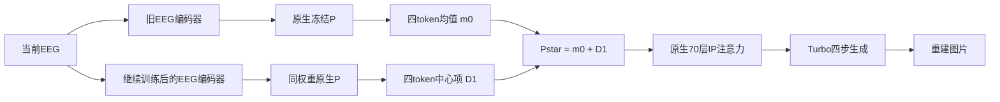

# 下一处架构接口：原生IP token均值与差异通路的工程验证

本次改动位置是原生图像投影P之后、70个IP注意力层之前，不新增适配器、采样步数或可学习参数。使用同一当前EEG的两个已保存编码器输出：旧direct和普通继续训练。旧ordinary未使用、未覆盖。它是一项待验证架构候选，不能由公式或工程成功宣称原创、图片收益或SOTA。

## 为什么检验这个位置

新继续训练在真实400图上提高刺激区分，但颜色误差变大。原始1024维条件的T均值补偿对同概念F检索和实际图片影响不同；继续直接改原始均值，不能约束非线性P之后的四个token如何共同变化。

另行使用已闭合400条做原生P诊断：新编码器的token均值对真实视觉token均值同概念Top1为31.75%，旧编码器为18.50%；中心化token分别32.75%和18.75%。因此token均值同样含刺激身份，不能直接当作噪声或纯风格。上述是特征诊断，真实查询F仅用于解释，不是推理输入、独立确认或实际注意力响应。

## 由一个约束得到整个接口变换

对每条EEG，令P₀、P₁∈R⁴ˣ²⁰⁴⁸为两个冻结编码器经过同一个原生P的输出，m₀、m₁分别为token轴均值。满足“保留新中心化token，恢复旧token均值”的最小二乘解是

$$P^*=\arg\min_Z\|Z-P_1\|_F^2\quad\mathrm{s.t.}\quad\tfrac14\mathbf1^TZ=m_0
=P_1+\mathbf1(m_0-m_1).$$

对任一原生IP层，K=PWK、V=PWV。令b=m₀−m₁，则

$$K^*=K_1+\mathbf1bW_K,\quad V^*=V_1+\mathbf1bW_V,$$
$$\operatorname{Attn}(Q,K^*,V^*)=\operatorname{Attn}(Q,K_1,V_1)+\mathbf1_QbW_V.$$

固定Q下的图像注意力权重保持，局部响应增加一个与Q无关的项。这是标准仿射投影和softmax公共key平移恒等式，不是原创定理。完整UNet后续Q会改变，不能推出最终图像仅改变颜色、刺激信息不变或两路语义已分离。FP16量化也会引入小的实际权重变化，必须测量，不能写成逐位保持。

这不同于沿训练样本轴恢复1024维总体均值：这里的均值轴是同一查询内部的四个IP token，而且两项都来自当前配对EEG。两路推理需要两个EEG编码器和额外投影工作，UNet仍为四次，不能称额外计算为零。

## 工程范围和固定对照

先在T中预先固定八个概念的首刺激，每个错配控制使用同概念第二刺激的旧EEG。全部模型、投影和宿主冻结；不读取查询真实图像、概念作为方法推理输入或图像分数训练任何参数。错配供体使用训练概念信息，只是诊断干预，不是可部署推理。

每条执行：原生旧／新两条参考，旧／新两条零变化回放，旧均值＋新中心项，新均值＋旧中心项，简单token平均融合，错配旧均值＋正确新中心项。总64张工程图；另回放既有Dcheck q0的旧／新两图，以绑定真实宿主来源。先验证两条回放，再运行新操作。没有研究效果评分、正式新训练或自动后续400准入。

固定512、四步、CFG0、IP1、同query私有初始／四次ancestral噪声。必须保留全部16张T零变化回放的逐像素相等，所有140个K/V输入确为投影输出，全部70层×四时刻的真实Q检查。48次被审计生成共13440个IP调用，保存32个实际Q/K/V小样本供独立复算。

对实际GPU的SDPA输出作独立CPU float64 softmax复算，缩放误差上限0.005；均值交换的实际注意力概率变化上限0.005。理想公共key／value平移等式误差限2×10⁻¹²。前两项是FP16实现工程门槛，不是图片效能或等效性阈值；普通融合允许改变注意力权重，不套用均值交换门槛。

## 文献与尚未建立的内容

[StyleAligned](https://arxiv.org/abs/2312.02133)已利用注意力共享控制风格，[InstantStyle](https://arxiv.org/abs/2404.02733)已研究IP特征与内容／风格控制。本轮目前只核对了它们的官方摘要，以及旧实例实际Diffusers 0.30.0的完整IP处理器源码；不能声称完成全面新颖性检索，更不能把统计量操作本身称为第二创新。未来若有收益，仍须排除普通融合、额外编码器和错误EEG通路等解释。

本工程新增128MiB在所有既有承诺之上，单个GPU作业900秒、GPU20GiB及额外CPU10GiB上限不变。只在旧卡实际空闲及父400链完整闭合退出后执行一次；失败保留，不自动重试。第二卡预留，single1729，正式D停止，旧native27保持撤下未运行。

## 2026-11-04：真实工程闭合与独立复核

旧卡包装679364／子进程679365于16:36:25 UTC正常退出，包装148.482秒、主体140.015秒；额外CPU约8.07GiB、GPU峰值约8.17GiB，原上限未提高。64张T工程图片、两条既有Dcheck q0回放和16条T恒等回放全部完成。服务器记录13440个真实IP调用，原生GPU与float64注意力最大缩放误差0.0007474、实际均值交换的概率最大变化0.0014975，均低于事前0.005工程门槛；理想恒等式误差约5.33×10⁻¹⁵。FP16实际概率没有被称为精确不变。

本地接收15份元数据、两个数组／日志文件共13.486MB及64张原图。全部原图字节与解码像素、16条T恒等和两条已有q0回放均已核验；13440条调用的完整覆盖和数值范围通过。32个保存的实际Q/K/V小样本另用NumPy float64独立复算，理想恒等式最大误差2.66×10⁻¹⁵。没有在本机重算其余13408组完整Q/K/V或重跑完整EEG网络。[独立复核范围](../audit/ATM_native_token_split_profile_complete_20261104_v1/independent_local_audit.json)保留这些边界。两页固定T图已打开查看；不同操作可同时改变对象和外观，没有据此宣布风格／语义分离或图片收益。

## 2026-11-04 16:57 UTC：完整400条效果研究已另行准入并启动

这是原生ATMS／h94／Turbo上的架构接口实验，不使用ordinary，不改变其历史权重。主方案仍为同一EEG的旧token均值加新中心化token；另固定反向交换、简单token均值融合、同概念不同刺激的旧均值供体三个控制。后三者分别检验方向、额外编码器／融合和当前配对EEG均值的作用。供体控制使用概念信息，仅作为诊断，不能部署成正常EEG重建方法。

四个新分支各400图，共1600新图；旧direct、普通继续训练、正确类内目标和训练集旧均值恢复共1600图及特征直接复用。固定400张目标图库、八项指标、八项事前比较，全部400完成后才读取新效果，不按一个指标提前停止或挑最高分支。正常候选只读当前EEG；两次EEG编码和额外两次原生P投影的成本明确报告，UNet仍为四次。该研究尚未比较与ordinary组合，也不预设收益可相加。

本次新的1024MiB额度加在工程128MiB及所有既有承诺、50GiB底线和8GiB缓冲之上，没有释放预算或删除旧结果。新控制器680136／start143034733实际于16:57:37 UTC启动，截止时间19:57:37 UTC、每阶段900秒；16:59:42 UTC同一控制器和GPU子进程680216仍在线，四组均完成8条。运行源和配方已封存，观察超时不能作为重启理由。[锁定配方与源码](../audit/crossdisciplinary_20261028_v1/ATM_token_split_images_deploy_request_20261104_v1.json)、[实际启动](../audit/crossdisciplinary_20261028_v1/ATM_token_split_images_actual_launch_20261104_v1.json)及服务器实时回执为准；这里没有新效果结论。

审查时发现反向对照的`mean_donor_EEG_SHA`字段仍记录旧流，不能把它当作该臂实际均值的来源。实际反向运算为旧中心项加当前新流均值，原始两路条件SHA和完整原生／混合token数组足以重建；已另存[明确字段注释](../audit/crossdisciplinary_20261028_v1/ATM_token_split_reverse_log_field_annotation_20261104_v1.json)。不改已封存公式、模型、图片或评分；400条原数组的独立重建仍须在终态后执行。

## 新颖性复核的更新范围

已进一步阅读[StyleAligned第3节](https://arxiv.org/html/2312.02133v2)、[InstantStyle第3节](https://arxiv.org/html/2404.02733v1)和[Nested Attention第3–5节](https://arxiv.org/html/2501.01407v1)。前者已有自注意力共享与统计量归一化，InstantStyle已有CLIP特征相减及选择IP层，Nested Attention已经研究依赖空间query的value，并将token均值作为Global V对照。本次不能据“全局与局部value拆分”主张原创；待检验的是EEG继续训练造成的条件漂移，能否在保留刺激区分的同时减轻真实生成代价。尚未建立首次性、独立机制、跨架构泛化或SOTA。
## 固定T8的接口自由度检查：为何不能直接压回原1024维条件

2026-11-04 17:19 UTC完成另一项纯CPU检查，只用原工程已固定的八条T条件和实际转换后的原生P权重，没有新EEG前向、拟合或图片，也不读取本轮Dcheck效果。原第一次执行在本机内存准入时拒绝，未计算；重新实测资源满足同一门槛后运行，原门槛未降低。

令单个token投影为 $p_k(c)=\gamma\odot(z_k-\bar z_k)/s_k+\beta$，其中 $z_k=W_kc+b_k$，$s_k^2=\operatorname{mean}(z_k-\bar z_k)^2+10^{-5}$。记 $n_k=(z_k-\bar z_k)/s_k$，则连续模型的Jacobian为

$$J_k=\operatorname{diag}(\gamma/s_k)\left[W_k-\mathbf1\overline W_k-\frac1{2048}n_k(n_k^TW_k)\right],\qquad J_m=\tfrac14\sum_kJ_k.$$

八条条件的 $J_m\in\mathbb R^{2048\times1024}$ 数值秩均为1024，最小奇异值为0.00604–0.00734，明显高于本次浮点秩阈值。在这些点的线性化模型中，要求 $J_m\delta c=0$ 就没有非零的自由方向；因此不能假定在原单条件接口中，均值通路和中心化通路可以任意独立调整。

另将主方案的纯token均值变化投影到完整P的Jacobian列空间。八条的67.20%–69.82%目标变化能量落在该局部切空间以外；最小二乘原条件步长已达原条件范数的0.877–1.160倍，实际连续P的非线性结果也没有回到这个线性目标。因此这里不给出“用一次大步原条件修正就能复现混合token”的结论。

这只支持在P之后检验新增控制自由度的结构理由，不证明额外自由度对图片有益，也不是整个非线性P的全局不可表示性定理。计算对实际转换权重的连续模型求导，不是对不连续FP16转换求导。原解析程序的16个中心差分方向检查最大相对误差1.74×10⁻⁹；另一套逐坐标有限差分与矩形SVD独立核对已完成7/8条，最末一条因本机内存保护拒绝，不能写成八条完整独立复核通过。原失败及七条实际输出均保留。[八条解析结果](../audit/ATM_token_split_tangent_T8_CPU_20261104_v1/completion.json)、[独立核对的真实范围](../audit/ATM_token_split_tangent_T8_CPU_20261104_v1/independent_audit_partial_status.json)可追溯。

## 当前验证的正常推理链

下图表示主方案的逻辑信息流；两个编码器读取同一条当前EEG，投影P使用同一份冻结权重。均值轴是当前query的四个token，不是训练样本总体均值。图中没有query真实图像或概念输入。

实际实现保留原生投影调用，并额外计算两流P输出，所以本轮记录两次EEG编码、额外两次P投影和四次UNet。没有测得更快的部署实现，不将缓存或共享编码器作为已实现的效率收益。反向交换、普通token平均和错配均值是同一研究中的固定控制，不能在看到结果后换成主方案。

## Full400 actual results: 2026-11-04 17:38 UTC

This is the completed preregistered eight-arm study, sub-01 / physical R4 / 400-gallery / single training seed. It used 1600 new and 1600 reused images with zero new training updates. No ordinary component was used or modified.

| Arm | DINO2AFC | Target cosine | Gallery Top1 | Within10 Top1 | Within10 2AFC | PixCorr | SSIM | RGB error (lower) |
|---|---:|---:|---:|---:|---:|---:|---:|---:|
| direct | 0.788477 | 0.289243 | 0.032500 | 0.170000 | 0.613889 | 0.081026 | 0.260900 | 0.109331 |
| nce_continued | 0.812588 | 0.278791 | 0.042500 | 0.225000 | 0.676944 | 0.109683 | 0.261206 | 0.157968 |
| conditional | 0.814718 | 0.280647 | 0.045000 | 0.235000 | 0.686111 | 0.111639 | 0.262885 | 0.159121 |
| restore_old_mean | 0.820382 | 0.288881 | 0.050000 | 0.225000 | 0.676111 | 0.102334 | 0.264833 | 0.154198 |
| old_mean_new_center | 0.821460 | 0.291381 | 0.045000 | 0.217500 | 0.662778 | 0.104961 | 0.258084 | 0.116642 |
| new_mean_old_center | 0.815620 | 0.301194 | 0.042500 | 0.215000 | 0.659444 | 0.103712 | 0.267315 | 0.120782 |
| token_ensemble | 0.826322 | 0.297219 | 0.040000 | 0.220000 | 0.663056 | 0.102009 | 0.262666 | 0.124121 |
| wrong_old_mean | 0.838565 | 0.299100 | 0.052500 | 0.217500 | 0.654722 | 0.105220 | 0.258703 | 0.116938 |

All eight predeclared comparisons and eight metrics remain in [the complete readout](../audit/ATM_native_IP_split_images_complete_20261104_v1/actual/readout400.json). The primary comparisons were not replaced by the largest mean.

### 如何判读本轮结果

主方案的平均颜色误差相对普通继续训练下降0.041326，描述性95%区间[-0.052093,-0.030692]；相对同样使用两个编码器的普通token融合下降0.007479，区间[-0.012083,-0.003641]。这是明确的颜色指标改善，不能说本轮所有尝试都无效。

同时，主方案相对普通继续训练的DINO仅+0.008872，区间[-0.005603,+0.023704]；同概念Top1差-0.75个百分点，区间[-5.5,+4.0]个百分点。它们没有确认额外刺激／语义收益，也不构成保留语义的非劣证明。主方案相对普通融合的SSIM下降0.004583，区间[-0.007266,-0.001928]；相对训练集raw均值恢复的SSIM亦下降。颜色、结构和刺激区分不能混成一个“质量更好”的结论。

正确旧均值相对同概念错配旧均值的DINO反而低0.017105，区间[-0.029188,-0.004410]；两者同概念Top1相同，颜色误差差异区间跨零。错配供体使用概念信息，仅是诊断控制，不能作为更好的可部署方法或按最高均值换主方案。当前没有证实逐query正确旧均值的必要性，应该增加T-only固定token均值控制，而不是直接扩大此双编码器主方案。

反向交换相对普通继续训练也有颜色改善，并有SSIM+0.006108 [0.000847,0.010681]，但语义与同概念区分的区间仍跨零。它是预设控制中的有用线索，不改名为事后赢家。全部指标和负向结果保留。

### 事后四组合分解：保留主判定，解释联合变化

以旧／新token均值为第一因子、旧／新中心项为第二因子，原生旧、原生新、主交换和反向交换已经形成四个组合。另行保存事后描述性分解 $I=Y_{11}-Y_{01}-Y_{10}+Y_{00}$，没有新训练或图片，也没有替换原八项比较。

颜色误差的非加性项为+0.029875 [0.018371,0.042564]，DINO为-0.036015 [-0.057177,-0.015772]，同概念2AFC为-0.031389 [-0.057507,-0.004993]。这表明在当前四个冻结实现中，不能用两条通路各自的平均效应简单相加来解释结果；它不是生理因果、训练梯度冲突或纯颜色／语义解耦的证明。[明确标注的事后全部八指标](../audit/ATM_native_IP_split_images_complete_20261104_v1/POSTHOC_factorial_readout.json)保留完整范围。

### 实际闭合与独立复算

控制器2449.758秒，六个GPU包装合计2294.359秒。所有1600新图完成后才读取新效应；680136及全部包装／子进程已在终态导出时核验退出。原只读接收器因SSH EOF退出，恢复的v2仅重连并读取原队列，原科学进程、配方与截止时间均没有重启或重置。

41份元数据、七个数组共62.179MB和八组固定原图／目标已逐SHA接收。独立重算3200条身份／噪声连接、16000语义值、64组区间、25600配对差、12800旧指标的精确复用，以及全部1600组混合FP16 token；固定64图像素和192个低层值通过，float32／float64没有排序边界翻转。原反向日志字段注释已由原始两流与token数组核验，不改分数或图片。未在本机重编码全部3200张图或重跑全部EEG网络。[独立范围](../audit/ATM_native_IP_split_images_complete_20261104_v1/independent_local_audit.json)和[实际图像查看](../audit/ATM_native_IP_split_images_complete_20261104_v1/actual_visual_inspection.json)明确记录边界。

本轮保留颜色校正的积极证据和结构代价，尚无第二个独立创新、SOTA或CCF A结论。当前开发集已经曝光，经典均值操作与attention恒等式也不能冒称原创。下一项仅准备T集原生token均值，用来区分逐query旧EEG信息、训练分布校准与普通融合的作用；不自动扩多seed或宣布新主方法。

## 训练集固定token均值准备的实际闭合：v148

仅准备控制输入的旧卡任务于2026-11-04 17:59:40 UTC完成，主体19.832秒、包装27.575秒。全部1323个T概念／13230刺激的旧编码器、新编码器和视觉教师三种原生P统计完成，共26460次冻结EEG前向及39690条P查询；原模型和P权重未变。800条既有native P输出逐位一致，T8编码器输出和此前全T CPU均值亦通过原门槛。这些统计只用T；视觉T锚点明确使用允许的T视觉教师，没有用Dcheck目标／特征／效果拟合均值。既有Dcheck EEG／P仅用于输入工程回放。

10个文件共74.703MB逐SHA取回，独立重算全部1323概念的12192768个分块和元素、三组总体均值与方差，并从此前400条新P输出逐位重建全部1200组FP16控制输入。[独立复核](../audit/ATM_native_token_Tanchors_complete_20261104_v1/independent_local_audit.json)明确区别于在本机重跑全部EEG网络。原控制器682475／子进程682476已在18:02:20 UTC精确核验退出；不能由该旧空闲快照推定未来GPU仍空闲。

未来固定锚点操作为 $P_{anchor}(c)=P_{new}(c)-\mathbf1\operatorname{mean}_{token}P_{new}(c)+\mathbf1\mu_T$，其中三种 $\mu_T$ 在看新图片前已分别锁定。推理只需要当前EEG的新编码器和固定T向量，不需要第二个query编码器，UNet仍四次。当前新增模型、优化更新、研究图片和UNet均为0，下一图片研究尚未准入；这些输入本身没有效果结论。新增128MiB额度保留在此前1024MiB和全部旧承诺之上，没有删除文件或释放预算。

该控制要检验的是本轮颜色收益是否需要当前EEG的旧token均值，还是固定分布校准即可得到。固定统计校准和token均值分解属于已有工具，不能把准备完成写成第二个创新或SOTA。发表判断仍以真实收益、强对照、成本和准确的新颖性范围为基础，CCF档次不是涨点阈值；当前ordinary有完整R80收益，额外独立方法尚未确认。

## 固定T-token均值的完整400条图片研究：v149

三种锚点已在看新图前由全13230条T锁定：旧EEG、新EEG和允许的T视觉教师。主对照预先指定旧EEG的固定T均值，其余两项均完整报告。三组使用相同当前EEG的新P中心项，原位运算为 $P'=P-\mathbf1\operatorname{mean}_{token}(P)+\mathbf1\mu_T$，每次实际原生P输出都与先前独立构造的token逐位核对。正常成本为一个EEG编码器、额外P为0、四次UNet；当前生成复用既有冻结EEG条件缓存，不能称为本轮重新执行了完整EEG网络。

新增三组各400图共1200图，既有八臂3200图和特征直接复用，全部十一臂、八指标、十三项固定比较在完整400后读取。错误旧均值参考仍是含概念信息的诊断，不是可部署方法。均值操作不被命名为新创新；目标是检验本轮颜色收益是否需要第二个query EEG编码器及正确配对旧均值。交叉零的区间不能证明等价或语义非劣。

第一份768MiB提案在创建研究目录或GPU进程前因空间缺口184070144字节被拒绝，原代码／提案和真实失败保留。完整新文件清单随后独立预算480612608字节：1200未来图仍按每图平均350000 allocated字节，其余明确计入特征、完整4400行来源、日志、两张工程回放等；另有56258304字节执行额度余量。v2上限512MiB，加在既有全部承诺及T统计128MiB、旧IP图1024MiB之上；50GiB底线、8GiB缓冲、分母、图像编码和分辨率未降低。旧四臂每臂400图的allocated均值实际约293489–299663字节，最大约495616字节；350000是未来总体平均规划，不是单图最大或运行保证。超限必须保留失败与完整分母，不截样本。

实际旧卡控制器683684／start143624268于18:35:53 UTC启动，截止21:35:53 UTC，各GPU作业900秒。18:45:55 UTC核验同一控制器、GPU684016存活，三组各128/400图，无失败；全部400条原生P、1200组原位FP16条件和原生／恒等两张回放已通过。只读接收器session65141只核验该真实PID，终态后才取回分数；观察过期不重启科学作业。全量来源、全部22000语义值／104区间／41600差值、1200条件和固定88图的独立复核入口已准备，真实终态正分支仍待执行。[明确资源修订](../audit/crossdisciplinary_20261028_v1/ATM_T_token_anchor_images_storage_amendment_20261104_v2.json)、[实际启动](../audit/crossdisciplinary_20261028_v1/ATM_T_token_anchor_images_actual_launch_20261104_v2.json)与[v149交接](../audit/GOAL_active_execution_handoff_20261104_v149.json)保存范围；当前尚无这一新控制的效能结论。

## 固定训练均值完整400条：真实结果与下一问题（v149闭合）

单被试sub-01／物理R4／400目标图库／单训练seed。三组各400图、共1200新图，八组3200参考图和特征复用，新增优化更新为0；ordinary没有接入或修改。三种固定T均值均由先前13230条T锁定，视觉锚点使用允许的T视觉教师，推理不读取当前query图像或概念。下表保留十一臂全部八指标，固定旧EEG训练均值仍为主对照，没有换成最高分支。

| 分支 | 目标余弦 | DINO2AFC | 图库Top1 | 同概念Top1 | 同概念2AFC | PixCorr | SSIM | 全图平均RGB误差↓ |
|---|---:|---:|---:|---:|---:|---:|---:|---:|
| 旧EEG原生 | 0.289243 | 0.788477 | 0.032500 | 0.170000 | 0.613889 | 0.081026 | 0.260900 | 0.109331 |
| 普通NCE继续训练 | 0.278791 | 0.812588 | 0.042500 | 0.225000 | 0.676944 | 0.109683 | 0.261206 | 0.157968 |
| 额外类内目标 | 0.280647 | 0.814718 | 0.045000 | 0.235000 | 0.686111 | 0.111639 | 0.262885 | 0.159121 |
| raw条件T均值恢复 | 0.288881 | 0.820382 | 0.050000 | 0.225000 | 0.676111 | 0.102334 | 0.264833 | 0.154198 |
| 当前旧均值＋新中心项 | 0.291381 | 0.821460 | 0.045000 | 0.217500 | 0.662778 | 0.104961 | 0.258084 | 0.116642 |
| 当前新均值＋旧中心项 | 0.301194 | 0.815620 | 0.042500 | 0.215000 | 0.659444 | 0.103712 | 0.267315 | 0.120782 |
| 普通token融合 | 0.297219 | 0.826322 | 0.040000 | 0.220000 | 0.663056 | 0.102009 | 0.262666 | 0.124121 |
| 同概念错配旧均值（诊断） | 0.299100 | 0.838565 | 0.052500 | 0.217500 | 0.654722 | 0.105220 | 0.258703 | 0.116938 |
| 固定旧EEG训练均值 | 0.281883 | 0.795451 | 0.037500 | 0.207500 | 0.660278 | 0.100057 | 0.258902 | 0.111853 |
| 固定新EEG训练均值 | 0.271496 | 0.793910 | 0.037500 | 0.177500 | 0.633056 | 0.114451 | 0.259543 | 0.120425 |
| 固定视觉训练均值 | 0.280065 | 0.802581 | 0.052500 | 0.230000 | 0.656667 | 0.109353 | 0.260767 | 0.118060 |

固定旧T均值相对普通NCE，DINO差−0.017137，描述性95%区间[-0.035815,-0.000178]；相对当前query旧均值，差−0.026009 [-0.039489,-0.014666]。它将全图平均RGB误差由0.157968降至0.111853，差−0.046115 [-0.057680,-0.034779]；相对query旧均值还降低0.004789，区间全负。因而公共统计可产生色调指标收益，却不能据此说它替代了当前query均值的全部功能。

固定新T均值相对NCE的同概念2AFC下降0.043889 [-0.064722,-0.020833]。同概念Top1差−4.75个百分点，区间[-9.75,0]个百分点，端点为0，不能改写成区间严格全负。固定视觉T均值相对NCE的DINO差−0.010006，区间跨零；它相对query旧均值仍下降0.018878 [-0.034630,-0.003858]。三种固定均值相对query旧均值的DINO区间均全负；不同识别指标的结论分开保存。

固定旧T均值相对旧EEG原生的同概念2AFC提高0.046389 [0.021111,0.072792]，但DINO与Top1差的区间跨零；相对反向交换的SSIM下降0.008413、区间全负。以上局部正向与结构代价均保留，不把一个指标的失败扩称整个家族无用，也不把色调收益扩称整体感知质量更好。全图平均RGB误差是两图全场RGB均值之差，不是逐像素MAE或物体颜色正确率。

本轮排除了当前这三种固定均值能够同时保留既有语义表现和色调收益的简单期待，但尚不能将损失唯一归因于删除了稳定EEG信息：把每query均值固定也改变了条件分布。下一项应检验新均值的同概念刺激错配，保持均值边际分布与中心项不变，再分析生成图对接受者和供体的区分。旧均值的既有错配控制不能直接替代新均值控制。目前没有准入该新图片研究或新训练，也没有确认第二个独立方法。

两页原图和全部104区间图已实际打开查看。预定q20的手推车、q70的鸟仍未被这些展示分支正确恢复，q40潜水装备被画成食物状内容；固定均值也会改变建筑、食物形态与背景，不能称为纯颜色干预。这八条是预先固定的说明例子，不是全体感知质量估计，未据图挑样本或主方案。仅改进图轴间距和“Mean RGB error”标签的v3展示保留v2原图，统计量完全相同。

### 完整T的分布分解与解释边界

已对1323概念／13230刺激的token均值 $m(c)$ 做描述性二阶能量分解。旧EEG的公共／概念间／概念内占比为81.227%／8.530%／10.243%，新EEG为29.019%／25.828%／45.153%，视觉教师为39.775%／33.692%／26.533%。这里的分母是 $E\|m(c)\|^2$，不是全部P token或完整注意力能量；概念内变化没有被识别为纯噪声、纯细节或生理不可靠性。

三者的token均值总体二阶能量分别56.031、57.490、55.359，说明不能只用“新条件整体变小”解释变化。旧／新总体均值对视觉均值的方向余弦为0.978657／0.765052，中心化概念原型对视觉原型的整体余弦为0.412253／0.305662；这些是允许T上的描述，不是OOF泛化、因果分解或图片效能。[全部分解与范围](../audit/ATM_T_token_mean_components_CPU_20261104_v1/actual_decomposition.json)保留原始统计SHA，没有读取本轮Dcheck效果来改运行配方。

### 复核、来源与时间

41份元数据、四个数组共27.474MB及96份固定原图／目标逐SHA接收。独立复算全部4400身份／噪声连接、22000语义值、104区间及41600差值，25600个旧指标与3200条旧来源记录精确复用；全部1200组FP16锚点逐位重建，固定88图像素及264个低层值通过。最大区间误差0，float32／float64排序边界翻转0，最大矩阵差4.60×10⁻⁷；没有在本机重跑全部EEG／DINO网络或解码全4400图。[独立复核范围](../audit/ATM_T_token_anchor_images_complete_20261104_v2/independent_local_audit.json)与[实际图像查看](../audit/ATM_T_token_anchor_images_complete_20261104_v2/actual_visual_inspection.json)可追溯。

DINO实现使用冻结DINOv3 ViT-S/16，第11层class token与patch均值各384维拼接、归一化为768维；保留历史真实图CPU resize／生成图CUDA resize来源路径。这是内部锁定评价，不能直接代替论文官方指标。还核对了原始ATMS训练器的sub-01原始ID=1，训练和导出都用该ID；当前继续训练／导出使用ones与之相符，没有因此改模型或重算结果。该静态核对不是原始EEG事件或全部梯度重放。

控制器记录2057.325秒，首次科学启动至终态2065.711秒，六个GPU包装合计1879.382秒；实现、空间预算修订、接收、独立复算和文档时间另计。683684及全部包装／子进程已精确核验退出，19:26:31 UTC的GPU为空仅是该时刻快照，不保证未来空闲。首个提案的空间拒绝、512MiB资源修订与全部旧结果保留，未重启科学作业或降低完整分母。

### 原训练目标与温度的后续静态复核（v149补记）

这次读取原始实际导入的 `encoder_utils._compute_loss` 和 `models.loss.ClipLoss`，没有导入Torch、拟合、出图或修改服务器文件。旧训练的损失为 $9L_{MSE}+L_{CLIP}$，选择检查点用 $9.9L_{MSE}+0.1L_{CLIP}$；该组合早在2026-10-18诊断中已经记录，并非新的创新发现。字面源码显示旧CLIP直接用参数 $ell=mathrm{logit_scale}$ 乘归一化余弦，最近三臂则使用 $min(e^ell,100)$。因此最近NCE相对旧编码器还同时改变了原始MSE约束、温度参数化、学习率、batch构成及最终检查点选择；不能仅归因于架构或某一个目标。正确类内目标与同轮NCE的预算和温度相同，其既有匹配比较仍然有效，全部分数保持。

归一化对比目标对非零输出 $c$ 的直接梯度满足

$$\nabla_c L_{CLIP}=\frac{I-uu^\top}{\|c\|}\nabla_u L_{CLIP},\qquad u=c/\|c\|,$$

而原始均方项的梯度是 $2(c-F)/(Bd)$。这是经典归一化链式法则，表明前者没有直接的径向约束；它不证明当前色调变化、token均值变化的唯一原因，不能推出混合目标必然更好，也不是新方法公式。

当前三个固定T十遍拟合中没有“相同新训练设置下保留原目标”的一臂。优先控制提案为原始MSE权重 $\{0,9\}$ 与温度乘子 $\{\ell,\min(e^\ell,100)\}$ 的二乘二：既有NCE是其中一格，其余三格固定相同初始权重、T、seed1729、概念batch、优化器、完整830更新和最终轮，并报告全部图片指标。这是归因控制，不是创新；代码、资源和GPU执行均尚未准入，不会用它覆盖或重训已闭合分支。原目标继续训练也不等于重做原始全部训练。全局历史任务尚未穷尽检索，因此这里不宣称其他时期从未有过类似训练。

[实际函数、源码SHA、控制范围和未执行状态](../audit/crossdisciplinary_20261028_v1/ATM_original_vs_recent_NCE_objective_source_review_20261104_v1.json)完整保存。新的EEG特异方法仍需证明：新增刺激区分信息能经实际生成通路兑现，且相对这些强对照有收益；简单重新加MSE或改温度不作为第二创新。

### 二乘二对照已实际执行：训练闭合，图片尚在生成（v150）

2026-11-04 20:01:50 UTC，旧卡控制器686659／start144139943实际启动。对照的原始MSE权重为0或9，logit乘子为字面参数或指数后截断；既有NCE指数格复用，新增其余三格。三次均使用完整13230个T刺激、1323概念、物理R4，同一初始ATMS、seed1729、概念batch、AdamW设置、梯度裁剪和固定第十遍，共2490更新／396900次EEG暴露，新增适配器参数为0。

真实四格梯度与全部400条旧编码器前向检查通过，后者误差为0。当前实际初始参数为3.853297，两种logit乘子为3.853297和47.148247；不能把二者当成同一温度。原生generation函数与手写MSE9字面格的损失误差为0，预测梯度最大误差2.62×10⁻¹⁰。这里只验证真实接口和函数等价，没有证明图片收益。

全部三次训练已经结束；30个epoch日志的顺序SHA和完整覆盖已独立重算，并与既有NCE十遍顺序一致。全部1200条新条件的服务器CPU前向对GPU缓存最大误差4.29×10⁻⁶；模型、优化器和保存RNG留在服务器，未在本机重放全部训练梯度。

| 新增格 | 末遍原始MSE | 末遍CLIP损失 | 末遍输出范数均值 | 830步中触发裁剪次数 |
|---|---:|---:|---:|---:|
| 纯NCE、字面温度 | 0.644155 | 4.424385 | 18.246258 | 2 |
| MSE9、字面温度 | 0.285877 | 4.765581 | 14.159734 | 478 |
| MSE9、指数温度 | 0.340249 | 3.122347 | 12.311845 | 830 |

这些是在线训练日志，改变温度后CLIP loss的绝对值不能直接当作更好的泛化性能。不同裁剪频率说明二乘二是在既定优化器／裁剪设置下的干预，不能外推为其他学习率下的最优结论。当前也没有从曲线挑中间轮或补参数扫描。

图已实际打开查看。另保留一个数值实现边界：既有NCE使用logsumexp减正例logit，新实现使用等价的cross_entropy表达式；同一真实batch／dropout种子的profile损失和梯度范数差为4.77×10⁻⁷／9.54×10⁻⁷，但没有证明830步训练轨迹逐位相同，也没有测量全轨迹差异幅度。不会将数学等价改写成逐位复现。[全部训练证据与范围](../audit/ATM_objective_scale_training_evidence_20261104_v1/actual_training_audit.json)保留该限制。

后续固定三格各400图，共1200新图，直接复用direct／NCE／类内目标三组1200参考。全部400结束后才读取六臂八指标、九项配对比较及MSE×温度交互；不是80条挑分支。保持原生四步、512、CFG0、IP1和同query噪声，不读取query真实图像、概念或图库答案作为推理输入。20:10:06 UTC同一控制器在线、每格77／400，没有失败，当时尚未读取图片效果。

空间上明确结算两项已完整闭合任务的1,373,007,872字节未用未来额度，全部实际文件、旧cap和源码保留；所有其他承诺固定保留。新项目768MiB另计，包含完整1200图、三个最终模型及一份可能失败前缀、日志、特征和评分；每未来图350000 allocated字节仍是总体平均规划值，50GiB底线和8GiB缓冲不变。[实际准入、封存源码和持续监控](../audit/GOAL_active_execution_handoff_20261104_v150.json)记录全部范围。以上是经典归因控制，当前没有新增创新／SOTA或CCF A结论；旧ordinary及第二卡预留规则不变。

### 二乘二完整400条已闭合：目标与温度有交互，仍无第二创新（v151）

完整三格新模型及1200新图、三组1200旧图全部结束；六臂、八指标、九项固定配对及交互均已读取并独立复算。仍是sub-01、真实R4、400目标图库、单训练seed的已曝光开发研究，ordinary未使用或改变。没有按某一指标停止家族、挑最高温度／epoch或追加系数扫描。表中目标余弦为生成图与真实图的DINO特征余弦，不是原始EEG条件对CLIP教师的余弦。

| 分支 | 目标余弦 | DINO2AFC | 图库Top1 | 同概念Top1 | 同概念2AFC | PixCorr | SSIM | 全图RGB均值误差↓ |
|---|---:|---:|---:|---:|---:|---:|---:|---:|
| 旧原生 | 0.289243 | 0.788477 | 0.032500 | 0.170000 | 0.613889 | 0.081026 | 0.260900 | 0.109331 |
| 纯NCE／指数温度 | 0.278791 | 0.812588 | 0.042500 | 0.225000 | 0.676944 | 0.109683 | 0.261206 | 0.157968 |
| 额外类内目标／指数温度 | 0.280647 | 0.814718 | 0.045000 | 0.235000 | 0.686111 | 0.111639 | 0.262885 | 0.159121 |
| 纯NCE／字面温度 | 0.257989 | 0.763797 | 0.042500 | 0.177500 | 0.627778 | 0.115247 | 0.245098 | 0.135780 |
| MSE9／字面温度 | 0.289618 | 0.801053 | 0.032500 | 0.207500 | 0.634167 | 0.097702 | 0.273136 | 0.106578 |
| MSE9／指数温度 | 0.296496 | 0.811711 | 0.047500 | 0.210000 | 0.651944 | 0.097268 | 0.258716 | 0.117383 |

| 固定比较 | DINO差及95%区间 | 同概念2AFC差及95%区间 | SSIM差及95%区间 | 全图RGB均值误差差及95%区间↓ |
|---|---|---|---|---|
| mse9_literal-nce_literal | +0.037256 [+0.000856, +0.078052] | +0.006389 [-0.035833, +0.043069] | +0.028038 [+0.019775, +0.036571] | -0.029203 [-0.038738, -0.020512] |
| mse9_exp-nce_continued | -0.000877 [-0.017880, +0.017409] | -0.025000 [-0.052243, -0.000556] | -0.002491 [-0.009694, +0.004745] | -0.040585 [-0.051215, -0.030266] |
| nce_continued-nce_literal | +0.048791 [+0.014417, +0.084455] | +0.049167 [+0.010278, +0.085007] | +0.016108 [+0.009796, +0.022542] | +0.022187 [+0.013455, +0.031215] |
| mse9_exp-mse9_literal | +0.010658 [-0.011380, +0.031705] | +0.017778 [-0.007222, +0.041944] | -0.014420 [-0.018623, -0.009767] | +0.010805 [+0.003666, +0.017759] |
| mse9_literal-nce_continued | -0.011535 [-0.037350, +0.015623] | -0.042778 [-0.070000, -0.017771] | +0.011930 [+0.002230, +0.021024] | -0.051390 [-0.064988, -0.038244] |
| nce_literal-direct | -0.024680 [-0.062471, +0.010213] | +0.013889 [-0.024722, +0.055833] | -0.015802 [-0.024255, -0.006222] | +0.026449 [+0.016203, +0.037153] |
| mse9_literal-direct | +0.012575 [-0.004552, +0.029641] | +0.020278 [+0.000833, +0.042236] | +0.012236 [+0.009118, +0.015338] | -0.002753 [-0.006353, +0.000923] |
| mse9_exp-direct | +0.023233 [+0.003463, +0.043483] | +0.038056 [+0.015278, +0.060840] | -0.002184 [-0.007642, +0.003724] | +0.008052 [-0.000983, +0.017287] |
| conditional-mse9_literal | +0.013665 [-0.011737, +0.039514] | +0.051944 [+0.026382, +0.080007] | -0.010251 [-0.019714, -0.000273] | +0.052543 [+0.038736, +0.066061] |
| MSE_x_scale_interaction | -0.038133 [-0.078435, -0.000269] | -0.031389 [-0.072500, +0.017500] | -0.030528 [-0.037557, -0.023749] | -0.011382 [-0.022775, -0.001387] |

原目标的匹配继续训练相对旧模型，同概念Top1提高3.75个百分点 [0.25,7.25]，同概念2AFC和SSIM也有正向区间；DINO差仍跨零。MSE9指数格相对旧模型的DINO及两项类内读数有正向支持，但相对强NCE组，DINO差−0.000877、区间跨零，类内2AFC却下降0.025、区间全负；全图RGB均值误差降低0.040585、区间全负。保留这一真实取舍，不将交叉零当成语义非劣。

纯NCE下指数温度提升DINO及类内2AFC，却增大全图RGB均值误差；保留MSE时，温度提升的DINO尚未确认，SSIM反而下降。DINO交互为−0.038133，描述区间[-0.078435,-0.000269]，SSIM交互亦为负。说明在当前优化器和裁剪设置下，两项改动不能按独立收益相加；不是新的普遍定律。原温度＋原目标继续训练有局部收益，这也不等于只延长任何训练都会改善。

补充的双向匹配在本轮新图片读数前固定，但受历史开发结果启发，不能恢复独立确认。指数纯NCE的优势和DINO负交互在反向与双向平均读数仍有支持；MSE9指数相对NCE的双向整体增量依然未确认。所有主指标保持原值，没有改用更好看的方向。[七项补充读数及70区间](../audit/ATM_objective_scale_complete_20261104_v1/SUPPLEMENTARY_bidirectional_readout.json)还验证了全体行／列平均配对间隔相等的代数恒等式，不能从单方向排名直接推出对象正确率。

三张PNG已实际查看：纯字面温度NCE在若干预定样本中产生插画／纹样；MSE9字面格较接近旧模型的照片外观，但手推车、潜水装备和鸟仍常被画成其他对象。这八条不是全体伪影率或感知质量估计，没有据此选赢家。

66份元数据、四个向量文件25.480MB和56份固定图／目标逐SHA接收；独立复算全部2400身份／噪声连接、12000语义值、80区间与32000配对差，9600旧指标及1200旧记录精确复用。全部1200新条件哈希、固定48图像素／144低层值通过；最大区间误差0、低层误差3.89×10⁻¹⁵，F32／F64边界翻转和区间符号变化均0。没有在本机重跑全部神经网络、全部梯度或全部2400图像素。[独立范围](../audit/ATM_objective_scale_complete_20261104_v1/independent_local_audit.json)保留限制。首次本地审计把三新模型精简数组误当旧全量五臂数组，错误保留；v2只修绑定并加入全部基线条件哈希，不改分数、模型、图片或门槛。

控制器1913.045秒，首次科学启动至终态1920.941秒，十一项GPU包装合计1790.296秒；设计、准入、接收、独立复算及文档另计。原队列和全部GPU子任务均已退出；接收器83885已成功结束，不应重启。当前768MiB未用未来额度仍计入后续规划，只有前述两项旧额度已明确结算；没有删除实际文件或放宽50GiB底线／8GiB缓冲。

相关工作核对进一步排除了把“原始MSE＋对比”或“绕过prior”作为新贡献的做法：[ENIGMA论文](https://arxiv.org/html/2602.10361v1)已有直接先例；公共源码commit460af4b6…采用原始EEG输出对归一化视觉／文本特征做CE，生成模式乘子为1，和本轮双边归一化CE不同，不能混称同一算法。公开骨干已在真实63电极T8上做了CPU接口验证，1405242参数、原类与显式分支前向一致，新增训练／图片／GPU均0；首个缺einops搜索路径失败保留，仅恢复既有依赖路径，没有装包或改作者前向。该验证不是ENIGMA训练或论文benchmark复现。后续先核对文本监督和预处理权限，再决定可审查的原生EEG骨干实验；不是继续叠加小头。见[源码与新原生接口实际证据](../audit/GOAL_active_execution_handoff_20261104_v151.json)。当前仍没有第二个可确认创新、SOTA或CCF A结论。

### v152–v153：原始63电极骨干已完整训练，图片验证继续

固定公开commit的原始类，保留63×250输入和1405242参数结构。sub-01完整T13230条，以及两个分别拟合6610／6620条、排除当前概念的角色，均从seed1729独立初始化并完成150轮；合计7800更新、3969000次EEG query暴露。实际执行作者的`train_epoch`与`prepare_optimizer`，损失为原始图像MSE＋0.5图像对比＋0.05文本对比，生成模式logit乘子1，不归一化EEG输出。真实512条独立梯度误差约2.99×10⁻¹⁰，两次同状态作者训练步的模型状态差为0。

16540张图像文件名和1654个唯一概念均已连接。两份资产的数字前缀是各自的编号，例如`00010_airplane`与`00011_airplane`；不能据数字相等连接。使用完整文件名和唯一概念名建立映射后，原T数组行及全部概念折保持不变。两次准入拒绝和两次训练步比较拒绝均保留；没有靠放宽阈值放行。

full首50轮／1300更新检查点原SHA523968a6…保留，OneCycleLR中的原始余弦函数导致`weights_only`加载拒绝。仅对本线程来源与SHA均锁定的训练状态恢复完整加载，外部EEG／视觉数组仍采用受限加载。24个模型状态张量、18组Adam状态、CPU／CUDA随机状态和剩余2601个学习率值核验通过，后续从原断点继续，没有重训或重置截止时间。三份模型的450条epoch顺序、九个状态证书及全部14880条独立CPU前向通过，最大误差1.10×10⁻⁵。

训练仍是明确偏离完整作者复现的开发参考：采用已有确定性HF/IP图像特征、ATM发布文本模板、物理R4缓存和完整T概念子集；每轮固定置乱且保留末批。原预处理的train-only MVNN未独立重放，只能说明编码器训练排除了相应概念，不能称全链OOF或官方benchmark复现。它与旧ATMS对照的预算不同，不能孤立归因于架构。

第一次生成在旧原生像素回放处停止，研究图为0。只读双环境检查发现，EEG依赖搜索路径使生成阶段选择Transformers4.57.1，旧对照为4.36.0；Torch2.3和Diffusers0.30相同。另存的v7图像入口恢复旧生成环境，原生q000像素、条件、token及全部五份噪声SHA已精确回到旧图。模型、条件、四步512采样、强度和seed均未改变，没有安装软件或删除失败。22:17:33 UTC，新图像控制器693304在线，80/400图完成；后续仍固定完整400、八项指标和五项强对照，当前没有新图片效果读数。[实际状态与全部边界](../audit/GOAL_active_execution_handoff_20261104_v153.json)为准。

### T-only目标诊断：公共偏移与两向对比目标

这项诊断在本轮新图片效果读取之前执行，只用固定seed选出的512条真实T-OOF条件，不更新模型或生成图片。令原始条件矩阵为C、视觉目标为Y，单位化目标为V，给全部条件加入同一偏移b，则

$$S(b)=(C+\mathbf1b^\top)V^\top=CV^\top+\mathbf1(Vb)^\top.$$

因此“图像→EEG”的列向softmax只增加每列公共常数，其交叉熵不变；“EEG→图像”的行向交叉熵会变化。这是标准softmax恒等式，不是新定理。对当前两向平均CE，记p为行softmax，则公共偏移的梯度为

$$g_b=\frac{2}{d}\overline{(C-Y)}+
\frac{0.5}{2}\sum_j(\bar p_j^{img}-1/B)V_j+
\frac{0.05}{2}\sum_j(\bar p_j^{txt}-1/B)U_j.$$

实际512条的12个方向有限差分通过；加权MSE与图像CE公共梯度范数为0.009396／0.010921，方向余弦−0.775574。将该T批条件的均值移到T目标均值，MSE由0.946125降至0.923523，列向CE不变，行向图像CE却由5.361264升至5.610771，总目标由3.909190升至3.949909。这验证了当前目标在公共坐标上存在取舍，不能从总loss下降推出所有生成相关几何都改善。

但公共均值误差只占该批MSE的2.38885%，并未解释全部残差；也没有识别出其余部分是神经噪声、可恢复细节还是模型误差。该批混合两份概念排除编码器的冻结输出，不是一次带dropout的真实训练batch，不据此判断整个训练的梯度冲突。批均值修正读取了T视觉目标，只是诊断，没有应用于Dcheck条件或作为推理方法。该经典恒等式与局部结果不作为第二创新，也不触发均值／系数扫描。[原始实际诊断](../audit/crossdisciplinary_20261028_v1/RAMroutes_old_goal153_ENIGMA_T_only_common_bias_objective_20261104T220239001758Z.json)保留完整范围。

### v154：原始63电极参考完整400条闭合，有线索但没有新增原创方法

2026-11-04 22:29:22 UTC，原新图控制器结束。三份150轮编码器、14880条服务器CPU复核、400张新图片、2400张原对照及全部八指标均完成；本地接收后独立重算2800身份／噪声连接、14000语义值、40个区间和16000配对差，450轮顺序及九个状态证书来源通过。固定56张图片像素和168项低层读数检查通过，四张PNG已实际查看；没有在本机重放全部训练梯度、全部评价网络或2800张图片像素。

| 分支 | DINO2AFC | 图库Top1 | 同概念Top1 | 同概念2AFC | PixCorr | SSIM | 全图RGB均值误差↓ |
|---|---:|---:|---:|---:|---:|---:|---:|
| 旧ATMS直连 | 0.788477 | 0.0325 | 0.1700 | 0.613889 | 0.081026 | 0.260900 | 0.109331 |
| ATMS纯NCE指数温度 | 0.812588 | 0.0425 | 0.2250 | 0.676944 | 0.109683 | 0.261206 | 0.157968 |
| ATMS额外类内目标 | 0.814718 | 0.0450 | 0.2350 | 0.686111 | 0.111639 | 0.262885 | 0.159121 |
| ATMS纯NCE字面温度 | 0.763797 | 0.0425 | 0.1775 | 0.627778 | 0.115247 | 0.245098 | 0.135780 |
| ATMS MSE9字面温度 | 0.801053 | 0.0325 | 0.2075 | 0.634167 | 0.097702 | 0.273136 | 0.106578 |
| ATMS MSE9指数温度 | 0.811711 | 0.0475 | 0.2100 | 0.651944 | 0.097268 | 0.258716 | 0.117383 |
| ENIGMA原生63参考 | 0.833797 | 0.0550 | 0.2725 | 0.679444 | 0.118072 | 0.252851 | 0.136409 |

ENIGMA−旧ATMS：DINO +0.045320 [0.016572,0.075254]、同概念Top1 +0.1025 [0.0550,0.1475]、同概念2AFC +0.065556 [0.039438,0.096118]；SSIM −0.008050 [−0.015611,−0.000594]，RGB均值误差 +0.027078，区间全正即恶化。这里没有用查询图像作推理条件。

ENIGMA−强NCE：DINO +0.021209 [−0.004991,0.051212]、同概念Top1 +0.0475 [0.0025,0.0875]，同概念2AFC +0.0025 [−0.027229,0.032778]；SSIM −0.008356，区间全负，RGB均值误差 −0.021559，区间全负即改善。相对额外类内目标，DINO和类内读数区间均跨零，SSIM下降、RGB误差改善。相对两个MSE对照，同概念Top1区间正；SSIM和RGB误差均恶化。所有五项固定比较、八指标和逐query差均保留，不挑弱对照宣布成功。

这支持继续研究原生EEG编码与刺激区分目标，但现有预算、初始化、文本监督和优化器均不同，不能把差异单独归因于63电极CNN，也不能据此宣布普通适配头跨架构成功。公开[ENIGMA](https://arxiv.org/html/2602.10361v1)是参考近邻，原始MSE＋双向对比不是本项目创新。当前为单被试R4／已曝光400图库；与HIVE十被试R80的分数不可直接比较。原ordinary的完整R80正向结果独立保留。

两页固定例图仍有明显错误对象；它们只用于定位，不能将漂亮或失败个例当成总体比例。完整训练图显示后半程full的raw MSE回升、CE和总loss继续降低，多数batch触发梯度裁剪；这提示实际多目标优化存在取舍，但不能直接判断过拟合、裁剪是失败原因或选择中间epoch挽救结果。

第一轮混合依赖环境的原生像素失败完整保留；独立v7仅恢复冻结生成环境，实际像素／token／噪声精确回放后完成原400槽，没有重复训练或条件导出。终态接收v2、v3因旧D09目标引用只封存path／SHA、不含bytes而拒绝；v4显式按原有SHA契约读取这两个旧引用，其他规范bytes／SHA检查不变，原源文件、图片和分数未改。图像恢复控制器实际877.52秒；这不是设计、训练、失败排查与最终整理的整轮耗时。

[全部均值和40个区间](../audit/ENIGMA_native63_reference_complete_20261104_v6/actual/readout400.json)、[独立复算范围](../audit/ENIGMA_native63_reference_complete_20261104_v6/independent_local_audit.json)、[最新闭合回执](../audit/GOAL_active_execution_handoff_20261104_v154.json)。原始512MiB与全部旧承诺、50GiB底线及8GiB余量仍计费，不删除或静默释放。没有新GPU候选准入或第二创新／SOTA／CCF A结论。

### v155：目标取舍的真实诊断与EEG平均次数前端

本轮不再把训练loss下降当作图片改善。完整13230条编码器OOF条件来自两份排除当前概念的冻结模型；对原始MSE、双向图像／文本CE计算实际末层LN的gamma／beta梯度，并用真实自动微分小批核对。两个角色的MSE／图像CE affine梯度余弦为−0.6115／−0.6383；但全局缩放的平均导数分别为+1.3033／+0.1662，二者都偏向缩小。因此“一个缩、一个放大”的简单解释不成立。这里没有重放完整网络训练梯度，也不是带dropout的真实训练batch。

固定64概念、每概念10刺激的640条T条件经原生P局部方向诊断后，MSE下降方向降低正确教师token误差，导数−0.20214，却降低正确相对同概念错误教师的间隔，导数−0.007505；图像CE下降方向分别为+0.20014／+0.005596，取舍方向相反。相关描述性区间均不跨零。这说明当前实际接口存在绝对匹配与刺激区分的局部取舍，不能据此宣布某个新loss有效。它是冻结FP16权重值下的CPU64投影器诊断，未执行完整生成器或新增图片。[全T及原生P证据](../audit/GOAL_active_execution_handoff_20261104_v155.json)与[独立局部复算](../audit/ENIGMA_all_T_affine_objective_20261104_v1/independent_local_audit.json)保留范围。

新的EEG方向针对训练R4、评价R80的实际测量差异。设第一处BN之前的线性特征具有跨重复可交换的条件协方差；同一刺激内的方差为a、非对角协方差为b，记nu=a−b，则重复平均的总体方差为：

$$v_R=v_4+\left(\frac1R-\frac14\right)\nu.$$

nu由完整T的真实四次重复差分估计；共享的刺激成分和共同重复成分在差分中抵消。nu不是纯生理噪声估计；从四次训练记录外推未来R80，还需要重复协方差及刺激总体的迁移假设。有限四次重复的全部子集恒等式只能核对代数实现，不能证明R80外推成立。该恒等式不是原创定理，[AdaBN](https://arxiv.org/abs/1603.04779)也已有利用BN统计适配域变化的方法；本候选能否形成新贡献仍待比较文献与真实效果。

只修改第一处、位于非线性之前的BN运行均值／方差，后续ELU和第二处BN保持原样；卷积、投影、affine及生成器参数不训练。固定四臂为原EMA、EMA加次数修正、T总体统计、T总体统计加次数修正。完整13230刺激／1323概念／真实四次重复已测量，200条R80各导出四组条件，共800条；R4次数修正精确回退，结束后原模型全部状态恢复。所有40通道预测方差为正，无裁剪；T总体口径预测R80／R4方差比中位数0.17734，只是模型预测，不是已测R80协方差或图片收益。

第一次工程在缓存来源检查处失败，保留原4e−6门槛和全部失败。查明原构建器先将单次记录转float32再求均值，之前的float64归约假设不适用；按原算法对全部208372500个T输入值回放，误差精确为0。独立v2使用原缓存均值和真实重复差分，没有更换输入、模型或阈值。GPU主体19.746秒、控制器30.283秒；独立原生CPU核对32条重复输入的前缀统计和全部800条R80条件，前者最大误差5.55×10⁻¹⁷、后者1.04×10⁻⁵，均通过原登记阈值。本地另核验全部接收SHA、40个外推式及四组有限子集恒等式；没有在本机重跑完整T神经统计。[实际完成](../audit/ENIGMA_measurement_count_engineering_complete_20261104_v2/actual/completion.json)、[独立CPU范围](../audit/ENIGMA_measurement_count_engineering_complete_20261104_v2/independent_server_CPU_replay.json)、[本地复算](../audit/ENIGMA_measurement_count_engineering_complete_20261104_v2/local_numerical_audit.json)。

旧695662失败、v2控制器696298完成后均已退出，不重启；原23:45:42 UTC截止和共用64MiB额度不变，全部旧承诺仍计费。新增模型、优化器更新和图片均0；没有读取新图片收益或准入下一图片队列。下一步须先固定原EMA对次数修正的主比较、T总体对照和交互，再闭合200条R80身份、原生像素／噪声与实际资源准入，才运行完整四臂图片。官方200刺激每概念仅一张，不能套用每概念十张的区分指标。单被试T1323骨干也不等于全1654／十被试最终SOTA。ordinary保留，第二卡预留，研究目标尚未达成。
### v156：平均次数前端进入完整R80图片比较

2026-11-04 16:07 America/Los_Angeles，旧卡控制器697550／start145615294实际启动。原始公开骨干与生成器权重不训练，复用v155锁定的200条R80×四组条件。四组为原EMA、次数修正、T总体统计、T总体加次数修正；主比较固定为次数修正−原EMA，另报告总体口径下的次数修正、总体重估本身及两因素交互。全部800张真实图完成后才读数，固定四步512、每query单图、相同query种子和全部初始／ancestral噪声，不挑强度、epoch或seed。

指标固定为DINO目标余弦、200图库2AFC／Top1／Top5、RGB像素相关／Y-SSIM／全图RGB均值误差，以及冻结原论文八指标，共15项、四项比较／60个描述性区间。官方200图库每概念一张，不计算同概念十选一。完整200条缓存行、作者视觉文件顺序、图像ID和目标文件bytes／SHA已连接；原始事件到刺激身份未独立重放，仍保留这项来源局限。全部五个作者评价权重SHA和既有数值fixture通过。第一轮只读预检发现复用运行文件并不全部位于仓库根目录；按原bytes／SHA解析其实际位置，失败保留，未更改源码或启动GPU。

原生R4像素、token及全部噪声精确回放通过，四组800条IP token实际导出；随后固定四段、每段四组各50张顺序生成。新任务共384MiB，图像规划仍按350000 allocated字节／图，并包含token、特征、元数据、失败与安全余量。只结清已完整闭合的目标×温度实验及ENIGMA参考实验共462082048字节未用未来额度，原实际文件和额度记录不变；其他承诺、测量工程64MiB及50GiB底线／8GiB缓冲继续保留。原ordinary、单seed和第二卡预留均不变。[固定方案及真实队列](../audit/GOAL_active_execution_handoff_20261104_v156.json)。

#### 条件锁定后的只读R80统计检验

在没有修改任何条件、没有读取重建效果的情况下，用原生类CPU64前钩测量全部200条R80输入的第一BN前40通道矩。实测方差／原EMA方差的通道中位数为0.204410；实测／次数修正预测为1.144719。加入实际BN epsilon后，40通道平均绝对对数方差比的偏差从1.389422降到0.101281；T总体口径为1.391418降到0.092012。1000次概念重采样区间及全部200×40一、二阶矩在本机独立复算，最大误差2.22×10⁻¹⁶。

这是“训练重复预测的统计变化接近实测R80”的证据；测试统计仅用于诊断，未用于拟合或改动前端。不同训练／测试刺激总体、预处理及未知重复会话关系仍可能解释剩余偏差；它不证明纯神经噪声估计准确、可交换假设完全成立或图片必然改善。该CPU诊断13.597秒，没有新模型、更新、图片或CUDA。原生神经前缀没有在本机重跑。[原始实际读数](../audit/ENIGMA_R80_empirical_moments_no_fit_20261104_v1/actual.json)和[独立复算范围](../audit/ENIGMA_R80_empirical_moments_no_fit_20261104_v1/independent_local_audit.json)保留完整边界。

图已实际查看；原图例布局另存，原始数组不变。已有[AdaBN](https://arxiv.org/abs/1603.04779)、[EEG中的BN适配（EMBC 2021）](https://www.paperhost.org/proceedings/embs/EMBC21/files/0361.pdf)及[跨批次矩匹配](https://tajanthan.github.io/cv/docs/axbn.pdf)均排除了把“改BN”或“矩匹配”本身作为原创。当前候选强调训练重复记录和已知物理平均次数的预测性校准，不以测试批次重估统计；这个具体区别还需实际图片及后续强对照验证，不据此预先宣布第二创新、SOTA或CCF A。

本节启动快照不是终态；以v156交接中的最新确切进程和后续完整读数为准。接收程序已在真实LIVE所有者下拒绝读取任何效果文件，终态正向分支仍待执行。
### v156终态：统计更接近，但当前校准损害编码与重建

2026-11-04 16:33:29 America/Los_Angeles，固定四臂全部800张真实R80图片、15项指标及四项比较完成；不是80条先导或中间样本。此处为单被试sub-01、训练T1323的ENIGMA参考骨干，不能与十被试全1654 ordinary的R80均值混为同一实验，也不能直接宣布官方SOTA。

| 分支 | DINO2AFC | 图库Top1 | 原论文CLIP | 原论文SSIM | EffNet距离↓ | SwAV距离↓ |
|---|---:|---:|---:|---:|---:|---:|
| 原EMA | 0.859523 | 0.160 | 0.803719 | 0.323021 | 0.875933 | 0.565764 |
| EMA次数修正 | 0.837789 | 0.120 | 0.787513 | 0.243155 | 0.906054 | 0.614262 |
| T总体统计 | 0.857864 | 0.165 | 0.804246 | 0.323194 | 0.876298 | 0.565924 |
| T总体加次数修正 | 0.838467 | 0.115 | 0.792588 | 0.243590 | 0.906030 | 0.614183 |

主比较次数修正−原EMA：DINO差−0.021734，描述性95%区间[−0.045851,+0.004577]，均值下降且没有收益支持，不能写成DINO已显著下降。原论文SSIM差−0.079866 [−0.089609,−0.070706]；AlexNet2/5差−0.070327／−0.049648，区间均负；EffNet／SwAV距离分别增加0.030121／0.048498，区间均正，即恶化。余下指标的跨零区间仍保留，不能当成等效或非劣。相关指标并非独立重复证据，不以“七票对八票”判定。

T总体口径同样出现次数修正的结构／语义取舍，图库Top1差−5个百分点，区间[−9.5125,−0.5]个百分点。单独T总体重估相对原EMA的原论文SSIM差+0.000173 [0.000090,0.000261]，是很小的正向次级读数；其DINO差−0.001658、区间跨零，未将它挑作新赢家。[全部四臂15指标及60区间](../audit/ENIGMA_R80_count_images_complete_20261104_v1/actual/readout.json)保留原始精度和全部方向。

#### 失败已在编码器输出中出现

全部重建结束后，另用同一视觉监督缓存做只读条件诊断，没有把查询图像特征用于推理、训练或改条件。原EMA／次数修正的原生CLIP目标余弦为0.367868／0.345001，差−0.022868 [−0.028203,−0.017611]；200候选条件检索Top1为28.5%／15.5%，差−13个百分点 [−18.5,−8.4875]。T总体口径几乎同样下降。该余弦检索对统一正向缩放不变，因此只校准输出幅度不能恢复这项区分损失。

原始目标MSE增加0.045904 [0.039590,0.052438]。逐query恒等式将其分为+0.025362的范数二阶项和+0.020542的目标对齐项，最大残差3.05×10⁻¹⁶；这只是代数分解，不是两种独立因果机制。它支持同时检查方向和幅度，不能把全部失败推给生成采样。视觉缓存编码器没有在此诊断中重新前向；[原始缓存来源与读数](../audit/ENIGMA_R80_condition_target_diagnostic_20261104_v1/actual.json)、[全部800条独立数值复算](../audit/ENIGMA_R80_condition_target_diagnostic_20261104_v1/independent_local_audit.json)保留范围。

第一BN方差预测更接近实测、编码检索却恶化，并不矛盾：无标签的边际矩接近训练分布，不保证保持训练好网络的任务判别函数。当前四臂干预将损失定位到编码端已存在，但没有独立区分ELU、第二BN、后续投影或条件均值变化的各自作用，也不能据此宣称所有BN适配或EEG测量建模无效。本次不做已曝光R80上的强度、半径或插值扫描，不直接向HIVE折叠同类方差修正。

#### 完整复核与图片

55份元数据、11份向量20.296MB、固定32张生成图／8目标图及一张旧R4工程回放均逐bytes／SHA接收。全部800身份／条件／token／配对噪声、DINO排名及作者评价后端数组交叉核验；全部60区间和12000差值独立复算，最大区间误差5.55×10⁻¹⁷。三项低层指标在服务器全800计算，本机只对固定32图的96项数值重新计算，最大误差5.41×10⁻¹⁵；没有在本机重跑全部评价神经网络或全部800图片像素。原生R4像素／噪声精确回放也通过。[独立审计范围](../audit/ENIGMA_R80_count_images_complete_20261104_v1/independent_local_audit.json)。

本地FP32矩阵最大误差3.58×10⁻⁷、排名边界变化0；额外FP64敏感性出现1处边界变化，四项DINO比较的区间方向均不变。原登记FP32分数与区间不修改，未把所有精度读数写成逐位相同。[精度敏感性](../audit/ENIGMA_R80_count_images_complete_20261104_v1/FP64_rank_sensitivity.json)。

三张PNG已实际查看。部分次数修正示例的纹理与对比更强，但错误对象仍在；原基线的这些示例也常不是目标对象。固定8条不能估计全体对象准确率或感知质量，不能用个例替换全200读数。

控制器1535.229秒，十项GPU包装合计1474.909秒；首次科学启动到终态1546.226秒，设计、准入、传输、独立复算和文档另计。697550控制器、92725观察及67348接收均正常结束，不重启。01:14:48 UTC的只读观测确认GPU计算进程为空，当时占用1MiB；不能据此假设以后持续空闲。全部产物allocated为291479552字节，原384MiB剩余未来额度仍计入后续承诺，测量64MiB、其他额度与50GiB＋8GiB不变；不删除图片或失败。原ordinary正向结果独立保留，第二卡继续预留。

#### 下一问题改为任务风险，尚未准入新训练

现在需要检验的是测量误差下的任务风险 $\mathcal R_R(\theta)=\mathbb E\,\ell(f_\theta(\bar e_R),F)$，不能再以匹配输入方差替代它。[SIMEX（Cook与Stefanski，JASA 1994）](https://jhanley.biostat.mcgill.ca/bios601/Surveys/SimulationExtrapolationEstimationMeasurementErrorModels.pdf)已有从测量误差水平外推估计的经典方法，不能把这条原则宣称原创；D08的可靠性解析解码、D23的协方差约束和D26的推理响应jackknife也必须区分。

本地已精确验证线性平方损失的有限四重复恒等式，但同时保留反例：非线性 $f(x)=x^2$ 时，用R2／R4线性外推R80会得到负风险；$f(x)=x^3$ 时二次外推也不精确。有限数据上的负权重校正还可能使未约束经验目标趋向负无穷。因此没有直接挂一个“校正loss”训练。下一项具体诊断应只用允许T和真实编码器OOF，枚举四重复的全部15个非空子集，检查R1／2／3／4下的任务损失，并预留R3检验其他计数的预测；即使拟合良好，也不能证明iid生理噪声或R80外推有效。[数学恒等式、反例及限制](../audit/EEG_measurement_risk_math_feasibility_20261104_v1/actual_finite_math.json)。这项全T诊断尚未实现或准入GPU，当前没有新成功方法／SOTA／CCF A结论，研究目标保持未完成。
