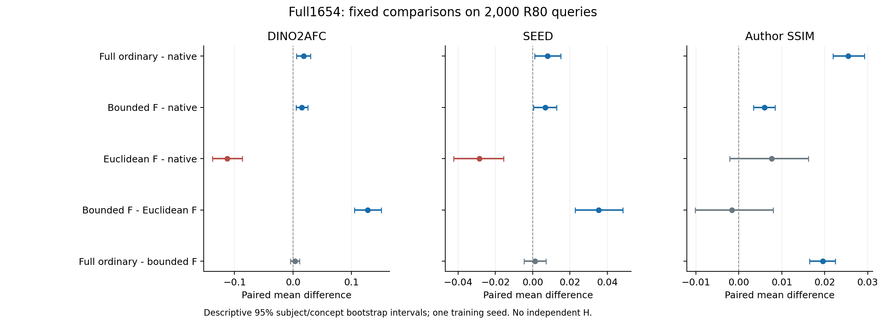

# 全1654概念完整ordinary：十被试2000条R80结果

完整ordinary相对原生的配对收益得到支持；相对受限F-only，额外语义收益未确认，低层像素／结构指标有正向增量。原先要求同时胜过原生与受限F-only的组合实用门槛未通过。本轮属于ordinary家族验证，没有第二个独立方法、SOTA或CCF A结论。

本轮拟合全部1654概念、16540图对应的165400条真实OOF条件，三遍31014更新／496200次EEG暴露，525568参数，单训练seed1729，固定最后检查点、强度1及半径0.25。完整目标是冻结原生生成器的噪声损失加0.1倍A/P token角误差；对照受限F-only仅用raw条件对F的余弦损失。两者改变了整组监督，不是只删除一个独立损失项，也不是计算匹配实验。

R80表示每条输入物理平均80次EEG记录。评价覆盖10被试×200刺激=2000query、200候选图库，每query单张512图片、原生四步、相同噪声。新增2000图，原生／受限F／Euclidean F共6000参考图直接复用。

## 完整读数

| 指标 | 原生 | 完整ordinary | 受限F-only | Euclidean F | 完整ordinary−原生（95%区间） | 完整ordinary−受限F-only（95%区间） |
|---|---:|---:|---:|---:|---|---|
| DINO2AFC | 0.872769 | 0.891198 | 0.887894 | 0.760344 | +0.018430 [+0.006081, +0.030192] | +0.003304 [-0.004531, +0.010975] |
| DINO_cosine | 0.319143 | 0.326678 | 0.328583 | 0.270034 | +0.007535 [+0.001084, +0.014302] | -0.001905 [-0.006189, +0.002525] |
| DINO_Top1 | 0.160000 | 0.172000 | 0.174500 | 0.059000 | +0.012000 [-0.016012, +0.042000] | -0.002500 [-0.029000, +0.023000] |
| DINO_Top5 | 0.398500 | 0.435000 | 0.420000 | 0.190500 | +0.036500 [+0.006500, +0.067512] | +0.015000 [-0.015500, +0.046537] |
| EffNet | 0.123275 | 0.133787 | 0.130863 | 0.090433 | +0.010511 [+0.004675, +0.016271] | +0.002923 [-0.002295, +0.008141] |
| CapSim | 0.240722 | 0.247655 | 0.244550 | 0.228907 | +0.006933 [-0.003091, +0.016939] | +0.003106 [-0.005258, +0.011955] |
| ObjectF1 | 0.184097 | 0.190674 | 0.192973 | 0.142980 | +0.006577 [-0.007436, +0.021219] | -0.002299 [-0.013606, +0.010259] |
| SEED | 0.182698 | 0.190705 | 0.189462 | 0.154107 | +0.008007 [+0.001090, +0.014995] | +0.001243 [-0.004552, +0.007128] |

| 指标 | 原生 | 完整ordinary | 受限F-only | Euclidean F | 完整ordinary−原生（95%区间） | 完整ordinary−受限F-only（95%区间） |
|---|---:|---:|---:|---:|---|---|
| eval_pixcorr | 0.189344 | 0.208549 | 0.198154 | 0.152781 | +0.019204 [+0.011817, +0.026610] | +0.010395 [+0.005848, +0.015056] |
| eval_ssim | 0.328023 | 0.353494 | 0.333988 | 0.335618 | +0.025472 [+0.021907, +0.029209] | +0.019506 [+0.016437, +0.022434] |
| eval_alex2 | 0.834430 | 0.840397 | 0.840495 | 0.688357 | +0.005967 [-0.004744, +0.017991] | -0.000098 [-0.006508, +0.006663] |
| eval_alex5 | 0.900867 | 0.905535 | 0.904731 | 0.805294 | +0.004668 [-0.003349, +0.013346] | +0.000804 [-0.005485, +0.006547] |
| eval_inception | 0.742595 | 0.758761 | 0.751065 | 0.673940 | +0.016166 [-0.003237, +0.034476] | +0.007696 [-0.009356, +0.023613] |
| eval_clip | 0.796234 | 0.810430 | 0.804716 | 0.719927 | +0.014196 [+0.001847, +0.026074] | +0.005714 [-0.002981, +0.014883] |
| eval_effnet | 0.876649 | 0.866301 | 0.869154 | 0.909166 | -0.010347 [-0.016315, -0.004496] | -0.002853 [-0.007957, +0.002304] |
| eval_swav | 0.564242 | 0.552755 | 0.555941 | 0.581118 | -0.011487 [-0.017344, -0.006303] | -0.003186 [-0.006668, +0.000500] |

所有区间按原seed1729的1000次subject/concept交叉重采样，不能覆盖训练seed不确定性。eval_effnet和eval_swav是距离，越低越好；DINO2AFC不是对象正确率。

## 结果改变了什么判断

完整ordinary−原生：DINO +0.018430 [+0.006081, +0.030192]，SEED +0.008007 [+0.001090, +0.014995]，十个被试的两项平均差均为正。ObjectF1均值差为+0.006577，其区间仍跨零；精确目标Top1区间也跨零。因此不能将总体语义相似度收益写成刺激身份或对象正确率已稳定提高。

完整ordinary−受限F-only：DINO +0.003304 [-0.004531, +0.010975]，SEED +0.001243 [-0.004552, +0.007128]，均未确认额外语义收益；这也不证明两者等价。SSIM为+0.019506 [+0.016437, +0.022434]、PixCorr为+0.010395 [+0.005848, +0.015056]，支持当前整组完整监督的低层收益。不能把这项差异单独归因于噪声损失、token项或某个梯度通路。

原事前门槛要求完整ordinary相对两条基线都达到DINO≥+0.01且区间下界>0、SEED区间下界>0、ObjectF1均值不降。实际为“相对原生通过、相对受限F-only未通过”，不根据SSIM改写原主判定。

原三项F几何比较也全部复算并保留；其完整表见[已闭合F几何结果](BRAINHIVE_FULL1654_F_GEOMETRY_R80_RESULTS_20261101_v1.md)。当前全部五项固定比较×16指标及160000条逐query差值见[科学读数](../audit/HIVE_full1654_original_ordinary_complete_20261101_v1/scientific_readout.json)和[原始配对差](../audit/HIVE_full1654_original_ordinary_complete_20261101_v1/actual/joint_comparison/all5x16_paired_differences.csv.gz)。

## 实际执行与复核

远端完整控制器41497.75秒，全部GPU包装合计41234.56秒，训练分段包装合计37989.97秒。旧受限F-only训练循环224.79秒、包装235.64秒。包装比约161.2倍，但包含不同分段加载和工程开销，不是纯算法加速测量；设计、输入资产准备和本地文档另计。

features_0在900秒保护后以wrapper1／child−15退出；原分片保留，按原有后续槽features_1补齐，未重训、未重出图片、未改变科学配方或资源门槛。全部失败回执保留。本地首次接收用了错误的参考目录，在写结果前拒绝；仅改成正确绝对路径后接收同一原始归档。

实际接收844份文件并逐SHA复核；独立重算全部160000差值、16指标、8000冻结DINO排名和新头全部2000条CPU64条件前向，显式前向最大误差约6.78e−7。111份保存状态证书及最终Adam／覆盖／已保存RNG通过；全165400训练前向来自服务器的独立CPU64审计。没有在本机重放全部31014次梯度、全部评价网络或全部8000张参考／候选图片像素。事前固定30张解码像素检查只涉及六条query和两种目标，不用于估计感知质量。

新头SHA为`8abaf46bed39c48f246063c30351edaaf1b81f50f378937cb5813bb829b52a14`，与旧ordinary的`a66869e5…9e11cc03`分开保存，旧权重／实现／强度未动。[独立复算范围](../audit/HIVE_full1654_original_ordinary_complete_20261101_v1/independent_local_full_audit.json)保留证据边界。

旧Dfit／Dcheck／V已进入完整1654拟合，官方200刺激也早已曝光；本轮是透明的完整benchmark比较，不能恢复独立H。论文重复次数／评价输入约定仍须分列，不能仅凭某一分数超过原表一行宣布SOTA。

## 后续队列

同一原生命周期已闭合退出，T-only固定方向CPU准备亦完成。完整4000张R80机制对照接续后，在首个工程profile因旧原生清单缺少噪声字段而退出；原生图片像素回放已经通过，异常发生在随后读取`initial_noise_latents_sha256`。尚无机制研究图片和效果结论，失败保留，须先修复有来源的清单接口再另行审查恢复。该控制检验learned raw方向的query依赖，不是删除EEG：固定方向仍经过依赖当前EEG的切向投影、范数保持与affine恢复。其效果未闭合前不宣称固定方向足够或EEG被忽略。

独立的全680 token原生类别测量按原规则因依赖失败而停止，尚无GPU事件；待工程恢复后另行绑定真实依赖闭合，不重启原失败控制器。不给本轮额外语义门槛改判，不追加训练seed，不恢复已停止的旧D或科学上已淘汰的模型。

后续实际更新，20:01 UTC：清单接口已在独立v2目录修复；全部2000输入／4000来源噪声记录CPU核验及首组完整profile通过，固定方向对照已经重新出图。独立VAR已绑定新控制器等待，旧失败不删除、旧控制器不重启。[恢复回执与范围](BRAINHIVE_MEAN_CONTROL_SCHEMA_RECOVERY_20261101_v2.md)保留具体证据；尚未读取新控制效果，本报告全部模型结果与主判定不变。

## 公共方向对照已完成

23:35 UTC已取回完整独立CPU复算：受限F训练公共方向的DINO为0.889731、SEED为0.191129，相对原生差+0.016962／+0.008431，两项区间下界均高于零。完整ordinary相对自己的训练公共方向，DINO仅+0.003719、区间[−0.002405,+0.009595]，SEED亦跨零；两个完整头均未建立额外主语义收益。SSIM、PixCorr及作者SwAV距离存在ordinary相对自身公共方向的正向次级结果，不能扩称所有指标都无增量。

原完整ordinary相对原生的正向结果和原双对照门槛判定保持；新证据收窄了机制解释，不能再将输入相关的原始方向预测视为已证明必要。公共方向依然与每条EEG条件进行切向投影及范数约束，不是常量图像条件，也不是第二个独立方法。[全部16指标、四比较及来源边界](HIVE_TRAIN_ONLY_MEAN_FIELD_R80_RESULTS_20261101_v1.md)。
