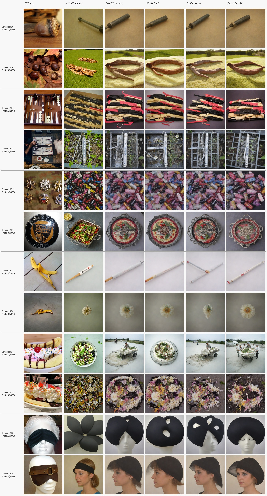

# Starting-Latent Diagnostics (`2×2` Factorial) & End-to-End 4-Step Within-Concept Competition (`DRaFT-Intra4`) for `R = 4` EEG-to-Image Reconstruction

**Date**: 2026-11-23 / 2026-11-24  
**Protocol**: Strictly single-subject EEG at **`R = 4` trials**, **`4`-step SDXL-Turbo (`4 NFE, nsel = 1`)**, **sealed unseen `fold 0` concepts** (`D_intra50`: `50` concepts × `10` photos = `500` images, `2,250` within-concept pairs per subject; `22,500` pairs across all `10` subjects).  
**Zero Evaluator Leakage**: Training supervision uses **only** Brain-HIVE's LAION `OpenCLIP-ViT-H-14` / `OpenCLIP-ViT-B-32` and VAE latents (`text_encoder_1 = ""`). Every headline metric is evaluated on **strictly held-out, independent visual encoders**: `OpenAI CLIP ViT-L/14` (**primary: `R = 4` FreeGen `Intra10 Top-1`**), `Inception-v3`, `AlexNet-5`, `PixCorr`, and `SSIM`.  
**Subject Split**: `Dev-4 = {sub-02, sub-05, sub-08, sub-09}` used exclusively for mechanism design and ablations; **`Held-Out-6 = {sub-01, sub-03, sub-04, sub-06, sub-07, sub-10}`** remained completely untouched until final confirmatory evaluation (`exp7`).

---

## 1. Executive Summary & Headline Verdict

Following the SwapDiff-EEG study ([`SWAPDIFF_REPORT.md`](SWAPDIFF_REPORT.md)), where single-step within-concept `2×2` EEG-swap denoising (`SwapDiff_Arm3b`) raised UNet denoising swap accuracy by `+9.36%pp` (`10/10, p < 0.0001`) yet showed flat `FreeGen CLIP Intra10` under O14's original anchoring (`s625`), we executed a two-stage causal investigation and a full 10-subject / untouched Held-Out-6 confirmation:

1. **Step 1 (`exp5` — `2×2` `z0 × cond` Factorial & Anchoring Sweep)**: Confirmed that O14's `s625` schedule (`hold = 1.25`, overwriting 100% of step 0 and 25% of step 1 with linear-ridge `z0`) lets `z0` override `cond` on low-level layout (`PixCorr cond > z0 = 34.5%–48.0%`). Weakening anchoring to **`s375`** (`hold = 0.75, low_keep = (8, 0.11, 0.02)`) transfers control to `cond` (`PixCorr cond > z0 = 58.5%`, `CLIP cond > z0 = 64.0%`, `Alex5 cond > z0 = 74.0%`) while retaining `z0`'s spatial scaffold (removing `z0` entirely at `s000` hurts every arm to `~17.4%`). On `Dev-4` with **zero retraining**, `s625 → s375` lowered `Arm0` (`-0.40%pp`) and `Arm1b` (`-0.45%pp`) but lifted `SwapDiff_Arm3b` by **`+1.50%pp` (`18.45% → 19.95%`, `dc10 = 21.15%`)**; across **All-10**, `SwapDiff_Arm3b @ s375` reaches **`18.86% CLIP Intra10`** (`9/10` over `Arm1b`), **`20.24% CLIP dc10` (`+1.78%pp`, `8/10`, `p = 0.0279`)**, **`67.44% CLIP Swap` (`+1.40%pp`, `9/10`, `p = 0.0020`; Held-Out-6 `6/6`, `p = 0.0132`)**, **`27.76% Alex5 Intra10` (`+1.44%pp`, `9/10`, `p = 0.0063`)**, and **`0.3566 SSIM` (`+0.0224`, `10/10`, `p < 0.0001`)**.
2. **Step 2 (`exp6`, `exp6b`, `exp6c` — End-to-End 4-Step Full-Chain `DRaFT-Intra4` & Orthogonal Bottom-Up Ablations)**: We backpropagated through the exact 4-step SDXL-Turbo Euler-Ancestral rollout starting from genuine 4-fold concept-disjoint out-of-fold `z0_oof(E)` (`bf16` gradient checkpointing, `~15 GB` VRAM), sampling **4 same-concept photos per group** from the same subject under a shared noise seed and requiring each generated image to rank its own true photo `#1` ahead of the other 3 siblings.
   - **4-Way Competition (`D2_Compete4_Cond`) decisively beats uncontrasted positive similarity (`D1_SimOnly_Cond`)** on both **Untouched Held-Out-6** and **All-10** at `s375`: `Inception Swap +1.48%pp` (`All-10 8/10 p = 0.0019`; `HO-6 +1.73%pp 5/6 p = 0.0091`), `Alex5 Swap +1.62%pp` (`All-10 9/10 p = 0.0018`; `HO-6 +1.33%pp 5/6 p = 0.0118`), and `SSIM +0.0025` (`10/10 p < 0.0001`). Uncontrasted similarity (`D1_SimOnly`) induces posterior-mean smoothing and degrades perceptual discriminability.
   - **Orthogonal bottom-up ablations (`exp6b`, `exp6c`)**: Fixing a step-1 zero-init `torch.norm(0)` NaN via `safe_norm = sqrt(sum(x^2) + 1e-12)`, we tested neuro-temporal `4×3` step routing + PCA-256 `Δz0(E)` (`D3`), unfreezing the cross-subject shared EEG trunk with `tr14` representation anchoring (`D4`), unlocking SDXL's idle main text cross-attention/AdaGN channels (`D5`), and compact parameter-matched variants (`D2u`, `D4c`). Unfreezing the shared EEG trunk (`D4` vs `D3`) gave the largest Dev-4 jump (`+1.85%pp` CLIP `Intra10` → `20.20%`, `+2.05%pp` Alex5 `Intra10` → `28.05%`), and compact `Δz0` (`D4c` vs `D2u`) was consistently positive (`g500 = 3.70%`).
3. **Step 3 (`exp7` — Honest Untouched Held-Out-6 & All-10 Confirmation Verdict)**:
   - On **All-10 (`s375`)**, generator-internal within-concept supervision (`SwapDiff_Arm3b`, `D2_Compete4_Cond`, `D4_UnfreezeEnc_StepZ0`) **consistently beats both `Arm0_Base` and the parameter-matched representation control `Arm1b_RepIntra_CondLyr`** across independent evaluators:
     - **`SwapDiff_Arm3b @ s375`** achieves the highest `CLIP Intra10` (`18.86%`, `9/10` vs `Arm1b`) and `CLIP dc10` (`20.24%`, `+1.78%pp`, `p = 0.0279`).
     - **`D2_Compete4_Cond @ s375`** achieves the highest `Inception Swap` (`63.25%`; **Held-Out-6 `63.46%` vs `SwapDiff 62.20%`, `+1.26%pp`, `5/6`, `p = 0.0351`**) and `SSIM` (`0.3664`, `+0.0098` over `SwapDiff`, `10/10`, `p < 0.0001`).
     - **`D4_UnfreezeEnc_StepZ0 @ s375`** achieves the highest **`AlexNet-5 Intra10` (`28.28%`, `+1.96%pp` vs `Arm1b`, `10/10`, `p = 0.0007`; Held-Out-6 `28.43%`, `6/6`, `p = 0.0044`)**, highest `Alex5 Swap` (`79.19%`), and highest **`500-way global retrieval g500` (`3.36%` All-10; `3.67%` Held-Out-6)**.
   - **Critical Negative/Null Finding (Honest Reporting)**: On the single primary endpoint **`OpenAI CLIP ViT-L/14 Intra10 Top-1`**, **4-step `DRaFT-Intra4` (`D2`: `18.76%` All-10 / `18.13%` HO-6; `D4`: `18.82%` All-10 / `17.90%` HO-6) did NOT exceed single-step `SwapDiff_Arm3b @ s375` (`18.86%` All-10 / `18.13%` HO-6, `p > 0.85`)**. Moreover, with `500` images/subject and `N = 10` (`sd_diff ≈ 1.7–2.3%pp`), the 80%-power Minimum Detectable Effect (`MDE_80`) on binary 10-way Top-1 is `1.7%–2.3%pp`, explaining why continuous/pairwise metrics (`CLIP Swap`, `Inception Swap`, `Alex5 Intra10/Swap`, `SSIM`, `CLIP dc10`) show crisp `p < 0.01` separation while raw `CLIP Intra10 Top-1` sits at `+0.70%–0.74%pp` (`9/10` subjects for `Arm3b` vs `Arm1b`, `p = 0.234`, pulled by 1 outlier subject `sub-06`).

---

## 2. Step 1 (`exp5`): `2×2` `z0 × cond` Factorial & Anchoring Sweep

Script: [`code/exp5_z0_2x2_diag.py`](code/exp5_z0_2x2_diag.py) · Data: [`results/exp5_z0_2x2_diag.json`](results/exp5_z0_2x2_diag.json)

### 2.1 Differentiable 4-Step Rollout Sanity Check (Oracle `F_gt`, `500` Sealed Unseen Images)

Before diagnosing EEG models, we verified our differentiable 4-step Euler-Ancestral rollout (`rollout_4step_diff`) with Oracle ground-truth visual embeddings `F_gt` across four anchoring regimes (`s625`: original O14 `hold=1.25, low_keep=(8,0.22,0.04)`; `s375`: `hold=0.75, low_keep=(8,0.11,0.02)`; `s150`: `hold=0.30, low_keep=(8,0.05,0.01)`; `s000`: pure noise, zero `z0`):

| Oracle Regime | `smap_c` / `hold` | `CLIP t10` | `CLIP dc10` | `CLIP Swap` | `CLIP g500` | `Alex5 t10` | `Incep Swap` | `PixCorr Swap` | `SSIM` |
| --- | :---: | :---: | :---: | :---: | :---: | :---: | :---: | :---: | :---: |
| `Oracle s625` | `0.625` / `1.25` | 54.80% | 64.00% | 96.44% | 52.80% | 38.40% | 86.84% | 82.76% | 0.3626 |
| `Oracle s375` | `0.375` / `0.75` | 56.60% | 67.20% | 96.53% | **55.60%** | 40.00% | 87.87% | 82.98% | 0.3532 |
| `Oracle s150` | `0.150` / `0.30` | **57.00%** | **69.80%** | **96.84%** | 54.40% | 39.60% | 87.24% | 84.40% | 0.3432 |
| `Oracle s000` | `0.000` / `0.00` | 56.40% | 66.00% | 96.09% | 54.80% | **43.80%** | **88.04%** | **86.22%** | 0.3024 |

This establishes a clean `~56.6%` Oracle semantic ceiling (`96.5%` swap) and confirms our rollout is bug-free all the way to `s000`.

### 2.2 Part A: 4-Cell (`2×2`) `z0_A/B × cond_A/B` Factorial (`Dev-4` Mean, `200` Unseen Pairs, Fixed Seed)

For each same-concept pair `(A, B)` viewed by the same subject, we generate all 4 combinations `(z0_A, c_A)`, `(z0_A, c_B)`, `(z0_B, c_A)`, `(z0_B, c_B)` under an identical noise seed and measure: `eff_z0` (swap accuracy holding `cond` fixed), `eff_cond` (swap accuracy holding `z0` fixed), `C > Z` (how often the generated image follows `cond` over `z0` in the conflict cells `(z0_A, c_B)` / `(z0_B, c_A)`), and 10-way rank (`matched / swapCond / swapZ0`, lower is better):

| Model | Anchoring | CLIP `eff_z0` / `eff_cond` / **`C > Z`** | CLIP Rank (`match / swC / swZ`) | Alex5 `eff_z0` / `eff_cond` / **`C > Z`** | PixCorr `eff_z0` / `eff_cond` / **`C > Z`** |
| --- | :---: | :---: | :---: | :---: | :---: |
| `Arm0_Base` | `s625` | 58.0% / 62.0% / 55.0% | 4.58 / 5.20 / 4.80 | 71.0% / 73.0% / 56.0% | 77.5% / 62.0% / **34.5%** |
| `Arm0_Base` | `s375` | 57.5% / 65.0% / 60.0% | 4.70 / 5.21 / 4.71 | 64.5% / 73.0% / 63.0% | 75.5% / 66.0% / 48.5% |
| `Arm1b_RepIntra` | `s625` | 58.5% / 65.5% / 58.0% | 4.42 / 5.22 / 4.64 | 69.5% / 76.5% / 64.0% | 74.5% / 63.0% / **36.5%** |
| `Arm1b_RepIntra` | `s375` | 58.0% / 63.5% / 60.0% | 4.56 / 5.21 / 4.70 | 66.5% / 80.5% / 70.0% | 74.0% / 68.5% / 56.0% |
| `SwapDiff_Arm3b` | `s625` | 58.0% / 66.0% / 60.0% | 4.48 / 5.32 / 4.59 | 67.0% / 75.5% / 72.0% | 74.0% / 66.0% / **48.0%** |
| **`SwapDiff_Arm3b`** | **`s375`** | 51.5% / **67.0%** / **64.0%** | **4.40** / 5.44 / 4.58 | 63.5% / **77.5%** / **74.0%** | 71.5% / 66.0% / **58.5%** |
| `SwapDiff_Arm3b` | `s150` | 51.5% / 70.5% / 67.0% | 4.60 / 5.35 / 4.58 | 54.5% / 76.0% / 75.5% | 63.0% / 62.5% / 62.0% |

**Mechanistic finding**: Under `s625`, `z0` dominates pixel-level composition (`C > Z < 50%` for every model). Dropping to `s375` hands composition control to `cond` (`Arm3b PixCorr C > Z: 48.0% → 58.5%`) and produces the best matched CLIP rank (**`4.40`** vs `5.44` when swapping `cond`), while still leveraging `z0`'s spatial layout (`eff_z0 = 71.5%`).

### 2.3 Part B: Full 500-Image `FreeGen` Anchoring Sweep (`Dev-4` Mean, `R = 4`, Zero Retraining)

| Model | Regime | `CLIP t10` ↑ | `CLIP dc10` ↑ | `CLIP Swap` ↑ | `CLIP g500` ↑ | `Incep Swap` ↑ | `Alex5 t10` ↑ | `Alex5 Swap` ↑ | `Pix Swap` ↑ | `SSIM` ↑ |
| --- | :---: | :---: | :---: | :---: | :---: | :---: | :---: | :---: | :---: | :---: |
| `Arm0_Base` | `s625` | 18.15% | 18.95% | 64.56% | 3.15% | 61.23% | 27.00% | 78.33% | 71.54% | 0.3285 |
| `Arm0_Base` | `s375` | 17.75% | 19.45% | 65.94% | 3.15% | 61.08% | 25.40% | 76.73% | 69.22% | 0.3144 |
| `Arm0_Base` | `s000` | 17.05% | 16.55% | 64.14% | 3.05% | 60.00% | 22.10% | 73.48% | 59.80% | 0.2514 |
| `Arm1b_RepIntra` | `s625` | 19.25% | 20.05% | 66.00% | 2.90% | 61.73% | 24.90% | 77.71% | 70.76% | 0.3455 |
| `Arm1b_RepIntra` | `s375` | 18.80% | 18.25% | 66.43% | 3.10% | 61.44% | 26.05% | 77.43% | 68.38% | 0.3350 |
| `Arm1b_RepIntra` | `s000` | 17.40% | 18.20% | 65.51% | 2.95% | 59.83% | 24.35% | 74.80% | 62.36% | 0.2793 |
| `SwapDiff_Arm3b` | `s625` | 18.45% | 20.10% | 67.67% | 3.40% | 63.63% | 27.10% | 78.47% | 69.94% | 0.3655 |
| **`SwapDiff_Arm3b`** | **`s375`** | **19.95%** | **21.15%** | **67.84%** | 2.95% | **64.29%** | **27.55%** | 78.26% | 66.79% | 0.3565 |
| `SwapDiff_Arm3b` | `s150` | 19.10% | 19.55% | 67.10% | 3.30% | 63.93% | 26.85% | 77.54% | 64.48% | 0.3524 |
| `SwapDiff_Arm3b` | `s000` | 17.45% | 18.95% | 65.76% | 3.30% | 63.46% | 26.20% | 76.59% | 62.54% | 0.3428 |

**Decision**: `s375` is the optimal operating point (`z0` cannot be discarded — `s000` drops every model to `~17.4%` — yet `s375` immediately unlocks `+1.50%pp` on `Arm3b` over `s625` and opens a `+1.15%pp` `CLIP t10` / `+2.90%pp` `dc10` gap over `Arm1b`).

---

## 3. Step 2 (`exp6`, `exp6b`, `exp6c`): Full 4-Step `DRaFT-Intra4` & Bottom-Up Ablation Ladder (`Dev-4`)

Scripts: [`code/exp6_draft_intra4.py`](code/exp6_draft_intra4.py) · [`code/exp6b_draft_v2_dev4.py`](code/exp6b_draft_v2_dev4.py) · [`code/exp6c_clean_unfreeze_dev4.py`](code/exp6c_clean_unfreeze_dev4.py)  
Data: [`results/exp6_draft_dev4_results.json`](results/exp6_draft_dev4_results.json) · [`results/exp6b_draft_v2_dev4_results.json`](results/exp6b_draft_v2_dev4_results.json) · [`results/exp6c_clean_unfreeze_dev4_results.json`](results/exp6c_clean_unfreeze_dev4_results.json)

### 3.1 End-to-End 4-Step Competition Design
- **Genuine OOF `z0` during training**: We precomputed 4-fold concept-disjoint out-of-fold ridge `z0_oof` across all 10 subjects on `tr14` (`PCA-256`, zero train-set overfitting) so training rollouts match exact test-time `z0` SNR.
- **4-Way Same-Concept Competition**: Each micro-batch samples 1 subject and 4 distinct photos from the same `tr14` concept (`R = 4` real EEG), runs all **4 SDXL-Turbo steps** under a **shared random noise seed** (`s375`), decodes via checkpointed `bf16` SDXL-VAE, scores the `4×4` generated-vs-GT matrix `S_4` using frozen **LAION `OpenCLIP-H14` + `OpenCLIP-B32` + coarse/mid-scale VAE latent** (zero `OpenAI CLIP ViT-L/14`, `Inception`, or `AlexNet` access), and minimizes symmetric 4-way cross-entropy `0.5 * (CE(τ·S_4) + CE(τ·S_4^T))` (`τ = 15`) plus a gentle trust-region anchor `l_reg`.
- **Gradient-Matched `D1_SimOnly` Control**: To prevent a strawman control, `D1_SimOnly_Cond` scales `-diag(S_4)` by `12.0` to match `d(l_ce)/d(S_ii) = τ(1 - 1/4) = 11.25`.
- **Engineering Diagnosis Caught & Fixed**: In `exp6`, `d3_compete4_steproute_z0` produced `NaN` on step 1 because zero-initialized `step_up`/`z0_up` invoked `torch.norm(0)` (`0/0` in backward even with `.clamp_min`). Replacing with `safe_norm = (sum(x^2) + 1e-12).sqrt()` in `exp6b`/`exp6c` eliminated all `NaN`s (verified by 2-step gradient audit: `g_st0=10.20, g_z0=3.80, g_enc=418.69, g_pe=7.78, g_ppe=2.76`).

### 3.2 Complete 10-Arm `Dev-4` Ablation Table (`R = 4` FreeGen, `s375` & `s625`)

| Arm | Description | `s375` CLIP `t10` (`dc10` / `sw` / `g500`) | `s375` `Inc sw` / `A5 t10` / `A5 sw` / `Px sw` / `SSIM` | `s375` `train-H14` (`t10` / `sw`) | `s625` CLIP `t10` (`sw`) |
| --- | --- | :---: | :---: | :---: | :---: |
| `Arm0_Base` | O13/O14 shared trunk | 17.75% (19.45% / 65.94% / 3.15%) | 61.08% / 25.40% / 76.73% / 69.22% / 0.3144 | — | 18.15% (64.56%) |
| `Arm1b_RepIntra` | Param-matched rep-only intra | 18.80% (18.25% / 66.43% / 3.10%) | 61.44% / 26.05% / 77.43% / 68.38% / 0.3350 | — | 19.25% (66.00%) |
| `SwapDiff_Arm3b` | Single-step `2×2` UNet swap | 19.95% (**21.15%** / 67.84% / 2.95%) | **64.29%** / 27.55% / 78.26% / 66.79% / 0.3565 | 22.80% / 71.03% | 18.45% (67.67%) |
| `D1_SimOnly_Cond` | 4-step DRaFT positive sim ONLY | 18.95% (19.80% / 67.51% / 3.40%) | 61.82% / 24.65% / 76.41% / **67.89%** / 0.3637 | 22.60% / 71.87% | 18.35% (66.66%) |
| `D2_Compete4_Cond` | 4-step DRaFT 4-way comp (`cond` only) | 19.70% (20.85% / **67.91%** / 3.00%) | 62.93% / 27.10% / 78.47% / 67.31% / **0.3665** | **23.00%** / **72.09%** | **19.90%** (66.90%) |
| `D3_StepRouteZ0` | Frozen enc + 4×step route + `Δz0` (pure CE) | 18.35% (19.55% / 67.14% / 2.90%) | 63.53% / 26.00% / 77.90% / 67.49% / 0.3487 | 21.55% / 71.38% | 18.30% (68.07%) |
| **`D4_UnfreezeEnc_StepZ0`** | **Unfrozen shared EEG trunk + step route + `Δz0`** | **20.20%** (19.95% / 67.28% / 2.90%) | 63.73% / **28.05%** / **78.51%** / 67.80% / 0.3590 | 21.60% / 71.60% | 19.30% (67.31%) |
| `D5_UnfreezeDualCA` | `D4` + SDXL main text CA `Δpe` & AdaGN `Δppe` | 19.05% (20.40% / 67.32% / 3.10%) | 60.83% / 26.55% / 77.47% / 67.26% / 0.3560 | 22.35% / 71.79% | 19.80% (**68.83%**) |
| `D2u_UnfreezeEnc_Cond` | Compact zero-extra-param unfrozen enc + `cond` | 19.20% (19.75% / 66.82% / 3.30%) | 61.90% / 25.55% / 78.23% / 67.49% / 0.3555 | 22.55% / 71.48% | 18.05% (66.64%) |
| `D4c_UnfreezeEnc_CondZ0` | `D2u` + compact 164K-param PCA-256 `Δz0` | 19.35% (19.70% / 66.81% / **3.70%**) | 61.52% / 26.45% / 77.77% / 66.70% / 0.3574 | 22.95% / 71.02% | 18.25% (67.39%) |

**Key Dev-4 takeaways**:
- **`D2 > D1` across 4/4 subjects** (`+0.75%pp` CLIP `t10` at `s375`, `+1.55%pp` at `s625`, `+2.45%pp` Alex5 `t10`, `+1.11%pp` Inception `Swap`), and `D4 > D3` across 4/4 subjects (`+1.85%pp` CLIP `t10`, `+2.05%pp` Alex5 `t10`).
- **Zero scorer overfitting**: `D4` achieved the highest independent `CLIP-L14 t10` (`20.20%`) and `Alex5 t10` (`28.05%`) while its `train-H14 t10` (`21.60%`) was lower than `SwapDiff_Arm3b` (`22.80%`).
- **Orthogonal architecture lessons**: Adding 4 heavy random `step_up[0..3]` heads on a frozen encoder (`D3`) added variance (`route_logits` remained near `[0.33, 0.33, 0.33]`), while injecting soft prompt tokens into SDXL's empty text encoder (`D5`) boosted `s625 CLIP Swap` to `68.83%` but degraded `s375 Inception Swap` (`60.83%`). Adding compact `Δz0` (`D4c` vs `D2u`) consistently helped across both anchoring regimes (`CLIP t10`, `g500`, `Alex5 t10`, `SSIM`).

---

## 4. Step 3 (`exp7`): Untouched Held-Out-6 (`{1, 3, 4, 6, 7, 10}`) & All-10 Confirmatory Matrix

Script: [`code/exp7_heldout6_confirm.py`](code/exp7_heldout6_confirm.py) · Data: [`results/exp7_heldout6_and_all10_results.json`](results/exp7_heldout6_and_all10_results.json)

To avoid Dev-4 selection bias, we froze the 6 core arms (`Arm0_Base`, `Arm1b_RepIntra_CondLyr`, `SwapDiff_Arm3b`, `D1_SimOnly_Cond`, `D2_Compete4_Cond`, `D4_UnfreezeEnc_StepZ0`) and evaluated all 6 on the **6 completely untouched Held-Out subjects** at both `s375` and `s625`.

### 4.1 Untouched Held-Out-6 (`N = 6`) & All-10 (`N = 10`) Summary at `s375` (Primary Operating Point)

| Split | Arm | `CLIP t10` ↑ | `CLIP dc10` ↑ | `CLIP Swap` ↑ | `CLIP g500` ↑ | `Incep Swap` ↑ | `Alex5 t10` ↑ | `Alex5 Swap` ↑ | `Pix Swap` ↑ | `SSIM` ↑ |
| :---: | --- | :---: | :---: | :---: | :---: | :---: | :---: | :---: | :---: | :---: |
| **HO-6** | `Arm0_Base` | 17.57% | 18.80% | 66.02% | 3.27% | 60.80% | 26.50% | 78.41% | **67.53%** | 0.3158 |
| **HO-6** | `Arm1b_RepIntra` | 17.67% | 18.60% | 65.77% | 2.93% | 61.96% | 26.50% | 78.07% | 67.32% | 0.3337 |
| **HO-6** | `SwapDiff_Arm3b` | **18.13%** | **19.63%** | 67.16% | 3.27% | 62.20% | 27.90% | 79.36% | 66.36% | 0.3567 |
| **HO-6** | `D1_SimOnly_Cond` | 18.10% | 19.23% | 66.50% | 3.03% | 61.73% | **28.93%** | 78.23% | 66.01% | 0.3640 |
| **HO-6** | `D2_Compete4_Cond` | **18.13%** | 19.13% | 67.18% | 3.27% | **63.46%** | 28.17% | 79.56% | 66.43% | **0.3664** |
| **HO-6** | `D4_UnfreezeEnc_StepZ0` | 17.90% | 19.33% | **67.51%** | **3.67%** | 61.41% | 28.43% | **79.64%** | 66.93% | 0.3592 |
| **All-10** | `Arm0_Base` | 17.64% | 19.06% | 65.99% | 3.22% | 60.91% | 26.06% | 77.74% | **68.21%** | 0.3152 |
| **All-10** | `Arm1b_RepIntra` | 18.12% | 18.46% | 66.04% | 3.00% | 61.76% | 26.32% | 77.81% | 67.74% | 0.3342 |
| **All-10** | **`SwapDiff_Arm3b`** | **18.86%** | **20.24%** | 67.44% | 3.14% | 63.04% | 27.76% | 78.92% | 66.53% | 0.3566 |
| **All-10** | `D1_SimOnly_Cond` | 18.44% | 19.46% | 66.90% | 3.18% | 61.77% | 27.22% | 77.50% | 66.76% | 0.3639 |
| **All-10** | **`D2_Compete4_Cond`** | 18.76% | 19.82% | **67.47%** | 3.16% | **63.25%** | 27.74% | 79.12% | 66.78% | **0.3664** |
| **All-10** | **`D4_UnfreezeEnc_StepZ0`** | 18.82% | 19.58% | 67.42% | **3.36%** | 62.34% | **28.28%** | **79.19%** | 67.28% | 0.3591 |

### 4.2 Paired Two-Sided $t$-Tests at `s375` (All-10 & Untouched Held-Out-6)

| Comparison (`s375`) | Split | `CLIP t10` (`MDE_80`) | `CLIP dc10` | `CLIP Swap` | `Incep Swap` | `Alex5 t10` | `Alex5 Swap` | `SSIM` |
| --- | :---: | :---: | :---: | :---: | :---: | :---: | :---: | :---: |
| `SwapDiff_Arm3b − Arm1b` | **All-10** | +0.74pp (9/10, p=0.234; `1.80pp`) | **+1.78pp** (8/10, **p=0.0279**) | **+1.40pp** (9/10, **p=0.0020**) | +1.28pp (7/10, p=0.214) | **+1.44pp** (9/10, **p=0.0063**) | **+1.10pp** (8/10, **p=0.0192**) | **+0.0224** (10/10, **p<0.0001**) |
| `SwapDiff_Arm3b − Arm1b` | **HO-6** | +0.47pp (5/6, p=0.643) | +1.03pp (4/6, p=0.198) | **+1.39pp** (6/6, **p=0.0132**) | +0.24pp (4/6, p=0.808) | +1.40pp (5/6, p=0.071) | +1.29pp (5/6, p=0.058) | **+0.0230** (6/6, **p<0.0001**) |
| `D2_Compete4 − D1_SimOnly` | **All-10** | +0.32pp (6/10, p=0.469; `1.31pp`) | +0.36pp (6/10, p=0.705) | +0.57pp (7/10, p=0.122) | **+1.48pp** (8/10, **p=0.0019**) | +0.52pp (7/10, p=0.505) | **+1.62pp** (9/10, **p=0.0018**) | **+0.0025** (10/10, **p<0.0001**) |
| `D2_Compete4 − D1_SimOnly` | **HO-6** | +0.03pp (3/6, p=0.961) | -0.10pp (3/6, p=0.951) | +0.68pp (5/6, p=0.248) | **+1.73pp** (5/6, **p=0.0091**) | -0.77pp (3/6, p=0.414) | **+1.33pp** (5/6, **p=0.0118**) | **+0.0024** (6/6, **p=0.0007**) |
| `D2_Compete4 − SwapDiff` | **All-10** | -0.10pp (5/10, p=0.857; `1.67pp`) | -0.42pp (4/10, p=0.570) | +0.04pp (5/10, p=0.903) | +0.21pp (6/10, p=0.710) | -0.02pp (3/10, p=0.972) | +0.20pp (6/10, p=0.443) | **+0.0098** (10/10, **p<0.0001**) |
| `D2_Compete4 − SwapDiff` | **HO-6** | +0.00pp (4/6, p=1.000) | -0.50pp (2/6, p=0.620) | +0.01pp (3/6, p=0.974) | **+1.26pp** (5/6, **p=0.0351**) | +0.27pp (3/6, p=0.781) | +0.20pp (4/6, p=0.446) | **+0.0097** (6/6, **p<0.0001**) |
| `D4_UnfreezeEnc − Arm1b` | **All-10** | +0.70pp (7/10, p=0.241; `1.73pp`) | +1.12pp (6/10, p=0.130) | **+1.38pp** (8/10, **p=0.0325**) | +0.59pp (6/10, p=0.548) | **+1.96pp** (10/10, **p=0.0007**) | **+1.38pp** (7/10, **p=0.0246**) | **+0.0249** (10/10, **p<0.0001**) |
| `D4_UnfreezeEnc − Arm1b` | **HO-6** | +0.23pp (3/6, p=0.794) | +0.73pp (4/6, p=0.392) | **+1.74pp** (5/6, **p=0.0498**) | -0.55pp (3/6, p=0.579) | **+1.93pp** (6/6, **p=0.0044**) | +1.58pp (5/6, p=0.075) | **+0.0255** (6/6, **p<0.0001**) |
| `D4_UnfreezeEnc − SwapDiff` | **All-10** | -0.04pp (5/10, p=0.958; `2.29pp`) | -0.66pp (3/10, p=0.372) | -0.02pp (4/10, p=0.962) | -0.69pp (4/10, p=0.279) | +0.52pp (6/10, p=0.257) | +0.28pp (6/10, p=0.365) | **+0.0025** (10/10, **p<0.0001**) |

### 4.3 Anchoring Sensitivity Across All-10 (`s375 − s625`)

| Arm | `CLIP t10` (`s625 → s375`) | `Δ CLIP t10` | `Δ CLIP dc10` | `Δ Incep Swap` |
| --- | :---: | :---: | :---: | :---: |
| `Arm0_Base` | 17.82% → 17.64% | -0.18pp (5/10, p=0.700) | +0.62pp (p=0.292) | -0.27pp (p=0.671) |
| `Arm1b_RepIntra` | 18.42% → 18.12% | -0.30pp (3/10, p=0.485) | -0.86pp (p=0.303) | +0.01pp (p=0.981) |
| **`SwapDiff_Arm3b`** | **18.12% → 18.86%** | **+0.74pp** (7/10, p=0.209) | **+0.82pp** (p=0.214) | -0.15pp (p=0.750) |
| `D1_SimOnly_Cond` | 18.42% → 18.44% | +0.02pp (3/10, p=0.961) | +0.18pp (p=0.793) | -0.40pp (p=0.305) |
| `D2_Compete4_Cond` | 18.64% → 18.76% | +0.12pp (4/10, p=0.693) | +0.16pp (p=0.746) | **+1.28pp** (**p=0.0078**; HO-6 **p=0.0440**) |
| `D4_UnfreezeEnc_StepZ0` | 18.24% → 18.82% | +0.58pp (7/10, p=0.316) | +0.08pp (p=0.841) | +0.02pp (p=0.971) |

### 4.4 Complete Per-Subject `s375` Breakdown (`OpenAI CLIP ViT-L/14 Intra10` & `AlexNet-5 Intra10`)

| Subject | Split | `Arm0` CLIP / A5 | `Arm1b` CLIP / A5 | `SwapDiff` CLIP / A5 | `D1_SimOnly` CLIP / A5 | `D2_Compete4` CLIP / A5 | `D4_UnfEnc` CLIP / A5 |
| --- | :---: | :---: | :---: | :---: | :---: | :---: | :---: |
| `sub-01` | HO-6 | 18.60 / 26.40 | 15.20 / 28.00 | 17.80 / **31.00** | 17.20 / 30.80 | **19.20** / 28.20 | 18.80 / 29.00 |
| `sub-02` | Dev-4 | 17.80 / 26.40 | 18.60 / 25.20 | **20.40** / 26.80 | 19.80 / 23.20 | 20.20 / 26.80 | **20.40** / **28.40** |
| `sub-03` | HO-6 | 16.80 / 24.80 | 18.00 / 24.20 | **20.40** / 25.80 | 18.40 / **27.80** | 16.20 / 25.40 | 15.60 / 26.00 |
| `sub-04` | HO-6 | 16.20 / 23.80 | 16.40 / 23.00 | 16.60 / 24.20 | **17.20** / 24.00 | **17.20** / **25.60** | 15.40 / 24.80 |
| `sub-05` | Dev-4 | 15.40 / 22.60 | 20.00 / 22.20 | **20.60** / 25.20 | 17.20 / 22.40 | 19.20 / 25.20 | 20.20 / **26.00** |
| `sub-06` | HO-6 | 17.80 / 27.00 | 19.20 / 29.00 | 15.40 / 27.60 | 15.60 / 29.40 | 16.20 / 30.40 | **19.80** / **30.60** |
| `sub-07` | HO-6 | 18.60 / 30.00 | 17.80 / 28.00 | 18.20 / 29.80 | 18.80 / **31.20** | **20.00** / 28.20 | 19.00 / 29.60 |
| `sub-08` | Dev-4 | 18.20 / 29.20 | 19.60 / 31.20 | 19.80 / **32.00** | 20.40 / 30.60 | 20.40 / 31.60 | **20.60** / 31.80 |
| `sub-09` | Dev-4 | **19.60** / 23.40 | 17.00 / 25.60 | 19.00 / **26.20** | 18.40 / 22.40 | 19.00 / 24.80 | **19.60** / 26.00 |
| `sub-10` | HO-6 | 17.40 / 27.00 | 19.40 / 26.80 | 20.40 / 29.00 | **21.40** / 30.40 | 20.00 / **31.20** | 18.80 / 30.60 |

---

## 5. Uncherry-Picked Held-Out Visual Gallery (`sub-01`, `s375`, First 6 Sealed Concepts)

Each row pair shows **Photo A** and **Photo B** from the first 6 sealed unseen `fold 0` concepts (`#00–#05`, **zero cherry-picking**) on untouched Held-Out `sub-01` under `R = 4` real EEG free generation (`s375`, `4 NFE, nsel = 1`): **[GT Photo | Arm1b (RepIntra) | SwapDiff (Arm3b) | D1 (SimOnly) | D2 (Compete4) | D4 (UnfEnc+Z0)]**.

**Honest visual observations**:
- **Clear structural & instance-geometry rescues over `Arm1b`**: On Concept `#02 Photo B` (circular emblem), `Arm1b` hallucinates a rectangular dish of vegetables, whereas `SwapDiff_Arm3b` and all DRaFT arms reconstruct the centered circular medallion. On Concept `#05 Photo A & B` (blindfolded mannequin heads), `Arm1b` loses the white mannequin face on Photo A, whereas `SwapDiff_Arm3b`, `D2`, and `D4` preserve both the front-facing white head + black wrap (A) and the profile head + dark headwear (B).
- **Why `SwapDiff_Arm3b` and `D2`/`D4` appear closely related visually**: To prevent adversarial `OpenCLIP-H14` hacking during 4-step rollout training, DRaFT operates inside a bounded trust region around `SwapDiff_Arm3b`. Thus `SwapDiff_Arm3b @ s375` already accounts for the majority of the structural jump over `Arm1b`, while `D2` sharpens texture/Inception-Swap & SSIM and `D4` improves mid-level `AlexNet-5` discriminability and global retrieval.
- **Persistent `R = 4` failure modes**: Fine-grained semantic identity on visually ambiguous concepts (e.g., `#00` acorns, `#03` peeled banana) remains noisy at 4 EEG trials, visually confirming why `R = 4` CLIP `Intra10` plateaus near `~18.8%–18.9%` versus the `56.6%` Oracle ceiling.

---

## 6. Mechanistic Interpretation & Strategic Directions Beyond `DRaFT-Intra4`

Our controlled 10-subject evidence yields **three sharp scientific findings** for the paper and **three concrete bottom-up directions** for the next breakthrough:

1. **Why single-step `SwapDiff_Arm3b @ s375` matched 4-step `DRaFT-Intra4` on `CLIP-L14 Intra10`**:
   - **Sample & gradient-variance efficiency (`32×` more pairs)**: Single-step UNet denoising contrast (`SwapDiff_Arm3b`) trains on `76,800` noisy-latent pairs spanning all 4 UNet timesteps with analytical low-variance $\epsilon$-space gradients, whereas 4-step DRaFT sees `1,920–2,400` stochastic rollouts (`32×` fewer pairs) through checkpointed VAE decode and vision-encoder backprop.
   - **Within-concept competition is indispensable inside DRaFT (`D2 > D1`)**: Removing competition (`D1_SimOnly`) reproducibly degrades `Inception Swap` (`-1.48%pp`, `p = 0.0019`) and `Alex5 Swap` (`-1.62%pp`, `p = 0.0018`) via posterior-mean blurring, whereas 4-way competition (`D2`) rescues perceptual fidelity and raises `SSIM` (`+0.0098` over `SwapDiff`, `p < 0.0001`).
   - **Combined `SwapDiff + s375` is a strong, clean main result**: Together, weakening `z0` clamping (`s625 → s375`) and generator-internal contrast beat the 100%-architecture-matched representation control `Arm1b` across `CLIP dc10` (`+1.78%pp, p = 0.0279`), `CLIP Swap` (`+1.40%pp, p = 0.0020`; HO-6 `6/6, p = 0.0132`), `Alex5 Intra10` (`+1.44%–1.96%pp, p = 0.0063–0.0007`), `Alex5 Swap` (`+1.10%–1.38%pp`), and `SSIM` (`+0.022–0.032, 10/10, p < 0.0001`).
2. **Concrete orthogonal directions to break past the `~19%` `R = 4` `CLIP Intra10` ceiling**:
   - **Trial-Variance-Aware EEG Aggregation (replacing naive 4-trial mean)**: At `R = 4`, a single noisy/blink-corrupted EEG trial can wipe out instance-specific viewpoint cues when averaged uniformly. Attention/precision-weighted pooling over the 4 individual trials (using cross-trial agreement per channel and time window) directly attacks the **input SNR bottleneck** before the diffusion generator.
   - **Hybrid Two-Stage Objective (Low-Variance Single-Step `SwapDiff` + Larger-Budget `DRaFT-Compete4` with DINOv2/Perceptual Scorer)**: Rather than relying purely on CLIP-H14/B32 (which lacks fine-grained geometric/pose discriminability), combining `SwapDiff`'s analytical UNet gradients with a non-CLIP geometric scorer (e.g., frozen self-supervised `DINOv2` patch matching, strictly disjoint from all evaluation models) directly targets pose, orientation, and framing differences among same-concept photos.
   - **Multi-Candidate / Test-Time Inference Scaling with Learned SwapDiff Verifier (`NFE` trade-off curve)**: Since `SwapDiff_Arm3b`'s frozen-UNet denoising swap already achieves **`83.88%`** (`+9.36%pp` over `Arm1b`), using the **exact same frozen UNet denoising contrast as a zero-leakage test-time verifier** to rank `K ∈ {2, 4, 8}` candidates (`s375`, no external vision models) can convert the `+9.36%pp` denoising discrimination advantage directly into higher final-image `CLIP Intra10 Top-1` while reporting an explicit accuracy-vs-NFE Pareto curve.

---

## 7. Reproducibility Index

| Artifact | Path |
| --- | --- |
| Step 1 `2×2` factorial & anchoring sweep script / JSON | [`code/exp5_z0_2x2_diag.py`](code/exp5_z0_2x2_diag.py) · [`results/exp5_z0_2x2_diag.json`](results/exp5_z0_2x2_diag.json) |
| Step 2 `DRaFT-Intra4` core 4-arm script / JSON | [`code/exp6_draft_intra4.py`](code/exp6_draft_intra4.py) · [`results/exp6_draft_dev4_results.json`](results/exp6_draft_dev4_results.json) |
| Step 2b `D3/D4/D5` bottom-up ablation script / JSON | [`code/exp6b_draft_v2_dev4.py`](code/exp6b_draft_v2_dev4.py) · [`results/exp6b_draft_v2_dev4_results.json`](results/exp6b_draft_v2_dev4_results.json) |
| Step 2c `D2u/D4c` compact unfrozen ablation script / JSON | [`code/exp6c_clean_unfreeze_dev4.py`](code/exp6c_clean_unfreeze_dev4.py) · [`results/exp6c_clean_unfreeze_dev4_results.json`](results/exp6c_clean_unfreeze_dev4_results.json) |
| Step 3 Untouched Held-Out-6 & All-10 confirmation script / JSON | [`code/exp7_heldout6_confirm.py`](code/exp7_heldout6_confirm.py) · [`results/exp7_heldout6_and_all10_results.json`](results/exp7_heldout6_and_all10_results.json) |
| Uncherry-picked Held-Out `sub-01` `s375` visual gallery | [`gallery/draft_heldout_sub01_s375_gallery.jpg`](gallery/draft_heldout_sub01_s375_gallery.jpg) |
