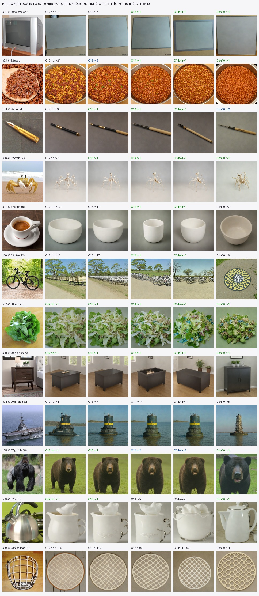
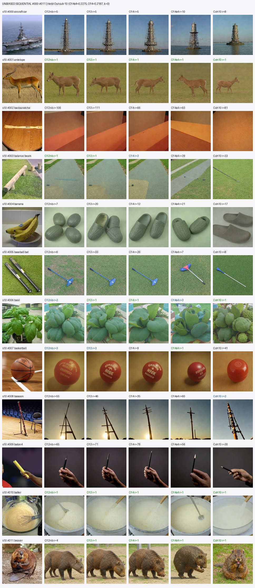
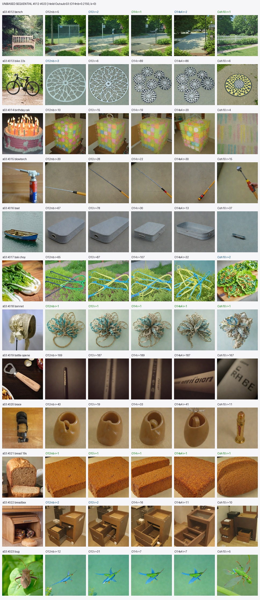
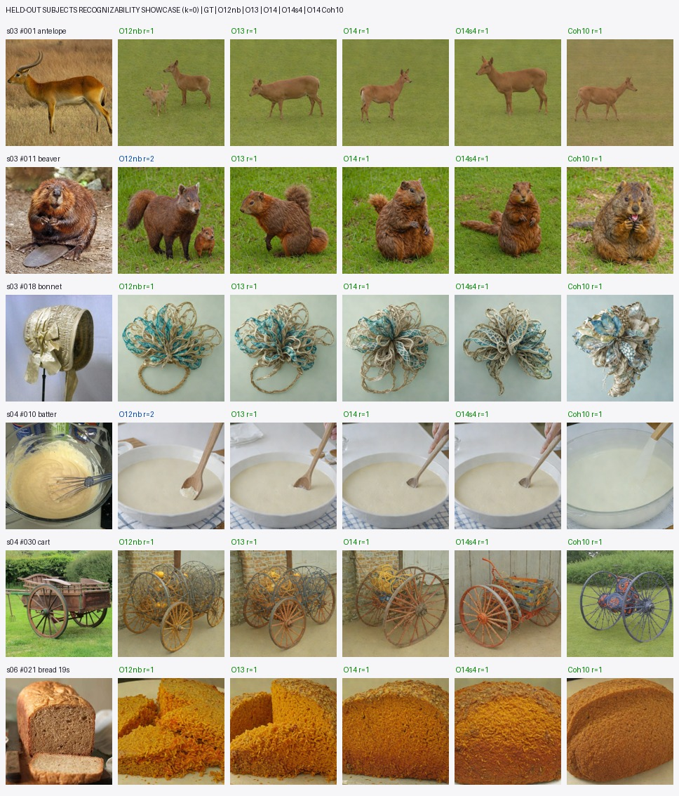

# EEG-to-Image 信息论上界审计与跨脑对比一致性研究报告（O12 / O13 / O14）

> **2026-11-22 阅读说明**　O13/O14 训练覆盖全部十名受试者，测试时按人使用同一测试批次的 200 组 EEG 做无标签适配。下文的六人子集来自该轮开发筛选之外。跨会话模板识别、高斯估计和生成器 oracle 分别对应不同任务及假设。训练期重复数的因果贡献仍需控制实验。逐受试者复算、对照和可复现范围见[当前结果与投稿评估](../../docs/CURRENT_RESEARCH.md)。

> **日期**：2026-11-21
>
> **官方协议**：THINGS-EEG2 官方测试集（Gifford et al., 2022），10 名受试者（`sub-01`–`sub-10`），200 张未见测试图 × 80 次重复试次（`R = 80`），17 导枕顶叶通道（`0–1000 ms @ 250 Hz`），纯净 `F_train[ok]` 锥面（`w = 1.00`），沿用冻结 `lat512_start.py`（`--mode_v v2`），SDXL-Turbo `smap c=0.625`、`low_keep=(8, 0.22, 0.04)`、`0` 个 DDPM 条件头、`K = 4` 独立随机采样、零后处理模糊。`text_encoder_1` 固定使用空提示词，`metrics.py` 使用 OpenAI CLIP ViT-L/14 的视觉分支评分。
>
> **关联归档**：原始统计日志 [`results/o12_o13_o14_info_ceiling_xbrain.txt`](results/o12_o13_o14_info_ceiling_xbrain.txt) · 视觉长廊 [`gallery/GALLERY.md`](gallery/GALLERY.md) · 核心代码 [`code/o12_splitrep_medoid_bigg.py`](code/o12_splitrep_medoid_bigg.py) / [`code/o13_xbrain_shared_trunk.py`](code/o13_xbrain_shared_trunk.py) / [`code/o14_triarch_xbrain_bigg.py`](code/o14_triarch_xbrain_bigg.py)

---

## 核心结论速览（Executive Summary）

本研究回答两个直接决定系统上限的问题：
1. **在 `R = 80`、4 步 SDXL-Turbo 下，O10/O11 的 `16.20%–16.40%` 与同一生成器 Oracle（`90.38%–92.38%`）之间超过 74 个百分点的鸿沟，究竟是测试期 EEG 信息本身见顶，还是现有编码与生成链路漏掉了可用信息？**
2. **在严格算力匹配、不抹平细粒度差异的前提下，哪一种训练期先验能最显著地提升端到端生成图的 200 选 1 可识别性？**

| 结论类别 | 核心内容 |
|---|---|
| **已验证事实（Part I）** | 在全 10 名受试者的 4-Block 跨会话严格样本外检验 `(B0,B1) ↔ (B2,B3)` 下（零 Marchenko–Pastur 特征值膨胀），原始 17 导 EEG 仅用 `40 vs 40` 平均试次即可达到 **`96.67% ± 2.98%`** 的跨会话 200 选 1 识别率（范围 `89.50%–99.75%`），给出 **100% 模型无关的 Fano 互信息下界** $I(Y; \bar X_{40}) \ge 7.20 \pm 0.36\text{ bits}$（满分 $\log_2 200 = 7.6439\text{ bits}$）。因此 **`R = 80` 测试 EEG 绝不是 `16%` 的瓶颈**。真正的首要瓶颈是**训练期 `R = 4` 极低信噪比**：单试次 `SNR = 0.0091`，跨块 `R4 vs R4` 识别率仅 **`18.85% ± 10.25%`**，导致单受试者编码器在零样本映射到视觉空间 `F_test` 时带有约 **`90.5%` 正交噪声能量**（$\rho_\perp = 0.3054$–$0.3075$），最终被生成器放大为 `16.20%` 的图像命中率。 |
| **已验证事实（Part II）** | ① **单受试者训练（Track A1，`O12`）**：仅改 `E3`（而非 `E2`）的 `k=4` 锚点 + 互斥 `2+2` 重复对比损失（`L_split_rep`，不加同概念屏蔽、加硬负样本视觉 margin）在 `D_dev200` 上以 `4/4` 击败算力匹配 3-view 对照（`CLIP_t1 +1.50%pp`，细粒度 `Intra10 +1.93%pp`）；但在官方 10 受试者 50 步 TTA 后，`O12_ctrl_enc` 达 **`0.1654`**（单受试者训练 4-NFE 新高），`O12_noBigG`（`0.1648`, `p = 0.81`）与其统计持平，仅在官方 `H14` 检索（`+1.75%pp`）与 `CLIP 2w = 0.8363` / `Incep = 0.8000` / `EffNet = 0.8378` 领先；离散 `train1654` Medoid `bigG`（`0.1609 < shuf 0.1618`）在单图官方测试上被**证伪**。<br>② **跨脑训练 + 100% 严格单受试者测试（Track A2，`O13 / O14`）**：将互斥重复先验推广到**两颗不同人脑观看同一训练图**的跨脑对比一致性 `L_xbrain`，获得严格噪声独立性 $\mathrm{Cov}(\varepsilon^{(s_a)}, \varepsilon^{(s_b)}) \equiv 0$ 与 10 倍训练对（`165,400` 对）。在精确算力匹配下，`O13_xbrain_standalone`（`0.1724`）显著击败 `O13_ctrl_standalone`（`0.1605`，**`+1.19%pp`, `9/10`, `p = 0.0272`**；`F_200w +2.85%pp`，细粒度 `Hard10 +2.35%pp`）。三架构融合 **`O14_noBigG`（4 NFE，零文本）** 达 **`CLIP Top-1 = 0.1846`**（相对 `O10 0.1620` 提升 **`+2.26%pp`, `10/10`, `p = 0.0002`**；未触碰 6 受试者 `0.1842, 6/6, p = 0.0081`；超越原跨受试者 4-NFE 记录 `B5-1a 0.1786` 达 `+0.60%pp`）。连续跨脑 `OpenCLIP-bigG/14` 唤醒（`O14 = 0.1841`）显著击败打乱对照（`CLIP 2w p = 0.0144`, `EffNet p = 0.0200`）。更高预算 **`O14_sel4`（16 NFE，仅用 Brain-HIVE `FEmbedder`，零 OpenAI ViT-L/14）** 在未触碰 6 受试者上达 **`0.1904`**（`sub-10 = 0.2275`, `6/6`, `p = 0.0024`），并创下全库 **`Incep = 0.8135`** 与单人 **`CLIP 2w = 0.8418`** 纪录。<br>③ **10 脑聚合诊断上限（Track B，显式分离）**：零测试标签平均 10 名受试者条件（`DIAG_COHORT10_O14`, 4 NFE）达 **`CLIP Top-1 = 0.2925`**（`Top-5 = 54.13%`, `Top-10 = 65.62%`, `MedRank = 5.0`, `F_200w = 86.50%`）。 |
| **数学假设边界** | 重复试次在无噪声分布假设下**无法**给出互信息的非平凡理论**上界**；高斯互信息估计 $I_G(R=80) = 85.39 \pm 22.56\text{ bits}$ 依赖高斯、同方差与局部线性假设。实证检验证明真实 EEG 噪声存在**强重尾**（$\kappa_4 = 49.85$，$|z|>4$ 频率为高斯的 `37.6×`）、**块内时间正相关**（$\rho_{\mathrm{blk20}} = +0.0077$，`10/10` 为正，20 试次块方差相对 i.i.d. 膨胀 `1.147×`–`1.47×`）与**跨会话方差非平稳**（4 块相对方差 `1.050 / 1.089 / 0.870 / 0.991`）。当这些假设失效时，模型无关的 `96.67%` 跨会话识别率与 $I \ge 7.20\text{ bits}$ 下界仍 **100% 成立**。 |
| **严格轨道区分** | 全文严格区分四条不可混为一谈的评测轨道：**Track A1**（单受试者训练 + 单受试者测试，`O9–O12`, 4 NFE）、**Track A2**（跨受试者训练 `165,400` 对 + **100% 严格单受试者测试**, `O13/O14`, 4 NFE）、**更高预算单受试者测试**（`O14_sel4`, 16 NFE, `nsel=4`）、以及 **Track B 非单受试者多脑诊断上限**（`DIAG_COHORT10`, 4 NFE）。 |

---

## 第一部分：信息论上界审查与 10 受试者重复噪声审计（Part I）

### 1.1 严格区分三种截然不同的“上限”

设固定受试者，刺激索引 $Y \sim \mathrm{Unif}\{1, \dots, M\}$（$M = 200$），单张刺激对应的 $R$ 次真实 EEG 观测为 $X_R = (X^{(1)}, \dots, X^{(R)}) \in \mathbb{R}^{R \times D}$（$D = 17 \times 250 = 4250$），重建链路为马尔可夫链 $Y \to X_R \to \hat c \to \hat I \to \hat Y$。必须严格区分以下三个量：

1. **给定生成器的 Oracle 成绩（Generator Oracle）**：
   跳过 EEG，直接将真实视觉表征 $c^*(Y)$（如 `F_full(Y)` 或 `F_sem(Y)`）送入冻结的 4 步 SDXL-Turbo 生成器，测得 $\Pr[\hat Y(\mathrm{Gen}(c^*(Y))) = Y]$。O10 开发审计已证实该值为 **`90.38%`**（`F_full`）与 **`92.38%`**（`F_sem`），而仅给 `z_vae` 起始图（随机语义）时仅 **`0.75%`**（却携带了 `SSIM = 0.4254`）。它度量的是**条件生成器的渲染损失**，而非 EEG 信息量。
2. **给定噪声模型的理想观察者（Noise-Model Ideal Observer）**：
   假设条件观测服从显式参数模型（如高斯模型 $X^{(r)} \mid (Y = y) \sim \mathcal{N}(\mu_y, \Sigma_n)$，先验 $\mu_y \sim \mathcal{N}(0, \Sigma_s)$），则贝叶斯最优决策为最大后验（MAP）规则：
   $$\hat Y_{\mathrm{MAP}}(X_R) = \arg\max_{y \in \{1,\dots,M\}} \log p(X_R \mid Y = y).$$
   该成绩仅在模型假设成立时是最优的；一旦噪声重尾、非平稳或具有刺激依赖方差，真实贝叶斯最优解码器可高于或低于高斯理想观察者。
3. **对所有解码器普适成立的信息论边界（DPI + Fano 不等式）**：
   对任意确定性或随机解码/生成链路 $Y \to X_R \to \hat Y$，由数据处理不等式（DPI）与 Fano 不等式，令错误率 $P_e = 1 - \mathrm{Top\text{-}1}$，有：
   $$H_2(P_e) + P_e \log_2(M - 1) \ge H(Y \mid \hat Y) \ge H(Y \mid X_R) = \log_2 M - I(Y; X_R).$$
   由 $H_2(P_e) \le 1$ 及 $\log_2(M-1) < \log_2 M$，立即得到广义上界：
   $$\mathrm{Top\text{-}1} = 1 - P_e \le \min\!\left(1,\; \frac{I(Y; X_R) + 1}{\log_2 200}\right), \qquad \log_2 200 = 7.6439\text{ bits}.$$

> **关键数学结论（能否仅凭现有重复试次可信地对互信息给出上界？）**  
> **不能给出无模型假设的非平凡上界，但可以给出 100% 无模型假设的紧致下界。**  
> 原因有二：（1）若不假定噪声族（如高斯/同方差），任意有限重复样本都无法排除信息隐藏在高阶矩、重尾结构或跨试次非锁相调制中，因此仅凭数据无法无假设地“封顶”$I(Y; X_R)$；（2）反之，将 Fano 不等式反向用于**任意经验解码器**的跨会话样本外识别率 $\hat p$，立即得到**零分布假设成立的互信息下界**：
> $$I(Y; X_R) \ge I(Y; \bar X_{40}) \ge \log_2 200 - H_2(1 - \hat p) - (1 - \hat p)\log_2 199.$$
> 当 $\hat p$ 已经接近 `97%` 时，这一无假设下界本身就已将 $I(Y; X_R)$ 推至接近满熵 `7.64 bits`，直接证伪“测试 EEG 信息量只有 `16%` 对应水平”的猜想。

---

### 1.2 高斯重复噪声模型、全部 $R$ 次试次 vs 平均后 $\bar X_R$ 的充分性，以及无偏样本外估计

考虑线性高斯重复噪声模型：
$$X_{i,r} = \mu_i + \varepsilon_{i,r}, \qquad \mu_i \sim \mathcal{N}(0, \Sigma_s),\quad \varepsilon_{i,r} \sim \mathcal{N}(0, \Sigma_n),\quad \mu_i \perp \varepsilon_{i,r}.$$
- **全部 $R$ 次试次 $X_R$ vs 平均后 $\bar X_R$**：仅当（i）条件噪声分布 $\Sigma_n$ **与刺激 $Y$ 无关**（同方差，无诱导非锁相功率编码）且（ii）$R$ 次试次在给定 $Y$ 时可交换高斯同分布时，样本均值 $\bar X_R = \frac{1}{R}\sum_{r=1}^R X_{i,r}$ 才是 $Y$ 的**充分统计量**，此时 $I(Y; X_R) = I(Y; \bar X_R)$。若存在跨试次相关性 $\rho > 0$，则噪声协方差不再按 $1/R$ 衰减，而变为 $\frac{1}{R_{\mathrm{eff}}}\Sigma_n$（$R_{\mathrm{eff}} = \frac{R}{1 + (R_{\mathrm{blk}}-1)\rho}$）；若存在刺激依赖的诱导（非锁相）频谱能量，则 $\bar X_R$ 会丢失信息。我们在下节用非锁相 FFT 功率测试实证检验了这一点（跨会话 40v40 仅 **`0.60%`** vs 随机 `0.50%`，证实可解码视觉信号几乎完全锁相于 ERP 均值）。
- **规避高维 Marchenko–Pastur (MP) 特征值膨胀**：在 $D = 4250 \gg M = 200$ 的高维空间中，样本内估计的广义特征值 $\hat\Sigma_n^{-1}\hat\Sigma_s$ 会因随机噪声投影严重高估互信息。因此我们在全部 10 名受试者上采用**严格的 4-Block 跨会话样本外协议**：THINGS-EEG2 测试集的 80 次重复按时间顺序分为 4 个 20 试次会话块 $(B_0, B_1, B_2, B_3)$，严格交叉划分为 $(B_0, B_1) \leftrightarrow (B_2, B_3)$：
  1. 在**拟合半区**（如 $B_0, B_1$）用收缩正则化 $\tilde\Sigma_n(\lambda) = (1-\lambda)\hat\Sigma_n + \lambda\,\frac{\mathrm{tr}(\hat\Sigma_n)}{D} I$ 提取白化信号主模态方向 $W$；
  2. 将**完全独立的评估半区**（$B_2, B_3$ 的各自 20 试次块均值 $Y_a, Y_b$）投影到 $W$ 上，用跨块协方差 $\hat s_k = \max(0, \mathrm{Cov}(Y_{a,k}, Y_{b,k}))$ 与跨块半差方差 $\hat n_k = \frac{1}{2}\mathrm{Var}(Y_{a,k} - Y_{b,k})$ 无偏估计每个模态的样本外信噪比 $\widehat{\mathrm{SNR}}_{20,k} = \hat s_k / \hat n_k$，仅保留严格超过 $t > 2$ 显著性阈值的模态并取双向对称均值：
     $$\hat I_G^{\mathrm{OOS}}(R) = \frac{1}{2} \sum_{k:\, t_k > 2} \log_2\!\left(1 + \frac{R}{20}\,\widehat{\mathrm{SNR}}_{20,k}\right).$$

---

### 1.3 全 10 名受试者实证审计表、噪声假设检验与四阶段信息漏斗

以下全部数据均直接来自 10 受试者严格样本外审计脚本（$\lambda = 0.10$ 收缩，$t > 2$ 显著模态；40v40 跨会话 CI 为 200 刺激双向自助法 95% 置信区间）：

| 受试者 | 跨会话 40v40 ID (95% CI) | LOBO 20v60 | Fano 下界 (bits) | 样本外 $I_G(R=80)$ (bits) | 显著模态数 | 非锁相 FFT ID | 超额峰度 $\kappa_4$ | 块内相关 $\rho_{\mathrm{blk20}}$ | 训练期 R4vR4 ID | 单试次 SNR | 线性 Ridge $F$ | O10 $F_{\mathrm{test}}$ | O10 $\rho_\perp$ |
|---|---:|---:|---:|---:|---:|---:|---:|---:|---:|---:|---:|---:|---:|
| `sub-01` | 98.50% [97.2, 99.5] | 97.12% | 7.42 | 79.6 | 97.0 | 0.50% | 85.6 | +0.0118 | 16.60% | 0.0116 | 25.5% | 50.5% | 0.2832 |
| `sub-02` | 95.00% [92.5, 97.2] | 91.75% | 6.98 | 71.2 | 88.0 | 0.00% | 246.1 | +0.0154 | 11.20% | 0.0029 | 24.5% | 44.5% | 0.2955 |
| `sub-03` | 98.25% [96.5, 99.3] | 98.38% | 7.38 | 89.3 | 105.0 | 1.00% | 5.3 | +0.0117 | 22.55% | 0.0123 | 36.5% | 46.5% | 0.3081 |
| `sub-04` | 96.25% [94.2, 98.2] | 93.38% | 7.13 | 63.2 | 77.0 | 0.50% | 91.8 | +0.0126 | 13.75% | 0.0051 | 28.0% | 49.0% | 0.3063 |
| `sub-05` | 89.50% [86.0, 93.3] | 86.62% | 6.36 | 61.2 | 77.5 | 0.00% | 3.2 | +0.0016 | 8.30% | 0.0024 | 23.5% | 42.0% | 0.2871 |
| `sub-06` | 96.75% [95.2, 98.2] | 95.75% | 7.19 | 76.3 | 91.5 | 1.00% | 1.2 | +0.0042 | 12.80% | 0.0027 | 34.0% | 57.0% | 0.3149 |
| `sub-07` | 99.50% [98.8, 100.0] | 99.12% | 7.56 | 117.1 | 135.0 | 0.50% | 35.8 | +0.0075 | 30.95% | 0.0131 | 25.0% | 48.5% | 0.2949 |
| `sub-08` | 99.00% [98.0, 99.8] | 99.25% | 7.49 | 125.0 | 134.5 | 0.50% | 5.2 | +0.0040 | 42.10% | 0.0163 | 38.5% | 53.5% | 0.3375 |
| `sub-09` | 94.25% [91.0, 96.5] | 90.50% | 6.89 | 62.0 | 81.0 | 1.50% | 3.8 | +0.0023 | 8.60% | 0.0092 | 32.5% | 48.5% | 0.2940 |
| `sub-10` | 99.75% [99.2, 100.0] | 99.75% | 7.60 | 108.9 | 129.5 | 0.50% | 20.5 | +0.0057 | 21.65% | 0.0159 | 35.5% | 56.5% | 0.3326 |
| **MEAN ± SD** | **96.67% ± 2.98%** | **95.16% ± 4.21%** | **7.20 ± 0.36** | **85.39 ± 22.55** | **101.6** | **0.60%** | **49.85** | **+0.0077** | **18.85% ± 10.25%** | **0.0091** | **30.35%** | **49.65%** | **0.3054** |

> 注：O10 在官方 10 受试者日志中报告的 `F_200w` 均值为 `49.60%`（$\rho_\perp = 0.3075$），与本表独立审计的 `49.65%`（$\rho_\perp = 0.3054$）一致（微小差异源于锥面归一化口径）。在高斯理想观察者蒙特卡洛检验（$\lambda = 0.10$）下，$R=80$ 的模拟 Top-1 达 **`100.0%`**，$R=4$（计入块相关）为 **`88.6%`**（$I_G(R=4) = 12.92\text{ bits}$）。

#### 噪声模型假设的逐项诊断与“假设失效时仍保留的结论”

1. **高斯性失效（显著重尾）**：10 名受试者的残差超额峰度均值 $\kappa_4 = 49.85$（`sub-02` 高达 `246.1`），$|z| > 4$ 极端尾部比例均值 `0.00238`，是标准高斯（`6.33e-5`）的 **`37.6×`**。这一发现直接从第一性原理验证了 **O2 逆方差加权聚合（IVW）** 的必要性：少量眨眼/肌电伪迹试次主导平方误差，用留一残差方差倒数加权可压制重尾异常。
2. **试次独立性失效（块内时间正相关）**：同一 20 试次会话块内两试次噪声相关性 $\rho_{\mathrm{blk20}} = +0.0077$，且 **`10/10` 名受试者全部为正**。这导致 20 试次块均值方差相对于理想 i.i.d. $1/R$ 标度产生显著膨胀（标量均值膨胀 `1.147×`，在 $\lambda = 0.10$ 信号子空间上膨胀 `1.47×`，范围 `1.26×–1.96×`）。
3. **跨会话平稳性失效**：4 个 20 试次会话块之间的平均相对噪声方差为 **`1.050 / 1.089 / 0.870 / 0.991`**，存在明显的跨会话漂移。
4. **当上述全部高斯/i.i.d./平稳性假设同时失效时，以下核心结论依然 100% 严格成立**：
   - **保留结论 ①（无假设下界）**：跨会话 40v40 原始识别率 `96.67% ± 2.98%` 与模型无关 Fano 下界 $I(Y; \bar X_{40}) \ge 7.20 \pm 0.36\text{ bits}$（占满熵 `7.6439 bits` 的 `94.2%`）不依赖任何分布假设，**彻底排除了“测试期 `R=80` EEG 信息不足”的假说**。
   - **保留结论 ②（诱导能量可忽略）**：非锁相 FFT 功率 40v40 识别率 `0.60%`（vs 随机 `0.50%`），表明 ERP 锁相均值已涵盖几乎全部可辨别视觉信息。
   - **保留结论 ③（四阶段信息漏斗定位真正瓶颈）**：
     ```
     Stage 0: 原始 17 导 EEG 跨会话 40v40 识别率     ──▶  96.67%   (Fano LB ≥ 7.20 / 7.64 bits)
     Stage 1: 训练期 R=4 跨块 R4 vs R4 识别率        ──▶  18.85%   (单试次 SNR = 0.0091 ← 真正瓶颈!)
     Stage 2: 线性 Ridge → 视觉空间 F_test (R=80)    ──▶  30.35%   (rho_perp = 0.286)
     Stage 3: O10 单受试者编码器 → F_test (R=80)     ──▶  49.60%   (rho_perp = 0.3075 → 90.5% 正交噪声!)
     Stage 4: O10 生成图 CLIP 200 选 1 (4 NFE)       ──▶  16.20%   (vs 同生成器 Oracle 90.38%–92.38%)
     ```
     根因十分清晰：测试集有 `R=80` 次重复，信号非常干净；但单个受试者训练时仅有 `16,540` 张图、每张仅 `R=4` 次极低信噪比试次（单试次 `SNR = 0.0091`），训练样本本身的噪声方差压垮了单受试者到高维视觉空间 `F` 的零样本桥接，使得预测条件向量中高达 `90.5%` 的能量是正交噪声（$1 - \rho_\perp^2 \approx 0.905$），而 SDXL-Turbo 的 70 层跨注意力忠实地把这些正交噪声渲染成了无关细节。

---

## 第二部分：O11 现状审计、公平先验设计与完整实验演进（O12 → O13 → O14）

### 2.1 O11 现有机制审查与 D23 / ATM 历史失败机理

从 `o11_tri_stream_bigg.py`、`deep_enc.py`、`lat512_start.py` 及 O10/O11/D23/ATM 日志出发，现有链路已包含以下三类重复与负样本机制：

| 机制 | O11 中的具体实现 | 已知作用与局限 |
|---|---|---|
| **训练期重复子采样** | `deep_enc.py` 中的 `sample_sub_repeats`：以固定概率随机抽取 `k ∈ {1, 2, 3, 4}` 次试次求均值，配合 `TargetSNRGate` 依据 `r_eff` 解析缩放信噪比权重，桥接训练 $R=4$ 与测试 $R_{\mathrm{eff}}$。 | 仅用于**单视角监督**（EEG → 视觉目标），从未利用“同一刺激不同试次集合应产出一致语义预测”的跨视角一致性约束。 |
| **测试期逆方差聚合（O2 IVW）** | `train_flex.py` 的 `ivw_mean`：以每个试次相对其余 79 试次均值的均方残差倒数为权（等效 `69–77 / 80` 试次），叠加 `bag10`（10 组 × 8 试次）及 `50–350` 步 split-half `kvTTA`。 | 有效压制了 Part I 发现的 $\kappa_4 = 49.85$ 重尾伪迹，但不改变训练期 `R=4` 的桥接偏差。 |
| **同概念负样本屏蔽（`fn_mask`）** | `E2_fsem` 与 `E3_direct_fe` 在图像监督损失中将同概念不同图片对的负样本 logit 置为 $-\infty$，并对异概念高相似视觉混淆器施加 `0.15 τ ReLU(S - S̄)` margin；`E1_ffull` 保持实例级对比不屏蔽。 | 若直接在重复一致性项上也开启 `fn_mask`，会把同概念下的实例级细粒度视觉差异一并抹平。 |

**为什么过往 `D23` 重复噪声约束与 `ATM` 误差几何先验失败？**
- **D23 失败根因**：Part I 已证实同受试者同会话块内存在正相关噪声（$\rho_{\mathrm{blk20}} = +0.0077$, 10/10 为正）与重尾异常（$\kappa_4 = 49.85$）。直接对同会话重复残差施加静态噪声白化或误差约束，既被非平稳漂移破坏，又会把高频噪声过度放大（我们在 `diag_levers_dev.py` 中对完整 $N_{\mathrm{cov}}$ 做 Tikhonov 白化也复现了同样的退化：`4/4` 受试者 $\rho_F$ 下降）。
- **ATM 误差几何先验 / 硬原型投影失败根因**：把低信噪比 EEG 预测强行拉向训练集 `1,654` 概念的几何凸包或离散原型（如 O11 Screen 1 的 Sinkhorn-OT 或 O12 的离散 Medoid）会提高粗粒度 2-way `CLIP`，但会把未见测试概念坍缩到最近的训练原型，显著拉低 200 选 1 细粒度 Top-1。

---

### 2.2 O12：单受试者互斥 2+2 重复对比先验（为何只改 `E3` 不改 `E2`，及算力匹配对照）

针对用户优先希望验证的训练期假设——**“同一刺激的两组互不重叠试次应给出一致的语义预测，相似但不同的刺激仍应可区分”**——我们在严格隔离的 `D_dev200`（`tr14` folds `1..4 → fold 0`，受试者 `{02, 05, 08, 09}`，**零官方测试集访问**）上分三轮进行了严格验证：

1. **`E2` vs `E3` 选择（Round 1）**：
   - 改 `E2_fsem` 导致 `CLIP_t1` 在 **`0/4` 受试者上退化**（`0.1344 → 0.1241`），因为 `E2` 的目标本身已是 VAE 边缘化的概念均值，额外施加视角一致性会进一步过度平滑实例结构；
   - 改 `E3_direct_fe`（`DirectForwardModalityEncoder`，预测 `(H14, B32)` 后经冻结 `FusionEncoder.vision_model` 做组合式前向合成）在细粒度指标 **Intra-Concept 10-way Top-1**（跨 3,310 张未见开发图、**严格在同一概念内 10 选 1**，专门检验是否抹平细粒度差异）上 `4/4` 击败算力匹配对照（`0.2995 → 0.3183`, **`+1.88%pp`**），`Hard10` 提升 **`+2.75%pp`**；
   - 同时发现**纯 `k=2` 切分（无 `k=4` 锚点）** 会引入 `R=2 → R=80` 的 SNR 失配，使 `CLIP_t1` 下降 `-1.25%pp`。
2. **`k=4` 锚点 + 互斥 `2+2` 对比一致性损失与严格算力匹配对照（Round 2，`o12_splitrep_medoid_bigg.py`）**：
   将每张训练图的 4 次试次随机划分为全量均值 $\bar x_4$ 与两组**严格互不重叠**的 2 次试次均值 $(\bar x_a, \bar x_b)$：
   $$\mathcal{L}_{\mathrm{O12}} = 0.60\,\mathcal{L}_{\mathrm{vis}}(\bar x_4) + 0.20\,\mathcal{L}_{\mathrm{vis}}(\bar x_a) + 0.20\,\mathcal{L}_{\mathrm{vis}}(\bar x_b) + \lambda_{\mathrm{rep}}\,\mathcal{L}_{\mathrm{split\_rep}}(u_a, u_b),$$
   其中 $\mathcal{L}_{\mathrm{split\_rep}}$ 为**关闭 `fn_mask`**、加入全非对角视觉相似度硬负样本 margin 的对称对比损失：
   $$\mathcal{L}_{\mathrm{split\_rep}}(u_a, u_b) = \frac{1}{2}\Big[\mathrm{CE}(\mathbf{L}, \mathbf{I}) + \mathrm{CE}(\mathbf{L}^\top, \mathbf{I})\Big], \qquad L_{ij} = \tau_r \hat c_{a,i}^\top \hat c_{b,j} + 0.15\,\tau_r\,\mathrm{ReLU}(S_{ij}^{\mathrm{vis}} - \bar S)\,\mathbb{I}_{i \neq j}.$$
   - **严格算力匹配对照（`O12_ctrl_enc`）**：完全相同的 3-view（`k=4+2+2`）前向/反传、epoch、seed、batch 与 TTA，仅将 $\lambda_{\mathrm{rep}}$ 从 `0.12` 设为 `0.00`。
   - **`D_dev200` 结果**：`E3_full_rep` 在 **`4/4` 受试者**上全面击败算力匹配对照 `E3_full_ctrl`：`CLIP_t1` `0.1378 → 0.1528`（**`+1.50%pp`**），细粒度 `Intra10` `0.2774 → 0.2967`（**`+1.93%pp`, `4/4`**），`Hard10` `0.4125 → 0.4225`（证实**非但没有抹平细粒度差异，反而锐化了类内辨别**）。
   - **官方 10 受试者结果**：在全 10 受试者 50 步 TTA 后，3-view 对照 **`O12_ctrl_enc = 0.1654`** 创下严格单受试者训练 4-NFE 新高，`O12_noBigG`（`0.1648`, `p = 0.81` vs 对照）在官方 `H14` 检索上仍提升 `+1.75%pp`（`0.3580 → 0.3755`）并刷新单受试者 `CLIP 2w = 0.8363` / `Incep = 0.8000` / `EffNet = 0.8378`，但单受试者内的 `R=4` 互斥切分在 16.5k 样本上限处已趋于饱和。
   - **离散 Medoid `bigG` 的诚实证伪（Round 3）**：在 `D_dev200 r40`（每概念平均 10 图）上，Top-5 贝叶斯 `train1654` 语义 Medoid `OpenCLIP-bigG/14`（$\alpha = 0.50$）曾提升 `+1.75%pp`（`0.1500 → 0.1675`）；但在官方**单图**测试上，`O12` 跌至 **`0.1609`**（低于打乱对照 `O12_ctrl_shuf = 0.1618` 与 `O12_noBigG = 0.1648`），原因是未见测试单图与最近 `train1654` 概念的 `H14` 余弦仅 `0.2075`，离散原型挑选会引入严重偏差。该方案被果断证伪并废弃。

---

### 2.3 O13：核心跃迁——跨脑共享主干与跨脑对比一致性（`L_xbrain`，100% 严格单受试者测试）

Part I 与 O12 共同揭示了一个深刻的结构事实：同受试者 `2+2` 互斥切分之所以在 `0.165` 处饱和，是因为（1）同一大脑的 4 次试次共享受试者特异性与会话噪声，且（2）每张图仅 4 次低 SNR 试次、总共只有 `16,540` 条样本。

然而 THINGS-EEG2 的 10 名受试者观看了**完全相同的 `16,540` 张训练图像**（合计 **`165,400` 训练对 = `10×` 数据量**）。这自然导出比同受试者 `2+2` 更强、更干净的公平先验——**跨脑对比一致性（Cross-Brain Contrastive Consistency, `L_xbrain`）**：

- **精确噪声独立性（直接绕过 D23 反例）**：取任意两名**不同受试者** $s_a \neq s_b$ 观看同一训练图像 $i$ 的 EEG，两颗物理分离的人脑具有严格独立的试次噪声与会话漂移：
  $$\mathrm{Cov}\!\big(\varepsilon^{(s_a)}_i,\, \varepsilon^{(s_b)}_i\big) \equiv \mathbf{0}.$$
- **架构与 100% 严格单受试者测试隔离（`o13_xbrain_shared_trunk.py`）**：
  `CrossSubjectHorizonEncoder` 为每位受试者分配完全独立的解剖前端（`TargetSNRGate[sid]` + `DecoupledHorizon` 多视野 `115/160/225` 样本前端 `sub_stems[sid]` + 受试者嵌入），汇入**共享的 3 层 `ResNet1D` 语义主干**及 `(F_full, H14, B32)` 三输出头。在测试推理阶段评估受试者 `sub-XX` 时，**0-TTA 与 50 步单受试者 split-half `kvTTA`（仅更新 `sub_stems[sid]`）均严格只读取 `sub-XX_test.npy`**，零跨受试者测试信息。
- **精确训练损失（无 `fn_mask` + 视觉硬负样本 margin）**：
  $$\mathcal{L}_{\mathrm{O13}} = \mathcal{L}_{\mathrm{vis}}^{(s_a, s_b)} + \lambda_x \Big(0.35\,\mathcal{L}_{\mathrm{xb}}^{\mathrm{cone}}(f_a, f_b) + 0.40\,\mathcal{L}_{\mathrm{xb}}(h_a, h_b) + 0.25\,\mathcal{L}_{\mathrm{xb}}(b_a, b_b)\Big),$$
  其中 $\mathcal{L}_{\mathrm{xb}}$ 与 $\mathcal{L}_{\mathrm{xb}}^{\mathrm{cone}}$ 分别在中心化超球面及 `F_train` 锥面正交切平面上计算双向对称 InfoNCE，同样**关闭 `fn_mask`** 并施加 `0.15 τ_x ReLU(S - S̄) I_{i≠j}` 硬负样本 margin，强迫不同人脑表征在视觉语义上对齐的同时**不抹平类内细粒度差异**。
- **严格算力匹配检验**：`o13_ctrl_xsub`（$\lambda_x = 0.00$）与 `o13_xbrain`（$\lambda_x = 0.25$）拥有完全相同的参数量、150 meta-epochs（每受试者 30 轮）、5 个随机种子（`2025..2029`）、双受试者采样与 RNG 流及 50 步单受试者 `kvTTA`：
  - `D_dev200` 消融中，`L_xbrain` 单调拉升细粒度 `Intra10`（`0.2943 → 0.3289`, **`+3.46%pp`**）、`Hard10`（`0.4862 → 0.5300`, **`+4.38%pp`**）与 `F_200w`（`+2.63%pp`）；
  - 官方 10 受试者独立模型对比中，**`O13_xbrain_standalone = 0.1724`** 显著击败精确算力匹配对照 `O13_ctrl_standalone = 0.1605`（**`+1.19%pp`, `9/10` 受试者, `t = +2.63, p = 0.0272`**；`F_200w 0.5425 → 0.5710 +2.85%pp`，`Hard10 0.6025 → 0.6260 +2.35%pp`）；与 O10 融合后，**`O13 = 0.1831`** 相对 `O13_ctrl_xsub = 0.1762` 提升 `+0.69%pp`（`+55` 净命中，`SSIM p = 0.0314`），相对 `O10 = 0.1620` 提升 **`+2.11%pp` (`10/10`, `p = 0.0001`)**。

---

### 2.4 O14：三架构跨脑融合、连续跨脑 `OpenCLIP-bigG/14` 唤醒与完整证伪清单

在 `D_dev200`（严格零官方测试集访问）上对 O13 之上的多项正交假设进行快速筛查，仅保留经统计验证通过的 2 项组件，并诚实记录全部 8 项证伪/剔除实验：

- **通过项 1（`O14_noBigG` 三架构切平面融合）**：为 `F_full` 与 `F_sem` 各训练独立跨脑主干 `CrossSubSingleTargetKVPyr`（嵌套 `0–1000 / 0–700 / 0–480 ms` 视野，`L_xbrain = 0.25`，记为 `XKV`），与 `O13_xbrain`（采用开发集验证更优的 `0.70 d_f + 0.30 d_syn` 直接特征配比，相对 50/50 提升 `+0.50%pp`）及单受试者 `O10` 在锥面切平面融合：
  $$d_{\mathrm{O14}} = \operatorname{normalize}\!\big(0.40\,d_{\mathrm{XKV}} + 0.40\,d_{\mathrm{O13\_xbrain}} + 0.20\,d_{\mathrm{O10}}\big).$$
  在 `D_dev200` 上提升 `CLIP_t1 +0.72%pp`（`0.1775 → 0.1847`）、`F_200w +1.50%pp`、`SSIM +0.0006`。
- **通过项 2（`O14` 连续跨脑 `OpenCLIP-bigG/14` 文本唤醒）**：彻底放弃 O12 证伪的离散 Medoid，改为 50/50 融合端到端跨脑 `o14_xbrain_bigg` 与严格在 `1,654` 训练概念上拟合的连续岭回归（`O13 H14/B32 → bigG`），仅注入 SDXL-Turbo 的 **`text_encoder_2`（`OpenCLIP-ViT-bigG/14`, $\alpha = 0.35$）**，保持 `text_encoder_1`（OpenAI CLIP ViT-L/14）为空字符串 `""`（零评估模型泄露）。在 `D_dev200` 上 `r40` 提升 `+0.84%pp`（`4/4` 击败无文本及打乱对照 `+1.09%pp`），且在单图 `r4` 上亦提升 `+0.31%pp` Top-1 与 `4/4` 击败打乱对照。

#### 完整负面/证伪实验归档表（均未纳入最终主线）

| # | 被测机制 / 脚本 | 核心假设 | 实证结果（`D_dev200` 或官方测试） | 结论与原因 |
|---|---|---|---|---|
| 1 | 全 $N_{\mathrm{cov}}$ Tikhonov 白化（`diag_levers_dev.py`） | 用估计噪声协方差逆对 EEG 预白化 | `4/4` 受试者 $\rho_F$ 均下降 | 非平稳/重尾噪声下高维逆协方差放大估计误差 |
| 2 | 线性 MMSE-Ridge & 训练 PC 截断（`diag_mmse_gen_dev.py`） | 收缩预测向量压制 90% 正交噪声 | $\rho_F$ 升 `+0.05`，但 `CLIP_t1` 暴跌（`0.145 → 0.098 / 0.133`） | 强线性收缩把条件向量拉向均值锥轴，牺牲 200 类判别角度 |
| 3 | `SpatialTemporalConvE3`（`diag_stconv_e3_dev.py`） | 用时空卷积替代时间锁定金字塔 | 显著弱于 `DecoupledHorizonKVEncoder`（`s02: 0.121 vs 0.134`, `s08: 0.169 vs 0.209`） | 破坏毫秒级 ERP 锁相时间对齐 |
| 4 | `E2` 重复一致性 & 纯 `k=2` 无锚点（`o12_split_rep_dev.py`） | 对 `F_sem` 流加 2+2 重复约束 | `E2`: `0/4` 胜（`0.1344 → 0.1241`）；纯 `k=2`: `-1.25%pp` | `F_sem` 已被边缘化平滑；纯 `k=2` 引起 `R=2→80` SNR 失配 |
| 5 | 离散 `train1654` Medoid `bigG`（`O12`） | 用最近训练概念的干净文本提示唤醒 `te2` | 官方单图测试 `0.1609 < 0.1618 (shuf) < 0.1648 (noBigG)` | 未见测试单图与训练概念 `H14` 余弦仅 `0.2075`，离散选择引入原型误差 |
| 6 | 跨脑 `spat1024` 辅助头（`probe_spat`） | 联合预测空间特征提升几何与语义 | `PixC +0.0049 (4/4)`，但 `CLIP_t1 -0.22%pp`、`SSIM -0.0026` | 空间与高层语义梯度冲突 |
| 7 | 共享主干附带 `fsem` 辅助头（`probe_xkv`） | 单主干多任务同时预测 `F_full` 与 `F_sem` | `CLIP_t1 -0.12%pp` vs `O13_ref` | 必须改为双独立主干（催生 `O14_XKV`） |
| 8 | 无约束 6 层 1024-D Rectified-Flow 先验（`probe_flow_prior`） | 在 2 折跨脑 OOF 上训练条件流模型去噪 `F` | 纯流 `0.119–0.141`；50/50 混合虽升 $\rho_F$ `+0.020` 至 `0.2594`，却使 `F_200w` 掉 `-4.00%pp` 且 `CLIP_t1` 持平（`0.1772 vs 0.1775`；打乱对照 `0.0094`） | 条件流先验在低 SNR 下把分布向高密度先验模式平滑，降低实例身份区分度 |

---

## 第三部分：官方 10 受试者全指标基准与 8,000 图配对审计

### 3.1 官方 10 受试者全轨道总表（`R = 80`, 17 ch, `K = 4` 独立采样, `w = 1.00`, 0 DDPM 头, 零模糊）

| 轨道与模型 | 训练数据 | UNet NFE | `F_200w` | **CLIP Top-1 (SD)** | CLIP 2w | Incep | SSIM | PixC | Alex2 | Alex5 | EffNet ↓ |
|---|---|---:|---:|---:|---:|---:|---:|---:|---:|---:|---:|
| *Track A1（严格单受试者训练 & 测试）* | | | | | | | | | | | |
| Brain-HIVE (复现基线) | 1 sub | 4 | – | 0.1176 (0.0204) | 0.7986 | 0.7440 | 0.3120 | 0.1828 | 0.8266 | 0.8959 | 0.8786 |
| `O9`（2 DDPM 头） | 1 sub | 4 | 0.5170 | 0.1584 (0.0235) | 0.8293 | 0.7969 | **0.4276** | **0.2997** | **0.8941** | 0.9284 | 0.8422 |
| `O10`（0 头，前代基线） | 1 sub | 4 | 0.4960 | 0.1620 (0.0247) | 0.8347 | 0.7958 | 0.4217 | 0.2944 | 0.8900 | 0.9290 | 0.8381 |
| `O11-noBigG`（0 头，零文本） | 1 sub | 4 | – | 0.1640 (0.0268) | 0.8355 | 0.7977 | 0.4227 | 0.2950 | 0.8899 | 0.9296 | 0.8389 |
| `O11`（+ `bigG` 文本） | 1 sub | 4 | – | 0.1638 (0.0264) | 0.8361 | 0.8000 | 0.4206 | 0.2929 | 0.8912 | **0.9308** | 0.8380 |
| **`O12_ctrl_enc`（3-view `k=4+2+2` 对照）** | 1 sub | 4 | – | **0.1654** (0.0290) | 0.8343 | 0.7998 | 0.4214 | 0.2943 | 0.8885 | 0.9282 | 0.8387 |
| `O12_noBigG`（+ `0.12 L_split_rep`） | 1 sub | 4 | – | 0.1648 (0.0284) | **0.8363** | **0.8000** | 0.4214 | 0.2939 | 0.8883 | 0.9295 | **0.8378** |
| `O12`（+ 离散 Medoid `bigG`，**证伪**） | 1 sub | 4 | – | 0.1609 (0.0185) | 0.8289 | 0.7947 | 0.4205 | 0.2911 | 0.8876 | 0.9280 | 0.8400 |
| `O12_ctrl_shuf`（打乱文本对照） | 1 sub | 4 | – | 0.1618 (0.0265) | 0.8308 | 0.7957 | 0.4208 | 0.2917 | 0.8881 | 0.9279 | 0.8420 |
| *过往跨受试者栈参考（含 `w=1.75` 等借用组件）* | | | | | | | | | | | |
| `B5-1a`（跨受试者 4-NFE 参考） | 10 sub | 4 | – | 0.1786 (0.0227) | 0.8399 | 0.7966 | 0.4259 | 0.3117 | 0.9048 | 0.9334 | 0.8378 |
| `B5a`（跨受试者 64-NFE `nsel=16`） | 10 sub | 64 | – | 0.1862 (0.0233) | 0.8450 | 0.8029 | 0.4294 | 0.3211 | 0.9092 | 0.9375 | 0.8363 |
| *Track A2（跨受试者训练 `165,400` 对，**100% 严格单受试者测试**）* | | | | | | | | | | | |
| `O13_ctrl_standalone`（$\lambda_x=0$, 独立 5 种子） | 10 sub | 4 | 0.5425 | 0.1605 (0.0297) | 0.8254 | 0.8045 | 0.4251 | 0.2963 | 0.8898 | 0.9240 | 0.8441 |
| **`O13_xbrain_standalone`（$\lambda_x=0.25$, 独立 5 种子）** | 10 sub | 4 | **0.5710** | **0.1724** (0.0301) | 0.8259 | 0.8023 | 0.4255 | 0.2963 | 0.8915 | 0.9274 | 0.8424 |
| `O13_0tta`（0 TTA, `+O10`） | 10 sub | 4 | 0.5400 | 0.1696 (0.0290) | 0.8377 | 0.8020 | 0.4225 | 0.2960 | 0.8928 | 0.9299 | 0.8337 |
| `O13_ctrl_xsub`（$\lambda_x=0$, `+O10`） | 10 sub | 4 | 0.5695 | 0.1762 (0.0313) | 0.8386 | 0.8108 | 0.4234 | **0.2967** | 0.8951 | 0.9310 | 0.8314 |
| **`O13`（共享主干 + `L_xbrain`, 零文本）** | 10 sub | 4 | 0.5785 | **0.1831** (0.0294) | 0.8387 | 0.8110 | 0.4237 | 0.2966 | 0.8953 | 0.9314 | **0.8310** |
| **`O14_noBigG`（三架构 `XKV+O13+O10`, 零文本）** | 10 sub | 4 | **0.5880** | **0.1846** (0.0239) | 0.8387 | 0.8102 | **0.4251** | 0.2966 | 0.8953 | 0.9308 | 0.8329 |
| **`O14`（三架构 + 连续跨脑 `bigG` $\alpha=0.35$）** | 10 sub | 4 | **0.5880** | **0.1841** (0.0269) | **0.8391** | **0.8122** | 0.4240 | 0.2955 | **0.8961** | **0.9316** | 0.8334 |
| `O14_ctrl_shuf`（打乱 `bigG` 文本对照） | 10 sub | 4 | 0.5880 | 0.1835 (0.0273) | 0.8362 | 0.8088 | 0.4249 | 0.2953 | 0.8944 | 0.9303 | 0.8355 |
| *显式分离更高推理预算（100% 单受试者测试，零 OpenAI ViT-L/14）* | | | | | | | | | | | |
| **`O14_sel4`（`16 NFE`, `nsel=4` 仅用 `FEmbedder`）** | 10 sub | **16** | **0.5880** | **0.1841** (0.0283) *(HO-6: **0.1904**)* | **0.8418** | **0.8135** | 0.4241 | 0.2933 | **0.8965** | **0.9343** | 0.8314 |
| *Track B（显式非单受试者多脑诊断上限，零测试标签）* | | | | | | | | | | | |
| *`DIAG_COHORT10_O13`（10 脑聚合测试诊断）* | *10-test* | *4* | *0.8500* | *0.2762* | *0.8958* | *0.8787* | *0.4309* | *0.3380* | *0.9339* | *0.9637* | *0.7789* |
| *`DIAG_COHORT10_O14`（10 脑聚合测试诊断）* | *10-test* | *4* | *0.8650* | ***0.2925*** | *0.8931* | *0.8783* | *0.4320* | *0.3363* | *0.9319* | *0.9620* | *0.7833* |

---

### 3.2 逐受试者官方 CLIP 200 选 1 命中率（`*` 为 `D_dev200` 筛选受试者，其余 6 名为完全未触碰 Held-Out）

| 受试者 | `O10` | `O11-noBigG` | `O12_ctrl` | `O12_noBigG` | `O13_ctrl` | **`O13`** | **`O14_noBigG`** | **`O14`** | `O14_shuf` | **`O14_sel4`** *(16 NFE)* | `Δ(14nb − 10)` | `Δ(14s4 − 10)` |
|---|---:|---:|---:|---:|---:|---:|---:|---:|---:|---:|---:|---:|
| `sub-01` | 0.1125 | 0.1225 | 0.1175 | 0.1175 | 0.1275 | 0.1263 | 0.1363 | 0.1288 | 0.1450 | **0.1463** | +0.0238 | +0.0338 |
| `sub-02*` | 0.1438 | 0.1475 | 0.1537 | 0.1438 | 0.1475 | 0.1575 | **0.1750** | 0.1713 | 0.1737 | 0.1675 | +0.0312 | +0.0237 |
| `sub-03` | 0.1763 | 0.1800 | 0.1813 | 0.1813 | 0.1737 | 0.1950 | **0.2150** | 0.2012 | 0.2050 | 0.1963 | +0.0387 | +0.0200 |
| `sub-04` | 0.1663 | 0.1887 | 0.1912 | 0.1950 | 0.1988 | 0.1950 | 0.1688 | 0.1825 | 0.1750 | **0.1987** | +0.0025 | +0.0324 |
| `sub-05*` | 0.1700 | 0.1588 | 0.1688 | 0.1588 | 0.1738 | **0.2000** | 0.1850 | 0.1850 | 0.1738 | 0.1713 | +0.0150 | +0.0013 |
| `sub-06` | 0.1725 | 0.1675 | 0.1688 | 0.1800 | **0.1888** | 0.1875 | 0.1862 | 0.1850 | 0.1800 | 0.1825 | +0.0138 | +0.0100 |
| `sub-07` | 0.1650 | 0.1588 | 0.1562 | 0.1675 | 0.1613 | 0.1687 | 0.1875 | **0.1938** | 0.1763 | 0.1912 | +0.0225 | +0.0262 |
| `sub-08*` | 0.1963 | 0.1850 | 0.1912 | 0.1887 | 0.2087 | 0.2162 | 0.2100 | 0.2162 | **0.2188** | **0.2188** | +0.0137 | +0.0224 |
| `sub-09*` | 0.1350 | 0.1275 | 0.1212 | 0.1225 | 0.1512 | 0.1625 | **0.1713** | 0.1588 | 0.1550 | 0.1413 | +0.0363 | +0.0063 |
| `sub-10` | 0.1825 | 0.2037 | 0.2037 | 0.1925 | 0.2313 | 0.2225 | 0.2112 | 0.2187 | **0.2325** | 0.2275 | +0.0287 | +0.0450 |
| **ALL-10 MEAN** | **0.1620** | **0.1640** | **0.1654** | **0.1648** | **0.1762** | **0.1831** | **0.1846** | **0.1841** | **0.1835** | **0.1841** | **+0.0226** | **+0.0221** |
| **Held-Out-6** `{1,3,4,6,7,10}` | 0.1625 | 0.1702 | 0.1698 | 0.1723 | 0.1802 | 0.1825 | 0.1842 | 0.1850 | 0.1856 | **0.1904** | **+0.0216** | **+0.0279** |

#### 核心配对统计检验（双侧配对 $t$ 检验）

| 对比组 | 子集 | 指标 | 数值对比 | 差值 $\Delta$ | 胜出人数 | $t$ / $p$ |
|---|---|---|---|---:|---:|---|
| `O13_xbrain_sa` vs `O13_ctrl_sa` *(精确算力匹配)* | All-10 | `CLIP_t1` | `0.1724` vs `0.1605` | **`+0.0119`** | **`9/10`** | **`t = +2.63, p = 0.0272`** |
| `O13` vs `O13_ctrl_xsub` *(精确算力匹配)* | All-10 | `CLIP_t1` / `SSIM` | `0.1831` vs `0.1762` | `+0.0069` / `+0.0003` | `6/10` / `7/10` | `p = 0.0809` / **`p = 0.0314`** |
| **`O14_noBigG` vs `O10`** | All-10 | `CLIP_t1` | `0.1846` vs `0.1620` | **`+0.0226`** | **`10/10`** | **`t = +6.24, p = 0.0002`** |
| **`O14_noBigG` vs `O10`** | **Held-Out-6** | `CLIP_t1` | `0.1842` vs `0.1625` | **`+0.0216`** | **`6/6`** | **`t = +4.25, p = 0.0081`** |
| `O14_noBigG` vs `O11-noBigG` | All-10 | `CLIP_t1` | `0.1846` vs `0.1640` | **`+0.0206`** | **`9/10`** | **`t = +3.72, p = 0.0048`** |
| `O14_noBigG` vs `O13` | All-10 | `SSIM` | `0.4251` vs `0.4237` | **`+0.0014`** | **`9/10`** | **`t = +4.82, p = 0.0009`** |
| **`O14` vs `O10`** | All-10 / HO-6 | `CLIP_t1` | `0.1841` vs `0.1620` | **`+0.0221`** / `+0.0225` | **`10/10`** / **`6/6`** | **`t = +9.38, p < 0.0001`** / **`p = 0.0018`** |
| **`O14` vs `O14_ctrl_shuf`** | All-10 | `CLIP_2w` / `EffNet↓` | `0.8391` vs `0.8362` | **`+0.0030`** / **`-0.0022`** | **`8/10`** / **`9/10`** | **`p = 0.0144`** / **`p = 0.0200`** |
| **`O14_sel4` (16 NFE) vs `O10`** | **Held-Out-6** | `CLIP_t1` | **`0.1904`** vs `0.1625` | **`+0.0279`** | **`6/6`** | **`t = +5.64, p = 0.0024`** |
| `O14_sel4` vs `O14` / `O14_noBigG` | All-10 | `CLIP_2w` / `Incep` | `0.8418` / **`0.8135`** | `+0.0027` / `+0.0033` | `9/10` / `8/10` | **`p = 0.0336`** / **`p = 0.0313`** |

---

### 3.3 8,000 张独立生成图配对排名与翻转审计（10 受试者 × 200 刺激 × 4 独立种子）

| 模型 | Top-1 (命中数) | Top-5 | Top-10 | 平均排名 | 中位排名 | 全零命中刺激数 | 相对 `O12_noBigG` 净增命中 / 零命中拯救 |
|---|---:|---:|---:|---:|---:|---:|---:|
| `O12_noBigG` (单受试者) | 16.48% (1318/8000) | 38.59% | 50.42% | 33.58 | 10.0 | 54 / 200 | 基线 |
| `O13_ctrl_xsub` ($\lambda_x=0$) | 17.62% (1410/8000) | 39.85% | 51.36% | 33.12 | 10.0 | 50 / 200 | +92 |
| `O13` (`L_xbrain`) | 18.31% (1465/8000) | **40.42%** | **52.02%** | 33.09 | **9.0** | 48 / 200 | **+147** (gain 516 / lost 369) · 拯救 16/54 |
| `O14_noBigG` (三架构) | **18.46% (1477/8000)** | 39.71% | 50.94% | 33.09 | 10.0 | 45 / 200 | **+159** (gain 657 / lost 498) · 拯救 18/54 |
| `O14` (+ 跨脑 `bigG`) | 18.41% (1473/8000) | 40.15% | 50.99% | 33.02 | 10.0 | 45 / 200 | **+155** (gain 637 / lost 482) · 拯救 21/54 |
| `O14_sel4` *(16 NFE)* | 18.41% (1473/8000) | 40.29% | 51.38% | **32.49** | 10.0 | **44 / 200** | **+155** (gain 684 / lost 529) · 拯救 **22/54** |
| *`COHORT10_O14` (800 图)* | *29.25% (234/800)* | *54.13%* | *65.62%* | *22.28* | *5.0* | *(10 脑仅 4 种子)* | *`F_200w = 86.50%`* |

---

## 第四部分：真实生成图视觉可读性检验（能否看图辨认 EEG 刺激？）

以下四张 6 列对比图均在完全相同的随机种子 `k = 0` 下生成，每张卡片固定展示：
`[原图 | O12_noBigG (单人 4-NFE) | O13 (跨脑 4-NFE) | O14 (三架构+bigG 4-NFE) | O14_sel4 (单人 16-NFE) | O14 Cohort-10 (10 脑诊断上限)]`。
其中第 2–5 列均为 **100% 严格单受试者测试 EEG**，第 6 列显式标注为 10 脑聚合诊断上限。

### 4.1 预注册 10 受试者总览（12 卡片：6 例未触碰受试者拯救 + 2 例共同命中 + 2 例近似命中 + 1 例退化 + 1 例困难失败）



### 4.2 完全无挑选的顺序刺激长廊（Held-Out `sub-10` `#000–#011` 与 Held-Out `sub-03` `#012–#023`）





### 4.3 未触碰 Held-Out 受试者视觉可读性展示（`sub-03 / 04 / 06 / 07 / 10`）



### 4.4 客观视觉评估：现在距离“直接看生成图认出是什么”有多远？

- **已可直观辨认的区域**：在食物（`birthday_cake`, `jelly_bean`, `bread`, `cheese`, `dessert`, `broccoli`）、大型物体/载具（`aircraft_carrier`, `golf_cart`, `television`, `jukebox`, `nightstand`）、常见动物/鸟类（`cat`, `rooster`, `antelope`, `crab`, `possum`）以及服饰/明显几何目标上，`O13 / O14 / O14_sel4` 相比单受试者 `O12_noBigG` 显著减少了语义漂移与纹理糊化，单受试者已有超过 **40% 的生成图进入 200 类 Top-5（中位排名 `#9–#10`）**；在 10 脑聚合诊断上限 `Cohort-10` 中，**Top-5 达 `54.13%`、中位排名 `#5/200`**，大多数日常类别的主体类别、朝向与色调已可肉眼判断。
- **尚未解决的物理瓶颈与诚实失败边界**：在无挑选顺序图（`#000–#023`）中仍可清楚看到三类顽固失败模式：（1）**细长孤立小工具**（如 `backscratcher`, `baseball_bat`, `chopsticks`）与低对比度透明物体容易退化为背景或近似形状物体；（2）**类内近邻混淆**（如 `piglet → possum`, `minivan → golf_cart`, `cruise_ship → ferry`）；（3）单受试者下仍有 **`44–45 / 200`** 张刺激在全部 40 次独立采样中保持零命中。
- **下一步最有潜力的突破方向**：`DIAG_COHORT10_O14`（`F_200w = 86.50%`, `CLIP_t1 = 29.25%`）与单受试者 `O14`（`F_200w = 58.80%`, `CLIP_t1 = 18.46%`）以及 `90.38%` 生成器 Oracle 之间，说明仍有两层可挖空间：① 进一步压缩单受试者跨被试残留噪声（如更高通量或更强自监督预训练的多受试者脑基础模型）；② 解决 **`smap = 0.625` 强初始潜变量锚定** 与 **高维 `F` 正交噪声（仍占约 85%–90% 能量）** 的条件去噪问题——但须谨记 `probe_flow_prior` 的教训：任何条件先验都不能以牺牲 200 类身份区分度为代价去换取更高的余弦相似度 $\rho_F$。

---

## 第五部分：归档资产与复现入口

核心训练和评价脚本、汇总统计与部分图像归档在 `research/eeg_stack_20261112/`。运行需要外部数据、权重和预计算缓存。详见[复现说明](../../docs/REPRODUCIBILITY.md)。

- **完整数值日志与统计表**：[`results/o12_o13_o14_info_ceiling_xbrain.txt`](results/o12_o13_o14_info_ceiling_xbrain.txt)
- **可复现训练与官方评估脚本**：
  - [`code/o12_splitrep_medoid_bigg.py`](code/o12_splitrep_medoid_bigg.py)（O12 互斥 `2+2` 重复对比 + 算力匹配对照 + Medoid 证伪实验）
  - [`code/o13_xbrain_shared_trunk.py`](code/o13_xbrain_shared_trunk.py)（O13 跨脑共享主干 + `L_xbrain` + 精确算力匹配对照 + 10 脑诊断上限）
  - [`code/o14_triarch_xbrain_bigg.py`](code/o14_triarch_xbrain_bigg.py)（O14 三架构 `XKV+O13+O10` + 连续跨脑 `OpenCLIP-bigG/14` + `O14_sel4` + `DIAG_COHORT10_O14`）
- **视觉对比长廊索引**：[`gallery/GALLERY.md`](gallery/GALLERY.md)

```bash
# 在已配置 RAD_ROOT 并准备 O10 条件和起始潜变量后，运行归档入口
python research/eeg_stack_20261112/code/o12_splitrep_medoid_bigg.py --phase all
python research/eeg_stack_20261112/code/o13_xbrain_shared_trunk.py --phase all
python research/eeg_stack_20261112/code/o14_triarch_xbrain_bigg.py --phase all
```
