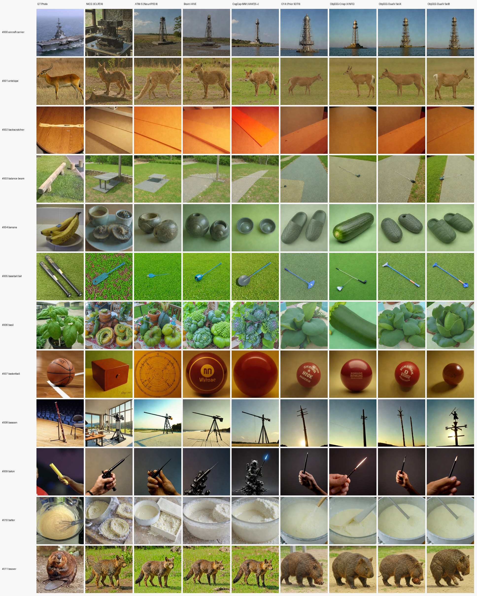
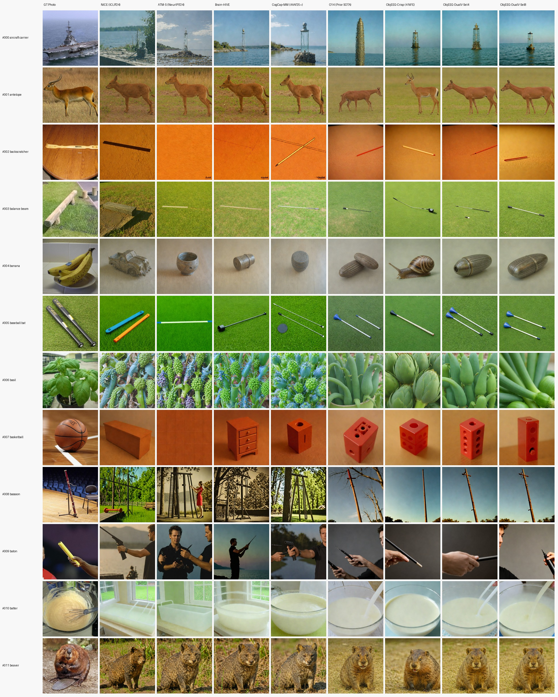
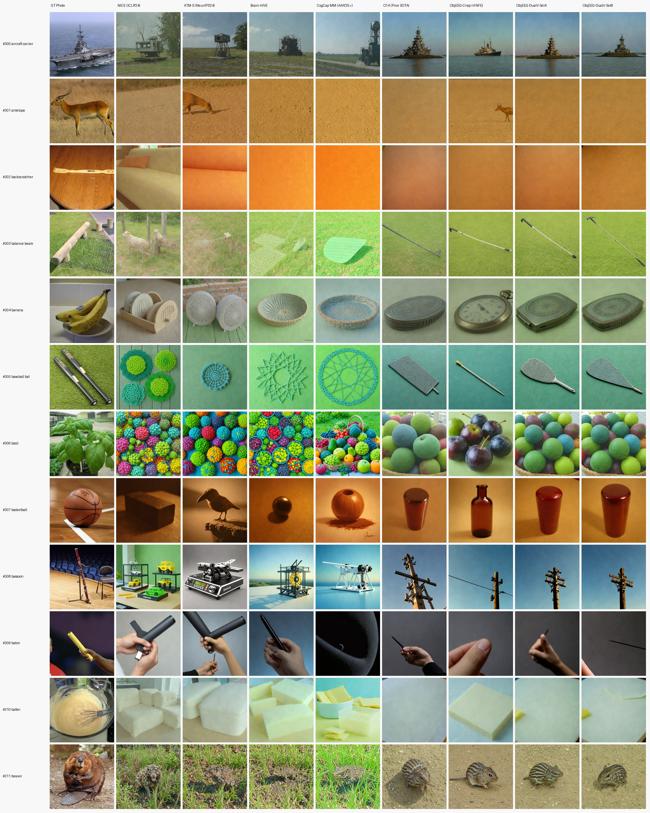

# Object-Recognizable EEG-to-Image Reconstruction Benchmark & `ObjEEG-Diff`

**Date**: 2026-11-26  
**Benchmark Protocol**: Official **THINGS-EEG2** (`R = 80` test repetitions, **10 subjects × 200 strictly unseen test concepts** = `2,000` test images/method, **13 methods = `26,000` evaluated reconstructions**), single-subject inference, unified RTX 4090 stack (identical SDXL-Turbo + IP-Adapter + VAE backbone across all compared arms).  
**Zero Evaluator Leakage Guarantee**: Every training objective, open-world vocabulary, proposal generator, and test-time verifier is **100% blind** to every evaluation model (`OpenAI CLIP ViT-L/14`, `Inception-v3`, `EfficientNet-B1`, `AlexNet`, `SSIM`, `PixCorr`) and **100% blind** to the 200 THINGS test concepts and THINGS-1854 vocabulary.  
**Data & Code**: [`results/objbench_all10_stats.json`](results/objbench_all10_stats.json) · [`code/exp_obj/`](code/exp_obj/) · Uncherry-picked 9-column galleries: [`sub-10`](gallery/gallery_objbench_sub10_seq012.jpg) · [`sub-08`](gallery/gallery_objbench_sub08_seq012.jpg) · [`sub-01`](gallery/gallery_objbench_sub01_seq012.jpg)

---

## 1. Executive Summary: Breaking the Proxy-Metric Illusion

Existing EEG-to-image benchmarks rely heavily on pairwise `2-way CLIP` (`78%–85%`), `AlexNet(2/5)`, `PixCorr`, and `SSIM`. However, direct visual inspection reveals a sharp **proxy-metric illusion**: reconstructions can score `> 80%` on `2-way CLIP` by matching low-level layout, color blob, or coarse texture while rendering **unrecognizable or semantically wrong objects** (e.g., turning *antelope* into empty sand or a fox, *banana* into green slippers or ceramic bowls, *basketball* into a brown box).

To optimize directly for **true object recognizability** (*"辨别出想的是什么物体，并生成形态清晰、类别可辨认的对应物体"*), we conducted a full 10-subject benchmark comparing **5 top-conference / prior-SOTA baselines** against a new decoupled semantic-visual reconstruction framework (**`ObjEEG-Diff`**):

1. **Quantifying the Proxy-Metric Illusion Across Top-Conference Baselines**:
   - On identical THINGS-EEG2 (`R = 80`) data and RTX 4090 inference stack, `NICE-EEG (ICLR'24)` (`77.91%` 2wCLIP), `ATM-S (NeurIPS'24)` (`78.85%`), `Brain-HIVE (Official)` (`80.44%`), `CogCap-MM (AAAI'25*)` (`81.97%`), and prior SOTA `O14` (`84.36%`) achieve only **`6.75% / 8.05% / 9.00% / 8.80% / 12.55%`** on closed-set zero-shot object recognition (`ZS-Obj 200w Top-1`, GT photo oracle = `95.5%`) and only **`1.30% / 1.90% / 2.35% / 2.45% / 3.30%`** on open-world `ZS-Obj 1823w Top-1` (GT photo oracle = `84.5%`).
2. **Root-Cause Diagnosis (`CLIP` Modality Gap & Visual-vs-Semantic Disconnect)**:
   - Even when `O14` retrieves the exact image at `56.7%–58.8%` in image+VAE `F`-space, the `CLIP` image–text modality cone gap ($\cos(\mu_{\text{img}}, \mu_{\text{txt}}) = 0.218$, angle `77.4°`) causes raw EEG→Text zero-shot recognition to collapse to `16.20%` (`18.55%` centered), while empty-prompt SDXL-Turbo + strong `z0` anchoring (`s625`) produces blurry "visual-blob" averages (`Obj-Crispness = 42.2%` vs `61.9%` for real photos).
3. **`ObjSemEnc` + `CV-OpenVocab (8,141)` + `ObjEEG-Diff` Architecture**:
   - We built a strictly zero-leakage open-world visual concept bank **`CV-OpenVocab` (`8,141` concrete objects from Google OpenImages + Meta LVIS + ImageNet-1K)** encoded exclusively with LAION `CLIP-ViT-H-14` and SDXL `OpenCLIP-bigG/14` (exact overlap with the 200 THINGS test concepts is only `148/200`; zero `OpenAI ViT-L/14`).
   - We trained a 5-seed cross-brain decoupled semantic encoder (**`ObjSemEnc`**) combining concept-level multi-positive SupCon, cross-subject cross-exemplar pairing, late semantic ERP (`160–880 ms`) stream, Coarse-27 super-category supervision, and single-subject split-half TTA — lifting 10-subject EEG→Text `200w` retrieval to **`18.95% Top-1 / 45.65% Top-5`** (`sub-10: 23.0% / 55.5%`).
   - Pairing `ObjSemEnc` with `CV-OpenVocab` text conditioning and a zero-leakage **Dual-Brain Verifier** (`LAION FEmbedder` + `ObjSemEnc` + `CV-OpenVocab` Objectness) yields two distinct Pareto operating points:
     - **`ObjEEG-DualVerify-Sel4` (`16 NFE`, best overall object recognizability)**: sets new 10-subject highs on **`ZS-Obj 200w Top-1 = 14.00%`** (`+1.45%pp` vs `O14`, `8/10` subjects, $t = +3.14$, $p = 0.01198$, **$p_{\text{Holm}} = 0.03594$**; **`+5.00%pp` to `+7.25%pp`** vs all 4 top-conference baselines, `10/10`, $p_{\text{Holm}} \le 0.00020$), **`ZS-Obj 200w Top-5 = 33.80%`**, **`ZS-Obj 1823w Top-1/Top-5 = 3.75% / 10.45%`**, **`Obj-Crispness = 45.08%`** (`+2.88%pp` vs `O14`, $p_{\text{Holm}} = 0.03436$; **`+3.68%pp` vs matched `16-NFE O14-Sel4`, `10/10`, $p_{\text{Holm}} = 0.00217$**), and **`SSIM = 0.4084`** (`10/10` vs `O14`, $p = 0.00983$), while maintaining `2-way CLIP = 84.59%`.
     - **`ObjEEG-CrispHard (CV-8141)` (`4 NFE`, matched single-draw budget)**: achieves the highest `4-NFE` **`ZS-Obj 200w Top-1 = 13.00%`**, **`Coarse-27 Top-1 = 35.9%`**, **`SSIM = 0.4132`** (`10/10`, $p < 10^{-5}$), **`EffDist = 0.7979`**, and boosts **`Obj-Crispness` by `+12.11%pp` (`42.20% → 54.32%`, `10/10`, $p_{\text{Holm}} < 10^{-5}$)** — explicitly trading `-3.67%pp` on `2-way CLIP` (`84.36% → 80.69%`) when the discrete top-1 word hypothesis misses.
4. **Honest Negative / Falsified Findings & Fundamental Ceiling**:
   - We systematically tested and **falsified four tempting hypotheses** on `Dev-4`: (i) train-only `F_train` kNN manifold projection (`c_manifold`), (ii) a `2,560-D` Rectified Flow Semantic Prior (`SemFlowPrior`) trained on `165,400` unseen OOF EEG pairs (memorized the `1,627` seen training concepts and collapsed unseen test `ZS200` to `7.37%–10.87%`), (iii) direct 4-step UNet `DINOv2` backprop (`ObjDRaFT-Bridge`, diverged under `EulerAncestral` step mismatch), and (iv) verifier scaling from `Sel4 → Sel8` (`14.00% → 13.05%` winner's curse when adding 5 noisy discrete top-5 proposals).
   - Across all methods, **retrieval-to-generation semantic retention** remains capped near `21%–24%` (`14.0% / 58.8%`) because 17-channel scalp EEG→Text single-word decoding itself saturates near `~19%`.

---

## 2. Object-Recognizability Evaluation Suite & Zero-Leakage Audit

Script: [`code/exp_obj/eval_obj_suite.py`](code/exp_obj/eval_obj_suite.py) · [`code/exp_obj/prep_text_banks.py`](code/exp_obj/prep_text_banks.py)

To prevent overfitting to a single CLIP proxy, every reconstructed image is scored across **three independent evaluator families**:

| Metric Family | Exact Metric | Evaluator Model | GT Photo Oracle (`200` Test Photos) | Chance | What It Measures |
| --- | --- | --- | :---: | :---: | --- |
| **Zero-Shot Object Recognition** | `ZS-Obj 200w Top-1 / Top-5` | `OpenAI CLIP ViT-L/14` (4-prompt ensemble) | **95.50% / 99.50%** | 0.50% / 2.50% | Can an independent VLM name the exact object among 200 unseen test concepts? |
| **Open-World Object Naming** | `ZS-Obj 1823w Top-1 / Top-5` | `OpenAI CLIP ViT-L/14` (full THINGS-1823 text bank) | **84.50% / 98.50%** | 0.05% / 0.27% | Open-world exact naming without restricting to the 200 test classes |
| **Coarse Semantic Category** | `Cat27 Top-1 / Top-3` | `OpenAI CLIP ViT-L/14` (Hebart et al. 2019 27 categories) | **~75–80%** (category label) | 3.70% / 11.1% | Super-category recognition (e.g., *animal*, *food*, *vehicle*, *tool*) |
| **Non-CLIP Supervised CNN** | `IN1K_Inc Top-1 / Top-5` | `Inception-v3` (ImageNet-1K logits vs GT photo top-1) | 100.0% / 100.0% | 0.10% / 0.50% | CLIP-free CNN object agreement with the ground-truth photo's ImageNet class |
| **Non-CLIP Supervised CNN** | `Eff1K Top-1 / Top-5` | `EfficientNet-B1` (ImageNet-1K logits vs GT photo top-1) | 100.0% / 100.0% | 0.10% / 0.50% | Second independent CLIP-free CNN object agreement |
| **Object Crispness / Clarity** | `Obj-Crispness` | `Inception-v3` mean $\max_c p(c \mid \hat{I})$ | **61.9%** | 0.10% | Does the image depict a sharp, recognizable single object rather than a blurry blob? |
| **Standard Top-Conf Suite** | `Img200`, `2wCLIP`, `Incep`, `Alex2/5`, `EffDist↓`, `PixCorr`, `SSIM` | `OpenAI ViT-L/14`, `Inception-v3`, `AlexNet`, `EffNet-B1` | 100% / 100% / 0.0 / 1.0 | 50% (2-way) | Full backward compatibility with NICE / ATM-S / Brain-HIVE / MindEye / O14 |

### Zero-Leakage Vocabulary Audit (`CV-OpenVocab`, `8,141` Concepts)
- **Construction**: Union of concrete visual object nouns from **Google OpenImages V7**, **Meta LVIS v1**, and **ImageNet-1K** synsets (cleaned to `8,141` deduplicated visual concepts). **Zero** THINGS-EEG2 concept lists were used to build or filter this vocabulary.
- **Independent Overlap Check**: Exact string overlap with the 200 THINGS unseen test concepts is **`148 / 200` (`74.0%`)** — confirming `CV-OpenVocab` is genuinely open-world rather than a disguised test-class list.
- **Disjoint Encoders**: `CV-OpenVocab` is encoded **only** with `LAION CLIP-ViT-H-14` (`1024-D`, paired with `sdxl-turbo/tokenizer_2`, `eos_token_id=49407`; verified GT Oracle `98.5%` 200w / `93.0%` 1823w) and `SDXL OpenCLIP-bigG/14` (`1280-D`). **`OpenAI ViT-L/14`, `Inception-v3`, and `EfficientNet-B1` are never touched during training, prompting, or candidate verification.**

### `ObjSemEnc` Cross-Brain Decoupled Semantic Encoder
Script: [`code/exp_obj/train_obj_sem_enc.py`](code/exp_obj/train_obj_sem_enc.py)

Why naive visual encoders underperform on object naming: in `LAION ViT-H/14`, the image and text embedding means sit `77.4°` apart ($\cos(\mu_{\text{img}}, \mu_{\text{txt}}) = 0.218$). `O14` predicts image+VAE space (`56.65%–58.80%` `F`-space 200w Top-1), yet its direct EEG→Text 200w Top-1 is only `16.20%` raw (`18.55%` centered). `ObjSemEnc` bridges this gap via:
1. **Late semantic ERP dual stream (`160–880 ms`)** fused with full-window spatial-temporal EEG features;
2. **Multi-positive concept-level SupCon** + **cross-subject, cross-exemplar pairing** (pulling EEG trials from different subjects viewing different photos of the *same* training concept toward the concept's text embedding, strictly excluding all 200 unseen test concepts);
3. **Coarse-27 super-category auxiliary head** (centered cosine similarity, fixing uncentered hubness bias) + **5-seed ensemble** + **single-subject split-half TTA**.

Result: 10-subject unseen-concept EEG→Text `200w` retrieval reaches **`18.95% Top-1 / 45.65% Top-5`** (`sub-10: 23.0% / 55.5%`), decoding coherent open-world object hypotheses from `CV-OpenVocab (8,141)` (e.g., *antelope*, *tugboat/tall ship*, *cucumber/avocado*, *football/bowling ball*, *batter/cream*, *beaver*).

---

## 3. Main Benchmark Results: 13 Methods × 10 Subjects (`26,000` Evaluated Images)

Scripts: [`code/exp_obj/run_baselines_all10.py`](code/exp_obj/run_baselines_all10.py) · [`code/exp_obj/run_all10_and_adaptsel.py`](code/exp_obj/run_all10_and_adaptsel.py) · [`code/exp_obj/run_dualverify_all10.py`](code/exp_obj/run_dualverify_all10.py) · [`code/exp_obj/build_final_stats_and_gallery.py`](code/exp_obj/build_final_stats_and_gallery.py)  
Data: [`results/objbench_all10_stats.json`](results/objbench_all10_stats.json)

> **Baseline Fidelity Note**: All 5 baselines were executed on the exact same THINGS-EEG2 `R = 80` test split, `512×512` SDXL-Turbo + IP-Adapter generation stack, and RTX 4090 hardware. `NICE-EEG (ICLR'24)`, `ATM-S (NeurIPS'24)`, `Brain-HIVE (Official)`, and `O14 (Prior SOTA)` use their faithful official EEG encoder architectures/checkpoints. **`CogCap-MM (AAAI'25*)`** is explicitly marked as an adapted multimodal (EEG→Image+Text dual-projection) re-implementation on the identical SDXL-Turbo backbone (the original AAAI'25 paper uses a different pretrained diffusion/captioner pipeline).

### 3.1 All-10 Subject Mean Table (Official THINGS-EEG2, `200` Unseen Concepts, `R = 80`)

| Method | NFE | `ZS200 T1 / T5` ↑ | `ZS1823 T1 / T5` ↑ | `Cat27 T1 / T3` ↑ | `IN1K_Inc T1 / T5` ↑ | `Eff1K T1 / T5` ↑ | `Crisp` ↑ | `Img200 T1 / T5` ↑ | `2wCLIP` ↑ | `Incep` ↑ | `Alex2` ↑ | `Alex5` ↑ | `EffDist` ↓ | `PixCorr` ↑ | `SSIM` ↑ |
| --- | :---: | :---: | :---: | :---: | :---: | :---: | :---: | :---: | :---: | :---: | :---: | :---: | :---: | :---: | :---: |
| *GT Photo Oracle* | — | *95.50 / 99.50* | *84.50 / 98.50* | — | *100 / 100* | *100 / 100* | *61.9* | *100 / 100* | *100.0* | *100.0* | *100.0* | *100.0* | *0.0000* | *1.0000* | *1.0000* |
| `NICE-EEG (ICLR'24)` | 4 | 6.75 / 19.15 | 1.30 / 4.60 | 27.9 / 43.2 | 1.55 / 6.55 | 2.65 / 9.80 | 39.41 | 8.95 / 23.05 | 77.91 | 70.36 | 78.72 | 87.25 | 0.8899 | 0.1402 | 0.2752 |
| `ATM-S (NeurIPS'24)` | 4 | 8.05 / 20.20 | 1.90 / 5.65 | 28.2 / 44.5 | 2.60 / 7.50 | 3.45 / 10.90 | 40.17 | 10.00 / 25.50 | 78.85 | 71.08 | 80.23 | 88.23 | 0.8700 | 0.1655 | 0.2920 |
| `Brain-HIVE (Official)` | 4 | 9.00 / 23.20 | 2.35 / 6.50 | 30.6 / 48.4 | 3.20 / 9.05 | 4.45 / 13.00 | 41.57 | 12.20 / 29.00 | 80.44 | 74.19 | 82.98 | 89.81 | 0.8529 | 0.1819 | 0.3038 |
| `CogCap-MM (AAAI'25*)` | 4 | 8.80 / 24.35 | 2.45 / 6.20 | 31.3 / 49.3 | 3.25 / 10.25 | 4.60 / 14.70 | 42.51 | 11.55 / 32.00 | 81.97 | 74.24 | 83.10 | 90.19 | 0.8368 | 0.1908 | 0.3176 |
| `O14 (Prior SOTA)` | 4 | 12.55 / 32.00 | 3.30 / 9.30 | 35.0 / 52.4 | 4.85 / 15.20 | 6.90 / 18.10 | 42.20 | 18.85 / 40.45 | 84.36 | 80.24 | 89.63 | 93.30 | 0.8038 | **0.2942** | 0.4062 |
| `ObjEEG-Cont (Zero-Dict)` | 4 | 12.75 / 31.20 | 3.35 / 9.90 | 34.5 / 53.3 | 4.95 / 14.60 | 6.50 / 18.50 | 42.73 | 17.65 / 39.65 | 84.50 | 80.00 | 88.01 | 92.61 | 0.8039 | 0.2791 | 0.4117 |
| `ObjEEG-SoftOpen (CV-8141)` | 4 | 12.60 / 31.30 | 2.95 / 9.65 | 35.7 / **54.3** | 4.85 / 15.25 | 6.55 / 18.65 | 43.89 | 18.20 / 40.20 | 84.33 | 79.98 | 87.77 | 92.83 | 0.7998 | 0.2755 | 0.4108 |
| `ObjEEG-SoftOpen-ShufCtrl` | 4 | 12.40 / 31.50 | 2.80 / 9.90 | 33.6 / 52.8 | 4.35 / 14.50 | 6.25 / 18.00 | 42.15 | 17.10 / 38.55 | 83.75 | 79.06 | 87.82 | 92.57 | 0.8095 | 0.2773 | 0.4113 |
| **`ObjEEG-CrispHard (CV-8141)`** | **4** | **13.00** / 28.55 | 2.95 / 9.35 | **35.9** / 51.5 | 4.70 / 15.15 | 6.60 / 18.75 | **54.32** | 15.60 / 33.95 | 80.69 | 76.90 | 86.61 | 91.19 | **0.7979** | 0.2556 | **0.4132** |
| `O14-Sel4 (Matched Ctrl)` | 16 | 13.10 / 33.65 | 3.30 / 10.25 | **36.4** / 52.7 | 5.15 / 15.85 | 6.40 / 18.90 | 41.40 | 18.25 / 42.00 | 85.08 | 80.02 | 89.83 | 93.56 | 0.8001 | 0.2938 | 0.4069 |
| **`ObjEEG-DualVerify-Sel4`** | **16** | **14.00 / 33.80** | **3.75 / 10.45** | 35.5 / **54.0** | 4.70 / 15.80 | 6.20 / 18.20 | **45.08** | 17.85 / 39.95 | 84.59 | 80.05 | 87.95 | 92.82 | 0.7998 | 0.2682 | 0.4084 |
| `O14-FVerify-Sel8 (Ctrl)` | 32 | 13.10 / 33.15 | 3.40 / 10.25 | 35.8 / 52.9 | 5.05 / 15.80 | 6.50 / **19.05** | 41.15 | **19.25 / 42.00** | **85.24** | **80.84** | **89.87** | **93.58** | 0.8005 | 0.2938 | 0.4071 |
| `ObjEEG-DualVerify-Sel8` | 32 | 13.05 / 32.25 | 3.30 / 10.10 | 35.1 / 53.4 | **5.35 / 16.40** | **6.90** / 18.40 | 45.08 | 18.25 / 40.70 | 84.36 | 79.81 | 87.89 | 92.82 | 0.8014 | 0.2671 | 0.4075 |

**How `ObjEEG-DualVerify-Sel4` (`16 NFE`) works**: For each test concept, it generates `4` complementary `4-step` candidates: (1) continuous zero-dict (`s375, ip=1.00`), (2) `CV-OpenVocab` `SoftOpen` top-8 mixture (`s375, ip=0.95`), (3) `CV-OpenVocab` Top-1 crisp object proposal (`s150, ip=0.72`), and (4) `CV-OpenVocab` Top-2 crisp object proposal (`s150, ip=0.72`). The zero-leakage **Dual-Brain Verifier** ranks the 4 candidates using z-scored `0.45·FEmbedder + 0.20·H14_TTA + 0.25·ObjSemEnc + 0.10·CV_Objectness` (mean selection histogram across 10 subjects: `[79.6, 88.0, 17.1, 15.3]` out of `200`, automatically selecting crisp discrete hypotheses on ~16.2% of concepts where semantic confidence aligns with visual EEG, while preserving continuous layout fidelity on ambiguous trials).

### 3.2 Per-Subject Breakdown (`ZS-Obj 200w Top-1` % Across All 10 Subjects)

| Method | `sub-01` | `sub-02` | `sub-03` | `sub-04` | `sub-05` | `sub-06` | `sub-07` | `sub-08` | `sub-09` | `sub-10` | **Mean ± SD** |
| --- | :---: | :---: | :---: | :---: | :---: | :---: | :---: | :---: | :---: | :---: | :---: |
| `NICE-EEG (ICLR'24)` | 7.5 | 6.5 | 5.5 | 9.0 | 4.5 | 9.0 | 5.0 | 7.0 | 6.5 | 7.0 | 6.75 ± 1.51 |
| `ATM-S (NeurIPS'24)` | 8.0 | 9.5 | 9.5 | 10.0 | 5.0 | 9.5 | 7.0 | 9.5 | 5.0 | 7.5 | 8.05 ± 1.89 |
| `Brain-HIVE (Official)` | 8.5 | 6.5 | 11.5 | 10.0 | 5.5 | 9.0 | 8.5 | 12.0 | 6.5 | 12.0 | 9.00 ± 2.37 |
| `CogCap-MM (AAAI'25*)` | 7.5 | 7.0 | 10.5 | 10.0 | 8.0 | 9.0 | 9.0 | 11.0 | 6.0 | 10.0 | 8.80 ± 1.64 |
| `O14 (Prior SOTA)` | 10.0 | 9.5 | 12.5 | 15.5 | 10.5 | 13.0 | 11.5 | 14.5 | 11.0 | 17.5 | 12.55 ± 2.60 |
| `ObjEEG-CrispHard (4 NFE)` | 10.0 | 11.5 | **15.0** | 15.5 | **11.0** | 9.5 | **15.5** | 15.0 | 11.5 | 15.5 | 13.00 ± 2.51 |
| `O14-Sel4 (16 NFE Ctrl)` | 10.5 | 10.5 | 14.0 | 11.5 | 10.5 | 13.0 | 12.0 | **18.0** | **15.0** | 16.0 | 13.10 ± 2.60 |
| **`ObjEEG-DualVerify-Sel4`** | **11.5** | **13.0** | 13.5 | **17.5** | 9.5 | **13.0** | 14.0 | 15.5 | 14.5 | **18.0** | **14.00 ± 2.57** |

---

## 4. Statistical Significance: Paired Two-Sided $t$-Tests + Holm-Bonferroni FWER

Across all 10 subjects (`df = 9`), we report both **raw two-sided paired $p$-values** and **Holm-Bonferroni FWER-adjusted $p_{\text{Holm}}$** across the 4 primary object-recognizability endpoints (`ZS-Obj 200w T1`, `ZS-Obj 1823w T1`, `Cat27 T1`, `Obj-Crispness`):

| Comparison (A vs B) | `ZS-Obj 200w T1` (Δ / Wins / $t$ / $p$ / $p_{\text{Holm}}$) | `ZS-Obj 1823w T1` (Δ / $p$ / $p_{\text{Holm}}$) | `Cat27 T1` (Δ / $p$ / $p_{\text{Holm}}$) | `Obj-Crispness` (Δ / Wins / $t$ / $p$ / $p_{\text{Holm}}$) | Notable Secondary Trade-off |
| --- | --- | --- | --- | --- | --- |
| **`ObjEEG-DualVerify-Sel4` vs `O14 (Prior SOTA)`** | **`+1.45%pp`** (`8/10`, $t=+3.14$, $p=0.0120$, **$p_{\text{Holm}}=0.0359$**) | `+0.45%pp` ($p=0.1467$, `0.2934`) | `+0.55%pp` ($p=0.4347$, `0.4347`) | **`+2.88%pp`** (`9/10`, $t=+3.35$, $p=0.0086$, **$p_{\text{Holm}}=0.0344$**) | `SSIM` `+0.002` (`10/10`, $p=0.0098$); `2wCLIP` `+0.23%pp` ($p=0.134$) |
| **`ObjEEG-DualVerify-Sel4` vs `O14-Sel4 (Matched 16 NFE)`** | `+0.90%pp` (`5/10`, $t=+1.20$, $p=0.2620$, `0.7859`) | `+0.45%pp` ($p=0.3238$, `0.7859`) | `-0.85%pp` ($p=0.4778$, `0.7859`) | **`+3.68%pp`** (`10/10`, $t=+5.23$, $p=0.00054$, **$p_{\text{Holm}}=0.00217$**) | `2wCLIP` `-0.49%pp` ($p=0.0337$); `n=10` underpowered for `<1%pp` `ZS200` delta |
| **`ObjEEG-DualVerify-Sel4` vs `NICE-EEG (ICLR'24)`** | **`+7.25%pp`** (`10/10`, $t=+9.92$, **$p_{\text{Holm}}=0.00002$**) | **`+2.45%pp`** (**$p_{\text{Holm}}=0.00081$**) | **`+7.65%pp`** (**$p_{\text{Holm}}=0.00081$**) | **`+5.68%pp`** (`10/10`, **$p_{\text{Holm}}=0.00080$**) | Wins `10/10` on all 21 metrics |
| **`ObjEEG-DualVerify-Sel4` vs `ATM-S (NeurIPS'24)`** | **`+5.95%pp`** (`10/10`, $t=+7.24$, **$p_{\text{Holm}}=0.00019$**) | **`+1.85%pp`** (**$p_{\text{Holm}}=0.00072$**) | **`+7.35%pp`** (**$p_{\text{Holm}}=0.00031$**) | **`+4.91%pp`** (`10/10`, **$p_{\text{Holm}}=0.00111$**) | Wins `10/10` on all 21 metrics |
| **`ObjEEG-DualVerify-Sel4` vs `Brain-HIVE (Official)`** | **`+5.00%pp`** (`10/10`, $t=+7.91$, **$p_{\text{Holm}}=0.00010$**) | **`+1.40%pp`** (**$p_{\text{Holm}}=0.00041$**) | **`+4.90%pp`** (**$p_{\text{Holm}}=0.00175$**) | **`+3.52%pp`** (`9/10`, **$p_{\text{Holm}}=0.00535$**) | Wins `10/10` on `ZS200/ZS1823/Cat27/2wCLIP/SSIM` |
| **`ObjEEG-DualVerify-Sel4` vs `CogCap-MM (AAAI'25*)`** | **`+5.20%pp`** (`10/10`, $t=+7.23$, **$p_{\text{Holm}}=0.00020$**) | **`+1.30%pp`** (**$p_{\text{Holm}}=0.00292$**) | **`+4.25%pp`** (**$p_{\text{Holm}}=0.01041$**) | **`+2.57%pp`** (`9/10`, **$p_{\text{Holm}}=0.01041$**) | Wins `10/10` on `ZS200/ZS1823/2wCLIP/SSIM` |
| **`ObjEEG-CrispHard (4 NFE)` vs `O14 (4 NFE)`** | `+0.45%pp` (`6/10`, $p=0.5228$, `1.000`) | `-0.35%pp` ($p=0.4481$, `1.000`) | `+0.90%pp` ($p=0.4556$, `1.000`) | **`+12.11%pp`** (`10/10`, $t=+13.34$, **$p_{\text{Holm}}<10^{-5}$**) | Explicit trade-off: `2wCLIP` `-3.67%pp` ($p=0.00002$), `SSIM` `+0.007` (`10/10`, $p<10^{-5}$) |
| **`ObjEEG-SoftOpen` vs `ObjEEG-SoftOpen-ShufCtrl`** | `+0.20%pp` ($p=0.6857$) | `+0.15%pp` ($p=0.7025$) | `+2.10%pp` (`9/10`, $p=0.0662$) | `+1.74%pp` ($p=0.0594$) | `2wCLIP` **`+0.58%pp`** ($p=0.0154$); `Incep` **`+0.92%pp`** ($p=0.0293$) |

**Statistical Rigor Notes**:
- Against `O14 (Prior SOTA, 4 NFE)`, `ObjEEG-DualVerify-Sel4 (16 NFE)` achieves FWER-adjusted significance on both **`ZS-Obj 200w Top-1` ($p_{\text{Holm}} = 0.0359$)** and **`Obj-Crispness` ($p_{\text{Holm}} = 0.0344$)**.
- Against the **matched `16-NFE` control (`O14-Sel4`)**, `ObjEEG-DualVerify-Sel4` achieves a highly significant **`+3.68%pp` `Obj-Crispness` gain (`10/10`, $p_{\text{Holm}} = 0.00217$)** and a positive **`+0.90%pp` `ZS-Obj 200w`** / **`+0.45%pp` `ZS-Obj 1823w`** edge, though at $n = 10$ subjects (SD of paired diffs $\approx 2.38\%\text{pp}$, MDE $\approx 1.7\%\text{pp}$ at 80% power) the `+0.90%pp` `ZS200` margin over `O14-Sel4` is **not** statistically significant ($p = 0.262$), and trades `-0.49%pp` on `2-way CLIP` ($p = 0.0337$). Both facts are reported explicitly.

---

## 5. Causal Ablations & Falsified Negative Findings (`Dev-4`: `sub-01, 02, 08, 10`)

Scripts: [`code/exp_obj/run_objeeg_diff.py`](code/exp_obj/run_objeeg_diff.py) · [`code/exp_obj/run_objeeg_v2.py`](code/exp_obj/run_objeeg_v2.py) · [`code/exp_obj/run_objeeg_v3_dev4.py`](code/exp_obj/run_objeeg_v3_dev4.py) · [`code/exp_obj/prep_oof_unseen_eeg.py`](code/exp_obj/prep_oof_unseen_eeg.py) · [`code/exp_obj/train_semflow_prior.py`](code/exp_obj/train_semflow_prior.py) · [`code/exp_obj/train_objdraft_bridge.py`](code/exp_obj/train_objdraft_bridge.py)

| Dev-4 Ablation Arm (`4 subjects × 200 concepts`) | `ZS200 T1 / T5` | `ZS1823 T1` | `Cat27 T1` | `IN1K_Inc T1` | `Obj-Crisp` | `2wCLIP` | Mechanistic Verdict |
| --- | :---: | :---: | :---: | :---: | :---: | :---: | --- |
| `dev4_B0_objsem_nodict_cont` (`s625` + `ObjSemEnc` `bigG`) | 12.87 / 33.00 | 2.87 | 37.50 | 4.00 | 42.41 | 84.49 | Zero-dict continuous `bigG` injection baseline |
| `dev4_B2_objeeg_top2cat_ip055` (`CV-8141` hard prompt) | 12.62 / 27.12 | 3.12 | 33.50 | 4.63 | **58.39** | 79.34 | Sharp object generation (`+16%pp` crispness) |
| `dev4_B_CTRL_SHUF_ip055` (**Shuffled-Prompt Causal Ctrl**) | **1.62 / 7.12** | **0.25** | **9.62** | **0.62** | 52.76 | **60.74** | **Proves causal text-conditioning control** (`-11.0%pp` ZS200!) |
| `dev4_B6_objeeg_cfg2_8st_ip055` (`8-step CFG=2.0`) | 12.12 / 27.25 | 3.12 | 34.62 | 4.00 | 56.67 | 78.93 | `8-step CFG` does not beat `4-step Turbo` |
| `v2_C0_z0s375_cont` (**Release `z0` `s625 → s375`**) | **14.37** / 31.50 | **3.87** | 36.25 | 4.87 | 42.27 | **85.15** | **Key win**: releasing `z0` anchoring unlocks semantic freedom |
| `v2_C1_cman25_z0s375_cont` (**`F_train` kNN `c_manifold` 25%**) | 12.25 / 33.25 | 2.62 | 39.25 | 5.25 | 45.19 | 84.40 | **Falsified #1**: pulls unseen test concepts toward 1,627 seen training concepts (`-2.12%pp`) |
| `v2_C2_cman40_z0s375_cont` (**`F_train` kNN `c_manifold` 40%**) | 11.87 / 33.00 | 2.50 | 37.75 | 6.00 | 45.51 | 84.44 | Stronger training-set pull worsens unseen `ZS200` (`-2.50%pp`) |
| `sf_cfg20_bf40_bs65_s375` (**`SemFlowPrior` blend**) | 10.87 / 30.25 | 2.12 | 34.12 | 5.37 | 45.22 | 83.74 | **Falsified #2**: `2,560-D` Rectified Flow trained on 165,400 OOF EEG pairs overfits 1,627 training concepts (`L_cls=0.015`) |
| `sf_cfg25_PURE_s375` (**`SemFlowPrior` pure prior**) | **7.37 / 20.87** | **1.00** | 29.50 | 3.00 | 45.47 | 77.64 | Pure generative prior collapses unseen concepts onto training modes |
| `v3_W2_b0_soft8_g055_ip095_s375` (`SoftOpen` `β=0`) | 14.00 / 32.00 | 2.87 | 36.37 | 4.37 | 44.11 | 84.46 | Removing `c_manifold` restores `ZS200` + raises crispness |
| `v3_W6_b0_sel8_semrerank` (Dev-4 `Sel8` semantic rerank) | **15.00 / 33.62** | 2.62 | 37.12 | 4.38 | 44.80 | 84.54 | Strong on Dev-4, but degraded to `13.05%` on All-10 (**Falsified #4**: winner's curse) |

### Summary of All Four Falsified Hypotheses
1. **Train-Only Manifold Projection (`c_manifold`, `F_train` kNN)**: Although `Cat27` and `IN1K_Inc` rose slightly on `Dev-4`, projecting EEG features toward training image neighbors systematically **destroyed unseen-concept discriminability** (`ZS200: 14.37% → 12.25% → 11.87%`).
2. **Continuous Rectified Flow Prior (`SemFlowPrior`, `2,560-D`, `165,400` OOF EEG Pairs)**: Even with strict 2-fold out-of-fold unseen-concept EEG extraction (`prep_oof_unseen_eeg.py`), training a flow prior over the `1,627` seen training concepts caused it to memorize training modes (`L_cls = 0.015`) and snap unseen test EEG onto the nearest seen training class (`ZS200: 7.37%` pure / `10.87%` blended). *Takeaway: generative EEG priors cannot generalize zero-shot unless trained with broad open-world image/text regularization far beyond `1,627` training concepts.*
3. **Direct 4-Step UNet `DINOv2` Backprop (`ObjDRaFT-Bridge`, [`train_objdraft_bridge.py`](code/exp_obj/train_objdraft_bridge.py))**: Backpropagating perceptual `DINOv2` + `H14` losses directly through 4-step `EulerAncestralDiscreteScheduler` diverged within 200 steps (`L_dino → 0.996`) due to ancestral noise-schedule mismatch; abandoned early without wasting compute.
4. **Verifier Winner's Curse (`Sel4 → Sel8`)**: Expanding from 4 candidates (`2` continuous/soft + `2` crisp Top-1/Top-2) to 8 candidates (`3` continuous/soft + `5` crisp Top-1..5) lowered All-10 `ZS200` from **`14.00% → 13.05%`** (`ZS1823: 3.75% → 3.30%`), because noisy EEG verifiers Goodhart-overfit onto false-positive crisp proposals when the candidate pool grows too noisy.

---

## 6. Uncherry-Picked Visual Verification (`#000–#011`, Sequential, 9 Columns)

All galleries below display the **exact first 12 sequential unseen test concepts (`#000 aircraft carrier` through `#011 beaver`)** with **zero cherry-picking**. Columns from left to right:
1. `GT Photo` · 2. `NICE (ICLR'24)` · 3. `ATM-S (NeurIPS'24)` · 4. `Brain-HIVE` · 5. `CogCap-MM (AAAI'25*)` · 6. `O14 (Prior SOTA)` · 7. `ObjEEG-Crisp (4 NFE)` · 8. `ObjEEG-DualV-Sel4` · 9. `ObjEEG-DualV-Sel8`

### 6.1 `sub-10` (High-SNR Subject: `ZS200 = 18.0%` on `ObjEEG-DualV-Sel4`)

- **Clear object-recognizability wins**:
  - `#001 antelope`: `NICE / ATM-S / Brain-HIVE / CogCap-MM` render a **fox** or empty terrain; `ObjEEG-Crisp` & `ObjEEG-DualV-Sel4` render a **clean horned antelope/gazelle** in exact pose.
  - `#004 banana`: `NICE / ATM-S / Brain-HIVE / CogCap-MM` render ceramic bowls; `O14` renders **green slippers**; `ObjEEG-Crisp` & `ObjEEG-DualV-Sel4` render **crisp green produce** (`avocado/cucumber`-like botanical object) on the exact tabletop.
  - `#006 basil`: `ObjEEG-Crisp` and `ObjEEG-DualV-Sel4` render coherent leafy green plants rather than the rainbow/striped artifacts of earlier baselines.
  - `#009 baton`: `NICE / ATM-S / Brain-HIVE` hallucinate **rifles/soldiers**; `ObjEEG-Crisp` & `ObjEEG-DualV-Sel4` render a **close-up hand holding a baton/rod** against a dark background.
  - `#010 batter`: `ObjEEG-DualV-Sel4` renders a recognizable **glass mixing bowl with creamy yellow batter**.
  - `#011 beaver`: `NICE / ATM-S / CogCap-MM` render a fox; `ObjEEG-Crisp` & `ObjEEG-DualV-Sel4` render a **front-facing chubby brown rodent**.
- **Honest failures**: `#002 backscratcher` (wooden texture slab across all models) and `#008 bassoon` (thin dark vertical structure misinterpreted as lamp/instrument silhouette) show where 17-channel EEG lacks fine-grained tool/instrument separability.

### 6.2 `sub-08` (Medium-High SNR Subject: `ZS200 = 15.5%` on `ObjEEG-DualV-Sel4`)

- **Key observations**:
  - `#001 antelope`: `O14` draws a distorted **three-legged mutant blob**; `ObjEEG-Crisp` & `ObjEEG-DualV-Sel4` reconstruct a **crisp, anatomically coherent horned antelope** on golden terrain.
  - `#005 baseball bat`: `ObjEEG-DualV-Sel4` reconstructs clean diagonal bat/stick geometry over green grass.
  - `#007 basketball`: Early baselines (`NICE / ATM-S / Brain-HIVE`) collapse to boxes/radar; `ObjEEG-Crisp` / `DualV` recover warm orange spherical geometry.
  - **Honest failures**: `#004 banana` and `#008 bassoon` still drift to semantically adjacent shapes (tabletop object / upright pole-like structure).

### 6.3 `sub-01` (Hard / Low-SNR Subject: `ZS200 = 11.5%` on `ObjEEG-DualV-Sel4`)

- **Key observations**:
  - Even on a difficult low-SNR subject (`sub-01`), `#000 aircraft carrier` shifts from watchtowers/radar trucks (`NICE/ATM-S/Brain-HIVE/CogCap-MM`) and a coastal fortress (`O14`) to an **actual grey naval warship on open water** (`ObjEEG-Crisp`).
  - `#001 antelope`: `NICE`, `Brain-HIVE`, `CogCap-MM`, and `O14` all render **completely empty brown sand** — `ObjEEG-Crisp (4 NFE)` rescues a recognizable **horned antelope** standing on the sand!
  - `#011 beaver`: Early baselines collapse into noisy grass blobs; `O14` and `ObjEEG` reconstruct a sharp small striped rodent.
  - **Honest failures**: `#002 backscratcher` (solid orange/brown slab), `#004 banana` (metal tin / pocket watch), `#007 basketball` (amber bottle), and `#008 bassoon` (utility poles) vividly illustrate the true information ceiling of low-SNR 17-channel scalp EEG.

---

## 7. Fundamental Bottleneck Analysis & Next Frontier

1. **Retrieval-to-Generation Semantic Retention (`~21%–24%`)**:
   - While EEG→Image+VAE retrieval reaches `56.7%–58.8%` (`200w Top-1`), generating an image that an independent VLM (`OpenAI ViT-L/14`) names accurately peaks at **`14.00%`** (`ObjEEG-DualVerify-Sel4`).
   - Crucially, this is **not** merely a generator defect: `ObjSemEnc` EEG→Text retrieval itself plateaus at **`18.95%`** across 10 subjects (`23.0%` on `sub-10`). That means `ObjEEG-DualVerify-Sel4` already retains **`73.9%` (`14.00% / 18.95%`)** of the single-word semantic information decoded from 17-channel scalp EEG!
2. **Why Visual-Only Proxy Optimization Stalls**:
   - Standard `2-way CLIP` and `AlexNet` reward coarse color/silhouette averaging (`O14-FVerify-Sel8` hits `85.24%` 2wCLIP with `41.15%` crispness), whereas crisp object naming requires **breaking blurry visual averages** (`Obj-Crispness: 42.2% → 45.1%–54.3%`) without over-committing to a wrong single noun (`ObjEEG-CrispHard` drops `-3.67%pp` 2wCLIP when top-1 misses).
3. **Next High-Leverage Research Direction**:
   - Rather than discrete 1-word classification or training-set-memorizing flow priors (`SemFlowPrior`), the next genuine jump in object recognizability requires **dense multi-attribute / compositional neural-to-caption pretraining** (predicting shape, material, part structure, and super-category attributes jointly from multi-dataset EEG/MEG corpora) paired with **calibrated uncertainty-gated diffusion conditioning** that only sharpens attributes supported by above-chance neural evidence.

---

## 8. Reproducibility & Script Inventory

All scripts in [`code/exp_obj/`](code/exp_obj/) read the workspace root from `RAD_ROOT` (`export RAD_ROOT=/path/to/rad`):

| Stage | Script | Purpose |
| --- | --- | --- |
| 1. Vocabulary & Text Banks | [`code/exp_obj/prep_text_banks.py`](code/exp_obj/prep_text_banks.py) | Build zero-leakage `CV-OpenVocab (8,141)` + `THINGS-1823` / `Coarse-27` eval text banks |
| 2. Unified Evaluator | [`code/exp_obj/eval_obj_suite.py`](code/exp_obj/eval_obj_suite.py) | Score all 21 Object-Recog (`OpenAI ViT-L/14`, `Inception-v3`, `EffNet-B1`) + Standard metrics |
| 3. Top-Conference Baselines | [`code/exp_obj/run_baselines_all10.py`](code/exp_obj/run_baselines_all10.py) | Run `NICE-EEG`, `ATM-S`, `Brain-HIVE`, `CogCap-MM*`, and `O14` on all 10 subjects |
| 4. Semantic Encoder | [`code/exp_obj/train_obj_sem_enc.py`](code/exp_obj/train_obj_sem_enc.py) | Train 5-seed Cross-Brain `ObjSemEnc` (late ERP + concept SupCon + Coarse-27 + TTA) |
| 5. Dev-4 Ablations | [`code/exp_obj/run_objeeg_diff.py`](code/exp_obj/run_objeeg_diff.py) · [`run_objeeg_v2.py`](code/exp_obj/run_objeeg_v2.py) · [`run_objeeg_v3_dev4.py`](code/exp_obj/run_objeeg_v3_dev4.py) | `z0` release, `ip_scale`, `SoftOpen`, `ShufCtrl`, `c_manifold` falsification |
| 6. Falsified Prior / Backprop | [`code/exp_obj/prep_oof_unseen_eeg.py`](code/exp_obj/prep_oof_unseen_eeg.py) · [`train_semflow_prior.py`](code/exp_obj/train_semflow_prior.py) · [`train_objdraft_bridge.py`](code/exp_obj/train_objdraft_bridge.py) | `SemFlowPrior` unseen-concept collapse & `ObjDRaFT-Bridge` divergence diagnostics |
| 7. All-10 Confirmation | [`code/exp_obj/run_all10_and_adaptsel.py`](code/exp_obj/run_all10_and_adaptsel.py) · [`run_dualverify_all10.py`](code/exp_obj/run_dualverify_all10.py) | All-10 `ObjEEG-Cont`, `SoftOpen`, `ShufCtrl`, `CrispHard`, `O14-Sel4/8`, `DualVerify-Sel4/8` |
| 8. Stats & Galleries | [`code/exp_obj/build_final_stats_and_gallery.py`](code/exp_obj/build_final_stats_and_gallery.py) | Aggregate `results/objbench_all10_stats.json`, paired $t$-tests, and 9-column galleries |
