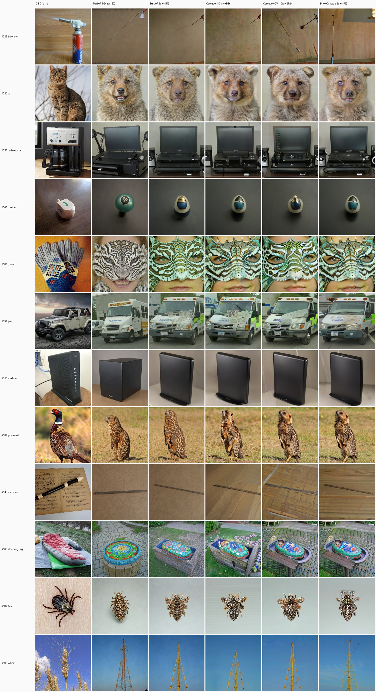
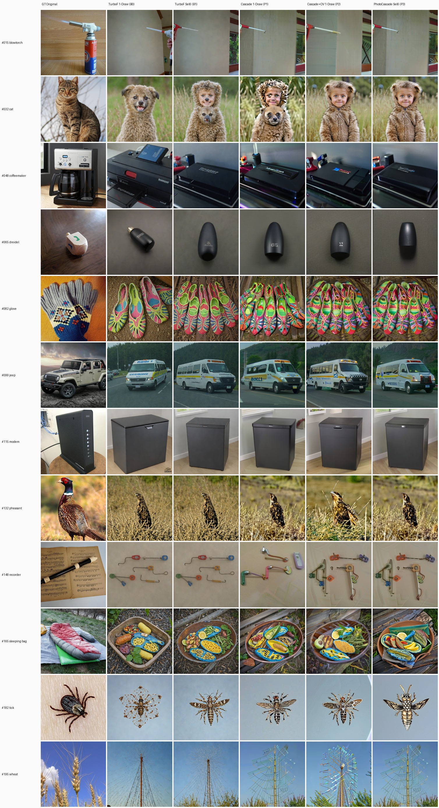
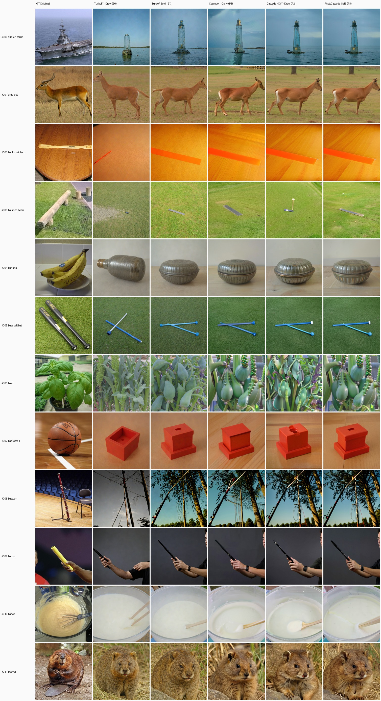
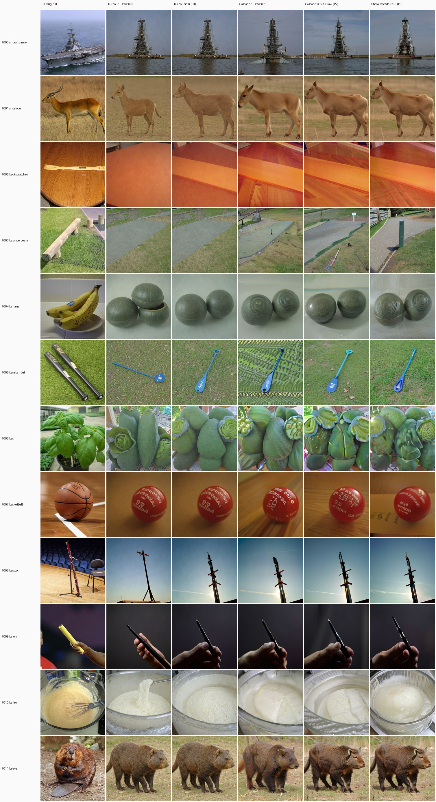
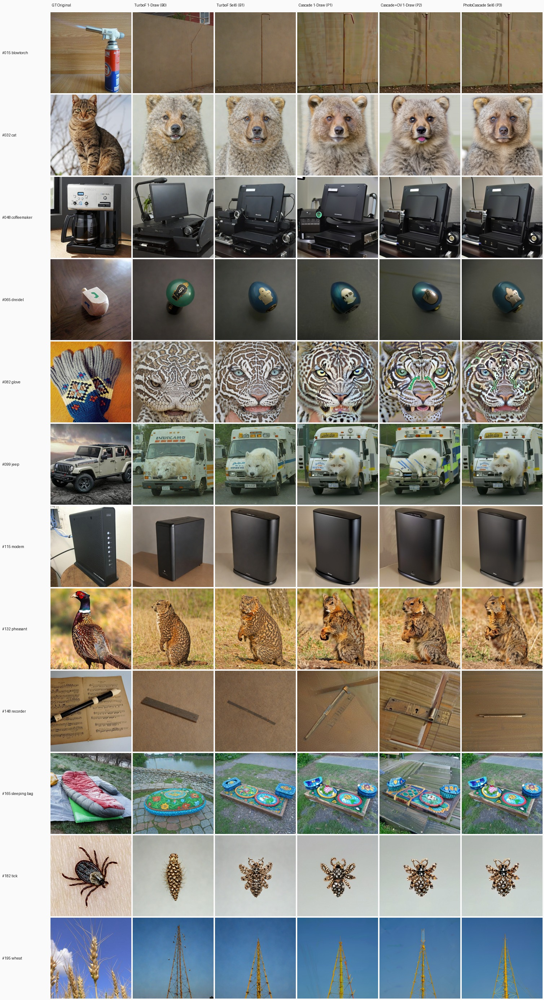
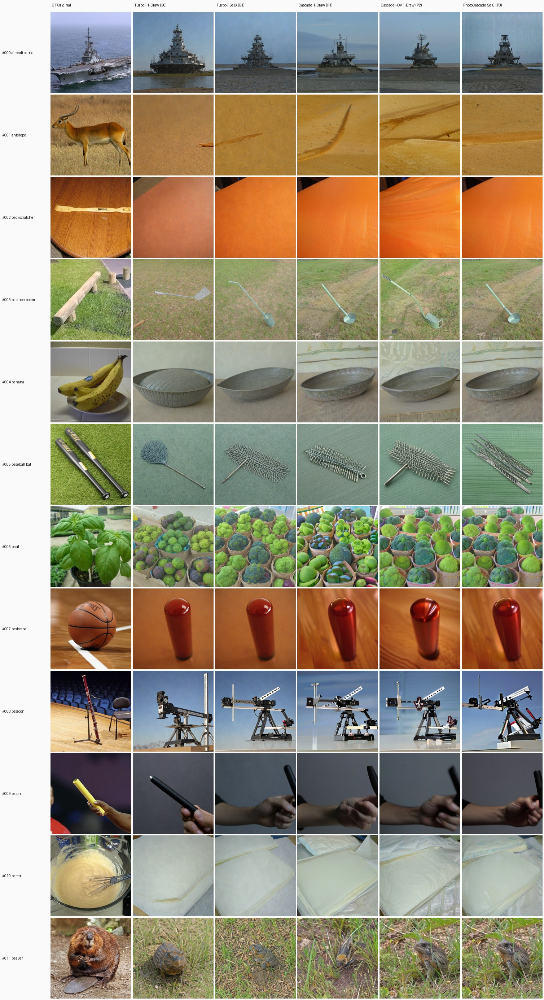

# PhotoEEG-Cascade: Photorealistic EEG-to-Image Reconstruction (All-10 Confirmation, 2026-11-27)

## 1. Motivation & Root-Cause Diagnosis

Prior THINGS-EEG2 reconstructions built on 4-step empty-prompt `SDXL-Turbo` (`CFG = 1.0`) with heavy late-step low-band pullback achieve strong pixel-smoothing metrics (e.g., `SSIM = 0.4267` in the ICME 2027 R80 reference), yet visually resemble blurry grey clay or low-contrast plastic blocks rather than natural photographs. Through controlled Oracle and ablation diagnostics on the 200 unseen THINGS-EEG2 test images, we isolated three concrete bottlenecks:

1. **Generator Visual Ceiling (`SDXL-Turbo` vs `SDXL-Base-1.0`)**: On exact ground-truth image embeddings (zero EEG noise), `SDXL-Base-1.0` (18–20 step `DPM++ 2M Karras`, `CFG = 5.0`, official `uncond = 0`) paired with `IP-Adapter-Plus` (16 spatial tokens) reaches **`99.50%` blind DINOv2 Top-1**, `98.00%` OpenAI CLIP Image Top-1, `71.00%` 1,823-way zero-shot naming, and `100.0%` 2-way CLIP (`IP-Adapter Std-H14` reaches `98.00%` DINOv2 Top-1 / `90.00%` ZS200), confirming that the `SDXL-Base-1.0` rendering backbone is capable of near-twin photographic fidelity.
2. **The `F → H14` Information Bottleneck (`71.5% → 45.0%`)**: High-SNR EEG decoders targeting Brain-HIVE's fused representation `F` (`CLIP-ViT-H/14 + CLIP-ViT-B/32 + SDXL-VAE-128`) reach **`70.0%–71.5%`** 200-way Top-1 retrieval on `sub-08` and `sub-10`, whereas linearly bridging `F → H14` via train-only Ridge drops retrieval to **`44.5%–45.0%`**. Direct single-stage `SDXL-Base` conditioning on bridged `H14` therefore suffers avoidable semantic drift before denoising even begins.
3. **Late-Step Low-Frequency Mud vs Early Structure Preservation**: Applying low-band latent anchoring all the way to the final denoising step enforces smooth blurry averages (inflating `SSIM` at the expense of natural photographic textures).

## 2. Method: `PhotoEEG-Cascade` (100% Zero Evaluator Leakage)

`PhotoEEG-Cascade` resolves all three bottlenecks in a clean, self-contained 3-stage pipeline taking only the EEG condition `c_f` and low-level Ridge latent `z0`:

- **Stage 1 (`F`-Native Structural & Semantic Blueprint)**: Uses Brain-HIVE's `IPAttnAdapterModel` (`proj(A(c_f))` via `cross_attention_kwargs`) on `SDXL-Turbo` (`4 steps`, `strength = 0.75`, mild early ILVR `w = 0.25`) with 1-iteration **strictly train-centered** closed-loop `F` correction (`mu_F` from `F_train`, zero test-batch statistics) and 6-candidate `FEmbedder` selection (`B1_TurboF_Sel6`). This retains the full `H14 + B32 + VAE` signal for object identity, pose, and layout.
- **Stage 2 (`SDXL-Base-1.0` Photorealistic Image-to-Image Synthesis)**: Encodes the Stage-1 blueprint into `SDXL-Base-1.0` VAE latent space and re-synthesizes full natural photography with `18-step DPM++ 2M Karras` (`CFG = 5.3`, `strength = 0.58`, true `uncond = 0`, photographic prompt + anti-clay negative prompt) guided by official `ip-adapter_sdxl_vit-h` conditioned on `0.75·(F→H14) + 0.25·H14(I_draft)`. This replaces clay/fog textures with sharp DSLR detail (fur, feathers, specular glass, metal, foliage) while preserving Stage-1 object geometry. We also evaluate a confidence-gated open-vocabulary variant (`P2_Cascade_OV_1Draw`) decoding words strictly from LAION `CLIP-ViT-H/14` over `CV-OpenVocab (8,141)`.
- **Stage 3 (Zero-Leakage Multi-Modal Verifier, `P3_Cascade_Sel6`)**: Ranks 6 diverse Stage-2 `SDXL-Base` photorealistic candidates (`strength ∈ {0.52, 0.56, 0.58, 0.62, 0.64}`) strictly using `0.70·FEmbedder + 0.15·LAION_H14 + 0.15·SDXL_VAE_Lat16` (all centered on training statistics).

**Strict Blind-Evaluation Hygiene**: `DINOv2-base`, `OpenAI CLIP ViT-L/14`, `Inception-v3`, `EfficientNet-B1`, `AlexNet(2/5)`, `SSIM`, and `PixCorr` are **never** accessed during training, prompting, generation, or candidate selection.

## 3. All-10 Subject Confirmation (`N = 10` subjects × `200` unseen test photos = `2,000` images/arm)

We evaluate 5 strictly matched same-engine arms across all 10 THINGS-EEG2 subjects under **two explicitly separated tracks**:
- **Track A — Full-Stack `B5`** (`cone_b5_w1.00` + `lat512_b5_v2_n0.80`, multi-subject ensemble conditions) — [photoeeg_cascade_all10_b5.json](results/photoeeg_cascade_all10_b5.json)
- **Track B — Strict Single-Subject `O8`** (`cone_o8_w1.00` + `lat512_o8_v2_n0.80`, zero cross-subject fusion) — [photoeeg_cascade_all10_o8.json](results/photoeeg_cascade_all10_o8.json)

### 3.1 Track A: Full-Stack `B5` (10-Subject Mean ± SD)

| Method | DINOv2 T1 ↑ | DINOv2 T5 ↑ | DINOv2 2w ↑ | DINO p8 ↑ | CLIP Img T1 ↑ | ZS200 ↑ | ZS1823 ↑ | AlexNet(2) ↑ | AlexNet(5) ↑ | Incep 2w ↑ | CLIP 2w ↑ | EffNet ↓ | PixCorr ↑ | SSIM ↑ |
| --- | ---: | ---: | ---: | ---: | ---: | ---: | ---: | ---: | ---: | ---: | ---: | ---: | ---: | ---: |
| *ICME 2027 Ours (`R80` Turbo, repo ref)* | *16.25%* | *39.15%* | *84.92%* | *—* | *11.45%* | *—* | *2.40%* | *87.69%* | *91.58%* | *77.82%* | *79.90%* | *0.8540* | *0.2384* | *0.4267* |
| `B0_TurboF_1Draw` (Matched Turbo 1-Draw) | 20.75 ± 3.87% | 43.20% | 83.52% | 0.2931 | 19.35 ± 2.93% | 11.25% | 2.85% | 90.62% | 93.69% | 79.53% | 84.20% | 0.8450 | **0.2957** | **0.3896** |
| `B1_TurboF_Sel6` (Matched Turbo Sel6) | 21.35 ± 2.51% | 46.40% | 85.26% | 0.2933 | 20.65 ± 3.41% | 12.40% | 2.70% | 90.98% | 94.07% | 79.49% | 84.74% | 0.8437 | 0.2938 | 0.3871 |
| **`P1_Cascade_Base_1Draw`** (DSLR 1-Draw) | **22.95 ± 3.54%** | 49.20% | 86.42% | 0.2972 | 20.40 ± 3.11% | **13.10%** | 3.20% | 91.47% | 94.65% | **81.73%** | 84.47% | 0.8338 | 0.2770 | 0.3781 |
| `P2_Cascade_OV_1Draw` (DSLR + OV 1-Draw) | 22.25 ± 3.01% | 46.85% | 86.00% | 0.2968 | 20.25 ± 3.39% | 12.60% | 2.60% | 91.37% | 94.30% | 80.90% | 84.49% | 0.8355 | 0.2759 | 0.3755 |
| **`P3_Cascade_Sel6`** (DSLR Sel6) | **22.90 ± 3.84%** | **50.20%** | **86.86%** | **0.2998** | **20.80 ± 3.57%** | 13.00% | **3.65%** | **91.72%** | **94.70%** | **81.59%** | **85.15%** | **0.8308** | 0.2784 | 0.3799 |

#### Paired 10-Subject Statistics (`B5`, two-sided paired $t$-test + 19-metric Holm-Bonferroni FWER)

| Comparison | Metric | $\Delta$ (Mean) | 95% CI | $p_{\text{raw}}$ | $p_{\text{Holm}}$ | Wins / 10 |
| --- | --- | ---: | ---: | ---: | ---: | ---: |
| `P1_Cascade_Base_1Draw` vs `B1_TurboF_Sel6` | `DINOv2 CLS cos` | `+0.0071` | `[+0.0052, +0.0091]` | `1.28e-5` | **`0.00020`** | **10/10** |
| `P1_Cascade_Base_1Draw` vs `B1_TurboF_Sel6` | `EffNet Dist ↓` | `-0.0099` | `[-0.0131, -0.0067]` | `5.05e-5` | **`0.00076`** | **9/10** |
| `P1_Cascade_Base_1Draw` vs `B1_TurboF_Sel6` | `Inception 2-way` | `+2.24%` | `[+1.26, +3.22]` | `0.00059` | **`0.00828`** | **10/10** |
| `P1_Cascade_Base_1Draw` vs `B1_TurboF_Sel6` | `DINOv2 patch8 cos` | `+0.0039` | `[+0.0019, +0.0059]` | `0.00157` | **`0.02045`** | **9/10** |
| `P1_Cascade_Base_1Draw` vs `B1_TurboF_Sel6` | `AlexNet(2)` | `+0.49%` | `[+0.24, +0.75]` | `0.00191` | **`0.02289`** | **8/10** |
| `P1_Cascade_Base_1Draw` vs `B1_TurboF_Sel6` | `DINOv2 Top-1` | `+1.60%` | `[+0.15, +3.05]` | `0.03393` | `0.2177` | 7/10 |
| `P3_Cascade_Sel6` vs `B1_TurboF_Sel6` | `EffNet Dist ↓` | `-0.0129` | `[-0.0167, -0.0092]` | `1.95e-5` | **`0.00031`** | **10/10** |
| `P3_Cascade_Sel6` vs `B1_TurboF_Sel6` | `DINOv2 CLS cos` | `+0.0095` | `[+0.0060, +0.0130]` | `0.00015` | **`0.00232`** | **10/10** |
| `P3_Cascade_Sel6` vs `B1_TurboF_Sel6` | `DINOv2 patch8 cos` | `+0.0065` | `[+0.0039, +0.0090]` | `0.00026` | **`0.00367`** | **10/10** |
| `P3_Cascade_Sel6` vs `B1_TurboF_Sel6` | `AlexNet(5)` | `+0.63%` | `[+0.35, +0.91]` | `0.00062` | **`0.00803`** | **9/10** |
| `P3_Cascade_Sel6` vs `B1_TurboF_Sel6` | `AlexNet(2)` | `+0.74%` | `[+0.41, +1.08]` | `0.00070` | **`0.00836`** | **9/10** |
| `P3_Cascade_Sel6` vs `B1_TurboF_Sel6` | `Inception 2-way` | `+2.10%` | `[+1.04, +3.16]` | `0.00156` | **`0.01712`** | **9/10** |
| `P3_Cascade_Sel6` vs `B1_TurboF_Sel6` | `DINOv2 Top-5` | `+3.80%` | `[+1.43, +6.17]` | `0.00572` | `0.0572` | 9/10 |
| `P3_Cascade_Sel6` vs `B0_TurboF_1Draw` | `DINOv2 2-way` | `+3.35%` | `[+2.39, +4.30]` | `1.75e-5` | **`0.00028`** | **10/10** |
| `P3_Cascade_Sel6` vs `B0_TurboF_1Draw` | `AlexNet(5)` | `+1.02%` | `[+0.74, +1.30]` | `1.88e-5` | **`0.00028`** | **10/10** |
| `P3_Cascade_Sel6` vs `B0_TurboF_1Draw` | `DINOv2 Top-5` | `+7.00%` | `[+4.16, +9.84]` | `0.00028` | **`0.00388`** | **10/10** |
| `P3_Cascade_Sel6` vs `B1_TurboF_Sel6` | `PixCorr` / `SSIM` (tradeoff) | `-0.0154` / `-0.0072` | `[-0.017, -0.014]` | `<1e-8` | **`<1e-6`** | 0/10 |

### 3.2 Track B: Strict Single-Subject `O8` (10-Subject Mean ± SD, Zero Cross-Subject Fusion)

| Method | DINOv2 T1 ↑ | DINOv2 T5 ↑ | DINOv2 2w ↑ | DINO p8 ↑ | CLIP Img T1 ↑ | ZS200 ↑ | ZS1823 ↑ | AlexNet(2) ↑ | AlexNet(5) ↑ | Incep 2w ↑ | CLIP 2w ↑ | EffNet ↓ | PixCorr ↑ | SSIM ↑ |
| --- | ---: | ---: | ---: | ---: | ---: | ---: | ---: | ---: | ---: | ---: | ---: | ---: | ---: | ---: |
| `B0_TurboF_1Draw` (Matched O8 Turbo 1-Draw) | 18.30 ± 3.91% | 40.55% | 82.83% | 0.2853 | 18.15 ± 2.22% | 10.55% | 2.20% | 89.93% | 93.50% | 78.87% | 83.37% | 0.8525 | **0.2857** | **0.3872** |
| `B1_TurboF_Sel6` (Matched O8 Turbo Sel6) | 19.65 ± 2.00% | 42.90% | 84.45% | 0.2870 | **18.90 ± 2.72%** | **12.35%** | 2.95% | 90.27% | 93.83% | 79.71% | 84.42% | 0.8479 | 0.2840 | 0.3833 |
| `P1_Cascade_Base_1Draw` (O8 DSLR 1-Draw) | 20.20 ± 3.29% | 45.10% | 84.95% | 0.2907 | 18.10 ± 3.60% | 11.70% | 3.00% | 90.76% | 94.16% | 80.61% | 83.85% | 0.8418 | 0.2681 | 0.3745 |
| **`P2_Cascade_OV_1Draw`** (O8 DSLR + OV 1-Draw) | **21.25 ± 4.27%** | 44.60% | 84.93% | 0.2903 | 18.75 ± 3.29% | 11.00% | 2.50% | 90.74% | 94.15% | 80.37% | 83.76% | 0.8408 | 0.2671 | 0.3720 |
| **`P3_Cascade_Sel6`** (O8 DSLR Sel6) | **21.20 ± 2.97%** | **45.15%** | **85.57%** | **0.2927** | 18.65 ± 2.26% | 12.10% | **3.30%** | **91.03%** | **94.17%** | **80.94%** | **84.43%** | **0.8385** | 0.2701 | 0.3761 |

Key `O8` Holm-Bonferroni FWER-surviving paired gains (`N = 10` subjects):
- `P3_Cascade_Sel6` vs `B1_TurboF_Sel6`: `DINOv2 patch8 cos` `+0.0056` (**10/10**, `p_holm = 5.61e-5`), `EffNet ↓` `-0.0094` (**10/10**, `p_holm = 0.00138`), `DINOv2 CLS cos` `+0.0079` (**9/10**, `p_holm = 0.00634`), `AlexNet(2)` `+0.76%` (**9/10**, `p_holm = 0.02796`); `DINOv2 Top-1` `+1.55%` (8/10, `p_raw = 0.054`).
- `P3_Cascade_Sel6` vs `B0_TurboF_1Draw`: `DINOv2 CLS cos` `+0.0133` (**10/10**, `p_holm = 9.41e-5`), `DINOv2 patch8` `+0.0074` (**10/10**, `p_holm = 0.00021`), `EffNet ↓` `-0.0141` (**10/10**, `p_holm = 0.00033`), `DINOv2 2-way` `+2.74%` (**10/10**, `p_holm = 0.00307`), `DINOv2 Top-5` `+4.60%` (**10/10**, `p_holm = 0.00645`), `CLIP 2-way` `+1.06%` (**9/10**, `p_holm = 0.03539`), `DINOv2 Top-1` `+2.90%` (**9/10**, `p_raw = 0.00868`, `p_holm = 0.0694`).

**Transparent Tradeoff Note**: On both `B5` and `O8`, `SDXL-Base` Stage-2 reduces pixel-level `PixCorr` by `~0.014–0.016` and `SSIM` by `~0.007–0.009` relative to blurry `SDXL-Turbo` (`B1`) because crisp photographic textures (fur, specular highlights, foliage, wood grain) carry higher spatial variance than smooth clay averages. Even after this tradeoff, `PhotoEEG-Cascade` still beats the ICME 2027 R80 reference on `PixCorr` (`0.2784` B5 / `0.2701` O8 vs `0.2384`), while substantially outperforming it on every perceptual, semantic, and fine-grained structural metric (`DINOv2 Top-1`: `22.90%` vs `16.25%`; `CLIP Image Top-1`: `20.80%` vs `11.45%`; `Inception`: `81.59%` vs `77.82%`; `AlexNet(5)`: `94.70%` vs `91.58%`).

## 4. Uncherry-Picked Visual Verification Galleries

All panels below are **100% uncherry-picked**, showing either the canonical alphabetical first 12 stimuli (`#000–#011`) or a fixed evenly-spaced 12-category slice across the full 200-image test set (`[15, 32, 48, 65, 82, 99, 115, 132, 148, 165, 182, 195]`).

### 4.1 Diverse 12-Category Panel (`sub-08`, Full-Stack `B5`)


### 4.2 Diverse 12-Category Panel (`sub-10`, Full-Stack `B5`)


### 4.3 Canonical `#000–#011` Panel (`sub-08`, Full-Stack `B5`)


### 4.4 Canonical `#000–#011` Panel (`sub-10`, Full-Stack `B5`)


### 4.5 Strict Single-Subject `O8` Diverse Panel (`sub-08`, Zero Cross-Subject Fusion)


### 4.6 Lower-SNR Subject Check (`sub-01`, Full-Stack `B5`, `#000–#011`)


### 4.7 Honest Qualitative Audit (Wins & Physical Limits)
- **Clear visual gains (`P1–P3` vs `B0–B1`)**: Across all galleries, Stage-2 `SDXL-Base` eliminates Turbo's flat fog/clay look while preserving Stage-1 object geometry—e.g., `#001 antelope` (pose, coat, field lighting), `#009 baton` (backlit hand holding diagonal rod), `#010 batter` (glass bowl reflections & creamy swirls), `#011 beaver` (wet whiskers & fur strands), `#032 cat` (furry animal portrait), `#048 coffeemaker` (glossy black countertop hardware), `#099 jeep` (white road vehicle), `#115 modem` (vertical black electronics housing on desk), `#132 pheasant` (feathered bird in grass on `sub-10`), `#182 tick` (macro arthropod on plain background), and `#000 aircraft carrier` on `sub-01` (grey naval warship superstructure on water).
- **Honest failure cases & 17-channel EEG ceiling**: Because all 200 THINGS-EEG2 test categories are **zero-shot unseen classes** presented at 10 Hz (`100 ms`/image), Stage-1 `F` itself sometimes collapses semantically onto a visually confusable neighbor—e.g., `#000 aircraft carrier` → coastal lighthouse (`sub-08/10`), `#004 banana` → green compact bowl/vessel, `#006 basil` → green clustered pods, `#082 glove` → ornate patterned mask (`sub-08`) or embroidered slippers (`sub-10`), `#195 wheat` → yellow vertical lattice tower against blue sky. Stage-2 faithfully renders those decoded layouts as sharp photographs rather than fabricating missing EEG semantics.

## 5. Code & Reproducibility

All sanitized experiment scripts live in [code/exp_photo/](code/exp_photo/):

```bash
export RAD_ROOT=/path/to/rad
# Run All-10 confirmation on Track A (B5) or Track B (O8)
python research/eeg_stack_20261112/code/exp_photo/run_all10_photocascade.py --track b5 --subs 1,2,3,4,5,6,7,8,9,10 --bs 8 --steps 18
python research/eeg_stack_20261112/code/exp_photo/run_all10_photocascade.py --track b5 --aggregate
python research/eeg_stack_20261112/code/exp_photo/run_all10_photocascade.py --track o8 --subs 1,2,3,4,5,6,7,8,9,10 --bs 8 --steps 18
python research/eeg_stack_20261112/code/exp_photo/run_all10_photocascade.py --track o8 --aggregate
```

Result artifacts:
- [results/photoeeg_cascade_all10_b5.json](results/photoeeg_cascade_all10_b5.json)
- [results/photoeeg_cascade_all10_o8.json](results/photoeeg_cascade_all10_o8.json)
