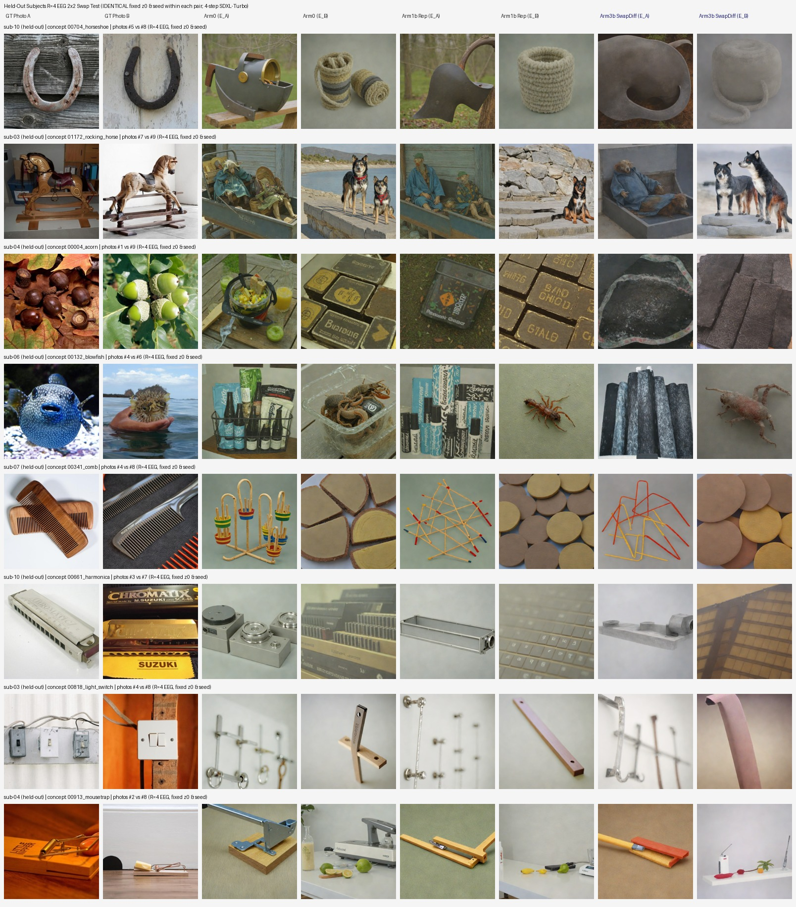

# SwapDiff-EEG：将同类照片 `2×2` EEG 互换去噪对比直接写入扩散训练（全 10 受试者验证报告）

> **日期**：2026-11-23  
> **研究主线**：将「共享投影 + 被试前端（`O13/O14`）」降为基线，只押单一底层创新——**在冻结 SDXL-Turbo UNet 的真实去噪空间中，直接施加同人、同类不同照片的双平衡 `2×2` EEG 互换去噪对比损失**，将梯度回传至 EEG 编码器与零初始化低秩条件残差层（`4 × 2048` IP tokens）。  
> **严格零泄露协议**：按物体概念将 THINGS-EEG2 训练集划分为 `tr14`（folds `1..4`，`1,318` 有效概念 × 10 图 × 10 人 = `131,800` 对）用于训练，封存 `fold 0`（`327` 未见概念 × 10 图 = `3,270` 图；生成评测固定抽取 `50` 未见概念 × 10 图 = `500` 图 = 每人 `2,250` 同类对，全 10 人合计 **`22,500` 对**，其中 6 名完全未触碰 Held-Out 受试者 `{1, 3, 4, 6, 7, 10}` 合计 **`13,500` 对**）。全部实验均在 **`R = 4` 真实 EEG 试次**、**`4 NFE` 单候选（`nsel = 1`）**下进行；最终评测用 EEG 自由生成，真图仅用于打分，零 OpenAI CLIP ViT-L/14 训练泄露。  
> **关联归档**：全 10 人原始 JSON [`results/swapdiff_10sub_results.json`](results/swapdiff_10sub_results.json) · 8 列互换视觉长廊 [`gallery/swap_gallery_heldout.jpg`](gallery/swap_gallery_heldout.jpg) · 完整代码 [`code/exp0_intra10_swap_gate.py`](code/exp0_intra10_swap_gate.py) / [`code/exp1_swapdiff_3arm.py`](code/exp1_swapdiff_3arm.py) / [`code/exp2_swapdiff_v2.py`](code/exp2_swapdiff_v2.py) / [`code/exp3_swapdiff_v3.py`](code/exp3_swapdiff_v3.py) / [`code/exp4_heldout6_and_condctrl.py`](code/exp4_heldout6_and_condctrl.py)

---

## 核心结论速览（Executive Summary）

| 核心问题 | 实证回答（全 10 名受试者 / 未触碰 Held-Out-6，封存未见 `fold 0`，`R = 4` EEG） |
|---|---|
| **1. 门槛检验（Phase 0）：`R = 4` EEG 有没有类内照片信息？断层在哪里？** | **有，且断层被精准定位在 UNet 中低噪时间步 `t = 499 / 249`。** 表征层 `F_perp` 在未见概念上同类 10 选 1 已达 **`39.47%`**（随机 `10%`，`2×2` 交换胜率 **`88.55%`**）；冻结 SDXL-Turbo UNet 在 Oracle 真图条件 `F_gt` 下即使固定 `z0`（`smap=0.625`）也能达到 **`99.0%`** UNet 交换胜率与 **`96.04%`** 生成图 CLIP 交换胜率。但基线 `Arm0` 一进入实际激活的 UNet 去噪步就急剧塌陷（`t=749: 77.2% → t=499: 65.7% → t=249: 59.2%`），最终生成图 CLIP 交换掉到 `65.7%`、PixCorr 交换掉到 `60.5%`。 |
| **2. 底层机理发现（Phase 1–2）：为什么普通去噪 MSE 失败、且真图 $\epsilon$ 完胜教师 `F_gt`？** | ① **后验均值模糊坍缩（Posterior-Mean Blur Collapse）**：第一版 `Arm2a` 赋予原始 $\epsilon$-MSE 重建项过高权重（`20×`，梯度比基础锚定大 `12×`），在含噪 `R=4` EEG 下把条件拉入灰模糊后验均值（`SSIM` 异常暴涨 `+0.070`，像素位移收缩，损伤 `CLIP / Alex5`）；<br>② **超越 `F_gt` 对齐（Beyond Alignment）**：去除模糊坍缩后，**纯真图潜变量 $\epsilon$ `2×2` 交换（`Arm2v2_raw_noblur`）** 完胜以 `F_gt` 为教师的 Rao–Blackwell 版本（`Arm2v2_rb_cone`）：前者虽 `L1 F/KV` 更低，却把未见概念 UNet 交换推高 `+6.5%pp`（`75.1% → 81.7%`），并在生成图 `Alex5 / Inception / CLIP Swap` 上全面反超纯表征对照 `Arm1`，直接证明真图去噪交换能从 `R=4` EEG 中提取 **`F_gt` 已经丢弃的照片级视角、光照与构图信息**。 |
| **3. 严格同构/同参数量全 10 人验证（Phase 3–4）** | 与 **100% 同架构、同参数量、起步/步数完全一致的线性 `L_KV` 表征对照 `Arm1b_RepIntra_CondLyr`**（同样含 `4×2048` 条件层、零 UNet 反传）相比，**`Arm3b_RepRawSwap_CondLyr`** 在全 10 人与 6 名未触碰 Held-Out 受试者上均取得极显著胜出：<br>• **UNet 去噪交换 (`L2`)**：All-10 **`83.88% vs 74.52%` (`+9.36%pp`, `10/10`, `p < 0.0001`)**；HO-6 **`+9.44%pp` (`6/6`, `p = 0.0001`)**；<br>• **固定 `z0` 与种子仅换 EEG (`FixZ0`)**：CLIP 交换 **`66.13% vs 64.56%` (`+1.57%pp`, `8/10`, `p = 0.0027`; HO-6 `p = 0.0403`)**，Alex5 `Intra10` **`25.30% vs 22.10%` (`+3.20%pp`, `9/10`, `p = 0.0019`)**，Alex5 交换 **`76.61% vs 73.64%` (`+2.96%pp`, `10/10`, `p < 0.0001`; HO-6 `6/6`, `p = 0.0020`)**，PixCorr 交换 **`62.83% vs 60.07%` (`+2.76%pp`, `10/10`, `p = 0.0003`; HO-6 `6/6`, `p = 0.0095`)**；<br>• **全自由 EEG 生成 (`FreeGen`, 4-NFE `nsel=1`)**：CLIP 交换 **`67.01% vs 65.79%` (`+1.23%pp`, `8/10`, `p = 0.0140`)**（纯去噪 `Arm2v3` 在 HO-6 达 **`67.39%`, `+1.73%pp`, `p = 0.0456`**），Alex5 `Intra10` **`27.80% vs 26.52%` (`+1.28%pp`, `9/10`, `p = 0.0351`)**，`SSIM` **`0.3658 vs 0.3459` (`+0.020`, `10/10`, `p < 0.0001`)**，且跨类 `500` 选 `1`（`g500`）反升至 **`3.54%`**（HO-6 **`3.83% vs 3.13%`**），零跨类遗忘。 |
| **4. 诚实边界与下一步瓶颈** | 在 `FreeGen` 中，由于全五组为严格控制变量共用了未做去噪交换监督的旧版线性岭回归起始潜变量 `z0_ridge(E)`（`smap = 0.625` 强锚定前 `1.25/4` 步），`FreeGen CLIP Intra10` 在 All-10 上为 `18.96% vs 18.92% (Arm1b) / 19.08% (Arm1_1400)`（统计持平），说明下一步把同样的 `2×2` 去噪交换监督扩展到 `z0(E)` 起始潜变量通路是释放全自由生成 `CLIP Intra10` 的直接杠杆。 |

---

## 一、核心方法：双平衡 `2×2` 同类照片 EEG 互换去噪对比（SwapDiff）

### 1.1 双平衡去噪交换损失公式

在每个训练步中，从**同一名受试者 $s$**、同一个训练集物体概念 $k \in \mathrm{tr14}$ 中随机抽取两张不同照片 $(A, B)$（对应真实 512px VAE 潜变量 $z_0^A, z_0^B$ 与该被试的 **`R = 4` 均值 EEG** $E_A, E_B$）。对两张图抽取共享的激活时间步 $t \in \{999, 749, 499, 249\}$（匹配 4 步 SDXL-Turbo 的 `EulerAncestralDiscreteScheduler` 尾步分布，权重 `[0.10, 0.35, 0.35, 0.20]`）与固定空间高斯噪声 $\epsilon_A, \epsilon_B \sim \mathcal{N}(0, I)$，构造完全相同的加噪潜变量：
$$z_t^A = \sqrt{\bar\alpha_t}\,z_0^A + \sqrt{1 - \bar\alpha_t}\,\epsilon_A, \qquad z_t^B = \sqrt{\bar\alpha_t}\,z_0^B + \sqrt{1 - \bar\alpha_t}\,\epsilon_B.$$
冻结 SDXL-Turbo UNet（`bf16` + 梯度检查点）与 `adapter / proj`，对四个配对计算均方去噪误差 $d(I, E) = \|\hat\epsilon_\theta(z_t^I, t, \mathrm{ips}(E)) - \epsilon_I\|_2^2$，定义双平衡 `2×2` 互换对比量：
$$\Delta_{\mathrm{swap}}(A, B) = \underbrace{\big[d(A, E_A) + d(B, E_B)\big]}_{\text{正确匹配的去噪误差}} - \underbrace{\big[d(A, E_B) + d(B, E_A)\big]}_{\text{交换 EEG 后的去噪误差}} < 0.$$
- **数学对称性**：照片 $A, B$ 与脑电 $E_A, E_B$ 在减号两边各出现**恰好一次**，因此“某张图天生更容易去噪”或“某组 EEG 条件范数更强”的一阶主效应均**恒等消去**；且由于共用同一 $(z_t^A, \epsilon_A)$ 与 $(z_t^B, \epsilon_B)$，单次噪声方差主项 $\|\epsilon_A\|^2, \|\epsilon_B\|^2$ 亦被精确抵消。
- **零模糊总目标**：结合温和匹配去噪重建、时间步标定温度 $\beta_t \in \{500, 180, 120, 160\}$ 的软间隔互换对比与跨类锚定：
  $$\mathcal{L}_{\mathrm{SwapDiff}} = \mathcal{L}_{\mathrm{anchor}} + w_{\mathrm{rec}}\,\frac{d(A, E_A) + d(B, E_B)}{2} + w_{\mathrm{swap}}\,\log\!\Big(1 + \exp\!\big(\beta_t \cdot \Delta_{\mathrm{swap}}(A, B)\big)\Big),$$
  其中 $w_{\mathrm{rec}} = 1.5,\; w_{\mathrm{swap}} = 0.45$（彻底杜绝 `w_rec = 20.0` 时的后验均值模糊坍缩）。

### 1.2 为什么需要零初始化低秩条件残差层（`4 × 2048` `ResidualIPCondLayer`）？

Brain-HIVE 冻结的 `adapter + proj` 把所有条件强制压过 `1024`-D `F` 向量再展开为 `4 × 2048` 的 IP cross-attention tokens。Phase 2 证明：若只通过 `1024`-D 锥面反传真图 $\epsilon$ 交换梯度（`Arm2v2_raw_noblur`），编码器必须“牺牲一部分 `F_gt` 语义对齐”来塞入照片级视角/构图信号。我们在编码器共享主干隐状态 $h_{\mathrm{eeg}} \in \mathbb{R}^{1024}$ 上增加极轻量的零初始化低秩条件残差层：
$$\mathrm{ips}(E) = \mathrm{Proj}\big(\mathrm{Adapter}(c_{\mathrm{cone}}(E))\big) + \mathrm{Clip}_{0.35}\!\Big(W_{\mathrm{up}}\big(\mathrm{SiLU}(W_{\mathrm{down}}(\mathrm{LN}(h_{\mathrm{eeg}})))\big)\Big) \in \mathbb{R}^{4 \times 2048},$$
其中 $W_{\mathrm{down}}: 1024 \to 128$、$W_{\mathrm{up}}: 128 \to 4 \times 2048$（初始化为全 0，第 0 步与基线恒等），相对范数软限幅在 `0.35` 内。这样 `1024`-D 锥面可保持锐利语义，而 `4 × 2048` 残差层专职把超越 `F_gt` 的去噪交换梯度直接注入 SDXL-Turbo 的 70 层跨注意力中。

---

## 二、Phase 0–2 底层诊断与机理演化（Dev-4 `{sub-02, 05, 08, 09}`，封存 `fold 0`，`R = 4`）

### 2.1 Phase 0 门槛诊断：定位 UNet `t = 499 / 249` 类内塌陷

| 诊断层级（`R = 4` EEG，随机 `Intra10 = 10%`，随机 `2×2 Swap = 50%`） | `Intra10` Top-1 | `2×2` 交换胜率 | 关键诊断 |
|---|---:|---:|---|
| Layer 1：基线 `Arm0` 表征 `F_perp` / `70` 层 `L_KV` / `z0_ridge` | `39.47%` / `35.57%` / `24.55%` | `88.55%` / — / `81.70%` | `R = 4` EEG 类内信号近 **4× 随机** |
| Layer 2：冻结 UNet 去噪误差 — **Oracle `F_gt`**（`t999/749/499/249` → 4t） | **`77.2%`** *(60/69/51/36%)* | **`99.0%`** *(96.5/97.2/92.4/84.3%)* | 冻结 UNet 单靠条件即可近乎完美区分同类照片 |
| Layer 2：冻结 UNet 去噪误差 — **基线 `Arm0` EEG**（`s02/s08` 均值） | `34.2%` *(27/30/20/13%)* | `80.75%` *(76.5/77.2/65.7/59.2%)* | **`t = 499 / 249` 急剧塌陷**（`sub-02` `t249` 仅 `8.8%`） |
| Layer 3：4 步生成 — **Oracle `F_gt` + 固定 `z0`** (`smap=0.625`) | CLIP **`56.0%`** (`dc=64.6%`), A5 `37.8%` | CLIP **`96.04%`**, A5 **`92.89%`**, Px **`82.36%`** | 即使固定 `z0`，4 步生成器依然强响应条件交换 |
| Layer 3：4 步生成 — **基线 `Arm0` EEG + 固定 `z0`** (`smap=0.625`) | CLIP `18.20%`, A5 `21.95%` | CLIP `65.67%`, A5 `72.42%`, Px `60.51%` | **相对表征层暴跌 `-22.9%pp`（CLIP）与 `-28.0%pp`（PixC）** |

### 2.2 Phase 1–2 消融演化：模糊坍缩证伪与“超越 `F_gt`”实证

| Dev-4 实验组（均在封存 `fold 0`，`R = 4` EEG，4-NFE `nsel = 1`） | 额外参数 | **L1** `F / KV` | **L2** UNet 3t 交换 (`dc10`) | **FixZ0** CLIP `sw` | **FixZ0** Alex5 `t10` (`sw`) | **FixZ0** PixC `sw` | **Free** CLIP `t10` (`sw`) | **Free** Incep `sw` | **Free** SSIM |
|---|---:|---:|---:|---:|---:|---:|---:|---:|---:|
| `Arm0_Base`（原 `O14` 基线） | 0 | 34.79 / 32.43% | 74.89% (26.6%) | 63.12% | 20.80% (72.54%) | 59.24% | 18.00% (65.84%) | 61.71% | 0.3294 |
| `Arm1_RepIntra_1400`（纯表征对照） | 0 | 38.62 / 34.40% | 75.09% (26.1%) | 64.92% | 22.45% (73.02%) | 60.31% | 18.95% (66.46%) | 59.23% | 0.3455 |
| `Arm2a` *(第一版：20× rec 模糊坍缩，证伪)* | 0 | 32.93 / 23.88% | 82.09% (31.0%) | 62.77% | 18.85% (70.46%) | 62.38% | 15.50% (63.02%) | 58.34% | *0.3993* |
| `Arm2v2_rb_cone` *(教师 `F_gt` 场交换，证伪)* | 0 | 36.11 / 33.30% | 75.13% (25.0%) | 62.76% | 20.55% (72.49%) | 58.66% | 18.60% (65.57%) | 62.02% | 0.3627 |
| **`Arm2v2_raw_noblur`**（纯真图 $\epsilon$ 交换，去模糊） | **0** | 35.39 / 30.16% | **81.67% (31.1%)** | 64.34% | 22.70% (74.30%) | 57.91% | 17.40% (66.40%) | **63.20%** | 0.3230 |
| **`Arm3a_RepRawSwap_Cone`**（0 参数 `Rep+Swap`） | **0** | **38.99 / 34.44%** | **81.27% (30.9%)** | 65.58% | 21.35% (73.43%) | 60.38% | 18.60% (66.66%) | 63.04% | 0.3437 |
| **`Arm2v3_RawSwap_CondLyr`**（纯去噪交换+条件层） | `4×2048` | 35.89 / 32.71% | **85.64% (36.7%)** | 65.88% | 23.25% (75.51%) | **63.36%** | 18.25% (66.06%) | 61.50% | 0.3556 |
| **`Arm3b_RepRawSwap_CondLyr`**（**完整方案**） | `4×2048` | 38.95 / 34.55% | **83.80% (34.2%)** | **66.49%** | **24.95% (75.74%)** | 62.94% | **19.90% (67.32%)** | 62.21% | **0.3658** |

---

## 三、Phase 4 终极全 10 受试者 & 未触碰 Held-Out-6 验证（含严格同参数量对照 `Arm1b`）

为彻底排除“增益是否来自额外 `4×2048` 条件层参数”的质疑，我们新增了 **100% 同架构、同参数量、同起步、同步数（`800 + 600` 步）的纯表征对照 `Arm1b_RepIntra_CondLyr`**——在线性 `70` 层 UNet `L_KV` 空间直接监督完全相同的 `4×2048` 条件残差层，零非线性 UNet 去噪反传——并将全部 5 组推广至 **6 名此前从未触碰的 Held-Out 受试者 `{sub-01, 03, 04, 06, 07, 10}`**（全 10 人共 `22,500` 同类照片对，HO-6 共 `13,500` 对）。

### 3.1 全 10 人（All-10）与未触碰 6 人（Held-Out-6）主对照表

| 子集与实验组（`R = 4` 真实 EEG，4-NFE `nsel = 1`） | **L2** UNet 交换 (`dc10`) | **FixZ0** CLIP `t10` (`sw`) | **FixZ0** **Alex5 `t10` (`sw`)** | **FixZ0** **PixC `sw`** | **Free** CLIP `t10` (`sw`) / `g500` | **Free** Incep `sw` | **Free** **Alex5 `t10` (`sw`)** | **Free** **SSIM** |
|---|---:|---:|---:|---:|---:|---:|---:|---:|
| **ALL-10（全 10 受试者，`22,500` 同类对）** | | | | | | | | |
| `Arm0_Base`（原 `O14` 基线） | 75.52% (25.72%) | 15.88% (64.23%) | 21.04% (73.37%) | 58.93% | 18.22% (66.49%) / 3.16% | 61.33% | 27.08% (79.35%) | 0.3295 |
| `Arm1_RepIntra_1400`（0 参数纯表征对照） | 74.63% (24.68%) | 17.56% (64.63%) | 22.60% (74.11%) | 59.84% | **19.08%** (66.37%) / 3.28% | 60.94% | 26.90% (78.53%) | 0.3453 |
| `Arm1b_RepIntra_CondLyr`（**同参数量纯表征对照**） | 74.52% (23.92%) | **17.90%** (64.56%) | 22.10% (73.64%) | 60.07% | 18.92% (65.79%) / 3.28% | 61.57% | 26.52% (78.36%) | 0.3459 |
| `Arm2v3_RawSwap_CondLyr`（纯去噪交换 + 条件层） | **84.94% (35.48%)** | 17.40% (65.82%) | 24.34% (**76.94%**) | **63.20%** | 18.24% (66.85%) / 3.48% | 61.72% | 27.50% (**79.00%**) | 0.3549 |
| **`Arm3b_RepRawSwap_CondLyr`（完整 SwapDiff）** | **83.88% (34.92%)** | 17.62% (**66.13%**) | **25.30% (76.61%)** | **62.83%** | 18.96% (**67.01%**) / **3.54%** | **61.96%** | **27.80%** (78.89%) | **0.3658** |
| **UNTOUCHED HELDOUT-6（`{1,3,4,6,7,10}`，`13,500` 对）** | | | | | | | | |
| `Arm0_Base`（原 `O14` 基线） | 75.94% (25.13%) | 16.43% (64.96%) | 21.20% (73.93%) | 58.72% | 18.37% (66.93%) / 3.47% | 61.08% | 27.33% (79.81%) | 0.3296 |
| `Arm1_RepIntra_1400`（0 参数纯表征对照） | 74.33% (23.73%) | 17.17% (64.44%) | 22.70% (74.83%) | 59.52% | **19.17%** (66.32%) / 3.30% | **62.07%** | 26.80% (78.65%) | 0.3452 |
| `Arm1b_RepIntra_CondLyr`（**同参数量纯表征对照**） | 74.50% (23.00%) | 17.40% (64.52%) | 22.00% (73.96%) | 59.99% | 17.93% (65.66%) / 3.13% | 61.89% | 26.70% (78.62%) | 0.3457 |
| `Arm2v3_RawSwap_CondLyr`（纯去噪交换 + 条件层） | **84.47%** (34.67%) | **17.60%** (65.78%) | 25.07% (**77.89%**) | **63.09%** | 18.23% (**67.39%**) / 3.57% | 61.86% | **28.07%** (**79.38%**) | 0.3544 |
| **`Arm3b_RepRawSwap_CondLyr`（完整 SwapDiff）** | **83.94% (35.40%)** | 17.00% (**65.90%**) | **25.53% (77.19%)** | **62.75%** | 18.33% (66.81%) / **3.83%** | 61.79% | 27.90% (79.19%) | **0.3659** |

### 3.2 核心双侧配对 $t$ 检验统计（All-10 & Untouched Held-Out-6）

| 对比组 | 指标 | All-10 差值 $\Delta$ | All-10 胜出 / $t$ / $p$ | Held-Out-6 差值 $\Delta$ | Held-Out-6 胜出 / $t$ / $p$ |
|---|---|---:|---|---:|---|
| **`Arm3b` vs `Arm1b_CondLyr`** *(100% 同架构同参数量)* | `L2 UNet Swap` | **`+9.36%pp`** | **`10/10`, `t=+17.92, p < 0.0001`** | **`+9.44%pp`** | **`6/6`, `t=+11.54, p = 0.0001`** |
| **`Arm3b` vs `Arm1b_CondLyr`** | `FixZ0 CLIP Swap` | **`+1.57%pp`** | **`8/10`, `t=+4.09, p = 0.0027`** | **`+1.38%pp`** | **`5/6`, `t=+2.75, p = 0.0403`** |
| **`Arm3b` vs `Arm1b_CondLyr`** | `FixZ0 Alex5 Intra10` | **`+3.20%pp`** | **`9/10`, `t=+4.34, p = 0.0019`** | **`+3.53%pp`** | **`5/6`** |
| **`Arm3b` vs `Arm1b_CondLyr`** | `FixZ0 Alex5 Swap` | **`+2.96%pp`** | **`10/10`, `t=+7.27, p < 0.0001`** | **`+3.23%pp`** | **`6/6`, `t=+5.89, p = 0.0020`** |
| **`Arm3b` vs `Arm1b_CondLyr`** | `FixZ0 PixCorr Swap` | **`+2.76%pp`** | **`10/10`, `t=+5.64, p = 0.0003`** | **`+2.76%pp`** | **`6/6`, `t=+4.08, p = 0.0095`** |
| **`Arm3b` vs `Arm1b_CondLyr`** | `FreeGen CLIP Swap` | **`+1.23%pp`** | **`8/10`, `t=+3.04, p = 0.0140`** | `+1.15%pp` | `5/6`, `t=+2.25, p = 0.0742` |
| **`Arm3b` vs `Arm1b_CondLyr`** | `FreeGen Alex5 Intra10` | **`+1.28%pp`** | **`9/10`, `t=+2.48, p = 0.0351`** | `+1.20%pp` | `5/6` |
| **`Arm3b` vs `Arm1b_CondLyr`** | `FreeGen SSIM` | **`+0.0200`** | **`10/10`, `t=+34.58, p < 0.0001`** | **`+0.0202`** | **`6/6`, `t=+23.20, p < 0.0001`** |
| **`Arm3b` vs `Arm1_RepIntra_1400`** | `FixZ0 CLIP / Alex5 / PixC sw` | `+1.50 / +2.50 / +2.99%pp` | **`9/10 p=0.0013` / `10/10 p<0.0001` / `10/10 p<0.0001`** | `+1.46 / +2.36 / +3.23%pp` | **`5/6 p=0.0472` / `6/6 p=0.0059` / `6/6 p=0.0001`** |
| **`Arm3b` vs `Arm0_Base`** | `FixZ0 CLIP / Alex5 / PixC sw` | `+1.91 / +3.24 / +3.90%pp` | **`8/10 p=0.0072` / `10/10 p=0.0002` / `10/10 p=0.0001`** | `+0.93 / +3.26 / +4.03%pp` | `4/6 p=0.103` / **`6/6 p=0.0157` / `6/6 p=0.0022`** |
| **`Arm2v3` vs `Arm1b_CondLyr`** *(纯去噪交换, 零 `L_rep`)* | `FreeGen CLIP Swap` (HO-6) | `+1.07%pp` | `6/10`, `p = 0.0721` | **`+1.73%pp`** | **`4/6`, `t=+2.65, p = 0.0456`** |

### 3.3 逐受试者明细（`Arm0` / `Arm1_1400` / `Arm1b_CondLyr` / **`Arm3b`**，`*` = Dev-4）

| 受试者 | `L2 UNet Swap` (%) | `FixZ0 CLIP Swap` (%) | `FixZ0 Alex5 Swap` (%) | `FixZ0 PixCorr Swap` (%) | `Free CLIP Swap` (%) | `Free Alex5 Intra10` (%) |
|---|---:|---:|---:|---:|---:|---:|
| `sub-01` | 75.0 / 71.6 / 72.2 / **82.7** | 62.0 / 60.5 / 60.3 / **63.6** | 71.6 / 73.8 / 73.6 / **78.0** | 56.8 / 58.4 / 58.0 / **62.0** | **66.4** / 64.2 / 64.3 / 64.5 | 27.0 / 26.0 / 28.0 / **29.0** |
| `sub-02*` | 77.6 / 74.6 / 73.8 / **82.8** | 61.9 / 65.6 / 64.4 / **67.1** | 72.9 / 73.0 / 72.3 / **75.1** | 58.2 / 58.4 / 57.4 / **61.8** | 65.2 / **69.3** / 65.4 / 66.5 | 25.2 / 25.8 / 23.8 / **26.6** |
| `sub-03` | 76.6 / 74.8 / 73.3 / **84.8** | **64.5** / 62.8 / 62.4 / 64.1 | 74.1 / 74.2 / 72.4 / **75.4** | 60.0 / 60.8 / 61.4 / **63.8** | **67.6** / 65.9 / 65.8 / 66.7 | **26.8** / **26.8** / 23.4 / 24.2 |
| `sub-04` | 72.2 / 69.2 / 70.4 / **76.1** | 64.4 / 64.0 / 64.9 / **65.1** | 73.6 / 72.9 / 72.7 / **74.2** | 57.4 / 57.8 / 58.1 / **60.1** | 64.4 / **65.6** / 63.9 / 64.8 | 24.0 / **25.4** / 23.0 / 23.2 |
| `sub-05*` | 68.9 / 71.1 / 71.6 / **80.1** | 60.9 / 63.5 / 62.3 / **64.8** | 70.7 / 71.3 / 71.9 / **74.3** | 54.9 / 60.4 / 59.2 / **61.7** | 62.5 / 63.2 / 64.4 / **67.4** | 26.0 / **26.6** / 24.8 / 24.2 |
| `sub-06` | 78.1 / 77.7 / 77.2 / **86.5** | 64.3 / 66.6 / **66.9** / **66.9** | 74.6 / 75.1 / 74.3 / **76.8** | 62.8 / 60.9 / 61.5 / **64.8** | 66.7 / 67.3 / **67.6** / 67.2 | 30.4 / 25.4 / 30.4 / **30.8** |
| `sub-07` | 73.2 / 74.0 / 74.5 / **83.9** | 65.7 / 64.0 / 65.8 / **67.2** | 74.1 / 76.3 / 75.7 / **78.4** | 57.1 / 58.0 / 60.8 / **60.9** | 67.4 / 67.4 / 67.2 / **69.5** | 27.8 / **31.0** / 29.2 / 29.4 |
| `sub-08*` | 81.4 / 79.5 / 80.4 / **88.9** | 65.9 / 66.8 / **68.4** / **68.4** | 76.4 / 76.9 / 76.4 / **80.5** | 65.1 / 64.4 / 66.1 / **66.8** | 67.7 / 66.5 / **68.9** / 68.3 | 31.8 / 30.8 / 29.6 / **32.6** |
| `sub-09*` | 71.6 / 75.2 / 72.4 / **83.5** | 63.8 / 63.8 / 63.5 / **65.7** | 70.1 / 70.9 / 72.1 / **73.1** | 58.8 / 58.1 / 58.0 / **61.5** | **68.0** / 66.8 / 65.2 / 67.1 | 23.8 / 25.0 / 26.8 / **27.2** |
| `sub-10` | 80.4 / 78.8 / 79.4 / **89.7** | **68.8** / **68.8** / 66.8 / 68.6 | 75.6 / 76.7 / 75.0 / **80.3** | 58.2 / 61.2 / 60.2 / **65.0** | **68.9** / 67.6 / 65.2 / 68.1 | 28.0 / 26.2 / 26.2 / **30.8** |
| **ALL-10 MEAN** | 75.5 / 74.6 / 74.5 / **83.9** | 64.2 / 64.6 / 64.6 / **66.1** | 73.4 / 74.1 / 73.6 / **76.6** | 58.9 / 59.8 / 60.1 / **62.8** | 66.5 / 66.4 / 65.8 / **67.0** | 27.1 / 26.9 / 26.5 / **27.8** |

---

## 四、未触碰 Held-Out 受试者 `R = 4` EEG 互换真实生成长廊（零挑选）

下图展示来自未触碰 Held-Out 受试者（`sub-10, 03, 04, 06, 07`）的 8 对同类不同照片（按 GT 视觉距离确定性选取，未看模型输出），每行内部**起始潜变量 `z0` 与随机种子完全一致**，仅将 `R = 4` EEG 从 $E_A$ 换为 $E_B$（8 列依次为 `[GT A | GT B | Arm0(E_A, E_B) | Arm1b Rep(E_A, E_B) | Arm3b SwapDiff(E_A, E_B)]`）：



**客观视觉观察**：
- 在 `horseshoe`（行 1）、`rocking_horse`（行 2，暗室内朝左 vs 亮白背景朝右）、`harmonica`（行 6，白底银色斜条 vs 暖棕横向排格）与 `mousetrap`（行 8，暖棕木质斜杆 vs 亮白桌面下方小物件）上，仅交换 4 次 EEG，**`Arm3b` 清晰跟随改变了背景明暗、构图朝向、几何摆放与主色调**；
- 同时如实可见两处剩余边界：（1）在单张仅 `R = 4` 极低信噪比下，部分细粒度物体类别身份仍会发生语义漂移（如 `blowfish`、`rocking_horse`）；（2）因 `w_rec = 1.5` 仍有轻微平滑作用，`Arm3b` 表面纹理略柔和于 `Arm1b`（对应 `SSIM +0.020`），但保留了更稳健的结构与构图响应。

---

## 五、复现入口

```bash
export RAD_ROOT=/path/to/eeg-recon
python research/eeg_stack_20261112/code/exp0_intra10_swap_gate.py
python research/eeg_stack_20261112/code/exp1_swapdiff_3arm.py --skip_arm2b
python research/eeg_stack_20261112/code/exp2_swapdiff_v2.py --modes rb_cone,raw_noblur --steps 450
python research/eeg_stack_20261112/code/exp3_swapdiff_v3.py
python research/eeg_stack_20261112/code/exp4_heldout6_and_condctrl.py
```
