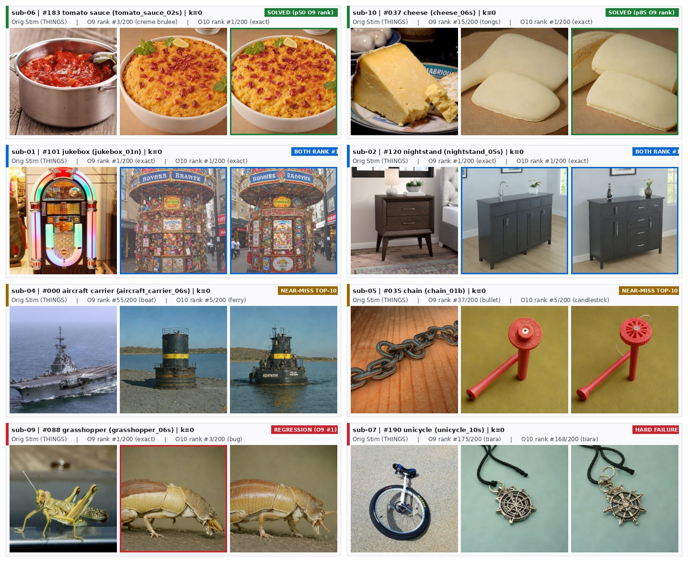
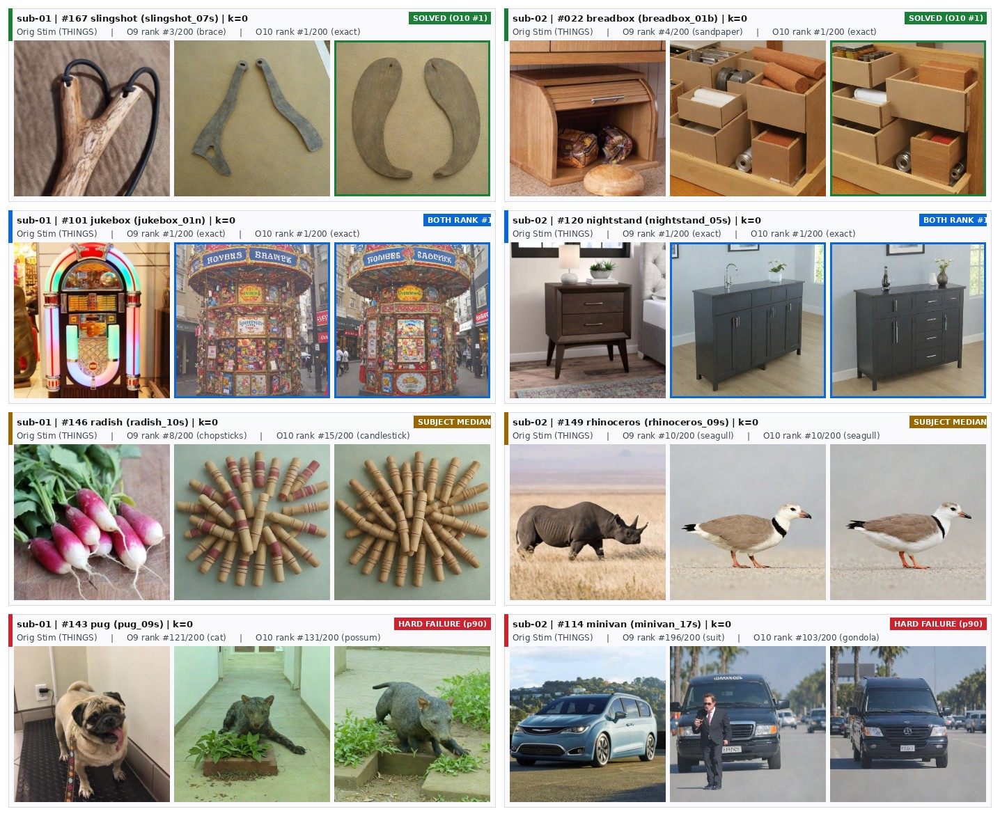
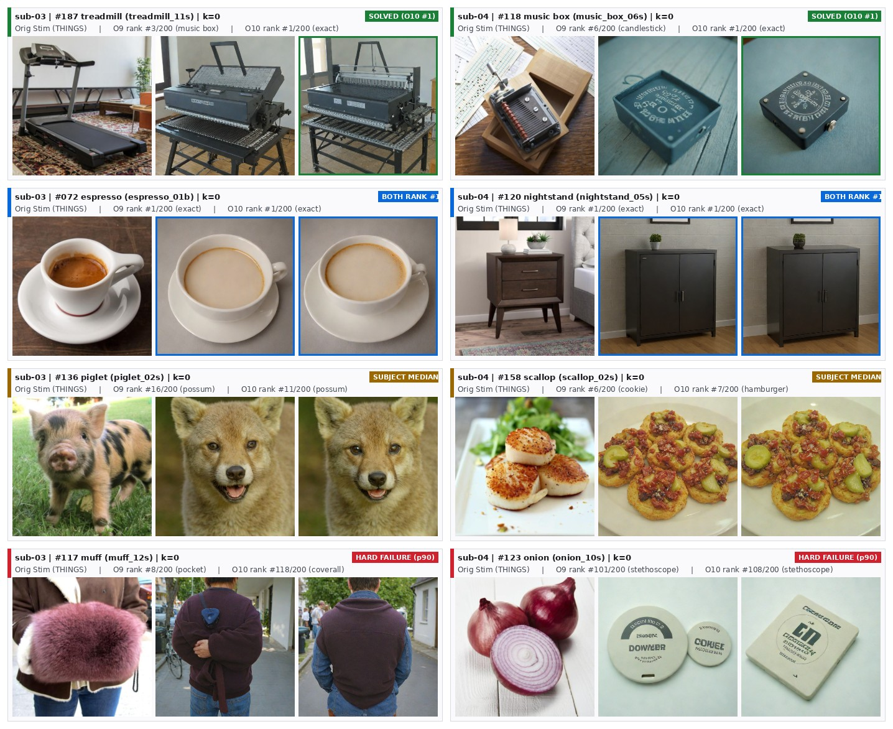
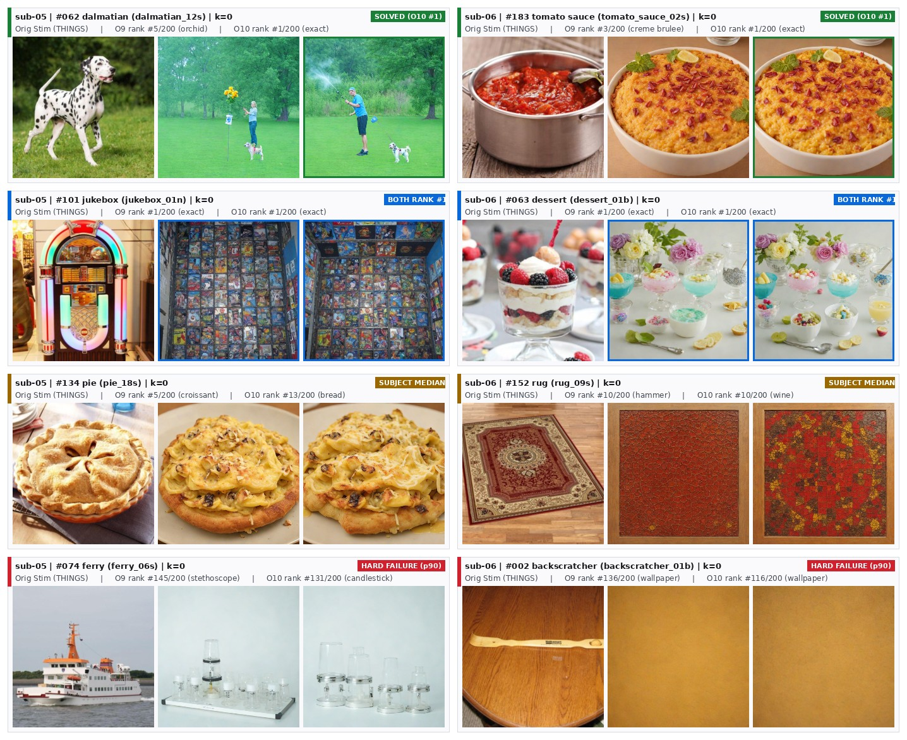
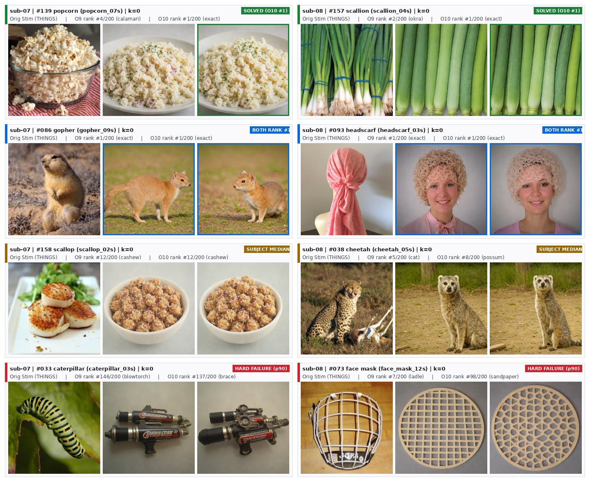
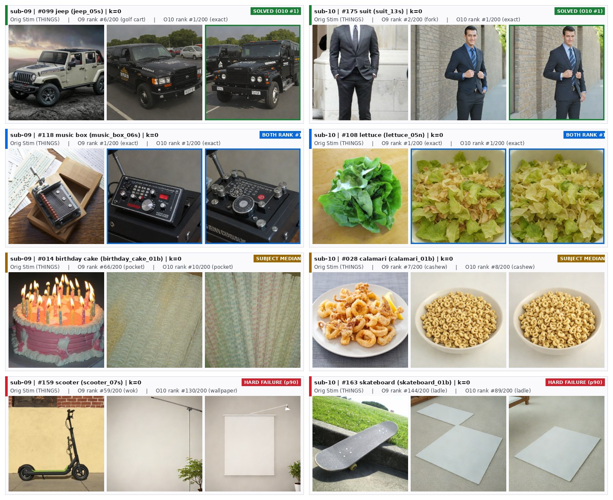

# Complete 10-Subject Side-by-Side Gallery: O9 vs O10 (`k = 0`, 200-Way CLIP Ranking)

Each triplet shows **[Original Stimulus | O9 Reconstruction | O10 Reconstruction]** at identical random seed (`k = 0`, `nsel = 1`, `4` SDXL-Turbo steps, strictly single-subject EEG, `80` repeats).

> **Attribution (THINGS-EEG2 Stimuli)**: Reference stimulus thumbnails in the left column come from the THINGS-EEG2 test set (`test_images`, Gifford et al., *NeuroImage* 2022, CC-BY 4.0) for visual verification alongside the corresponding `O9` and `O10` EEG reconstructions.

## Pre-Registered Deterministic Sampling Rule (Zero Cherry-Picking)

- **Seed fixed**: seed index `k = 0` (`gen_exp.py` generator seed `1_000_003 * j + 12345`, latent noise seed `7_000_003 * j + 99`) across all `10` subjects (`200` test stimuli each).
- **README Overview Grid (`readme_overview_o9_vs_o10.jpg`)**: 8 triplets across 8 distinct subjects: `2` newly solved (`O9 rank > 1 -> O10 rank = 1` at exact 50th and 85th percentiles of `O9` rank), `2` shared rank-1 hits, `2` near-misses (`2 <= O10 rank <= 10`, closest to rank 5), `1` median regression (`O9 = 1 -> O10 > 1`), and `1` persistent hard failure (75th percentile among `O9 >= 100` & `O10 >= 100`).
- **Per-Subject Sheets (`gallery_sub01_02.jpg` .. `gallery_sub09_10.jpg`)**: For each subject (`sub-01` .. `sub-10`), 4 stratified items: median-`r_O9` **SOLVED (`O9 > 1 -> O10 = 1`)**, median-index **BOTH #1**, exact **50th-percentile (`SUBJECT MEDIAN`)** of `O10` rank, and exact **90th-percentile (`HARD FAILURE`)** of `O10` rank.

## Overview Sheet (`O9` vs `O10` Across 4 Rank Strata)

## Complete 10-Subject Sheets

### Subjects sub-01 & sub-02

### Subjects sub-03 & sub-04

### Subjects sub-05 & sub-06

### Subjects sub-07 & sub-08

### Subjects sub-09 & sub-10

## Index of All 40 Displayed Items (`k = 0`)

| Sheet | Subject | Stim # | Stimulus ID | Stratum | O9 Rank | O9 Top-1 Prediction | O10 Rank | O10 Top-1 Prediction |
|---|---:|---:|---|---|---:|---|---:|---|
| `gallery_sub01_02.jpg` | sub-01 | 167 | `slingshot_07s` | SOLVED (O10 #1) | #3/200 | `brace_08s` | **#1/200** | **exact** |
| `gallery_sub01_02.jpg` | sub-01 | 101 | `jukebox_01n` | BOTH RANK #1 | #1/200 | **exact** | **#1/200** | **exact** |
| `gallery_sub01_02.jpg` | sub-01 | 146 | `radish_10s` | SUBJECT MEDIAN | #8/200 | `chopsticks_11s` | **#15/200** | `candlestick_04s` |
| `gallery_sub01_02.jpg` | sub-01 | 143 | `pug_09s` | HARD FAILURE (p90) | #121/200 | `cat_01b` | **#131/200** | `possum_05s` |
| `gallery_sub01_02.jpg` | sub-02 | 022 | `breadbox_01b` | SOLVED (O10 #1) | #4/200 | `sandpaper_08s` | **#1/200** | **exact** |
| `gallery_sub01_02.jpg` | sub-02 | 120 | `nightstand_05s` | BOTH RANK #1 | #1/200 | **exact** | **#1/200** | **exact** |
| `gallery_sub01_02.jpg` | sub-02 | 149 | `rhinoceros_09s` | SUBJECT MEDIAN | #10/200 | `seagull_09s` | **#10/200** | `seagull_09s` |
| `gallery_sub01_02.jpg` | sub-02 | 114 | `minivan_17s` | HARD FAILURE (p90) | #196/200 | `suit_13s` | **#103/200** | `gondola_11s` |
| `gallery_sub03_04.jpg` | sub-03 | 187 | `treadmill_11s` | SOLVED (O10 #1) | #3/200 | `music_box_06s` | **#1/200** | **exact** |
| `gallery_sub03_04.jpg` | sub-03 | 072 | `espresso_01b` | BOTH RANK #1 | #1/200 | **exact** | **#1/200** | **exact** |
| `gallery_sub03_04.jpg` | sub-03 | 136 | `piglet_02s` | SUBJECT MEDIAN | #16/200 | `possum_05s` | **#11/200** | `possum_05s` |
| `gallery_sub03_04.jpg` | sub-03 | 117 | `muff_12s` | HARD FAILURE (p90) | #8/200 | `pocket_04s` | **#118/200** | `coverall_06s` |
| `gallery_sub03_04.jpg` | sub-04 | 118 | `music_box_06s` | SOLVED (O10 #1) | #6/200 | `candlestick_04s` | **#1/200** | **exact** |
| `gallery_sub03_04.jpg` | sub-04 | 120 | `nightstand_05s` | BOTH RANK #1 | #1/200 | **exact** | **#1/200** | **exact** |
| `gallery_sub03_04.jpg` | sub-04 | 158 | `scallop_02s` | SUBJECT MEDIAN | #6/200 | `cookie_09s` | **#7/200** | `hamburger_01s` |
| `gallery_sub03_04.jpg` | sub-04 | 123 | `onion_10s` | HARD FAILURE (p90) | #101/200 | `stethoscope_11s` | **#108/200** | `stethoscope_11s` |
| `gallery_sub05_06.jpg` | sub-05 | 062 | `dalmatian_12s` | SOLVED (O10 #1) | #5/200 | `orchid_05s` | **#1/200** | **exact** |
| `gallery_sub05_06.jpg` | sub-05 | 101 | `jukebox_01n` | BOTH RANK #1 | #1/200 | **exact** | **#1/200** | **exact** |
| `gallery_sub05_06.jpg` | sub-05 | 134 | `pie_18s` | SUBJECT MEDIAN | #5/200 | `croissant_06s` | **#13/200** | `bread_19s` |
| `gallery_sub05_06.jpg` | sub-05 | 074 | `ferry_06s` | HARD FAILURE (p90) | #145/200 | `stethoscope_11s` | **#131/200** | `candlestick_04s` |
| `gallery_sub05_06.jpg` | sub-06 | 183 | `tomato_sauce_02s` | SOLVED (O10 #1) | #3/200 | `creme_brulee_01b` | **#1/200** | **exact** |
| `gallery_sub05_06.jpg` | sub-06 | 063 | `dessert_01b` | BOTH RANK #1 | #1/200 | **exact** | **#1/200** | **exact** |
| `gallery_sub05_06.jpg` | sub-06 | 152 | `rug_09s` | SUBJECT MEDIAN | #10/200 | `hammer_08s` | **#10/200** | `wine_05s` |
| `gallery_sub05_06.jpg` | sub-06 | 002 | `backscratcher_01b` | HARD FAILURE (p90) | #136/200 | `wallpaper_01b` | **#116/200** | `wallpaper_01b` |
| `gallery_sub07_08.jpg` | sub-07 | 139 | `popcorn_07s` | SOLVED (O10 #1) | #4/200 | `calamari_01b` | **#1/200** | **exact** |
| `gallery_sub07_08.jpg` | sub-07 | 086 | `gopher_09s` | BOTH RANK #1 | #1/200 | **exact** | **#1/200** | **exact** |
| `gallery_sub07_08.jpg` | sub-07 | 158 | `scallop_02s` | SUBJECT MEDIAN | #12/200 | `cashew_01b` | **#12/200** | `cashew_01b` |
| `gallery_sub07_08.jpg` | sub-07 | 033 | `caterpillar_03s` | HARD FAILURE (p90) | #146/200 | `blowtorch_08s` | **#137/200** | `brace_08s` |
| `gallery_sub07_08.jpg` | sub-08 | 157 | `scallion_04s` | SOLVED (O10 #1) | #2/200 | `okra_14n` | **#1/200** | **exact** |
| `gallery_sub07_08.jpg` | sub-08 | 093 | `headscarf_03s` | BOTH RANK #1 | #1/200 | **exact** | **#1/200** | **exact** |
| `gallery_sub07_08.jpg` | sub-08 | 038 | `cheetah_05s` | SUBJECT MEDIAN | #5/200 | `cat_01b` | **#8/200** | `possum_05s` |
| `gallery_sub07_08.jpg` | sub-08 | 073 | `face_mask_12s` | HARD FAILURE (p90) | #7/200 | `ladle_13s` | **#98/200** | `sandpaper_08s` |
| `gallery_sub09_10.jpg` | sub-09 | 099 | `jeep_05s` | SOLVED (O10 #1) | #6/200 | `golf_cart_06s` | **#1/200** | **exact** |
| `gallery_sub09_10.jpg` | sub-09 | 118 | `music_box_06s` | BOTH RANK #1 | #1/200 | **exact** | **#1/200** | **exact** |
| `gallery_sub09_10.jpg` | sub-09 | 014 | `birthday_cake_01b` | SUBJECT MEDIAN | #66/200 | `pocket_04s` | **#10/200** | `pocket_04s` |
| `gallery_sub09_10.jpg` | sub-09 | 159 | `scooter_07s` | HARD FAILURE (p90) | #59/200 | `wok_12s` | **#130/200** | `wallpaper_01b` |
| `gallery_sub09_10.jpg` | sub-10 | 175 | `suit_13s` | SOLVED (O10 #1) | #2/200 | `fork_07s` | **#1/200** | **exact** |
| `gallery_sub09_10.jpg` | sub-10 | 108 | `lettuce_05n` | BOTH RANK #1 | #1/200 | **exact** | **#1/200** | **exact** |
| `gallery_sub09_10.jpg` | sub-10 | 028 | `calamari_01b` | SUBJECT MEDIAN | #7/200 | `cashew_01b` | **#8/200** | `cashew_01b` |
| `gallery_sub09_10.jpg` | sub-10 | 163 | `skateboard_01b` | HARD FAILURE (p90) | #144/200 | `ladle_13s` | **#89/200** | `ladle_13s` |
