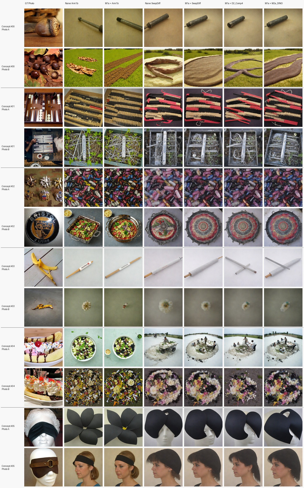
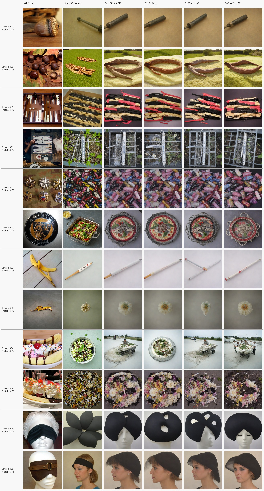
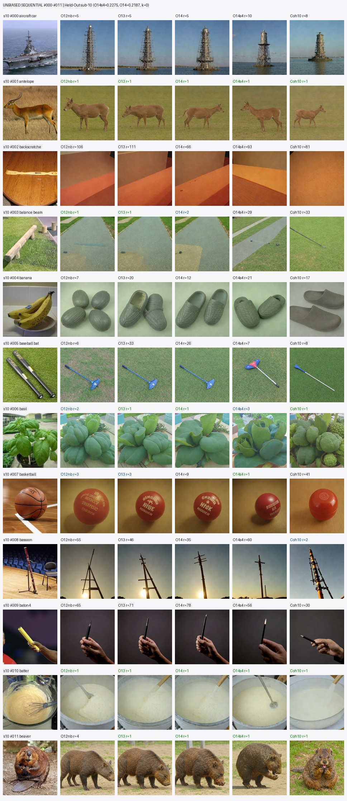
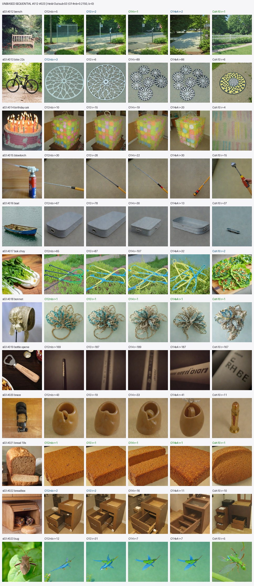
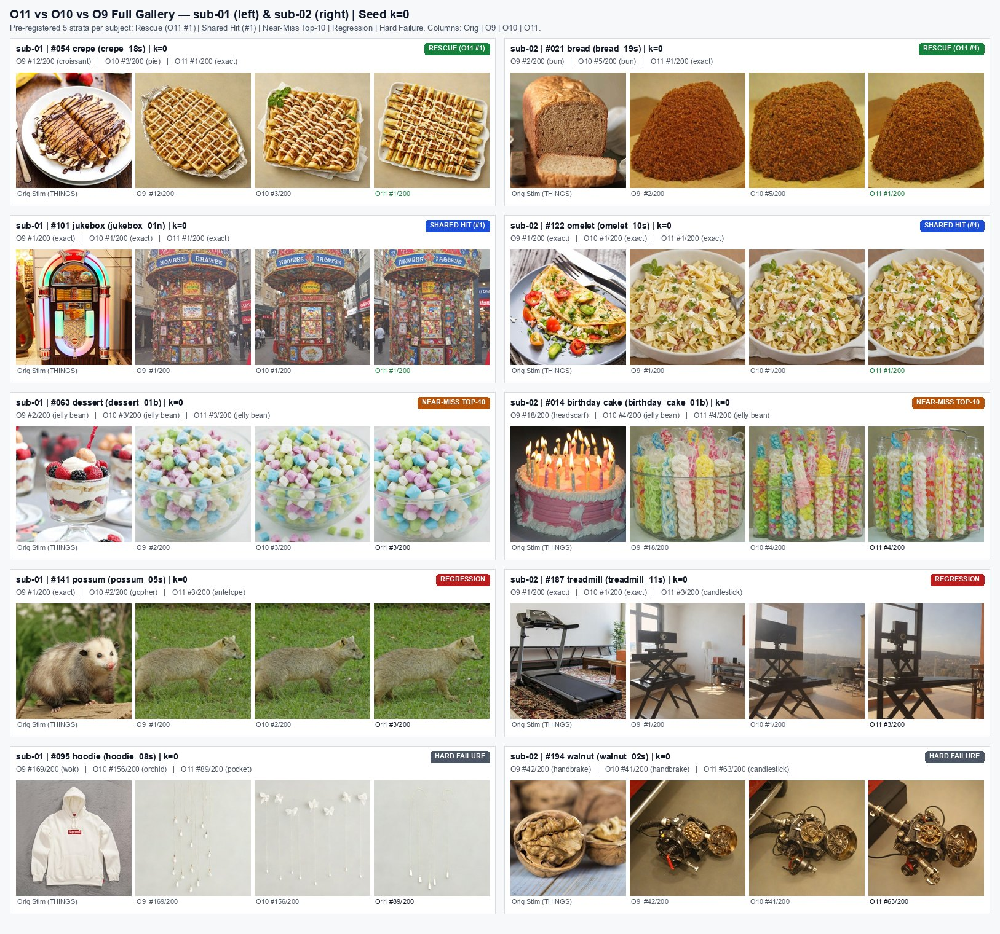
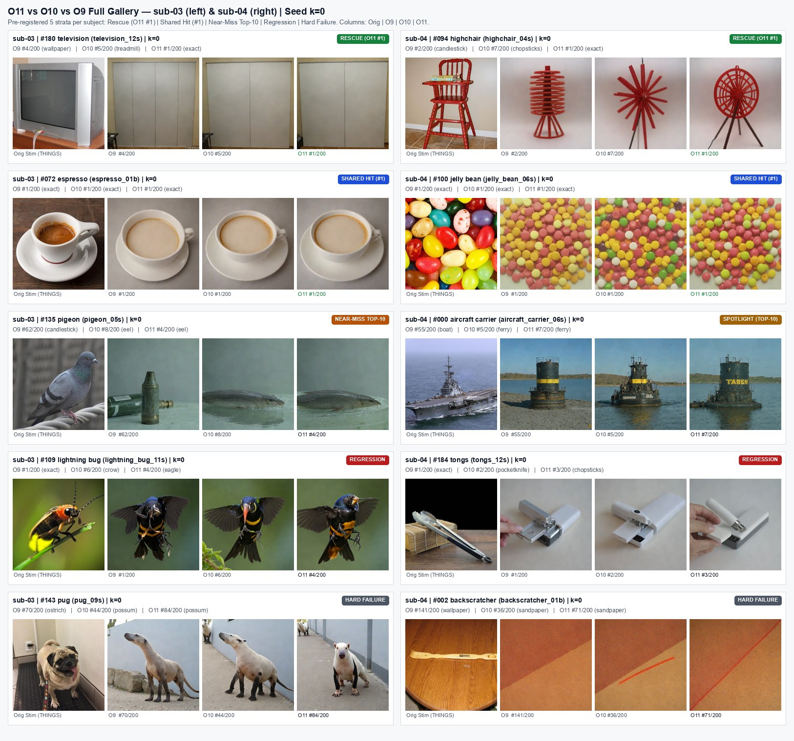
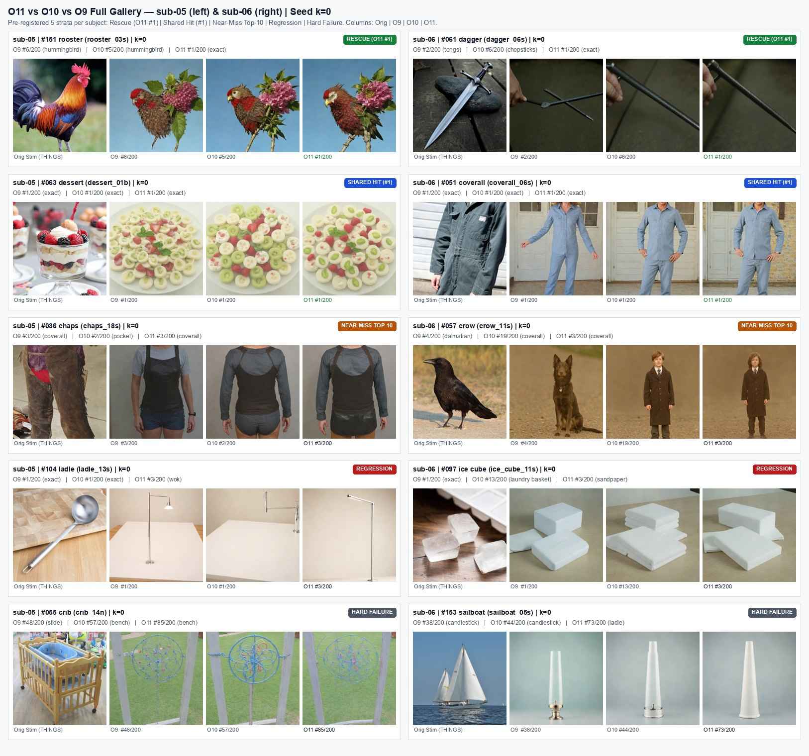
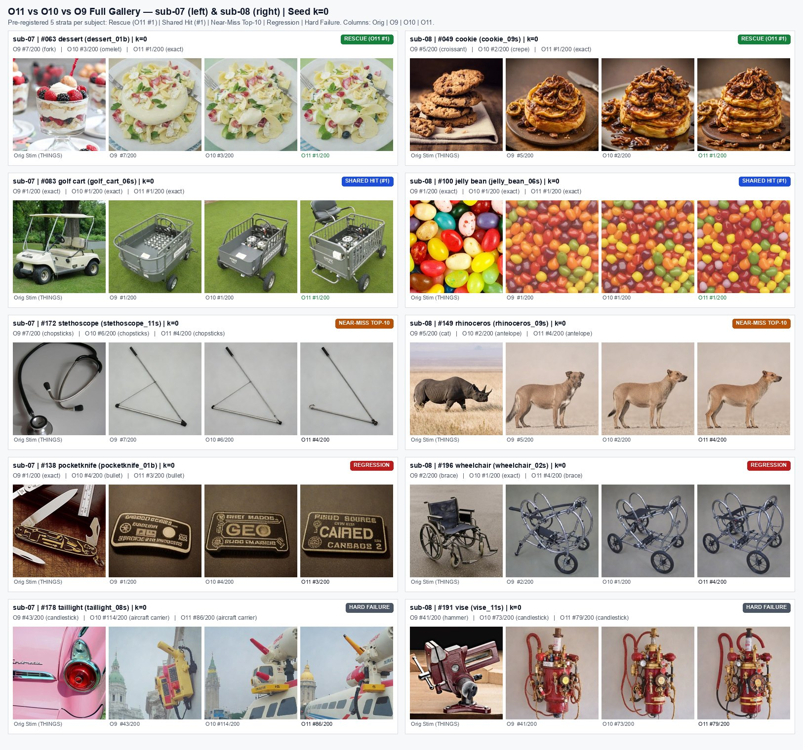
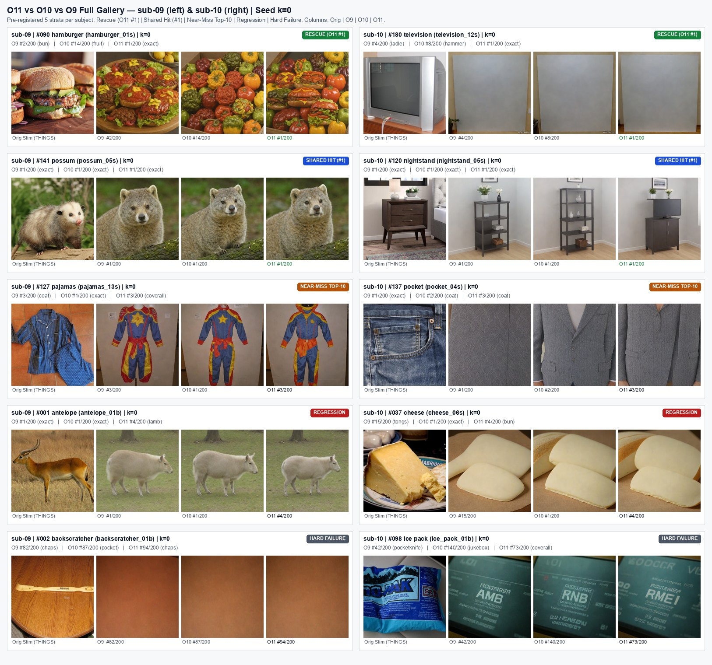

# EEG reconstruction galleries

## Single-person reconstruction on 200 unfamiliar objects

One participant viewed each photograph 80 times. The fixed sheet includes every twentieth stimulus in archive order. It shows how scaling the EEG-derived visual condition changes the generated object and what happens when another stimulus supplies that condition. [Generated images](official_repeat_sub04_r80.jpg) · [Stimulus identities, prompts and scoring](../../../docs/OFFICIAL_REPEAT_IMAGES.md)

## Same-photo comparisons across one, three and nine viewers

Each sheet includes the lowest archive row of every object in its panel. The ordinary comparison uses the same decoded word and eight support photographs in all three conditions. The guidance comparisons show how increasing the influence of the nine viewers' photo-specific EEG affects generation. [Registered panel](fixed_word_dose_registered.jpg) · [Replication panel](fixed_word_dose_replicate.jpg) · [Registered panel with guidance](fixed_word_dose_registered_guided.jpg) · [Replication panel with guidance](fixed_word_dose_replicate_guided.jpg) · [Image-selection rule and results](../../../docs/FIXED_WORD_PHOTO_DOSE.md)

## Session-matched objects

Each gallery takes the lowest archive row for every object. The single-person reconstruction uses sub-04's four presentations. The cohort combines sub-04, sub-05 and sub-01, each with four presentations of the same photograph. All twelve stress-test objects share the same recording-session signature. Each decision in the separate four-way experiment receives its registered list of four alternatives. The replay script also makes private three-column sheets with the viewed photograph beside both reconstructions. [Protocol and image measurements](../../../docs/COHORT_SESSION_CONTROLS.md)

| Fixed target panel | One person, four observations | Three people, twelve observations |
| --- | --- | --- |
| One recording-session signature, twelve object choices | [Single-person images](photo_angle_sub04_stress12.jpg) | [Cohort images](photo_angle_cohort3_stress12.jpg) |
| Three separate four-object choice sets | [Single-person images](photo_angle_sub04_new_three4.jpg) | [Cohort images](photo_angle_cohort3_new_three4.jpg) |

## Twelve additional objects

The same three participants viewed 120 new photographs. These panels show the generated image for the lowest archive row of each object, including mistakes. The two labels identify the viewed object and the EEG prediction used for generation. [Sub-01](photo_angle_sub01_fresh.jpg) · [Sub-04](photo_angle_sub04_fresh.jpg) · [Sub-05](photo_angle_sub05_fresh.jpg) · [Reproduce the original-versus-generated comparison locally](../../../docs/FRESH_PHOTO_VALIDATION.md#reproduce-the-saved-image-comparison)

## Calibrated objects from four EEG trials

Each panel shows the first archive photograph of each of its twelve objects. Every tile is a generated image, labeled with the viewed object and the word decoded from EEG. Sub-01 is the first participant in the locked seven-person confirmation. Sub-05 provided the earlier single-person check. Use the replay script with the stimulus archive for private side-by-side comparisons. [How to read the results](../../../docs/OBJECT_FIDELITY.md) · [Build a comparison](../code/compare_personal_renders.py)

| Participant and generic calibration budget | First panel | Second panel |
| --- | --- | --- |
| sub-01, 128 other objects | [Twelve generated objects](personal_sub01_registered.jpg) | [Twelve generated objects](personal_sub01_replicate.jpg) |
| sub-01, 512 other objects | [Same twelve queries](expanded_sub01_registered.jpg) | [Same twelve queries](expanded_sub01_replicate.jpg) |
| sub-05, 128 other objects | [Twelve generated objects](personal_sub05_registered.jpg) | [Twelve generated objects](personal_sub05_replicate.jpg) |
| sub-05, 512 other objects | [Same twelve queries](expanded_sub05_registered.jpg) | [Same twelve queries](expanded_sub05_replicate.jpg) |

The photograph-level experiment keeps the 512-object readout and gives SDXL-Turbo an H/14 image condition through the ViT-H IP-Adapter. Its displacement from the eight support photos is scaled using separate training objects. These grids show the same fixed stimuli as the tables above. [Image and control scores](../../../docs/PHOTO_STRUCTURE.md)

| Participant | Common objects | Random objects |
| --- | --- | --- |
| sub-01, additional confirmation | [Generated images](photo_angle_sub01_registered.jpg) | [Generated images](photo_angle_sub01_replicate.jpg) |
| sub-05, validation | [Generated images](photo_angle_sub05_registered.jpg) | [Generated images](photo_angle_sub05_replicate.jpg) |

## Trial-Precision Dual-Stream (`M1a`) & `DINOv2` Geometric DRaFT (`M2a`): Uncherry-Picked Held-Out `sub-01` 7-Column Gallery (2026-11-24)

Each row pair shows Photo A and Photo B from the first 6 sealed unseen `fold 0` concepts (`#00–#05`, zero cherry-picking) on untouched held-out `sub-01` under **`R = 4` real EEG free generation** at **`s375`** (`4-step SDXL-Turbo`, `nsel = 1`): **[GT Photo | Naive Arm1b | M1a + Arm1b | Naive SwapDiff | M1a + SwapDiff | M1a + D2_Comp4 | M1a + M2a_DINO]**. See [`../TRIAL_PREC_DINOV2_REPORT.md`](../TRIAL_PREC_DINOV2_REPORT.md).

---

## DRaFT-Intra4 & `s375` Anchoring: Uncherry-Picked Held-Out `sub-01` FreeGen Gallery (2026-11-24)

Each row pair shows Photo A and Photo B from the first 6 sealed unseen `fold 0` concepts (`#00–#05`, zero cherry-picking) on untouched held-out `sub-01` under **`R = 4` real EEG free generation** at **`s375`** (`4-step SDXL-Turbo`, `nsel = 1`): **[GT Photo | Arm1b (RepIntra) | SwapDiff (Arm3b) | D1 (SimOnly) | D2 (Compete4) | D4 (UnfEnc+Z0)]**. See [`../DRAFT_INTRA4_REPORT.md`](../DRAFT_INTRA4_REPORT.md).

---

## SwapDiff-EEG: Held-Out Subjects `R = 4` 2×2 Within-Concept EEG-Swap Gallery (2026-11-23)

Each 8-column row shows a real same-concept photo pair `(A, B)` from sealed unseen `fold 0` concepts on untouched held-out subjects (`sub-10, 03, 04, 06, 07`) under **identical fixed start latent `z0` & random seed** (`4-step SDXL-Turbo`, `nsel = 1`, `R = 4` real EEG): **[GT Photo A | GT Photo B | Arm0(E_A) | Arm0(E_B) | Arm1b Rep(E_A) | Arm1b Rep(E_B) | Arm3b SwapDiff(E_A) | Arm3b SwapDiff(E_B)]**. See [`../SWAPDIFF_REPORT.md`](../SWAPDIFF_REPORT.md).

---

## O12 / O13 / O14 6-Column Side-by-Side Sheets (`k = 0`, 200-Way CLIP Ranking)

Each 6-column card shows **[Original Stimulus | O12_noBigG (single-sub, 4 NFE) | O13 (x-brain, 4 NFE) | O14 (Tri-Arch + x-brain bigG, 4 NFE) | O14_sel4 (16 NFE, zero ViT-L/14) | O14 Cohort-10 Ceiling (non-single-subject diagnostic, 4 NFE)]** at identical random seed (`k = 0`, `w = 1.00`, `0` DDPM heads, zero blur, `80` repeats). Columns 2–5 use **100% strictly single-subject test EEG**; column 6 is explicitly labeled as a 10-brain diagnostic SNR ceiling (zero test labels).

### Pre-Registered Deterministic 10-Subject Overview (12 Cards: 6 Held-Out Rescues, 2 Shared Hits, 2 Near-Misses, 1 Regression, 1 Hard Failure)

### Unbiased Sequential Stimuli (`#000–#011` on Held-Out `sub-10` & `#012–#023` on Held-Out `sub-03`, Zero Cherry-Picking)

### Held-Out Subjects Recognizability Showcase (`sub-03, sub-04, sub-06, sub-07, sub-10`)

---

# Complete 10-Subject Side-by-Side Gallery: O9 vs O10 vs O11 (`k = 0`, 200-Way CLIP Ranking)

Each 4-column card shows **[Original Stimulus | O9 Reconstruction | O10 Reconstruction | O11 Reconstruction]** at identical random seed (`k = 0`, `nsel = 1`, `4` SDXL-Turbo steps, `0` DDPM heads for O10/O11, strictly single-subject EEG, `80` repeats).

> **Attribution (THINGS-EEG2 Stimuli)**: Reference stimulus thumbnails in the left column come from the THINGS-EEG2 test set (`test_images`, Gifford et al., *NeuroImage* 2022, CC-BY 4.0) for visual verification alongside the corresponding `O9`, `O10`, and `O11` EEG reconstructions.

## Pre-Registered Deterministic Sampling Rule (Zero Cherry-Picking)

- **Seed fixed**: seed index `k = 0` (`gen_exp.py` generator seed `1_000_003 * j + 12345`, latent noise seed `7_000_003 * j + 99`) across all `10` subjects (`200` test stimuli each).
- **Per-Subject Sheets (`gallery_o11_sub01_02.jpg` .. `gallery_o11_sub09_10.jpg`)**: 5 pre-registered strata per subject (50 four-column cards = 200 real images): **RESCUE (O11 #1)** (`O9 > 1 & O10 > 1 & O11 = 1`, 35th percentile by `-(r9 + r10)`), **SHARED HIT (#1)** (`O9 = O10 = O11 = 1`, median index), **NEAR-MISS TOP-10** (`2 <= O11 <= 10`, with `sub-04 #000 aircraft_carrier_06s` explicit spotlight), **REGRESSION** (`(O10 = 1 or O9 = 1) & O11 > 1`, median O11 rank), and **HARD FAILURE** (`O9 > 20 & O10 > 20 & O11 > 20`, median O11 rank).
- **README Overview Grid (`readme_overview_o9_o10_o11.jpg`)**: 12 cards drawn directly from the 50 pre-registered per-subject cards, covering all 10 subjects (4 rescues on held-out subjects, 2 shared hits, 2 near-misses including the `sub-04 #000 aircraft_carrier_06s` spotlight, 2 regressions, and 2 hard failures).

## Overview Sheet (`Orig | O9 | O10 | O11` Across All 10 Subjects)

## Complete 10-Subject Sheets (50 Four-Column Cards)

### Subjects sub-01 & sub-02

### Subjects sub-03 & sub-04

### Subjects sub-05 & sub-06

### Subjects sub-07 & sub-08

### Subjects sub-09 & sub-10

## Index of All 50 Displayed Items (`k = 0`)

| Sheet | Subject | Stim # | Stimulus ID | Stratum | O9 Rank | O10 Rank | O11 Rank | O11 Top-1 Prediction |
|---|---:|---:|---|---|---:|---:|---:|---|
| `gallery_o11_sub01_02.jpg` | sub-01 | 054 | `crepe_18s` | RESCUE (O11 #1) | #12/200 | #3/200 | **#1/200** | **exact** |
| `gallery_o11_sub01_02.jpg` | sub-01 | 101 | `jukebox_01n` | SHARED HIT (#1) | #1/200 | #1/200 | **#1/200** | **exact** |
| `gallery_o11_sub01_02.jpg` | sub-01 | 063 | `dessert_01b` | NEAR-MISS TOP-10 | #2/200 | #3/200 | #3/200 | `jelly_bean_06s` |
| `gallery_o11_sub01_02.jpg` | sub-01 | 141 | `possum_05s` | REGRESSION | #1/200 | #2/200 | #3/200 | `antelope_01b` |
| `gallery_o11_sub01_02.jpg` | sub-01 | 095 | `hoodie_08s` | HARD FAILURE | #169/200 | #156/200 | #89/200 | `pocket_04s` |
| `gallery_o11_sub01_02.jpg` | sub-02 | 021 | `bread_19s` | RESCUE (O11 #1) | #2/200 | #5/200 | **#1/200** | **exact** |
| `gallery_o11_sub01_02.jpg` | sub-02 | 122 | `omelet_10s` | SHARED HIT (#1) | #1/200 | #1/200 | **#1/200** | **exact** |
| `gallery_o11_sub01_02.jpg` | sub-02 | 014 | `birthday_cake_01b` | NEAR-MISS TOP-10 | #18/200 | #4/200 | #4/200 | `jelly_bean_06s` |
| `gallery_o11_sub01_02.jpg` | sub-02 | 187 | `treadmill_11s` | REGRESSION | #1/200 | #1/200 | #3/200 | `candlestick_04s` |
| `gallery_o11_sub01_02.jpg` | sub-02 | 194 | `walnut_02s` | HARD FAILURE | #42/200 | #41/200 | #63/200 | `candlestick_04s` |
| `gallery_o11_sub03_04.jpg` | sub-03 | 180 | `television_12s` | RESCUE (O11 #1) | #4/200 | #5/200 | **#1/200** | **exact** |
| `gallery_o11_sub03_04.jpg` | sub-03 | 072 | `espresso_01b` | SHARED HIT (#1) | #1/200 | #1/200 | **#1/200** | **exact** |
| `gallery_o11_sub03_04.jpg` | sub-03 | 135 | `pigeon_05s` | NEAR-MISS TOP-10 | #62/200 | #8/200 | #4/200 | `eel_02s` |
| `gallery_o11_sub03_04.jpg` | sub-03 | 109 | `lightning_bug_11s` | REGRESSION | #1/200 | #6/200 | #4/200 | `eagle_06s` |
| `gallery_o11_sub03_04.jpg` | sub-03 | 143 | `pug_09s` | HARD FAILURE | #70/200 | #44/200 | #84/200 | `possum_05s` |
| `gallery_o11_sub03_04.jpg` | sub-04 | 094 | `highchair_04s` | RESCUE (O11 #1) | #2/200 | #7/200 | **#1/200** | **exact** |
| `gallery_o11_sub03_04.jpg` | sub-04 | 100 | `jelly_bean_06s` | SHARED HIT (#1) | #1/200 | #1/200 | **#1/200** | **exact** |
| `gallery_o11_sub03_04.jpg` | sub-04 | 000 | `aircraft_carrier_06s` | SPOTLIGHT (TOP-10) | #55/200 | #5/200 | #7/200 | `ferry_06s` |
| `gallery_o11_sub03_04.jpg` | sub-04 | 184 | `tongs_12s` | REGRESSION | #1/200 | #2/200 | #3/200 | `chopsticks_11s` |
| `gallery_o11_sub03_04.jpg` | sub-04 | 002 | `backscratcher_01b` | HARD FAILURE | #141/200 | #36/200 | #71/200 | `sandpaper_08s` |
| `gallery_o11_sub05_06.jpg` | sub-05 | 151 | `rooster_03s` | RESCUE (O11 #1) | #6/200 | #5/200 | **#1/200** | **exact** |
| `gallery_o11_sub05_06.jpg` | sub-05 | 063 | `dessert_01b` | SHARED HIT (#1) | #1/200 | #1/200 | **#1/200** | **exact** |
| `gallery_o11_sub05_06.jpg` | sub-05 | 036 | `chaps_18s` | NEAR-MISS TOP-10 | #3/200 | #2/200 | #3/200 | `coverall_06s` |
| `gallery_o11_sub05_06.jpg` | sub-05 | 104 | `ladle_13s` | REGRESSION | #1/200 | #1/200 | #3/200 | `wok_12s` |
| `gallery_o11_sub05_06.jpg` | sub-05 | 055 | `crib_14n` | HARD FAILURE | #48/200 | #57/200 | #85/200 | `bench_01b` |
| `gallery_o11_sub05_06.jpg` | sub-06 | 061 | `dagger_06s` | RESCUE (O11 #1) | #2/200 | #6/200 | **#1/200** | **exact** |
| `gallery_o11_sub05_06.jpg` | sub-06 | 051 | `coverall_06s` | SHARED HIT (#1) | #1/200 | #1/200 | **#1/200** | **exact** |
| `gallery_o11_sub05_06.jpg` | sub-06 | 057 | `crow_11s` | NEAR-MISS TOP-10 | #4/200 | #19/200 | #3/200 | `coverall_06s` |
| `gallery_o11_sub05_06.jpg` | sub-06 | 097 | `ice_cube_11s` | REGRESSION | #1/200 | #13/200 | #3/200 | `sandpaper_08s` |
| `gallery_o11_sub05_06.jpg` | sub-06 | 153 | `sailboat_05s` | HARD FAILURE | #38/200 | #44/200 | #73/200 | `ladle_13s` |
| `gallery_o11_sub07_08.jpg` | sub-07 | 063 | `dessert_01b` | RESCUE (O11 #1) | #7/200 | #3/200 | **#1/200** | **exact** |
| `gallery_o11_sub07_08.jpg` | sub-07 | 083 | `golf_cart_06s` | SHARED HIT (#1) | #1/200 | #1/200 | **#1/200** | **exact** |
| `gallery_o11_sub07_08.jpg` | sub-07 | 172 | `stethoscope_11s` | NEAR-MISS TOP-10 | #7/200 | #6/200 | #4/200 | `chopsticks_11s` |
| `gallery_o11_sub07_08.jpg` | sub-07 | 138 | `pocketknife_01b` | REGRESSION | #1/200 | #4/200 | #3/200 | `bullet_01s` |
| `gallery_o11_sub07_08.jpg` | sub-07 | 178 | `taillight_08s` | HARD FAILURE | #43/200 | #114/200 | #86/200 | `aircraft_carrier_06s` |
| `gallery_o11_sub07_08.jpg` | sub-08 | 049 | `cookie_09s` | RESCUE (O11 #1) | #5/200 | #2/200 | **#1/200** | **exact** |
| `gallery_o11_sub07_08.jpg` | sub-08 | 100 | `jelly_bean_06s` | SHARED HIT (#1) | #1/200 | #1/200 | **#1/200** | **exact** |
| `gallery_o11_sub07_08.jpg` | sub-08 | 149 | `rhinoceros_09s` | NEAR-MISS TOP-10 | #5/200 | #2/200 | #4/200 | `antelope_01b` |
| `gallery_o11_sub07_08.jpg` | sub-08 | 196 | `wheelchair_02s` | REGRESSION | #2/200 | #1/200 | #4/200 | `brace_08s` |
| `gallery_o11_sub07_08.jpg` | sub-08 | 191 | `vise_11s` | HARD FAILURE | #41/200 | #73/200 | #79/200 | `candlestick_04s` |
| `gallery_o11_sub09_10.jpg` | sub-09 | 090 | `hamburger_01s` | RESCUE (O11 #1) | #2/200 | #14/200 | **#1/200** | **exact** |
| `gallery_o11_sub09_10.jpg` | sub-09 | 141 | `possum_05s` | SHARED HIT (#1) | #1/200 | #1/200 | **#1/200** | **exact** |
| `gallery_o11_sub09_10.jpg` | sub-09 | 127 | `pajamas_13s` | NEAR-MISS TOP-10 | #3/200 | #1/200 | #3/200 | `coverall_06s` |
| `gallery_o11_sub09_10.jpg` | sub-09 | 001 | `antelope_01b` | REGRESSION | #1/200 | #1/200 | #4/200 | `lamb_01b` |
| `gallery_o11_sub09_10.jpg` | sub-09 | 002 | `backscratcher_01b` | HARD FAILURE | #82/200 | #87/200 | #94/200 | `chaps_18s` |
| `gallery_o11_sub09_10.jpg` | sub-10 | 180 | `television_12s` | RESCUE (O11 #1) | #4/200 | #8/200 | **#1/200** | **exact** |
| `gallery_o11_sub09_10.jpg` | sub-10 | 120 | `nightstand_05s` | SHARED HIT (#1) | #1/200 | #1/200 | **#1/200** | **exact** |
| `gallery_o11_sub09_10.jpg` | sub-10 | 137 | `pocket_04s` | NEAR-MISS TOP-10 | #1/200 | #2/200 | #3/200 | `coat_01b` |
| `gallery_o11_sub09_10.jpg` | sub-10 | 037 | `cheese_06s` | REGRESSION | #15/200 | #1/200 | #4/200 | `bun_01b` |
| `gallery_o11_sub09_10.jpg` | sub-10 | 098 | `ice_pack_01b` | HARD FAILURE | #42/200 | #140/200 | #73/200 | `coverall_06s` |

---

## Previous Round Archive (`O9` vs `O10`, 40 Triplets)

The prior O9-vs-O10 gallery sheets remain preserved in this directory: `readme_overview_o9_vs_o10.jpg` and `gallery_sub01_02.jpg` .. `gallery_sub09_10.jpg`.
